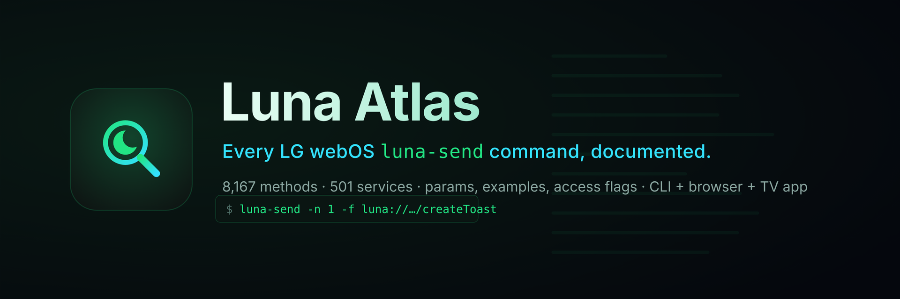
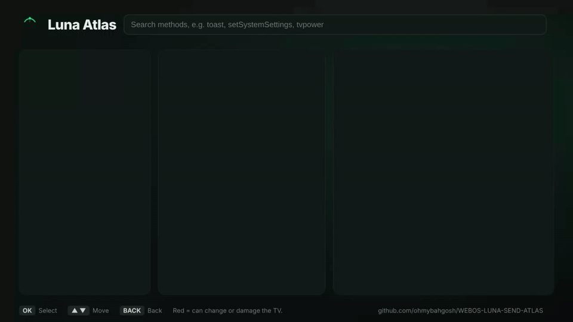
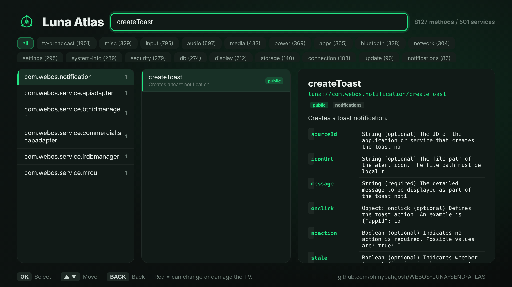

# WEBOS-LUNA-SEND-ATLAS

[](https://github.com/ohmybahgosh/WEBOS-LUNA-SEND-ATLAS/releases/latest)
[](LICENSE)
[](catalog/luna-catalog.jsonl)
[](#services)
[](#install)
[](#what-this-is)
[](https://github.com/ohmybahgosh/WEBOS-LUNA-SEND-ATLAS/stargazers)



> **Every LG webOS `luna-send` command in one place.**  8,167 methods across 501 services, each with its parameters, a ready-to-run example, its access level and where it came from.  Drive it from a terminal, a browser, or a webOS app on the TV.

---

## Contents

|  |  |
|---|---|
| **Start here** | [What this is](#what-this-is) &middot; [Install](#install) &middot; [Quick start](#quick-start) |
| **Use it** | [Script (SSH)](#script-ssh) &middot; [Browser UI](#browser-ui) &middot; [TV app](#tv-app) |
| **Reference** | [The catalog](#the-catalog) &middot; [Coverage](#coverage) &middot; [How descriptions are sourced](#how-descriptions-are-sourced) &middot; [Categories](#categories) &middot; [Services](#services) |
| **More** | [Dump your own TV](#dump-your-own-tv) &middot; [Scope & safety](#scope-and-safety) &middot; [Credits](#credits) &middot; [License](#license) |

---

## What this is

Every LG webOS TV ships a command-line tool called **`luna-send`**.  It talks to the **Luna Service Bus**, the internal message bus that every system service listens on: power, apps, inputs, picture and sound, Wi-Fi, notifications, the panel, software update, and hundreds more.  On a rooted TV or in Developer Mode, `luna-send` is how you drive any of it from a shell:

```sh
luna-send -n 1 -f luna://com.webos.notification/createToast '{"message":"Hello from luna-send"}'
```

There has never been a complete list of what you can *say* to it.  This repo is that list, **8,167 methods across 501 services**, plus three ways to use it that all read one catalog, so they always agree:

| Tool | What it is | Where |
|---|---|---|
| **Script** | `search` / `show` / `run` over SSH, with tab completion | [`luna-atlas.sh`](luna-atlas.sh) |
| **Browser UI** | browse and test from a phone or PC | [`luna-atlas serve`](#browser-ui) |
| **webOS app** | the same from the couch, with the remote | [`webos-app/`](webos-app/) |

> [!IMPORTANT]
> **Under heavy active development.**  The catalog, the script and the app are all changing fast.  Method names are solid, but many parameters are still being filled in, categories may move, and the app and script are pre-1.0.  Expect breaking changes and re-dumps; pin a commit if you need something stable.

> [!WARNING]
> **This drives real services on your TV.**  Many calls change settings, inputs, power or the panel, and a few can factory reset, wipe data, or brick the set.  Those are flagged ⚠️ and listed in [docs/dangerous.md](docs/dangerous.md).  Running one here is exactly as safe or unsafe as typing the same `luna-send` yourself.  Use at your own risk; there is no warranty (see [LICENSE](LICENSE)).  You need a **rooted TV or Developer Mode**.

<details>
<summary><b>How this is built</b> &mdash; AI-assisted, directed and verified on a real TV</summary>

<br>

I, [OhMyBahGosh](https://github.com/ohmybahgosh), build this with AI coding agents (Claude), directed, reviewed and tested by me.  I've been building software for over 17 years; my day job is data engineering, and security and pentesting are what I do for fun.  AI does a lot of the work here: I decide what goes in, check how it's done, and verify it against a real TV (an LG C2 on webOS 22).  The catalog is pulled from the official webOS TV and webOS OSE docs, the homebrew and remote-control community, and the full service list introspected from my own rooted TV; every record lists its source, and a scrub step keeps personal data and installed-app names out.

</details>

---

## Install

First you need a **rooted TV** (see [RootMyTV](https://rootmy.tv)) or **Developer Mode**, so that `luna-send` and SSH are available.

<details>
<summary><b>Option A &mdash; the webOS app</b> (no SSH needed)</summary>

<br>

Install the **Luna Atlas** app through the [Homebrew Channel](https://github.com/webosbrew/webos-homebrew-channel):

1. Build or download the IPK (`webos-app/build.sh`, or the [Releases](https://github.com/ohmybahgosh/WEBOS-LUNA-SEND-ATLAS/releases) page once published).
2. Install it with the Homebrew Channel's **Developer Manager**, or `ares-install org.ohmybahgosh.lunaatlas_*.ipk`.
3. For private methods, use the Homebrew Channel's **Elevate service** on it; public ones work as-is.

</details>

<details>
<summary><b>Option B &mdash; the script</b> (SSH)</summary>

<br>

On a rooted TV, drop the repo somewhere writable (e.g. with [Entware](https://github.com/ohmybahgosh/WEBOS-ENTWARE-INSTALLER) for `git`/`curl`, or just `scp` it over):

```sh
# from your PC:
scp -r WEBOS-LUNA-SEND-ATLAS root@<tv-ip>:/home/root/luna-atlas
# on the TV:
cd /home/root/luna-atlas
sh luna-atlas.sh search toast
```

Only `luna-atlas.sh` and the `catalog/` and `web/` folders are needed at runtime.  Put `luna-atlas.sh` on your `PATH` and set `LUNA_ATLAS_DATA` to that folder if you move it.  For **tab completion**, source the right file (bash via Entware, or on your own machine):

```sh
. completions/luna-atlas.bash     # bash
# or add completions/luna-atlas.zsh to your $fpath for zsh
```

</details>

---

## Quick start

```sh
luna-atlas search toast                               # find methods by name, service or description
luna-atlas show com.webos.notification/createToast    # params + a ready-to-run example
luna-atlas run luna://com.webos.notification/createToast '{"message":"hi"}'
```

---

## Usage

### Script (SSH)

```sh
luna-atlas search toast                 # find methods by name, service or description
luna-atlas show com.webos.notification/createToast   # params + a ready-to-run example
luna-atlas services tvpower             # list services (optionally filtered)
luna-atlas categories                   # methods grouped by what they do
luna-atlas run luna://com.webos.notification/createToast '{"message":"hi"}'
luna-atlas run luna://com.webos.service.tvpower/power/reboot   # dangerous ones ask first
luna-atlas serve 28472                  # start the browser UI (see below)
luna-atlas dump                         # read-only dump of THIS TV's services
```

`run` passes your call straight to `luna-send`, and asks for a typed **YES** on anything flagged dangerous.  Tab completion fills in service and method names from the catalog.

### Browser UI

`luna-atlas serve` runs a tiny `node` web server (node ships on webOS, so nothing to install) bound to **localhost only**, reached through an SSH tunnel so nothing is exposed on your network:

```sh
# on the TV:
luna-atlas serve 28472
# on your PC/phone, in another terminal:
ssh -L 28472:127.0.0.1:28472 root@<tv-ip>
# then open http://localhost:28472
```

The webOS app has a simpler path: its **Web access** switch starts the same UI on your LAN with a QR code and a one-time code, no SSH needed.  The default port is **28472** (an uncommon one, chosen to avoid SSAP on 3000/3001 and other services).  The page browses the whole catalog, shows parameters, and **runs** commands back on the TV.

### TV app

The **Luna Atlas** webOS app is the same thing with the remote: browse by category or service, search, read the params, edit a payload and run it, with a confirm on the dangerous calls and a **Show command** button that prints the `luna-send` line and a QR code so you can grab it on your phone.

<details>
<summary>Screenshots</summary>

<br>

<p align="center">
  
</p>



</details>

Build it with [`webos-app/build.sh`](webos-app/build.sh); details in [`webos-app/README.md`](webos-app/README.md).

---

## The catalog

8,167 methods across 501 services.  Machine-readable in [`catalog/luna-catalog.json`](catalog/luna-catalog.json) / [`.jsonl`](catalog/luna-catalog.jsonl); a grep-friendly [`catalog/index.tsv`](catalog/index.tsv) feeds the script.  One page per service under [`docs/services/`](docs/services/), grouped by category under [`docs/categories/`](docs/categories/).

<details>
<summary>Deeper reference docs</summary>

<br>

[luna-send basics](docs/luna-send-basics.md) &middot; [SSAP + the createAlert trick](docs/ssap-and-createalert.md) &middot; [SSAP routing](docs/ssap-routing-W22O.md) &middot; [settings keys](docs/settings-keys.md) &middot; [hidden menus](docs/hidden-menus.md) &middot; [calibration](docs/calibration.md) &middot; [dangerous calls](docs/dangerous.md) &middot; [sensitive services](docs/sensitive-services.md) &middot; [TV dumps](docs/tv-dumps.md)

</details>

### Coverage

| Access | Methods |
|---|---|
| `private` | 5141 |
| `public` | 2478 |
| `unknown` | 413 |
| `ssap` | 100 |
| `root` | 35 |

`public` = callable by apps with the right permission.  `private` = needs root or system rights.  `ssap` = reachable over the SSAP websocket.  `unknown` = the source didn't say.

### How descriptions are sourced

Every method carries a `confidence` flag (column 9 of `index.tsv`, `dc` in the app catalog) so nothing reads as more certain than it is:

| Confidence | Methods | What it means |
|---|---|---|
| `documented` | 1,849 | Described from an authoritative source: the [webOS OSE LS2 API reference](https://www.webosose.org/docs/reference/ls2-api/) (CC-BY 4.0), official LG docs, or community tools.  Parameters and return fields are real where shown. |
| `inferred` | 6,316 | LG-proprietary services with no public documentation and no readable source (native firmware binaries).  The one-line description is derived **only from the method's own name** &mdash; e.g. `getLockStatusforSubscribe` &rarr; "Returns the lock status (subscription variant)".  **No parameters are invented.**  Treat these as a best-effort guide, not verified behaviour. |
| `stub` | 2 | Name only, no description yet. |

The method names, access levels, ACG permission groups and danger flags are all real (from the on-device permission registry).  Recovering real parameter schemas for the `inferred` methods needs the running device, which reports what each call requires &mdash; a planned follow-up.

### Categories

A method's category is what it broadly does.  Most open their full method list inline; pick one below.

_The largest categories (TV Broadcast / DVR, Misc, Input & Keys, Audio, Media Playback, Power, Applications, Bluetooth, Network / Wi-Fi, Settings, System Info) open on their own page (&nearr;) so this README stays under GitHub's size limit._

| Category | Methods |
|---|---|
| [TV Broadcast / DVR](docs/categories/tv-broadcast.md) &nearr; | 1901 |
| [Misc](docs/categories/misc.md) &nearr; | 869 |
| [Input & Keys](docs/categories/input.md) &nearr; | 795 |
| [Audio](docs/categories/audio.md) &nearr; | 697 |
| [Media Playback](docs/categories/media.md) &nearr; | 433 |
| [Power](docs/categories/power.md) &nearr; | 369 |
| [Applications](docs/categories/apps.md) &nearr; | 365 |
| [Bluetooth](docs/categories/bluetooth.md) &nearr; | 338 |
| [Network / Wi-Fi](docs/categories/network.md) &nearr; | 304 |
| [Settings](docs/categories/settings.md) &nearr; | 295 |
| [System Info](docs/categories/system-info.md) &nearr; | 289 |
| [Security / Keys](#cat-security) | 279 |
| [Database (db8)](#cat-db) | 274 |
| [Display / Panel](#cat-display) | 212 |
| [Storage & USB](#cat-storage) | 140 |
| [Connection Manager](#cat-connection) | 103 |
| [Software Update](#cat-update) | 90 |
| [Notifications & Alerts](#cat-notifications) | 82 |
| [Camera](#cat-camera) | 73 |
| [Activity Manager](#cat-activity) | 66 |
| [Developer Mode & Testing](#cat-devmode) | 44 |
| [Power Management (sleep/wake)](#cat-power-mgmt) | 44 |
| [UI / Compositor](#cat-ui) | 44 |
| [Picture](#cat-picture) | 26 |
| [Location](#cat-location) | 21 |
| [Key Management](#cat-keys) | 13 |
| [Sound](#cat-sound) | 1 |

<a id="cat-security"></a>
<details>
<summary><b>Security / Keys</b> (279 methods)</summary>

| Method | Access | Conf | Description |
|---|---|---|---|
| [`com.webos.chromecast.cell/checkTos`](docs/services/com.webos.chromecast.cell.md#checktos) | private | inferred | Checks the tos. |
| [`com.webos.chromecast.cell/getCellStatus`](docs/services/com.webos.chromecast.cell.md#getcellstatus) | private | inferred | Returns the cell status. |
| [`com.webos.chromecast.cell/getControlStatus`](docs/services/com.webos.chromecast.cell.md#getcontrolstatus) | private | inferred | Returns the control status. |
| [`com.webos.chromecast.cell/start`](docs/services/com.webos.chromecast.cell.md#start) | private | inferred | Starts the chromecast cell. |
| [`com.webos.chromecast.cell/stop`](docs/services/com.webos.chromecast.cell.md#stop) | private | inferred | Stops the chromecast cell. |
| [`com.webos.chromecast.log/start`](docs/services/com.webos.chromecast.log.md#start) | private | inferred | Starts the chromecast log. |
| [`com.webos.chromecast.log/stop`](docs/services/com.webos.chromecast.log.md#stop) | private | inferred | Stops the chromecast log. |
| [`com.webos.service.appcasting/debug`](docs/services/com.webos.service.appcasting.md#debug) | private | inferred | Handles the debug. |
| [`com.webos.service.appcasting/getState`](docs/services/com.webos.service.appcasting.md#getstate) | private | inferred | Returns the state. |
| [`com.webos.service.appcasting/localizationTest`](docs/services/com.webos.service.appcasting.md#localizationtest) | private | inferred | Handles the localization test. |
| [`com.webos.service.appcasting/sendAppMsg`](docs/services/com.webos.service.appcasting.md#sendappmsg) | private | inferred | Sends the app msg. |
| [`com.webos.service.appcasting/sendUIBCEvent`](docs/services/com.webos.service.appcasting.md#senduibcevent) | private | inferred | Sends the UIBC event. |
| [`com.webos.service.btgattwowcast/bleConnect`](docs/services/com.webos.service.btgattwowcast.md#bleconnect) | private | inferred | Handles the ble connect. |
| [`com.webos.service.btgattwowcast/bleDisconnect`](docs/services/com.webos.service.btgattwowcast.md#bledisconnect) | private | inferred | Handles the ble disconnect. |
| [`com.webos.service.btgattwowcast/bleReadData`](docs/services/com.webos.service.btgattwowcast.md#blereaddata) | private | inferred | Handles the ble read data. |
| [`com.webos.service.btgattwowcast/bleSendData`](docs/services/com.webos.service.btgattwowcast.md#blesenddata) | private | inferred | Handles the ble send data. |
| [`com.webos.service.btgattwowcast/getRemoteDeviceInfo`](docs/services/com.webos.service.btgattwowcast.md#getremotedeviceinfo) | private | inferred | Returns the remote device info. |
| [`com.webos.service.btgattwowcast/startScan`](docs/services/com.webos.service.btgattwowcast.md#startscan) | private | inferred | Starts the scan. |
| [`com.webos.service.btgattwowcast/stopScan`](docs/services/com.webos.service.btgattwowcast.md#stopscan) | private | inferred | Stops the scan. |
| [`com.webos.service.chromecast.provisioning/disableActivationPopup`](docs/services/com.webos.service.chromecast.provisioning.md#disableactivationpopup) | private | inferred | Disables the activation popup. |
| [`com.webos.service.chromecast.provisioning/getDialUuid`](docs/services/com.webos.service.chromecast.provisioning.md#getdialuuid) | private | inferred | Returns the dial uuid. |
| [`com.webos.service.chromecast.provisioning/getStatus`](docs/services/com.webos.service.chromecast.provisioning.md#getstatus) | private | inferred | Returns the status. |
| [`com.webos.service.commercial.scapadapter/captureScreen`](docs/services/com.webos.service.commercial.scapadapter.md#capturescreen) | public | inferred | Captures the screen. |
| [`com.webos.service.commercial.scapadapter/changeLogoImage`](docs/services/com.webos.service.commercial.scapadapter.md#changelogoimage) | public | inferred | Changes the logo image. |
| [`com.webos.service.commercial.scapadapter/clearCache`](docs/services/com.webos.service.commercial.scapadapter.md#clearcache) | public | inferred | Clears the cache. |
| [`com.webos.service.commercial.scapadapter/debug`](docs/services/com.webos.service.commercial.scapadapter.md#debug) | public | inferred | Handles the debug. |
| [`com.webos.service.commercial.scapadapter/deviceInfo/deleteBlockedPortList`](docs/services/com.webos.service.commercial.scapadapter.md#deviceinfo_deleteblockedportlist) | public | inferred | Deletes the blocked port list (device info) &#9888; |
| [`com.webos.service.commercial.scapadapter/deviceInfo/getBlockedPortList`](docs/services/com.webos.service.commercial.scapadapter.md#deviceinfo_getblockedportlist) | public | inferred | Returns the blocked port list (device info) |
| [`com.webos.service.commercial.scapadapter/deviceInfo/getEddystoneInfo`](docs/services/com.webos.service.commercial.scapadapter.md#deviceinfo_geteddystoneinfo) | public | inferred | Returns the eddystone info (device info) |
| [`com.webos.service.commercial.scapadapter/deviceInfo/getiBeaconInfo`](docs/services/com.webos.service.commercial.scapadapter.md#deviceinfo_getibeaconinfo) | public | inferred | Handles the geti beacon info (device info) |
| [`com.webos.service.commercial.scapadapter/deviceinfo/getNetworkMacInfo`](docs/services/com.webos.service.commercial.scapadapter.md#deviceinfo_getnetworkmacinfo) | public | inferred | Returns the network MAC info (deviceinfo) |
| [`com.webos.service.commercial.scapadapter/deviceInfo/getPlatformInfo`](docs/services/com.webos.service.commercial.scapadapter.md#deviceinfo_getplatforminfo) | public | inferred | Returns the platform info (device info) |
| [`com.webos.service.commercial.scapadapter/deviceInfo/getProxyInfo`](docs/services/com.webos.service.commercial.scapadapter.md#deviceinfo_getproxyinfo) | public | inferred | Returns the proxy info (device info) |
| [`com.webos.service.commercial.scapadapter/deviceinfo/getSoftApClientInfo`](docs/services/com.webos.service.commercial.scapadapter.md#deviceinfo_getsoftapclientinfo) | public | inferred | Returns the soft ap client info (deviceinfo) |
| [`com.webos.service.commercial.scapadapter/deviceInfo/setEddystoneInfo`](docs/services/com.webos.service.commercial.scapadapter.md#deviceinfo_seteddystoneinfo) | public | inferred | Sets the eddystone info (device info) |
| [`com.webos.service.commercial.scapadapter/deviceInfo/setiBeaconInfo`](docs/services/com.webos.service.commercial.scapadapter.md#deviceinfo_setibeaconinfo) | public | inferred | Handles the seti beacon info (device info) |
| [`com.webos.service.commercial.scapadapter/deviceInfo/setProxyInfo`](docs/services/com.webos.service.commercial.scapadapter.md#deviceinfo_setproxyinfo) | public | inferred | Sets the proxy info (device info) |
| [`com.webos.service.commercial.scapadapter/downloadFirmware`](docs/services/com.webos.service.commercial.scapadapter.md#downloadfirmware) | public | inferred | Downloads the firmware. &#9888; |
| [`com.webos.service.commercial.scapadapter/eventManager/getValue`](docs/services/com.webos.service.commercial.scapadapter.md#eventmanager_getvalue) | public | inferred | Returns the value (event manager) |
| [`com.webos.service.commercial.scapadapter/eventManager/stopWatcher`](docs/services/com.webos.service.commercial.scapadapter.md#eventmanager_stopwatcher) | public | inferred | Stops the watcher (event manager) |
| [`com.webos.service.commercial.scapadapter/fs/copyFile`](docs/services/com.webos.service.commercial.scapadapter.md#fs_copyfile) | public | inferred | Copies the file (fs) |
| [`com.webos.service.commercial.scapadapter/fs/decryptFile`](docs/services/com.webos.service.commercial.scapadapter.md#fs_decryptfile) | public | inferred | Decrypts the file (fs) |
| [`com.webos.service.commercial.scapadapter/fs/exists`](docs/services/com.webos.service.commercial.scapadapter.md#fs_exists) | public | inferred | Handles the exists (fs) |
| [`com.webos.service.commercial.scapadapter/fs/fsyncFile`](docs/services/com.webos.service.commercial.scapadapter.md#fs_fsyncfile) | public | inferred | Handles the fsync file (fs) |
| [`com.webos.service.commercial.scapadapter/fs/getMD5Hash`](docs/services/com.webos.service.commercial.scapadapter.md#fs_getmd5hash) | public | inferred | Returns the MD 5 hash (fs) |
| [`com.webos.service.commercial.scapadapter/fs/listFiles`](docs/services/com.webos.service.commercial.scapadapter.md#fs_listfiles) | public | inferred | Lists the files (fs) |
| [`com.webos.service.commercial.scapadapter/fs/mkdir`](docs/services/com.webos.service.commercial.scapadapter.md#fs_mkdir) | public | inferred | Handles the mkdir (fs) |
| [`com.webos.service.commercial.scapadapter/fs/moveFile`](docs/services/com.webos.service.commercial.scapadapter.md#fs_movefile) | public | inferred | Moves the file (fs) |
| [`com.webos.service.commercial.scapadapter/fs/readFile`](docs/services/com.webos.service.commercial.scapadapter.md#fs_readfile) | public | inferred | Reads the file (fs) |
| [`com.webos.service.commercial.scapadapter/fs/removeAll`](docs/services/com.webos.service.commercial.scapadapter.md#fs_removeall) | public | inferred | Removes the all (fs) &#9888; |
| [`com.webos.service.commercial.scapadapter/fs/removeFile`](docs/services/com.webos.service.commercial.scapadapter.md#fs_removefile) | public | inferred | Removes the file (fs) &#9888; |
| [`com.webos.service.commercial.scapadapter/fs/statFile`](docs/services/com.webos.service.commercial.scapadapter.md#fs_statfile) | public | inferred | Handles the stat file (fs) |
| [`com.webos.service.commercial.scapadapter/fs/unzip`](docs/services/com.webos.service.commercial.scapadapter.md#fs_unzip) | public | inferred | Handles the unzip (fs) |
| [`com.webos.service.commercial.scapadapter/fs/writeFile`](docs/services/com.webos.service.commercial.scapadapter.md#fs_writefile) | public | inferred | Writes the file (fs) |
| [`com.webos.service.commercial.scapadapter/getExternalInputList`](docs/services/com.webos.service.commercial.scapadapter.md#getexternalinputlist) | public | inferred | Returns the external input list. |
| [`com.webos.service.commercial.scapadapter/getFailoverPrioirty`](docs/services/com.webos.service.commercial.scapadapter.md#getfailoverprioirty) | public | inferred | Returns the failover prioirty. |
| [`com.webos.service.commercial.scapadapter/getFirmwareUpgradeStatus`](docs/services/com.webos.service.commercial.scapadapter.md#getfirmwareupgradestatus) | public | inferred | Returns the firmware upgrade status. |
| [`com.webos.service.commercial.scapadapter/getHolidaySchedule`](docs/services/com.webos.service.commercial.scapadapter.md#getholidayschedule) | public | inferred | Returns the holiday schedule. |
| [`com.webos.service.commercial.scapadapter/getSignageInformation`](docs/services/com.webos.service.commercial.scapadapter.md#getsignageinformation) | public | inferred | Returns the signage information. |
| [`com.webos.service.commercial.scapadapter/getSystemUsageInfo`](docs/services/com.webos.service.commercial.scapadapter.md#getsystemusageinfo) | public | inferred | Returns the system usage info. |
| [`com.webos.service.commercial.scapadapter/getVideoSize`](docs/services/com.webos.service.commercial.scapadapter.md#getvideosize) | public | inferred | Returns the video size. |
| [`com.webos.service.commercial.scapadapter/info`](docs/services/com.webos.service.commercial.scapadapter.md#info) | public | inferred | Handles the info. |
| [`com.webos.service.commercial.scapadapter/inputsource/getInputLabelForVideoTag`](docs/services/com.webos.service.commercial.scapadapter.md#inputsource_getinputlabelforvideotag) | public | inferred | Returns the input label for video tag (inputsource) |
| [`com.webos.service.commercial.scapadapter/inputSource/getInputSourceStatus`](docs/services/com.webos.service.commercial.scapadapter.md#inputsource_getinputsourcestatus) | public | inferred | Returns the input source status (input source) |
| [`com.webos.service.commercial.scapadapter/iot/getBindingIdList`](docs/services/com.webos.service.commercial.scapadapter.md#iot_getbindingidlist) | public | inferred | Returns the binding ID list (iot) |
| [`com.webos.service.commercial.scapadapter/iot/getBridgeStatus`](docs/services/com.webos.service.commercial.scapadapter.md#iot_getbridgestatus) | public | inferred | Returns the bridge status (iot) |
| [`com.webos.service.commercial.scapadapter/iot/getFrameworkStatus`](docs/services/com.webos.service.commercial.scapadapter.md#iot_getframeworkstatus) | public | inferred | Returns the framework status (iot) |
| [`com.webos.service.commercial.scapadapter/iot/getThingList`](docs/services/com.webos.service.commercial.scapadapter.md#iot_getthinglist) | public | inferred | Returns the thing list (iot) |
| [`com.webos.service.commercial.scapadapter/iot/getThingListPrivate`](docs/services/com.webos.service.commercial.scapadapter.md#iot_getthinglistprivate) | public | inferred | Returns the thing list private (iot) |
| [`com.webos.service.commercial.scapadapter/iot/getVersions`](docs/services/com.webos.service.commercial.scapadapter.md#iot_getversions) | public | inferred | Returns the versions (iot) |
| [`com.webos.service.commercial.scapadapter/iot/requestFactoryReset`](docs/services/com.webos.service.commercial.scapadapter.md#iot_requestfactoryreset) | public | inferred | Requests the factory reset (iot) &#9888; |
| [`com.webos.service.commercial.scapadapter/iot/requestRegisterThing`](docs/services/com.webos.service.commercial.scapadapter.md#iot_requestregisterthing) | public | inferred | Requests the register thing (iot) |
| [`com.webos.service.commercial.scapadapter/iot/requestRejectThing`](docs/services/com.webos.service.commercial.scapadapter.md#iot_requestrejectthing) | public | inferred | Requests the reject thing (iot) |
| [`com.webos.service.commercial.scapadapter/iot/requestSetBridgeStatus`](docs/services/com.webos.service.commercial.scapadapter.md#iot_requestsetbridgestatus) | public | inferred | Requests the set bridge status (iot) |
| [`com.webos.service.commercial.scapadapter/iot/requestSetComponent`](docs/services/com.webos.service.commercial.scapadapter.md#iot_requestsetcomponent) | public | inferred | Requests the set component (iot) |
| [`com.webos.service.commercial.scapadapter/iot/requestSynchronizeThing`](docs/services/com.webos.service.commercial.scapadapter.md#iot_requestsynchronizething) | public | inferred | Requests the synchronize thing (iot) |
| [`com.webos.service.commercial.scapadapter/iot/requestUnregisterThing`](docs/services/com.webos.service.commercial.scapadapter.md#iot_requestunregisterthing) | public | inferred | Requests the unregister thing (iot) |
| [`com.webos.service.commercial.scapadapter/iot/setThingNickname`](docs/services/com.webos.service.commercial.scapadapter.md#iot_setthingnickname) | public | inferred | Sets the thing nickname (iot) |
| [`com.webos.service.commercial.scapadapter/iot/subscribeIoTEvent`](docs/services/com.webos.service.commercial.scapadapter.md#iot_subscribeiotevent) | public | inferred | Subscribes to the io t event (iot) |
| [`com.webos.service.commercial.scapadapter/network/getBeaconInfo`](docs/services/com.webos.service.commercial.scapadapter.md#network_getbeaconinfo) | public | inferred | Returns the beacon info (network) |
| [`com.webos.service.commercial.scapadapter/network/getNetworkInfo`](docs/services/com.webos.service.commercial.scapadapter.md#network_getnetworkinfo) | public | inferred | Returns the network info (network) |
| [`com.webos.service.commercial.scapadapter/network/getSoftApInfo`](docs/services/com.webos.service.commercial.scapadapter.md#network_getsoftapinfo) | public | inferred | Returns the soft ap info (network) |
| [`com.webos.service.commercial.scapadapter/network/notifyUpdatingBeaconInfo`](docs/services/com.webos.service.commercial.scapadapter.md#network_notifyupdatingbeaconinfo) | public | inferred | Notifies of the updating beacon info (network) |
| [`com.webos.service.commercial.scapadapter/network/setBeaconInfo`](docs/services/com.webos.service.commercial.scapadapter.md#network_setbeaconinfo) | public | inferred | Sets the beacon info (network) |
| [`com.webos.service.commercial.scapadapter/network/setNetworkInfo`](docs/services/com.webos.service.commercial.scapadapter.md#network_setnetworkinfo) | public | inferred | Sets the network info (network) |
| [`com.webos.service.commercial.scapadapter/network/setSoftApInfo`](docs/services/com.webos.service.commercial.scapadapter.md#network_setsoftapinfo) | public | inferred | Sets the soft ap info (network) |
| [`com.webos.service.commercial.scapadapter/network/startWps`](docs/services/com.webos.service.commercial.scapadapter.md#network_startwps) | public | inferred | Starts the wps (network) |
| [`com.webos.service.commercial.scapadapter/network/stopWps`](docs/services/com.webos.service.commercial.scapadapter.md#network_stopwps) | public | inferred | Stops the wps (network) |
| [`com.webos.service.commercial.scapadapter/ping_local_server`](docs/services/com.webos.service.commercial.scapadapter.md#ping_local_server) | public | inferred | Pings the local server. |
| [`com.webos.service.commercial.scapadapter/quit`](docs/services/com.webos.service.commercial.scapadapter.md#quit) | public | inferred | Quits the commercial scapadapter. |
| [`com.webos.service.commercial.scapadapter/removeApplication`](docs/services/com.webos.service.commercial.scapadapter.md#removeapplication) | public | inferred | Removes the application. &#9888; |
| [`com.webos.service.commercial.scapadapter/restart_application`](docs/services/com.webos.service.commercial.scapadapter.md#restart_application) | public | inferred | Restarts the application. |
| [`com.webos.service.commercial.scapadapter/security/existServerCertificate`](docs/services/com.webos.service.commercial.scapadapter.md#security_existservercertificate) | public | inferred | Handles the exist server certificate (security) |
| [`com.webos.service.commercial.scapadapter/security/getServerCertificateList`](docs/services/com.webos.service.commercial.scapadapter.md#security_getservercertificatelist) | public | inferred | Returns the server certificate list (security) |
| [`com.webos.service.commercial.scapadapter/security/registerServerCertificate`](docs/services/com.webos.service.commercial.scapadapter.md#security_registerservercertificate) | public | inferred | Registers the server certificate (security) |
| [`com.webos.service.commercial.scapadapter/security/registerServerCertificateList`](docs/services/com.webos.service.commercial.scapadapter.md#security_registerservercertificatelist) | public | inferred | Registers the server certificate list (security) |
| [`com.webos.service.commercial.scapadapter/security/unregisterAllServerCertificateList`](docs/services/com.webos.service.commercial.scapadapter.md#security_unregisterallservercertificatelist) | public | inferred | Unregisters the all server certificate list (security) |
| [`com.webos.service.commercial.scapadapter/security/unregisterServerCertificate`](docs/services/com.webos.service.commercial.scapadapter.md#security_unregisterservercertificate) | public | inferred | Unregisters the server certificate (security) |
| [`com.webos.service.commercial.scapadapter/security/unregisterServerCertificateList`](docs/services/com.webos.service.commercial.scapadapter.md#security_unregisterservercertificatelist) | public | inferred | Unregisters the server certificate list (security) |
| [`com.webos.service.commercial.scapadapter/setHolidaySchedule`](docs/services/com.webos.service.commercial.scapadapter.md#setholidayschedule) | public | inferred | Sets the holiday schedule. |
| [`com.webos.service.commercial.scapadapter/setManualFailoverPrioirty`](docs/services/com.webos.service.commercial.scapadapter.md#setmanualfailoverprioirty) | public | inferred | Sets the manual failover prioirty. |
| [`com.webos.service.commercial.scapadapter/setOsdPortraitMode`](docs/services/com.webos.service.commercial.scapadapter.md#setosdportraitmode) | public | inferred | Sets the OSD portrait mode. |
| [`com.webos.service.commercial.scapadapter/setProperty`](docs/services/com.webos.service.commercial.scapadapter.md#setproperty) | public | inferred | Sets the property. |
| [`com.webos.service.commercial.scapadapter/setVideoSize`](docs/services/com.webos.service.commercial.scapadapter.md#setvideosize) | public | inferred | Sets the video size. |
| [`com.webos.service.commercial.scapadapter/sound/getSoundMode`](docs/services/com.webos.service.commercial.scapadapter.md#sound_getsoundmode) | public | inferred | Returns the sound mode (sound) |
| [`com.webos.service.commercial.scapadapter/sound/getSoundOut`](docs/services/com.webos.service.commercial.scapadapter.md#sound_getsoundout) | public | inferred | Returns the sound out (sound) |
| [`com.webos.service.commercial.scapadapter/sound/getSoundStatus`](docs/services/com.webos.service.commercial.scapadapter.md#sound_getsoundstatus) | public | inferred | Returns the sound status (sound) |
| [`com.webos.service.commercial.scapadapter/sound/setExternalSpeaker`](docs/services/com.webos.service.commercial.scapadapter.md#sound_setexternalspeaker) | public | inferred | Sets the external speaker (sound) |
| [`com.webos.service.commercial.scapadapter/sound/setMuted`](docs/services/com.webos.service.commercial.scapadapter.md#sound_setmuted) | public | inferred | Sets the muted (sound) |
| [`com.webos.service.commercial.scapadapter/sound/setSoundMode`](docs/services/com.webos.service.commercial.scapadapter.md#sound_setsoundmode) | public | inferred | Sets the sound mode (sound) |
| [`com.webos.service.commercial.scapadapter/sound/setSoundOut`](docs/services/com.webos.service.commercial.scapadapter.md#sound_setsoundout) | public | inferred | Sets the sound out (sound) |
| [`com.webos.service.commercial.scapadapter/sound/setVolumeLevel`](docs/services/com.webos.service.commercial.scapadapter.md#sound_setvolumelevel) | public | inferred | Sets the volume level (sound) |
| [`com.webos.service.commercial.scapadapter/start_local_server`](docs/services/com.webos.service.commercial.scapadapter.md#start_local_server) | public | inferred | Starts the local server. |
| [`com.webos.service.commercial.scapadapter/start_service`](docs/services/com.webos.service.commercial.scapadapter.md#start_service) | public | inferred | Starts the service. |
| [`com.webos.service.commercial.scapadapter/stop_local_server`](docs/services/com.webos.service.commercial.scapadapter.md#stop_local_server) | public | inferred | Stops the local server. |
| [`com.webos.service.commercial.scapadapter/systemMonitor/doNotify`](docs/services/com.webos.service.commercial.scapadapter.md#systemmonitor_donotify) | public | inferred | Handles the do notify (system monitor) |
| [`com.webos.service.commercial.scapadapter/systemMonitor/getFanEvent`](docs/services/com.webos.service.commercial.scapadapter.md#systemmonitor_getfanevent) | public | inferred | Returns the fan event (system monitor) |
| [`com.webos.service.commercial.scapadapter/systemMonitor/getLampEvent`](docs/services/com.webos.service.commercial.scapadapter.md#systemmonitor_getlampevent) | public | inferred | Returns the lamp event (system monitor) |
| [`com.webos.service.commercial.scapadapter/systemMonitor/getScreenEvent`](docs/services/com.webos.service.commercial.scapadapter.md#systemmonitor_getscreenevent) | public | inferred | Returns the screen event (system monitor) |
| [`com.webos.service.commercial.scapadapter/systemMonitor/getSignalEvent`](docs/services/com.webos.service.commercial.scapadapter.md#systemmonitor_getsignalevent) | public | inferred | Returns the signal event (system monitor) |
| [`com.webos.service.commercial.scapadapter/systemMonitor/getTemperature`](docs/services/com.webos.service.commercial.scapadapter.md#systemmonitor_gettemperature) | public | inferred | Returns the temperature (system monitor) |
| [`com.webos.service.commercial.scapadapter/systemMonitor/startMonitor`](docs/services/com.webos.service.commercial.scapadapter.md#systemmonitor_startmonitor) | public | inferred | Starts the monitor (system monitor) |
| [`com.webos.service.commercial.scapadapter/systemMonitor/startMonitorRS232C`](docs/services/com.webos.service.commercial.scapadapter.md#systemmonitor_startmonitorrs232c) | public | inferred | Starts the monitor RS 232 c (system monitor) |
| [`com.webos.service.commercial.scapadapter/systemMonitor/stopMonitor`](docs/services/com.webos.service.commercial.scapadapter.md#systemmonitor_stopmonitor) | public | inferred | Stops the monitor (system monitor) |
| [`com.webos.service.commercial.scapadapter/systemMonitor/stopMonitorRS232C`](docs/services/com.webos.service.commercial.scapadapter.md#systemmonitor_stopmonitorrs232c) | public | inferred | Stops the monitor RS 232 c (system monitor) |
| [`com.webos.service.commercial.scapadapter/unsetHolidaySchedule`](docs/services/com.webos.service.commercial.scapadapter.md#unsetholidayschedule) | public | inferred | Handles the unset holiday schedule. |
| [`com.webos.service.commercial.scapadapter/upgradeApplication`](docs/services/com.webos.service.commercial.scapadapter.md#upgradeapplication) | public | inferred | Upgrades the application. |
| [`com.webos.service.commercial.scapadapter/upgradeFirmware`](docs/services/com.webos.service.commercial.scapadapter.md#upgradefirmware) | public | inferred | Upgrades the firmware. &#9888; |
| [`com.webos.service.commercial.scapadapter/version`](docs/services/com.webos.service.commercial.scapadapter.md#version) | public | inferred | Handles the version. |
| [`com.webos.service.commercial.scapadapter/video/getContentRotation`](docs/services/com.webos.service.commercial.scapadapter.md#video_getcontentrotation) | public | inferred | Returns the content rotation (video) |
| [`com.webos.service.commercial.scapadapter/video/getVideoStatus`](docs/services/com.webos.service.commercial.scapadapter.md#video_getvideostatus) | public | inferred | Returns the video status (video) |
| [`com.webos.service.commercial.scapadapter/video/setContentRotation`](docs/services/com.webos.service.commercial.scapadapter.md#video_setcontentrotation) | public | inferred | Sets the content rotation (video) |
| [`com.webos.service.dmost/getBroadcastState`](docs/services/com.webos.service.dmost.md#getbroadcaststate) | private | inferred | Returns the broadcast state. |
| [`com.webos.service.drm/acquireRightsAsync`](docs/services/com.webos.service.drm.md#acquirerightsasync) | private | inferred | Acquires the rights async. |
| [`com.webos.service.drm/authenticateDevice`](docs/services/com.webos.service.drm.md#authenticatedevice) | public | inferred | Authenticates the device. |
| [`com.webos.service.drm/checkContentDrm`](docs/services/com.webos.service.drm.md#checkcontentdrm) | private | documented | Checks whether content is DRM-protected and by which scheme. (licensed-playback CDM lifecy |
| [`com.webos.service.drm/checkRightsAcquired`](docs/services/com.webos.service.drm.md#checkrightsacquired) | private | inferred | Checks the rights acquired. |
| [`com.webos.service.drm/deleteDrmStore`](docs/services/com.webos.service.drm.md#deletedrmstore) | public | inferred | Deletes the DRM store. &#9888; |
| [`com.webos.service.drm/deregistrate`](docs/services/com.webos.service.drm.md#deregistrate) | public | inferred | Handles the deregistrate. |
| [`com.webos.service.drm/getActivationStatus`](docs/services/com.webos.service.drm.md#getactivationstatus) | private | documented | Reports DRM activation status. (licensed-playback CDM lifecycle.) |
| [`com.webos.service.drm/getCertificateInfo`](docs/services/com.webos.service.drm.md#getcertificateinfo) | private | documented | Returns the DRM certificate info. (licensed-playback CDM lifecycle.) |
| [`com.webos.service.drm/getCustomData`](docs/services/com.webos.service.drm.md#getcustomdata) | private | inferred | Returns the custom data. |
| [`com.webos.service.drm/getDecryptionKey`](docs/services/com.webos.service.drm.md#getdecryptionkey) | private | inferred | Returns the decryption key. |
| [`com.webos.service.drm/getDeregistrationInfo`](docs/services/com.webos.service.drm.md#getderegistrationinfo) | private | inferred | Returns the deregistration info. |
| [`com.webos.service.drm/getDivXDrmStatus`](docs/services/com.webos.service.drm.md#getdivxdrmstatus) | private | documented | Returns DivX DRM registration status/code. (licensed-playback CDM lifecycle.) |
| [`com.webos.service.drm/getDrmMessage`](docs/services/com.webos.service.drm.md#getdrmmessage) | private | documented | Returns a DRM challenge/message for the license server. (licensed-playback CDM lifecycle.) |
| [`com.webos.service.drm/getKeyProvisionInfo`](docs/services/com.webos.service.drm.md#getkeyprovisioninfo) | private | inferred | Returns the key provision info. |
| [`com.webos.service.drm/getKeyProvisionInfoAsync`](docs/services/com.webos.service.drm.md#getkeyprovisioninfoasync) | private | inferred | Returns the key provision info async. |
| [`com.webos.service.drm/getMediaStatus`](docs/services/com.webos.service.drm.md#getmediastatus) | private | documented | Returns the protected-media status. (licensed-playback CDM lifecycle.) |
| [`com.webos.service.drm/getRegistrationInfo`](docs/services/com.webos.service.drm.md#getregistrationinfo) | private | documented | Returns device DRM registration info. (licensed-playback CDM lifecycle.) |
| [`com.webos.service.drm/getRentalStatus`](docs/services/com.webos.service.drm.md#getrentalstatus) | private | documented | Returns rental/entitlement status for protected content. (licensed-playback CDM lifecycle. |
| [`com.webos.service.drm/getRightsError`](docs/services/com.webos.service.drm.md#getrightserror) | public | documented | Returns DRM rights error info on license errors during playback. |
| [`com.webos.service.drm/getRightsRequestInfo`](docs/services/com.webos.service.drm.md#getrightsrequestinfo) | public | inferred | Returns the rights request info. |
| [`com.webos.service.drm/getVerifyUriSignature`](docs/services/com.webos.service.drm.md#getverifyurisignature) | public | inferred | Returns the verify URI signature. |
| [`com.webos.service.drm/initializeDrmMemory`](docs/services/com.webos.service.drm.md#initializedrmmemory) | private | inferred | Initializes the DRM memory. |
| [`com.webos.service.drm/isLoaded`](docs/services/com.webos.service.drm.md#isloaded) | private | documented | Reports whether the DRM module is loaded. (licensed-playback CDM lifecycle.) |
| [`com.webos.service.drm/load`](docs/services/com.webos.service.drm.md#load) | private | documented | Loads the DRM/CDM module. (licensed-playback CDM lifecycle.) |
| [`com.webos.service.drm/notifyRightsAcquired`](docs/services/com.webos.service.drm.md#notifyrightsacquired) | public | inferred | Notifies of the rights acquired. |
| [`com.webos.service.drm/notifyRightsError`](docs/services/com.webos.service.drm.md#notifyrightserror) | private | inferred | Notifies of the rights error. |
| [`com.webos.service.drm/parseCustomData`](docs/services/com.webos.service.drm.md#parsecustomdata) | private | inferred | Parses the custom data. |
| [`com.webos.service.drm/requestDaemonService`](docs/services/com.webos.service.drm.md#requestdaemonservice) | private | inferred | Requests the daemon service. |
| [`com.webos.service.drm/saveRights`](docs/services/com.webos.service.drm.md#saverights) | public | inferred | Saves the rights. |
| [`com.webos.service.drm/sendDrmMessage`](docs/services/com.webos.service.drm.md#senddrmmessage) | private | documented | Sends a DRM message to the license server. (licensed-playback CDM lifecycle.) |
| [`com.webos.service.drm/unload`](docs/services/com.webos.service.drm.md#unload) | private | documented | Unloads the DRM module. (licensed-playback CDM lifecycle.) |
| [`com.webos.service.ics/blaster/clearSettingCash`](docs/services/com.webos.service.ics.md#blaster_clearsettingcash) | private | inferred | Clears the setting cash (blaster) |
| [`com.webos.service.keymanager3/abort`](docs/services/com.webos.service.keymanager3.md#abort) | public | documented | Aborts an in-progress operation. |
| [`com.webos.service.keymanager3/begin`](docs/services/com.webos.service.keymanager3.md#begin) | public | documented | Starts a crypto operation and returns a handle. |
| [`com.webos.service.keymanager3/exportKey`](docs/services/com.webos.service.keymanager3.md#exportkey) | public | documented | Gets the public key of a key pair. |
| [`com.webos.service.keymanager3/finish`](docs/services/com.webos.service.keymanager3.md#finish) | public | documented | Completes the operation and returns result. |
| [`com.webos.service.keymanager3/generateKey`](docs/services/com.webos.service.keymanager3.md#generatekey) | public | documented | Generates a key for algorithms supported by keymanager3. |
| [`com.webos.service.keymanager3/importKey`](docs/services/com.webos.service.keymanager3.md#importkey) | public | documented | Imports an externally generated key. |
| [`com.webos.service.keymanager3/removeKey`](docs/services/com.webos.service.keymanager3.md#removekey) | public | documented | Deletes a key. |
| [`com.webos.service.keymanager3/update`](docs/services/com.webos.service.keymanager3.md#update) | public | documented | Feeds data to an operation handle. |
| [`com.webos.service.miracast/debug`](docs/services/com.webos.service.miracast.md#debug) | private | inferred | Handles the debug. |
| [`com.webos.service.miracast/deletePairedDeviceList`](docs/services/com.webos.service.miracast.md#deletepaireddevicelist) | private | inferred | Deletes the paired device list. &#9888; |
| [`com.webos.service.miracast/getBBDInfo`](docs/services/com.webos.service.miracast.md#getbbdinfo) | private | inferred | Returns the BBD info. |
| [`com.webos.service.miracast/getBlockedDeviceInfo`](docs/services/com.webos.service.miracast.md#getblockeddeviceinfo) | private | inferred | Returns the blocked device info. |
| [`com.webos.service.miracast/getConnectedDeviceInfo`](docs/services/com.webos.service.miracast.md#getconnecteddeviceinfo) | private | inferred | Returns the connected device info. |
| [`com.webos.service.miracast/getDeviceInfo`](docs/services/com.webos.service.miracast.md#getdeviceinfo) | private | inferred | Returns the device info. |
| [`com.webos.service.miracast/getMiracastStatistics`](docs/services/com.webos.service.miracast.md#getmiracaststatistics) | private | inferred | Returns the miracast statistics. |
| [`com.webos.service.miracast/getOverlayBlockedAppList`](docs/services/com.webos.service.miracast.md#getoverlayblockedapplist) | private | inferred | Returns the overlay blocked app list. |
| [`com.webos.service.miracast/getPerformanceStatistics`](docs/services/com.webos.service.miracast.md#getperformancestatistics) | private | inferred | Returns the performance statistics. |
| [`com.webos.service.miracast/getSourceProperty`](docs/services/com.webos.service.miracast.md#getsourceproperty) | private | inferred | Returns the source property. |
| [`com.webos.service.miracast/getState`](docs/services/com.webos.service.miracast.md#getstate) | private | inferred | Returns the state. |
| [`com.webos.service.miracast/getWFDConnectionMode`](docs/services/com.webos.service.miracast.md#getwfdconnectionmode) | private | inferred | Returns the WFD connection mode. |
| [`com.webos.service.miracast/initProperty`](docs/services/com.webos.service.miracast.md#initproperty) | private | inferred | Initializes the property. |
| [`com.webos.service.miracast/notifyAppSettingChanged`](docs/services/com.webos.service.miracast.md#notifyappsettingchanged) | private | inferred | Notifies of the app setting changed. |
| [`com.webos.service.miracast/notifySettingMenu`](docs/services/com.webos.service.miracast.md#notifysettingmenu) | private | inferred | Notifies of the setting menu. |
| [`com.webos.service.miracast/open`](docs/services/com.webos.service.miracast.md#open) | private | inferred | Opens the miracast. |
| [`com.webos.service.miracast/popupTest`](docs/services/com.webos.service.miracast.md#popuptest) | private | inferred | Handles the popup test. |
| [`com.webos.service.miracast/registerActionHandler`](docs/services/com.webos.service.miracast.md#registeractionhandler) | private | inferred | Registers the action handler. |
| [`com.webos.service.miracast/registerInfoCallback`](docs/services/com.webos.service.miracast.md#registerinfocallback) | private | inferred | Registers the info callback. |
| [`com.webos.service.miracast/releaseProperty`](docs/services/com.webos.service.miracast.md#releaseproperty) | private | inferred | Releases the property. |
| [`com.webos.service.miracast/seamlessConnection`](docs/services/com.webos.service.miracast.md#seamlessconnection) | private | inferred | Handles the seamless connection. |
| [`com.webos.service.miracast/sendIDRRequest`](docs/services/com.webos.service.miracast.md#sendidrrequest) | private | inferred | Sends the IDR request. |
| [`com.webos.service.miracast/sendPauseRequest`](docs/services/com.webos.service.miracast.md#sendpauserequest) | private | inferred | Sends the pause request. |
| [`com.webos.service.miracast/sendPlayInfo`](docs/services/com.webos.service.miracast.md#sendplayinfo) | private | inferred | Sends the play info. |
| [`com.webos.service.miracast/sendPlayRequest`](docs/services/com.webos.service.miracast.md#sendplayrequest) | private | inferred | Sends the play request. |
| [`com.webos.service.miracast/sendRTSPRequest`](docs/services/com.webos.service.miracast.md#sendrtsprequest) | private | inferred | Sends the RTSP request. |
| [`com.webos.service.miracast/setForceAvahiPublish`](docs/services/com.webos.service.miracast.md#setforceavahipublish) | private | inferred | Sets the force avahi publish. |
| [`com.webos.service.miracast/setOverlayAvailableState`](docs/services/com.webos.service.miracast.md#setoverlayavailablestate) | private | inferred | Sets the overlay available state. |
| [`com.webos.service.miracast/setOverlayBlockedApp`](docs/services/com.webos.service.miracast.md#setoverlayblockedapp) | private | inferred | Sets the overlay blocked app. |
| [`com.webos.service.miracast/setWFDConnectionMode`](docs/services/com.webos.service.miracast.md#setwfdconnectionmode) | private | inferred | Sets the WFD connection mode. |
| [`com.webos.service.miracast/stopP2pThread`](docs/services/com.webos.service.miracast.md#stopp2pthread) | private | inferred | Stops the p 2 p thread. |
| [`com.webos.service.miracast/uibc/createKeyEvent`](docs/services/com.webos.service.miracast.md#uibc_createkeyevent) | private | inferred | Creates the key event (uibc) |
| [`com.webos.service.miracast/uibc/createMouseEvent`](docs/services/com.webos.service.miracast.md#uibc_createmouseevent) | private | inferred | Creates the mouse event (uibc) |
| [`com.webos.service.miracast/uibc/createTouchEvent`](docs/services/com.webos.service.miracast.md#uibc_createtouchevent) | private | inferred | Creates the touch event (uibc) |
| [`com.webos.service.miracast/unregisterInfoCallback`](docs/services/com.webos.service.miracast.md#unregisterinfocallback) | private | inferred | Unregisters the info callback. |
| [`com.webos.service.miracast/widi/registerMouseEventCallback`](docs/services/com.webos.service.miracast.md#widi_registermouseeventcallback) | private | inferred | Registers the mouse event callback (widi) |
| [`com.webos.service.miracast/widi/unregisterMouseEventCallback`](docs/services/com.webos.service.miracast.md#widi_unregistermouseeventcallback) | private | inferred | Unregisters the mouse event callback (widi) |
| [`com.webos.service.miracasttx/alertAction`](docs/services/com.webos.service.miracasttx.md#alertaction) | private | inferred | Handles the alert action. |
| [`com.webos.service.miracasttx/connect`](docs/services/com.webos.service.miracasttx.md#connect) | private | inferred | Connects the miracasttx. |
| [`com.webos.service.miracasttx/debug`](docs/services/com.webos.service.miracasttx.md#debug) | private | inferred | Handles the debug. |
| [`com.webos.service.miracasttx/getDeviceInfo`](docs/services/com.webos.service.miracasttx.md#getdeviceinfo) | private | inferred | Returns the device info. |
| [`com.webos.service.miracasttx/getState`](docs/services/com.webos.service.miracasttx.md#getstate) | private | inferred | Returns the state. |
| [`com.webos.service.miracasttx/requestMiracast`](docs/services/com.webos.service.miracasttx.md#requestmiracast) | private | inferred | Requests the miracast. |
| [`com.webos.service.miracasttx/requestMsg`](docs/services/com.webos.service.miracasttx.md#requestmsg) | private | inferred | Requests the msg. |
| [`com.webos.service.miracasttx/setEncodingMode`](docs/services/com.webos.service.miracasttx.md#setencodingmode) | private | inferred | Sets the encoding mode. |
| [`com.webos.service.pkgverifier/verifyIpk`](docs/services/com.webos.service.pkgverifier.md#verifyipk) | private | inferred | Verifies the ipk. |
| [`com.webos.service.sdx/deleteDeviceAuthentication`](docs/services/com.webos.service.sdx.md#deletedeviceauthentication) | private | documented | Clears the stored SDP device authentication. Documented as existing. &#9888; |
| [`com.webos.service.sdx/getDeviceAuthenticationStatus`](docs/services/com.webos.service.sdx.md#getdeviceauthenticationstatus) | private | documented | Read-only: reports whether the device is authenticated/provisioned with SDP (isDeviceAuthe |
| [`com.webos.service.sdx/requestDeviceAuthentication`](docs/services/com.webos.service.sdx.md#requestdeviceauthentication) | private | documented | Starts SDP device authentication/provisioning. Documented as existing; this repo does not  |
| [`com.webos.service.sdx/requestProvisioningDev`](docs/services/com.webos.service.sdx.md#requestprovisioningdev) | private | documented | Developer provisioning request against SDP. Name only. |
| [`com.webos.service.sdx/setTokenRefreshInterval`](docs/services/com.webos.service.sdx.md#settokenrefreshinterval) | private | documented | Sets how often the SDP account token is refreshed. |
| [`com.webos.service.sdxpromo/appListChange`](docs/services/com.webos.service.sdxpromo.md#applistchange) | public | inferred | Handles the app list change. |
| [`com.webos.service.sdxpromo/checkEula`](docs/services/com.webos.service.sdxpromo.md#checkeula) | public | inferred | Checks the eula. |
| [`com.webos.service.sdxpromo/checkPromos`](docs/services/com.webos.service.sdxpromo.md#checkpromos) | public | inferred | Checks the promos. |
| [`com.webos.service.sdxpromo/deletePromo`](docs/services/com.webos.service.sdxpromo.md#deletepromo) | public | inferred | Deletes the promo. &#9888; |
| [`com.webos.service.sdxpromo/dumpPacket`](docs/services/com.webos.service.sdxpromo.md#dumppacket) | public | inferred | Dumps the packet. |
| [`com.webos.service.sdxpromo/expirePromo`](docs/services/com.webos.service.sdxpromo.md#expirepromo) | public | inferred | Handles the expire promo. |
| [`com.webos.service.sdxpromo/info`](docs/services/com.webos.service.sdxpromo.md#info) | public | inferred | Handles the info. |
| [`com.webos.service.sdxpromo/localeChange`](docs/services/com.webos.service.sdxpromo.md#localechange) | public | inferred | Handles the locale change. |
| [`com.webos.service.sdxpromo/quit`](docs/services/com.webos.service.sdxpromo.md#quit) | public | inferred | Quits the sdxpromo. |
| [`com.webos.service.sm/deviceid/getIDs`](docs/services/com.webos.service.sm.md#deviceid_getids) | public | documented | Returns device IDs provided by webOS TV (LGUDID). |
| [`com.webos.service.sm/license/apps/getDrmStatus`](docs/services/com.webos.service.sm.md#license_apps_getdrmstatus) | private | inferred | Returns the DRM status (license apps) |
| [`com.webos.service.utp.acas/getAutoDisplayMessageInfo`](docs/services/com.webos.service.utp.acas.md#getautodisplaymessageinfo) | private | inferred | Returns the auto display message info. |
| [`com.webos.service.utp.acas/getAutoDisplayMessageStatus`](docs/services/com.webos.service.utp.acas.md#getautodisplaymessagestatus) | private | inferred | Returns the auto display message status. |
| [`com.webos.service.utp.acas/getCasInfo`](docs/services/com.webos.service.utp.acas.md#getcasinfo) | private | inferred | Returns the cas info. |
| [`com.webos.service.utp.acas/getCasModuleInfo`](docs/services/com.webos.service.utp.acas.md#getcasmoduleinfo) | private | inferred | Returns the cas module info. |
| [`com.webos.service.utp.acas/getConfirmContractInfo`](docs/services/com.webos.service.utp.acas.md#getconfirmcontractinfo) | private | inferred | Returns the confirm contract info. |
| [`com.webos.service.utp.acas/getCurrentContractInfo`](docs/services/com.webos.service.utp.acas.md#getcurrentcontractinfo) | private | inferred | Returns the current contract info. |
| [`com.webos.service.utp.acas/getCurrentEcmInfo`](docs/services/com.webos.service.utp.acas.md#getcurrentecminfo) | private | inferred | Returns the current ecm info. |
| [`com.webos.service.utp.acas/setAutoDisplayMessageInfo`](docs/services/com.webos.service.utp.acas.md#setautodisplaymessageinfo) | private | inferred | Sets the auto display message info. |
| [`com.webos.service.utp.acas/setCasInfo`](docs/services/com.webos.service.utp.acas.md#setcasinfo) | private | inferred | Sets the cas info. |
| [`com.webos.service.utp.acas/setConfirmContractInfo`](docs/services/com.webos.service.utp.acas.md#setconfirmcontractinfo) | private | inferred | Sets the confirm contract info. |
| [`com.webos.service.wampluggable.hbbtv/getCurrBroadcastPipelineId`](docs/services/com.webos.service.wampluggable.hbbtv.md#getcurrbroadcastpipelineid) | private | inferred | Returns the curr broadcast pipeline ID. |
| [`com.webos.service.widevine/castSign`](docs/services/com.webos.service.widevine.md#castsign) | public | inferred | Handles the cast sign. |
| [`com.webos.service.widevine/closeSession`](docs/services/com.webos.service.widevine.md#closesession) | private | documented | Closes a session. (standard Widevine CDM call.) |
| [`com.webos.service.widevine/createCdm`](docs/services/com.webos.service.widevine.md#createcdm) | private | documented | Creates a Widevine CDM instance. (standard Widevine CDM call.) |
| [`com.webos.service.widevine/createSession`](docs/services/com.webos.service.widevine.md#createsession) | private | documented | Opens a Widevine license session. (standard Widevine CDM call.) |
| [`com.webos.service.widevine/destroyCdm`](docs/services/com.webos.service.widevine.md#destroycdm) | private | documented | Destroys a CDM instance. (standard Widevine CDM call.) |
| [`com.webos.service.widevine/generateRequest`](docs/services/com.webos.service.widevine.md#generaterequest) | private | documented | Generates a license request for the server. (standard Widevine CDM call.) |
| [`com.webos.service.widevine/getCastProvisioningRequest`](docs/services/com.webos.service.widevine.md#getcastprovisioningrequest) | public | inferred | Returns the cast provisioning request. |
| [`com.webos.service.widevine/getKeyStatusesChange`](docs/services/com.webos.service.widevine.md#getkeystatuseschange) | public | inferred | Returns the key statuses change. |
| [`com.webos.service.widevine/getMessage`](docs/services/com.webos.service.widevine.md#getmessage) | public | inferred | Returns the message. |
| [`com.webos.service.widevine/getOecSessionId`](docs/services/com.webos.service.widevine.md#getoecsessionid) | public | inferred | Returns the oec session ID. |
| [`com.webos.service.widevine/getProvisioningRequest`](docs/services/com.webos.service.widevine.md#getprovisioningrequest) | private | documented | Returns a provisioning request for the Widevine server. (standard Widevine CDM call.) |
| [`com.webos.service.widevine/getResourceRatingTier`](docs/services/com.webos.service.widevine.md#getresourceratingtier) | public | inferred | Returns the resource rating tier. |
| [`com.webos.service.widevine/getStatusForHdcpVersion`](docs/services/com.webos.service.widevine.md#getstatusforhdcpversion) | private | documented | Reports allowed playback for an HDCP version. (standard Widevine CDM call.) |
| [`com.webos.service.widevine/getUserAgent`](docs/services/com.webos.service.widevine.md#getuseragent) | public | inferred | Returns the user agent. |
| [`com.webos.service.widevine/getVersion`](docs/services/com.webos.service.widevine.md#getversion) | private | documented | Returns the Widevine CDM version. (standard Widevine CDM call.) |
| [`com.webos.service.widevine/handleCastProvisioningResponse`](docs/services/com.webos.service.widevine.md#handlecastprovisioningresponse) | public | inferred | Handles the cast provisioning response. |
| [`com.webos.service.widevine/handleProvisioningResponse`](docs/services/com.webos.service.widevine.md#handleprovisioningresponse) | public | inferred | Handles the provisioning response. |
| [`com.webos.service.widevine/initDataContainsEmbeddedKeys`](docs/services/com.webos.service.widevine.md#initdatacontainsembeddedkeys) | public | inferred | Initializes the data contains embedded keys. |
| [`com.webos.service.widevine/isExistingLicense`](docs/services/com.webos.service.widevine.md#isexistinglicense) | public | inferred | Reports whether the existing license is set. |
| [`com.webos.service.widevine/isProvisioned`](docs/services/com.webos.service.widevine.md#isprovisioned) | private | documented | Reports whether the CDM is provisioned. (standard Widevine CDM call.) |
| [`com.webos.service.widevine/loadEmbeddedKeys`](docs/services/com.webos.service.widevine.md#loadembeddedkeys) | public | inferred | Loads the embedded keys. |
| [`com.webos.service.widevine/loadSession`](docs/services/com.webos.service.widevine.md#loadsession) | private | documented | Loads a persisted session. (standard Widevine CDM call.) |
| [`com.webos.service.widevine/removeComplete`](docs/services/com.webos.service.widevine.md#removecomplete) | public | inferred | Removes the complete. &#9888; |
| [`com.webos.service.widevine/removeLicense`](docs/services/com.webos.service.widevine.md#removelicense) | public | inferred | Removes the license. &#9888; |
| [`com.webos.service.widevine/removeSession`](docs/services/com.webos.service.widevine.md#removesession) | private | documented | Removes a session. (standard Widevine CDM call.) &#9888; |
| [`com.webos.service.widevine/selectKey`](docs/services/com.webos.service.widevine.md#selectkey) | public | inferred | Selects the key. |
| [`com.webos.service.widevine/setAppParameter`](docs/services/com.webos.service.widevine.md#setappparameter) | public | inferred | Sets the app parameter. |
| [`com.webos.service.widevine/setVideoResolution`](docs/services/com.webos.service.widevine.md#setvideoresolution) | private | documented | Sets the resolution the CDM enforces policy for. (standard Widevine CDM call.) |
| [`com.webos.service.widevine/updateSession`](docs/services/com.webos.service.widevine.md#updatesession) | private | documented | Applies a license response to a session. (standard Widevine CDM call.) |
| [`com.webos.service.wowplay/getWowcastEdidInfo`](docs/services/com.webos.service.wowplay.md#getwowcastedidinfo) | private | inferred | Returns the wowcast EDID info. |
| [`com.webos.service.wowplay/getWOWCASTState`](docs/services/com.webos.service.wowplay.md#getwowcaststate) | public | inferred | Returns the WOWCAST state. |
| [`ssap:pairing/setPin`](docs/services/ssap_pairing.md#setpin) | ssap | documented | Submit PIN during PIN-type pairing |
| [`ssap:tv/getACRAuthToken`](docs/services/ssap_tv.md#getacrauthtoken) | ssap | documented | Get ACR auth token |

</details>

<a id="cat-db"></a>
<details>
<summary><b>Database (db8)</b> (274 methods)</summary>

| Method | Access | Conf | Description |
|---|---|---|---|
| [`com.palm.db/batch`](docs/services/com.palm.db.md#batch) | public | documented | Executes multiple database operations in one request. |
| [`com.palm.db/cancelSearch`](docs/services/com.palm.db.md#cancelsearch) | unknown | documented | Stops the search operation mid-way. This method can be used when the search operation take |
| [`com.palm.db/compact`](docs/services/com.palm.db.md#compact) | private | documented | The compact method invokes the low level garbage collector. When DB8 executes a del operat |
| [`com.palm.db/del`](docs/services/com.palm.db.md#del) | public | documented | Deletes JSON data objects. |
| [`com.palm.db/delKind`](docs/services/com.palm.db.md#delkind) | public | documented | Deletes a kind and ALL objects of that kind. |
| [`com.palm.db/dump`](docs/services/com.palm.db.md#dump) | private | documented | Backs up a database. The file created by the dump method typically contains JSON statement |
| [`com.palm.db/find`](docs/services/com.palm.db.md#find) | public | documented | Returns objects matching the query. |
| [`com.palm.db/get`](docs/services/com.palm.db.md#get) | public | documented | Retrieves objects by IDs (fastest retrieval). |
| [`com.palm.db/getProfile`](docs/services/com.palm.db.md#getprofile) | unknown | documented | Get profiling data for applications. Profile data includes the queries made and related in |
| [`com.palm.db/internal/postBackup`](docs/services/com.palm.db.md#internal_postbackup) | private | documented | An internal DB8 method that is called when a backup operation has been completed. |
| [`com.palm.db/internal/postRestore`](docs/services/com.palm.db.md#internal_postrestore) | private | documented | An internal DB8 method that is called when the database finishes a restore process. |
| [`com.palm.db/internal/preBackup`](docs/services/com.palm.db.md#internal_prebackup) | private | documented | Invoked when an internal webOS service wants to restore a database from a backup file. |
| [`com.palm.db/internal/preRestore`](docs/services/com.palm.db.md#internal_prerestore) | private | documented | Used by the webOS service to correctly respond to a database restore command. This method  |
| [`com.palm.db/internal/releaseAdminProfile`](docs/services/com.palm.db.md#internal_releaseadminprofile) | private | documented | For applications whose profiling is controlled by admin-privileged applications, this meth |
| [`com.palm.db/internal/scheduledBackup`](docs/services/com.palm.db.md#internal_scheduledbackup) | private | inferred | Handles the scheduled backup (internal) |
| [`com.palm.db/internal/scheduledPurge`](docs/services/com.palm.db.md#internal_scheduledpurge) | private | documented | An internal DB8 private method, used by activityManager . Activity manager periodically ca |
| [`com.palm.db/internal/scheduledSpaceCheck`](docs/services/com.palm.db.md#internal_scheduledspacecheck) | private | documented | An internal DB8 callback method, that is called by the Activity Manager for checking avail |
| [`com.palm.db/internal/spaceCheck`](docs/services/com.palm.db.md#internal_spacecheck) | private | documented | An internal DB8 private method, used by webOS private services. Services can subscribe for |
| [`com.palm.db/listActiveMedia`](docs/services/com.palm.db.md#listactivemedia) | unknown | documented | Returns a list of active attached media, and shards. |
| [`com.palm.db/load`](docs/services/com.palm.db.md#load) | private | documented | Restores a database from a dumped JSON file. &#9888; |
| [`com.palm.db/merge`](docs/services/com.palm.db.md#merge) | public | documented | Updates properties of existing objects. |
| [`com.palm.db/mergePut`](docs/services/com.palm.db.md#mergeput) | unknown | documented | The mergePut method updates the properties of existing objects. If an object doesn't exist |
| [`com.palm.db/profile`](docs/services/com.palm.db.md#profile) | unknown | documented | Enables or disables DB8 profiling for an application. When enabled, profiling data is stor |
| [`com.palm.db/purge`](docs/services/com.palm.db.md#purge) | unknown | documented | The purge method invokes the garbage collector. The purge method will: Remove all objects  &#9888; |
| [`com.palm.db/purgeStatus`](docs/services/com.palm.db.md#purgestatus) | unknown | documented | The purgeStatus method returns the status of the last run purge command. If the last run p |
| [`com.palm.db/put`](docs/services/com.palm.db.md#put) | public | documented | Stores JSON objects of a kind. |
| [`com.palm.db/putKind`](docs/services/com.palm.db.md#putkind) | public | documented | Registers a kind with the database. |
| [`com.palm.db/putPermissions`](docs/services/com.palm.db.md#putpermissions) | public | documented | Grants other apps/services access to the app DB8 data. |
| [`com.palm.db/putQuotas`](docs/services/com.palm.db.md#putquotas) | private | documented | The putQuotas method provides the ability to update a quota's current service limits at ru &#9888; |
| [`com.palm.db/quotaStats`](docs/services/com.palm.db.md#quotastats) | private | documented | The quotaStats method returns information about a service's used limits. |
| [`com.palm.db/removeAppData`](docs/services/com.palm.db.md#removeappdata) | unknown | documented | The removeAppData method removes all data associated with the given owner. In other words, &#9888; |
| [`com.palm.db/reserveIds`](docs/services/com.palm.db.md#reserveids) | public | documented | Reserves a block of object IDs. |
| [`com.palm.db/search`](docs/services/com.palm.db.md#search) | public | documented | Like find but supports the ? full-text operator. |
| [`com.palm.db/setShardMode`](docs/services/com.palm.db.md#setshardmode) | unknown | documented | Marks an external media as transient for the specified DB8 shard Id. This means that all d |
| [`com.palm.db/shardInfo`](docs/services/com.palm.db.md#shardinfo) | unknown | documented | Retrieves the state of a shard, like shard activity, associated media devices, mount point |
| [`com.palm.db/shardKind`](docs/services/com.palm.db.md#shardkind) | public | inferred | Handles the shard kind. |
| [`com.palm.db/stats`](docs/services/com.palm.db.md#stats) | unknown | documented | The stats method returns detailed information about the storage space used by every servic |
| [`com.palm.db/watch`](docs/services/com.palm.db.md#watch) | public | documented | Watches for updates that would change a query result. |
| [`com.palm.tempdb/batch`](docs/services/com.palm.tempdb.md#batch) | unknown | documented | The batch method enables apps to execute multiple database operations in one service reque |
| [`com.palm.tempdb/cancelSearch`](docs/services/com.palm.tempdb.md#cancelsearch) | private | inferred | Cancels the search. |
| [`com.palm.tempdb/compact`](docs/services/com.palm.tempdb.md#compact) | private | documented | The compact method invokes the low level garbage collector. When DB8 executes a del operat |
| [`com.palm.tempdb/del`](docs/services/com.palm.tempdb.md#del) | unknown | documented | The del method deletes JSON data objects from the database. Apps can specify the objects t |
| [`com.palm.tempdb/delKind`](docs/services/com.palm.tempdb.md#delkind) | unknown | documented | The delKind method deletes a Kind from the database. Deleting a Kind deletes ALL data obje |
| [`com.palm.tempdb/dump`](docs/services/com.palm.tempdb.md#dump) | private | inferred | Dumps the tempdb. |
| [`com.palm.tempdb/find`](docs/services/com.palm.tempdb.md#find) | unknown | documented | The find method returns a set of objects that match the query specified in the query param |
| [`com.palm.tempdb/get`](docs/services/com.palm.tempdb.md#get) | unknown | documented | The get method retrieves JSON data objects by ids. This is the fastest way to retrieve dat |
| [`com.palm.tempdb/getProfile`](docs/services/com.palm.tempdb.md#getprofile) | unknown | documented | Get profiling data for applications. Profile data includes the queries made and related in |
| [`com.palm.tempdb/internal/postBackup`](docs/services/com.palm.tempdb.md#internal_postbackup) | private | documented | An internal DB8 method that is called when a backup operation has been completed. |
| [`com.palm.tempdb/internal/postRestore`](docs/services/com.palm.tempdb.md#internal_postrestore) | private | documented | An internal DB8 method that is called when the database finishes a restore process. |
| [`com.palm.tempdb/internal/preBackup`](docs/services/com.palm.tempdb.md#internal_prebackup) | private | documented | Invoked when an internal webOS service wants to restore a database from a backup file. |
| [`com.palm.tempdb/internal/preRestore`](docs/services/com.palm.tempdb.md#internal_prerestore) | private | documented | Used by the webOS service to correctly respond to a database restore command. This method  |
| [`com.palm.tempdb/internal/releaseAdminProfile`](docs/services/com.palm.tempdb.md#internal_releaseadminprofile) | private | documented | For applications whose profiling is controlled by admin-privileged applications, this meth |
| [`com.palm.tempdb/internal/scheduledBackup`](docs/services/com.palm.tempdb.md#internal_scheduledbackup) | private | inferred | Handles the scheduled backup (internal) |
| [`com.palm.tempdb/internal/scheduledPurge`](docs/services/com.palm.tempdb.md#internal_scheduledpurge) | private | documented | An internal DB8 private method, used by activityManager . Activity manager periodically ca |
| [`com.palm.tempdb/internal/scheduledSpaceCheck`](docs/services/com.palm.tempdb.md#internal_scheduledspacecheck) | private | documented | An internal DB8 callback method, that is called by the Activity Manager for checking avail |
| [`com.palm.tempdb/internal/spaceCheck`](docs/services/com.palm.tempdb.md#internal_spacecheck) | private | documented | An internal DB8 private method, used by webOS private services. Services can subscribe for |
| [`com.palm.tempdb/listActiveMedia`](docs/services/com.palm.tempdb.md#listactivemedia) | unknown | documented | Returns a list of active attached media, and shards. |
| [`com.palm.tempdb/load`](docs/services/com.palm.tempdb.md#load) | private | inferred | Loads the tempdb. |
| [`com.palm.tempdb/merge`](docs/services/com.palm.tempdb.md#merge) | unknown | documented | The merge method updates the properties of existing objects. The objects can be specified  |
| [`com.palm.tempdb/mergePut`](docs/services/com.palm.tempdb.md#mergeput) | unknown | documented | The mergePut method updates the properties of existing objects. If an object doesn't exist |
| [`com.palm.tempdb/profile`](docs/services/com.palm.tempdb.md#profile) | unknown | documented | Enables or disables DB8 profiling for an application. When enabled, profiling data is stor |
| [`com.palm.tempdb/purge`](docs/services/com.palm.tempdb.md#purge) | unknown | documented | The purge method invokes the garbage collector. The purge method will: Remove all objects  &#9888; |
| [`com.palm.tempdb/purgeStatus`](docs/services/com.palm.tempdb.md#purgestatus) | unknown | documented | The purgeStatus method returns the status of the last run purge command. If the last run p |
| [`com.palm.tempdb/put`](docs/services/com.palm.tempdb.md#put) | unknown | documented | The put method stores JSON data objects of a particular Kind into the database. The put me |
| [`com.palm.tempdb/putKind`](docs/services/com.palm.tempdb.md#putkind) | unknown | documented | The putKind method registers a kind with the database. Kinds define the owner, and the ind |
| [`com.palm.tempdb/putPermissions`](docs/services/com.palm.tempdb.md#putpermissions) | unknown | documented | The putPermissions method enables other apps or services to access an app's stored DB8 dat |
| [`com.palm.tempdb/putQuotas`](docs/services/com.palm.tempdb.md#putquotas) | private | documented | The putQuotas method provides the ability to update a quota's current service limits at ru &#9888; |
| [`com.palm.tempdb/quotaStats`](docs/services/com.palm.tempdb.md#quotastats) | private | documented | The quotaStats method returns information about a service's used limits. |
| [`com.palm.tempdb/removeAppData`](docs/services/com.palm.tempdb.md#removeappdata) | unknown | documented | The removeAppData method removes all data associated with the given owner. In other words, &#9888; |
| [`com.palm.tempdb/reserveIds`](docs/services/com.palm.tempdb.md#reserveids) | unknown | documented | When a client service creates objects that have references between each other, the service |
| [`com.palm.tempdb/search`](docs/services/com.palm.tempdb.md#search) | unknown | documented | Unlike the find method, the search method supports the "?" (question mark) operator. The ? |
| [`com.palm.tempdb/setShardMode`](docs/services/com.palm.tempdb.md#setshardmode) | unknown | documented | Marks an external media as transient for the specified DB8 shard Id. This means that all d |
| [`com.palm.tempdb/shardInfo`](docs/services/com.palm.tempdb.md#shardinfo) | unknown | documented | Retrieves the state of a shard, like shard activity, associated media devices, mount point |
| [`com.palm.tempdb/shardKind`](docs/services/com.palm.tempdb.md#shardkind) | public | inferred | Handles the shard kind. |
| [`com.palm.tempdb/stats`](docs/services/com.palm.tempdb.md#stats) | unknown | documented | The stats method returns detailed information about the storage space used by every servic |
| [`com.palm.tempdb/watch`](docs/services/com.palm.tempdb.md#watch) | unknown | documented | The watch method watches for updates to the database that would change the results of a qu |
| [`com.webos.accountdb/batch`](docs/services/com.webos.accountdb.md#batch) | private | inferred | Handles the batch. |
| [`com.webos.accountdb/compact`](docs/services/com.webos.accountdb.md#compact) | private | inferred | Handles the compact. |
| [`com.webos.accountdb/del`](docs/services/com.webos.accountdb.md#del) | private | inferred | Handles the del. |
| [`com.webos.accountdb/deleteWorkSpace`](docs/services/com.webos.accountdb.md#deleteworkspace) | private | inferred | Deletes the work space. &#9888; |
| [`com.webos.accountdb/delKind`](docs/services/com.webos.accountdb.md#delkind) | private | inferred | Handles the del kind. |
| [`com.webos.accountdb/dump`](docs/services/com.webos.accountdb.md#dump) | private | inferred | Dumps the accountdb. |
| [`com.webos.accountdb/fill`](docs/services/com.webos.accountdb.md#fill) | private | inferred | Handles the fill. |
| [`com.webos.accountdb/find`](docs/services/com.webos.accountdb.md#find) | private | inferred | Handles the find. |
| [`com.webos.accountdb/get`](docs/services/com.webos.accountdb.md#get) | private | inferred | Returns the accountdb. |
| [`com.webos.accountdb/internal/postBackup`](docs/services/com.webos.accountdb.md#internal_postbackup) | private | inferred | Posts the backup (internal) |
| [`com.webos.accountdb/internal/postRestore`](docs/services/com.webos.accountdb.md#internal_postrestore) | private | inferred | Posts the restore (internal) |
| [`com.webos.accountdb/internal/preBackup`](docs/services/com.webos.accountdb.md#internal_prebackup) | private | inferred | Handles the pre backup (internal) |
| [`com.webos.accountdb/internal/preRestore`](docs/services/com.webos.accountdb.md#internal_prerestore) | private | inferred | Handles the pre restore (internal) |
| [`com.webos.accountdb/internal/releaseAdminProfile`](docs/services/com.webos.accountdb.md#internal_releaseadminprofile) | private | inferred | Releases the admin profile (internal) |
| [`com.webos.accountdb/internal/scheduledBackup`](docs/services/com.webos.accountdb.md#internal_scheduledbackup) | private | inferred | Handles the scheduled backup (internal) |
| [`com.webos.accountdb/internal/scheduledPurge`](docs/services/com.webos.accountdb.md#internal_scheduledpurge) | private | inferred | Handles the scheduled purge (internal) |
| [`com.webos.accountdb/internal/scheduledSpaceCheck`](docs/services/com.webos.accountdb.md#internal_scheduledspacecheck) | private | inferred | Handles the scheduled space check (internal) |
| [`com.webos.accountdb/internal/spaceCheck`](docs/services/com.webos.accountdb.md#internal_spacecheck) | private | inferred | Handles the space check (internal) |
| [`com.webos.accountdb/merge`](docs/services/com.webos.accountdb.md#merge) | private | inferred | Merges the accountdb. |
| [`com.webos.accountdb/mergePut`](docs/services/com.webos.accountdb.md#mergeput) | private | inferred | Merges the put. |
| [`com.webos.accountdb/purge`](docs/services/com.webos.accountdb.md#purge) | private | inferred | Handles the purge. |
| [`com.webos.accountdb/put`](docs/services/com.webos.accountdb.md#put) | private | inferred | Writes the accountdb. |
| [`com.webos.accountdb/putKind`](docs/services/com.webos.accountdb.md#putkind) | private | inferred | Writes the kind. |
| [`com.webos.accountdb/putPermissions`](docs/services/com.webos.accountdb.md#putpermissions) | private | inferred | Writes the permissions. |
| [`com.webos.accountdb/resetWorkSpaceData`](docs/services/com.webos.accountdb.md#resetworkspacedata) | private | inferred | Resets the work space data. &#9888; |
| [`com.webos.accountdb/search`](docs/services/com.webos.accountdb.md#search) | private | inferred | Searches for accountdb. |
| [`com.webos.accountdb/setCurrentWorkSpace`](docs/services/com.webos.accountdb.md#setcurrentworkspace) | private | inferred | Sets the current work space. |
| [`com.webos.accountdb/watch`](docs/services/com.webos.accountdb.md#watch) | private | inferred | Handles the watch. |
| [`com.webos.app.igallery.preview/createGalleryDB`](docs/services/com.webos.app.igallery.preview.md#creategallerydb) | private | inferred | Creates the gallery DB. |
| [`com.webos.epgdb/batch`](docs/services/com.webos.epgdb.md#batch) | unknown | documented | The batch method enables apps to execute multiple database operations in one service reque |
| [`com.webos.epgdb/compact`](docs/services/com.webos.epgdb.md#compact) | private | documented | The compact method invokes the low level garbage collector. When DB8 executes a del operat |
| [`com.webos.epgdb/del`](docs/services/com.webos.epgdb.md#del) | unknown | documented | The del method deletes JSON data objects from the database. Apps can specify the objects t |
| [`com.webos.epgdb/delKind`](docs/services/com.webos.epgdb.md#delkind) | unknown | documented | The delKind method deletes a Kind from the database. Deleting a Kind deletes ALL data obje |
| [`com.webos.epgdb/dump`](docs/services/com.webos.epgdb.md#dump) | private | documented | Backs up a database. The file created by the dump method typically contains JSON statement |
| [`com.webos.epgdb/find`](docs/services/com.webos.epgdb.md#find) | unknown | documented | The find method returns a set of objects that match the query specified in the query param |
| [`com.webos.epgdb/get`](docs/services/com.webos.epgdb.md#get) | unknown | documented | The get method retrieves JSON data objects by ids. This is the fastest way to retrieve dat |
| [`com.webos.epgdb/getProfile`](docs/services/com.webos.epgdb.md#getprofile) | unknown | documented | Get profiling data for applications. Profile data includes the queries made and related in |
| [`com.webos.epgdb/internal/postBackup`](docs/services/com.webos.epgdb.md#internal_postbackup) | private | documented | An internal DB8 method that is called when a backup operation has been completed. |
| [`com.webos.epgdb/internal/postRestore`](docs/services/com.webos.epgdb.md#internal_postrestore) | private | documented | An internal DB8 method that is called when the database finishes a restore process. |
| [`com.webos.epgdb/internal/preBackup`](docs/services/com.webos.epgdb.md#internal_prebackup) | private | documented | Invoked when an internal webOS service wants to restore a database from a backup file. |
| [`com.webos.epgdb/internal/preRestore`](docs/services/com.webos.epgdb.md#internal_prerestore) | private | documented | Used by the webOS service to correctly respond to a database restore command. This method  |
| [`com.webos.epgdb/internal/releaseAdminProfile`](docs/services/com.webos.epgdb.md#internal_releaseadminprofile) | private | documented | For applications whose profiling is controlled by admin-privileged applications, this meth |
| [`com.webos.epgdb/internal/scheduledPurge`](docs/services/com.webos.epgdb.md#internal_scheduledpurge) | private | documented | An internal DB8 private method, used by activityManager . Activity manager periodically ca |
| [`com.webos.epgdb/internal/scheduledSpaceCheck`](docs/services/com.webos.epgdb.md#internal_scheduledspacecheck) | private | documented | An internal DB8 callback method, that is called by the Activity Manager for checking avail |
| [`com.webos.epgdb/internal/spaceCheck`](docs/services/com.webos.epgdb.md#internal_spacecheck) | private | documented | An internal DB8 private method, used by webOS private services. Services can subscribe for |
| [`com.webos.epgdb/listActiveMedia`](docs/services/com.webos.epgdb.md#listactivemedia) | unknown | documented | Returns a list of active attached media, and shards. |
| [`com.webos.epgdb/load`](docs/services/com.webos.epgdb.md#load) | private | documented | Restores a database from a dumped JSON file. &#9888; |
| [`com.webos.epgdb/merge`](docs/services/com.webos.epgdb.md#merge) | unknown | documented | The merge method updates the properties of existing objects. The objects can be specified  |
| [`com.webos.epgdb/mergePut`](docs/services/com.webos.epgdb.md#mergeput) | unknown | documented | The mergePut method updates the properties of existing objects. If an object doesn't exist |
| [`com.webos.epgdb/profile`](docs/services/com.webos.epgdb.md#profile) | unknown | documented | Enables or disables DB8 profiling for an application. When enabled, profiling data is stor |
| [`com.webos.epgdb/purge`](docs/services/com.webos.epgdb.md#purge) | unknown | documented | The purge method invokes the garbage collector. The purge method will: Remove all objects  &#9888; |
| [`com.webos.epgdb/purgeStatus`](docs/services/com.webos.epgdb.md#purgestatus) | unknown | documented | The purgeStatus method returns the status of the last run purge command. If the last run p |
| [`com.webos.epgdb/put`](docs/services/com.webos.epgdb.md#put) | unknown | documented | The put method stores JSON data objects of a particular Kind into the database. The put me |
| [`com.webos.epgdb/putKind`](docs/services/com.webos.epgdb.md#putkind) | unknown | documented | The putKind method registers a kind with the database. Kinds define the owner, and the ind |
| [`com.webos.epgdb/putPermissions`](docs/services/com.webos.epgdb.md#putpermissions) | unknown | documented | The putPermissions method enables other apps or services to access an app's stored DB8 dat |
| [`com.webos.epgdb/putQuotas`](docs/services/com.webos.epgdb.md#putquotas) | private | documented | The putQuotas method provides the ability to update a quota's current service limits at ru &#9888; |
| [`com.webos.epgdb/quotaStats`](docs/services/com.webos.epgdb.md#quotastats) | private | documented | The quotaStats method returns information about a service's used limits. |
| [`com.webos.epgdb/removeAppData`](docs/services/com.webos.epgdb.md#removeappdata) | unknown | documented | The removeAppData method removes all data associated with the given owner. In other words, &#9888; |
| [`com.webos.epgdb/reserveIds`](docs/services/com.webos.epgdb.md#reserveids) | unknown | documented | When a client service creates objects that have references between each other, the service |
| [`com.webos.epgdb/search`](docs/services/com.webos.epgdb.md#search) | unknown | documented | Unlike the find method, the search method supports the "?" (question mark) operator. The ? |
| [`com.webos.epgdb/setShardMode`](docs/services/com.webos.epgdb.md#setshardmode) | unknown | documented | Marks an external media as transient for the specified DB8 shard Id. This means that all d |
| [`com.webos.epgdb/shardInfo`](docs/services/com.webos.epgdb.md#shardinfo) | unknown | documented | Retrieves the state of a shard, like shard activity, associated media devices, mount point |
| [`com.webos.epgdb/stats`](docs/services/com.webos.epgdb.md#stats) | unknown | documented | The stats method returns detailed information about the storage space used by every servic |
| [`com.webos.epgdb/watch`](docs/services/com.webos.epgdb.md#watch) | unknown | documented | The watch method watches for updates to the database that would change the results of a qu |
| [`com.webos.mediadb/batch`](docs/services/com.webos.mediadb.md#batch) | public | documented | Executes multiple database operations in one request. |
| [`com.webos.mediadb/compact`](docs/services/com.webos.mediadb.md#compact) | private | documented | The compact method invokes the low level garbage collector. When DB8 executes a del operat |
| [`com.webos.mediadb/del`](docs/services/com.webos.mediadb.md#del) | public | documented | Deletes JSON data objects. |
| [`com.webos.mediadb/delKind`](docs/services/com.webos.mediadb.md#delkind) | public | documented | Deletes a kind and ALL objects of that kind. |
| [`com.webos.mediadb/dump`](docs/services/com.webos.mediadb.md#dump) | private | documented | Backs up a database. The file created by the dump method typically contains JSON statement |
| [`com.webos.mediadb/find`](docs/services/com.webos.mediadb.md#find) | public | documented | Returns objects matching the query. |
| [`com.webos.mediadb/get`](docs/services/com.webos.mediadb.md#get) | public | documented | Retrieves objects by IDs (fastest retrieval). |
| [`com.webos.mediadb/getProfile`](docs/services/com.webos.mediadb.md#getprofile) | unknown | documented | Get profiling data for applications. Profile data includes the queries made and related in |
| [`com.webos.mediadb/internal/postBackup`](docs/services/com.webos.mediadb.md#internal_postbackup) | private | documented | An internal DB8 method that is called when a backup operation has been completed. |
| [`com.webos.mediadb/internal/postRestore`](docs/services/com.webos.mediadb.md#internal_postrestore) | private | documented | An internal DB8 method that is called when the database finishes a restore process. |
| [`com.webos.mediadb/internal/preBackup`](docs/services/com.webos.mediadb.md#internal_prebackup) | private | documented | Invoked when an internal webOS service wants to restore a database from a backup file. |
| [`com.webos.mediadb/internal/preRestore`](docs/services/com.webos.mediadb.md#internal_prerestore) | private | documented | Used by the webOS service to correctly respond to a database restore command. This method  |
| [`com.webos.mediadb/internal/releaseAdminProfile`](docs/services/com.webos.mediadb.md#internal_releaseadminprofile) | private | documented | For applications whose profiling is controlled by admin-privileged applications, this meth |
| [`com.webos.mediadb/internal/scheduledPurge`](docs/services/com.webos.mediadb.md#internal_scheduledpurge) | private | documented | An internal DB8 private method, used by activityManager . Activity manager periodically ca |
| [`com.webos.mediadb/internal/scheduledSpaceCheck`](docs/services/com.webos.mediadb.md#internal_scheduledspacecheck) | private | documented | An internal DB8 callback method, that is called by the Activity Manager for checking avail |
| [`com.webos.mediadb/internal/spaceCheck`](docs/services/com.webos.mediadb.md#internal_spacecheck) | private | documented | An internal DB8 private method, used by webOS private services. Services can subscribe for |
| [`com.webos.mediadb/listActiveMedia`](docs/services/com.webos.mediadb.md#listactivemedia) | unknown | documented | Returns a list of active attached media, and shards. |
| [`com.webos.mediadb/load`](docs/services/com.webos.mediadb.md#load) | private | documented | Restores a database from a dumped JSON file. &#9888; |
| [`com.webos.mediadb/merge`](docs/services/com.webos.mediadb.md#merge) | public | documented | Updates properties of existing objects. |
| [`com.webos.mediadb/mergePut`](docs/services/com.webos.mediadb.md#mergeput) | unknown | documented | The mergePut method updates the properties of existing objects. If an object doesn't exist |
| [`com.webos.mediadb/profile`](docs/services/com.webos.mediadb.md#profile) | unknown | documented | Enables or disables DB8 profiling for an application. When enabled, profiling data is stor |
| [`com.webos.mediadb/purge`](docs/services/com.webos.mediadb.md#purge) | unknown | documented | The purge method invokes the garbage collector. The purge method will: Remove all objects  &#9888; |
| [`com.webos.mediadb/purgeStatus`](docs/services/com.webos.mediadb.md#purgestatus) | unknown | documented | The purgeStatus method returns the status of the last run purge command. If the last run p |
| [`com.webos.mediadb/put`](docs/services/com.webos.mediadb.md#put) | public | documented | Stores JSON objects of a kind. |
| [`com.webos.mediadb/putKind`](docs/services/com.webos.mediadb.md#putkind) | public | documented | Registers a kind with the database. |
| [`com.webos.mediadb/putPermissions`](docs/services/com.webos.mediadb.md#putpermissions) | public | documented | Grants other apps/services access to the app DB8 data. |
| [`com.webos.mediadb/putQuotas`](docs/services/com.webos.mediadb.md#putquotas) | private | documented | The putQuotas method provides the ability to update a quota's current service limits at ru &#9888; |
| [`com.webos.mediadb/quotaStats`](docs/services/com.webos.mediadb.md#quotastats) | private | documented | The quotaStats method returns information about a service's used limits. |
| [`com.webos.mediadb/removeAppData`](docs/services/com.webos.mediadb.md#removeappdata) | unknown | documented | The removeAppData method removes all data associated with the given owner. In other words, &#9888; |
| [`com.webos.mediadb/reserveIds`](docs/services/com.webos.mediadb.md#reserveids) | public | documented | Reserves a block of object IDs. |
| [`com.webos.mediadb/search`](docs/services/com.webos.mediadb.md#search) | public | documented | Like find but supports the ? full-text operator. |
| [`com.webos.mediadb/setShardMode`](docs/services/com.webos.mediadb.md#setshardmode) | unknown | documented | Marks an external media as transient for the specified DB8 shard Id. This means that all d |
| [`com.webos.mediadb/shardInfo`](docs/services/com.webos.mediadb.md#shardinfo) | unknown | documented | Retrieves the state of a shard, like shard activity, associated media devices, mount point |
| [`com.webos.mediadb/stats`](docs/services/com.webos.mediadb.md#stats) | unknown | documented | The stats method returns detailed information about the storage space used by every servic |
| [`com.webos.mediadb/watch`](docs/services/com.webos.mediadb.md#watch) | public | documented | Watches for updates that would change a query result. |
| [`com.webos.service.admanager/requestRollAndBannerInfo`](docs/services/com.webos.service.admanager.md#requestrollandbannerinfo) | public | inferred | Requests the roll and banner info. |
| [`com.webos.service.asc/readBleDevices`](docs/services/com.webos.service.asc.md#readbledevices) | public | inferred | Reads the ble devices. |
| [`com.webos.service.avmutemanager/getRegisterDB`](docs/services/com.webos.service.avmutemanager.md#getregisterdb) | public | inferred | Returns the register DB. |
| [`com.webos.service.commercial.scapadapter/deviceInfo/addBlockedPortList`](docs/services/com.webos.service.commercial.scapadapter.md#deviceinfo_addblockedportlist) | public | inferred | Adds the blocked port list (device info) |
| [`com.webos.service.db/activity`](docs/services/com.webos.service.db.md#activity) | unknown | documented | Information about registered Activity in ActivityManager for calling DB8 internal/schedule |
| [`com.webos.service.db/batch`](docs/services/com.webos.service.db.md#batch) | public | documented | The batch method enables apps to execute multiple database operations in one service reque |
| [`com.webos.service.db/BatchOperation`](docs/services/com.webos.service.db.md#batchoperation) | unknown | documented | Method and params for batch operation. |
| [`com.webos.service.db/BatchResponse`](docs/services/com.webos.service.db.md#batchresponse) | unknown | documented | Response to batch operation. |
| [`com.webos.service.db/cancelSearch`](docs/services/com.webos.service.db.md#cancelsearch) | public | documented | Stops the search operation mid-way. This method can be used when the search operation take |
| [`com.webos.service.db/compact`](docs/services/com.webos.service.db.md#compact) | public | documented | The compact method invokes the low level garbage collector. When DB8 executes a del operat |
| [`com.webos.service.db/del`](docs/services/com.webos.service.db.md#del) | public | documented | The del method deletes JSON data objects from the database. Apps can specify the objects t |
| [`com.webos.service.db/delKind`](docs/services/com.webos.service.db.md#delkind) | public | documented | The delKind method deletes a Kind from the database. Deleting a Kind deletes ALL data obje |
| [`com.webos.service.db/dump`](docs/services/com.webos.service.db.md#dump) | public | documented | Backs up a database. The file created by the dump method typically contains JSON statement |
| [`com.webos.service.db/FilterClause`](docs/services/com.webos.service.db.md#filterclause) | unknown | documented | Definition of the Filter clause that is part of the Query object. |
| [`com.webos.service.db/find`](docs/services/com.webos.service.db.md#find) | public | documented | The find method returns a set of objects that match the query specified in the query param |
| [`com.webos.service.db/get`](docs/services/com.webos.service.db.md#get) | public | documented | The get method retrieves JSON data objects by ids. This is the fastest way to retrieve dat |
| [`com.webos.service.db/getProfile`](docs/services/com.webos.service.db.md#getprofile) | public | documented | Get profiling data for applications. Profile data includes the queries made and related in |
| [`com.webos.service.db/IndexClause`](docs/services/com.webos.service.db.md#indexclause) | unknown | documented | Used in the putKind call for creating kind object indexes. Note that indexes determine the |
| [`com.webos.service.db/IndexPropClause`](docs/services/com.webos.service.db.md#indexpropclause) | unknown | documented | Defines index property for IndexClause |
| [`com.webos.service.db/internal/postBackup`](docs/services/com.webos.service.db.md#internal_postbackup) | public | documented | An internal DB8 method that is called when a backup operation has been completed. |
| [`com.webos.service.db/internal/postRestore`](docs/services/com.webos.service.db.md#internal_postrestore) | public | documented | An internal DB8 method that is called when the database finishes a restore process. |
| [`com.webos.service.db/internal/preBackup`](docs/services/com.webos.service.db.md#internal_prebackup) | public | documented | Invoked when an internal webOS service wants to restore a database from a backup file. |
| [`com.webos.service.db/internal/preRestore`](docs/services/com.webos.service.db.md#internal_prerestore) | public | documented | Used by the webOS service to correctly respond to a database restore command. This method  |
| [`com.webos.service.db/internal/releaseAdminProfile`](docs/services/com.webos.service.db.md#internal_releaseadminprofile) | public | documented | For applications whose profiling is controlled by admin-privileged applications, this meth |
| [`com.webos.service.db/internal/scheduledPurge`](docs/services/com.webos.service.db.md#internal_scheduledpurge) | public | documented | An internal DB8 private method, used by activityManager . Activity manager periodically ca |
| [`com.webos.service.db/internal/scheduledSpaceCheck`](docs/services/com.webos.service.db.md#internal_scheduledspacecheck) | public | documented | An internal DB8 callback method, that is called by the Activity Manager for checking avail |
| [`com.webos.service.db/internal/spaceCheck`](docs/services/com.webos.service.db.md#internal_spacecheck) | public | documented | An internal DB8 private method, used by webOS private services. Services can subscribe for |
| [`com.webos.service.db/listActiveMedia`](docs/services/com.webos.service.db.md#listactivemedia) | public | documented | Returns a list of active attached media, and shards. |
| [`com.webos.service.db/load`](docs/services/com.webos.service.db.md#load) | public | documented | Restores a database from a dumped JSON file. |
| [`com.webos.service.db/media`](docs/services/com.webos.service.db.md#media) | unknown | inferred | Handles the media. |
| [`com.webos.service.db/merge`](docs/services/com.webos.service.db.md#merge) | public | documented | The merge method updates the properties of existing objects. The objects can be specified  |
| [`com.webos.service.db/mergePut`](docs/services/com.webos.service.db.md#mergeput) | public | documented | The mergePut method updates the properties of existing objects. If an object doesn't exist |
| [`com.webos.service.db/operation`](docs/services/com.webos.service.db.md#operation) | unknown | documented | Object used to represent a batch operation to run. Note: This object has different format  |
| [`com.webos.service.db/profile`](docs/services/com.webos.service.db.md#profile) | public | documented | Enables or disables DB8 profiling for an application. When enabled, profiling data is stor |
| [`com.webos.service.db/purge`](docs/services/com.webos.service.db.md#purge) | public | documented | The purge method invokes the garbage collector. The purge method will: Remove all objects  |
| [`com.webos.service.db/purgeStatus`](docs/services/com.webos.service.db.md#purgestatus) | public | documented | The purgeStatus method returns the status of the last run purge command. If the last run p |
| [`com.webos.service.db/put`](docs/services/com.webos.service.db.md#put) | public | documented | The put method stores JSON data objects of a particular Kind into the database. The put me |
| [`com.webos.service.db/putKind`](docs/services/com.webos.service.db.md#putkind) | public | documented | The putKind method registers a kind with the database. Kinds define the owner, and the ind |
| [`com.webos.service.db/putPermissions`](docs/services/com.webos.service.db.md#putpermissions) | public | documented | The putPermissions method enables other apps or services to access an app's stored DB8 dat |
| [`com.webos.service.db/putQuotas`](docs/services/com.webos.service.db.md#putquotas) | public | documented | The putQuotas method provides the ability to update a quota's current service limits at ru |
| [`com.webos.service.db/Query`](docs/services/com.webos.service.db.md#query) | unknown | documented | Defines a db8 query. |
| [`com.webos.service.db/quotaStats`](docs/services/com.webos.service.db.md#quotastats) | public | documented | The quotaStats method returns information about a service's used limits. |
| [`com.webos.service.db/quotaStatsResult`](docs/services/com.webos.service.db.md#quotastatsresult) | unknown | documented | Information about used quotas. |
| [`com.webos.service.db/removeAppData`](docs/services/com.webos.service.db.md#removeappdata) | public | documented | The removeAppData method removes all data associated with the given owner. In other words, |
| [`com.webos.service.db/reserveIds`](docs/services/com.webos.service.db.md#reserveids) | public | documented | When a client service creates objects that have references between each other, the service |
| [`com.webos.service.db/Results`](docs/services/com.webos.service.db.md#results) | unknown | documented | Contains "id" and "rev" fields for the JSON data object. |
| [`com.webos.service.db/RevSetClause`](docs/services/com.webos.service.db.md#revsetclause) | unknown | documented | Defines a revision set - subset of an object's properties that your app can be notified ab |
| [`com.webos.service.db/RevSetPropClause`](docs/services/com.webos.service.db.md#revsetpropclause) | unknown | documented | A property in a RevSetClause. |
| [`com.webos.service.db/search`](docs/services/com.webos.service.db.md#search) | public | documented | Unlike the find method, the search method supports the "?" (question mark) operator. The ? |
| [`com.webos.service.db/setShardMode`](docs/services/com.webos.service.db.md#setshardmode) | public | documented | Marks an external media as transient for the specified DB8 shard Id. This means that all d |
| [`com.webos.service.db/shardInfo`](docs/services/com.webos.service.db.md#shardinfo) | public | documented | Retrieves the state of a shard, like shard activity, associated media devices, mount point |
| [`com.webos.service.db/shardKind`](docs/services/com.webos.service.db.md#shardkind) | public | documented | Requests whether an external media supports a specific kind, by providing the DB8 short ID |
| [`com.webos.service.db/stats`](docs/services/com.webos.service.db.md#stats) | public | documented | The stats method returns detailed information about the storage space used by every servic |
| [`com.webos.service.db/statsKindResult`](docs/services/com.webos.service.db.md#statskindresult) | unknown | documented | Information about kind usage. |
| [`com.webos.service.db/watch`](docs/services/com.webos.service.db.md#watch) | public | documented | The watch method watches for updates to the database that would change the results of a qu |
| [`com.webos.service.db/WhereClause`](docs/services/com.webos.service.db.md#whereclause) | unknown | documented | Defines a SQL-like JSON where clause for a db8 Query. |
| [`com.webos.service.factorymanager/ledBarCtrl`](docs/services/com.webos.service.factorymanager.md#ledbarctrl) | private | inferred | Handles the LED bar ctrl. |
| [`com.webos.service.ftms/appendBlockedDeviceList`](docs/services/com.webos.service.ftms.md#appendblockeddevicelist) | private | inferred | Handles the append blocked device list. |
| [`com.webos.service.ics/blaster/getIrDbVersion`](docs/services/com.webos.service.ics.md#blaster_getirdbversion) | private | inferred | Returns the IR db version (blaster) |
| [`com.webos.service.irdbmanager/blockIRDevice`](docs/services/com.webos.service.irdbmanager.md#blockirdevice) | private | inferred | Blocks the IR device. |
| [`com.webos.service.irdbmanager/channelChanged`](docs/services/com.webos.service.irdbmanager.md#channelchanged) | private | inferred | Handles the channel changed. |
| [`com.webos.service.irdbmanager/clearSettingCash`](docs/services/com.webos.service.irdbmanager.md#clearsettingcash) | private | inferred | Clears the setting cash. |
| [`com.webos.service.irdbmanager/createAlert`](docs/services/com.webos.service.irdbmanager.md#createalert) | private | inferred | Creates the alert. |
| [`com.webos.service.irdbmanager/delDeviceHistory`](docs/services/com.webos.service.irdbmanager.md#deldevicehistory) | private | inferred | Handles the del device history. |
| [`com.webos.service.irdbmanager/getBrandList`](docs/services/com.webos.service.irdbmanager.md#getbrandlist) | private | inferred | Returns the brand list. |
| [`com.webos.service.irdbmanager/getBrandListByPredictive`](docs/services/com.webos.service.irdbmanager.md#getbrandlistbypredictive) | private | inferred | Returns the brand list by predictive. |
| [`com.webos.service.irdbmanager/getDeviceHistory`](docs/services/com.webos.service.irdbmanager.md#getdevicehistory) | private | inferred | Returns the device history. |
| [`com.webos.service.irdbmanager/getDevices`](docs/services/com.webos.service.irdbmanager.md#getdevices) | private | inferred | Returns the devices. |
| [`com.webos.service.irdbmanager/getIPDeviceList`](docs/services/com.webos.service.irdbmanager.md#getipdevicelist) | private | inferred | Returns the IP device list. |
| [`com.webos.service.irdbmanager/getIrDbVersion`](docs/services/com.webos.service.irdbmanager.md#getirdbversion) | private | inferred | Returns the IR db version. |
| [`com.webos.service.irdbmanager/getModelList`](docs/services/com.webos.service.irdbmanager.md#getmodellist) | private | inferred | Returns the model list. |
| [`com.webos.service.irdbmanager/getPinCodeInfo`](docs/services/com.webos.service.irdbmanager.md#getpincodeinfo) | private | inferred | Returns the pin code info. |
| [`com.webos.service.irdbmanager/getRemoteData`](docs/services/com.webos.service.irdbmanager.md#getremotedata) | private | inferred | Returns the remote data. |
| [`com.webos.service.irdbmanager/getSearchedModelInfo`](docs/services/com.webos.service.irdbmanager.md#getsearchedmodelinfo) | private | inferred | Returns the searched model info. |
| [`com.webos.service.irdbmanager/getServiceList`](docs/services/com.webos.service.irdbmanager.md#getservicelist) | private | inferred | Returns the service list. |
| [`com.webos.service.irdbmanager/nextKeyTest`](docs/services/com.webos.service.irdbmanager.md#nextkeytest) | private | inferred | Handles the next key test. |
| [`com.webos.service.irdbmanager/setDeviceBrand`](docs/services/com.webos.service.irdbmanager.md#setdevicebrand) | private | inferred | Sets the device brand. |
| [`com.webos.service.irdbmanager/setDeviceType`](docs/services/com.webos.service.irdbmanager.md#setdevicetype) | private | inferred | Sets the device type. |
| [`com.webos.service.irdbmanager/setModelName`](docs/services/com.webos.service.irdbmanager.md#setmodelname) | private | inferred | Sets the model name. |
| [`com.webos.service.irdbmanager/setSoundOutSetting`](docs/services/com.webos.service.irdbmanager.md#setsoundoutsetting) | private | inferred | Sets the sound out setting. |
| [`com.webos.service.irdbmanager/startKeyTest`](docs/services/com.webos.service.irdbmanager.md#startkeytest) | private | inferred | Starts the key test. |
| [`com.webos.service.irdbmanager/subscribeChannelChange`](docs/services/com.webos.service.irdbmanager.md#subscribechannelchange) | private | inferred | Subscribes to the channel change. |
| [`com.webos.service.irdbmanager/updateServerKeyList`](docs/services/com.webos.service.irdbmanager.md#updateserverkeylist) | private | inferred | Updates the server key list. |
| [`com.webos.service.ledbarcontroller/setAplusLedBarControl`](docs/services/com.webos.service.ledbarcontroller.md#setaplusledbarcontrol) | public | inferred | Sets the aplus LED bar control. |
| [`com.webos.service.micomservice/requestAplusLedBarCtrl`](docs/services/com.webos.service.micomservice.md#requestaplusledbarctrl) | public | inferred | Requests the aplus LED bar ctrl. |
| [`com.webos.service.micomservice/setAplusLedBar`](docs/services/com.webos.service.micomservice.md#setaplusledbar) | public | inferred | Sets the aplus LED bar. |
| [`com.webos.service.pbsw/getDbFilePath`](docs/services/com.webos.service.pbsw.md#getdbfilepath) | private | inferred | Returns the db file path. |
| [`com.webos.service.personalsoundwizard/getSoundBarStatus`](docs/services/com.webos.service.personalsoundwizard.md#getsoundbarstatus) | private | inferred | Returns the sound bar status. |
| [`com.webos.service.personalsoundwizard/setSoundBarStatus`](docs/services/com.webos.service.personalsoundwizard.md#setsoundbarstatus) | private | inferred | Sets the sound bar status. |
| [`com.webos.service.sm/license/apps/getDbPath`](docs/services/com.webos.service.sm.md#license_apps_getdbpath) | private | inferred | Returns the db path (license apps) |
| [`com.webos.service.tts/msgFeedback`](docs/services/com.webos.service.tts.md#msgfeedback) | private | inferred | Handles the msg feedback. |
| [`com.webos.service.update/startedByActivitymanager`](docs/services/com.webos.service.update.md#startedbyactivitymanager) | private | inferred | Handles the started by activitymanager. |
| [`com.webos.service.utp.externaldevice/getLastInputInfoDB`](docs/services/com.webos.service.utp.externaldevice.md#getlastinputinfodb) | private | inferred | Returns the last input info DB. |
| [`com.webos.service.utp.externaldevice/setLastInputInfoDB`](docs/services/com.webos.service.utp.externaldevice.md#setlastinputinfodb) | private | inferred | Sets the last input info DB. |
| [`com.webos.service.utp.ssu/onOffWarmStandByOTA`](docs/services/com.webos.service.utp.ssu.md#onoffwarmstandbyota) | private | inferred | Event handler: fires on the off warm stand by OTA. |
| [`com.webos.service.utp.ssu/startWarmStandByOTA`](docs/services/com.webos.service.utp.ssu.md#startwarmstandbyota) | private | inferred | Starts the warm stand by OTA. |
| [`com.webos.service.utp.ssu/stopWarmStandByOTA`](docs/services/com.webos.service.utp.ssu.md#stopwarmstandbyota) | private | inferred | Stops the warm stand by OTA. |
| [`com.webos.service.wowplay/getSoundbarStatus`](docs/services/com.webos.service.wowplay.md#getsoundbarstatus) | private | inferred | Returns the soundbar status. |
| [`com.webos.service.wowplay/requestSoundbarStatus`](docs/services/com.webos.service.wowplay.md#requestsoundbarstatus) | private | inferred | Requests the soundbar status. |

</details>

<a id="cat-display"></a>
<details>
<summary><b>Display / Panel</b> (212 methods)</summary>

| Method | Access | Conf | Description |
|---|---|---|---|
| [`com.webos.service.avoutput/audio/connect`](docs/services/com.webos.service.avoutput.md#audio_connect) | public | documented | Connects audio source to audio sink. Note : In case it's already connected, will disconnec |
| [`com.webos.service.avoutput/audio/disconnect`](docs/services/com.webos.service.avoutput.md#audio_disconnect) | public | documented | Disconnect from audio sink. No change is done if not connected. |
| [`com.webos.service.avoutput/audio/getStatus`](docs/services/com.webos.service.avoutput.md#audio_getstatus) | public | documented | Lists all video and audio sinks and their status. |
| [`com.webos.service.avoutput/audio/mute`](docs/services/com.webos.service.avoutput.md#audio_mute) | public | documented | Stop/start outputting data to audio sink. This allows seamless disconnect and connect and  |
| [`com.webos.service.avoutput/audio/volume/down`](docs/services/com.webos.service.avoutput.md#audio_volume_down) | public | documented | Decreases the volume. |
| [`com.webos.service.avoutput/audio/volume/set`](docs/services/com.webos.service.avoutput.md#audio_volume_set) | public | documented | Set volume to a numerical value. |
| [`com.webos.service.avoutput/audio/volume/up`](docs/services/com.webos.service.avoutput.md#audio_volume_up) | public | documented | Increases the volume. |
| [`com.webos.service.avoutput/video/blankVideo`](docs/services/com.webos.service.avoutput.md#video_blankvideo) | public | documented | Stop/start data output to video sink. This allows seamless disconnect and connect and avoi |
| [`com.webos.service.avoutput/video/connect`](docs/services/com.webos.service.avoutput.md#video_connect) | public | documented | Connects a video source to a video sink |
| [`com.webos.service.avoutput/video/disconnect`](docs/services/com.webos.service.avoutput.md#video_disconnect) | public | documented | Disconnects video from sink. |
| [`com.webos.service.avoutput/video/display/getOutputCapabilities`](docs/services/com.webos.service.avoutput.md#video_display_getoutputcapabilities) | public | documented | Helper method to query the set video limits |
| [`com.webos.service.avoutput/video/display/setCompositing`](docs/services/com.webos.service.avoutput.md#video_display_setcompositing) | public | documented | Set compositing parameters for the video sinks. This maps directly to adapter call and cha |
| [`com.webos.service.avoutput/video/display/setDisplayWindow`](docs/services/com.webos.service.avoutput.md#video_display_setdisplaywindow) | public | documented | Setup video output location on the screen for specified sink. Note : Video is actually pla |
| [`com.webos.service.avoutput/video/getStatus`](docs/services/com.webos.service.avoutput.md#video_getstatus) | public | documented | Lists all video sinks and their status. |
| [`com.webos.service.avoutput/video/setMediaData`](docs/services/com.webos.service.avoutput.md#video_setmediadata) | public | documented | Sets video media data needed for playback. |
| [`com.webos.service.avoutput/VideoRect`](docs/services/com.webos.service.avoutput.md#videorect) | unknown | documented | Object to represent the video window coordinates. |
| [`com.webos.service.avoutput/VideoSize`](docs/services/com.webos.service.avoutput.md#videosize) | unknown | documented | Object to represent video size. |
| [`com.webos.service.capture/executeOneShot`](docs/services/com.webos.service.capture.md#executeoneshot) | ssap | documented | Take a screenshot (SSAP alias: ssap://tv/executeOneShot) |
| [`com.webos.service.multiviewcontroller/ackProcess`](docs/services/com.webos.service.multiviewcontroller.md#ackprocess) | public | inferred | Handles the ack process. |
| [`com.webos.service.multiviewcontroller/addPreset`](docs/services/com.webos.service.multiviewcontroller.md#addpreset) | public | inferred | Adds the preset. &#9888; |
| [`com.webos.service.multiviewcontroller/changeAppView`](docs/services/com.webos.service.multiviewcontroller.md#changeappview) | public | inferred | Changes the app view. |
| [`com.webos.service.multiviewcontroller/changeControlMode`](docs/services/com.webos.service.multiviewcontroller.md#changecontrolmode) | public | inferred | Changes the control mode. |
| [`com.webos.service.multiviewcontroller/changeMode`](docs/services/com.webos.service.multiviewcontroller.md#changemode) | public | inferred | Changes the mode. |
| [`com.webos.service.multiviewcontroller/changeSubAppPosition`](docs/services/com.webos.service.multiviewcontroller.md#changesubappposition) | public | inferred | Changes the sub app position. |
| [`com.webos.service.multiviewcontroller/changeSubAppSize`](docs/services/com.webos.service.multiviewcontroller.md#changesubappsize) | public | inferred | Changes the sub app size. |
| [`com.webos.service.multiviewcontroller/closeApp`](docs/services/com.webos.service.multiviewcontroller.md#closeapp) | public | inferred | Closes the app. |
| [`com.webos.service.multiviewcontroller/closeMultiview`](docs/services/com.webos.service.multiviewcontroller.md#closemultiview) | public | inferred | Closes the multiview. |
| [`com.webos.service.multiviewcontroller/createAppView`](docs/services/com.webos.service.multiviewcontroller.md#createappview) | public | inferred | Creates the app view. |
| [`com.webos.service.multiviewcontroller/destroyAppView`](docs/services/com.webos.service.multiviewcontroller.md#destroyappview) | public | inferred | Handles the destroy app view. |
| [`com.webos.service.multiviewcontroller/getAppList`](docs/services/com.webos.service.multiviewcontroller.md#getapplist) | public | inferred | Returns the app list. |
| [`com.webos.service.multiviewcontroller/getAppListChanged`](docs/services/com.webos.service.multiviewcontroller.md#getapplistchanged) | public | inferred | Returns the app list changed. |
| [`com.webos.service.multiviewcontroller/getAppViewStatus`](docs/services/com.webos.service.multiviewcontroller.md#getappviewstatus) | public | inferred | Returns the app view status. |
| [`com.webos.service.multiviewcontroller/getChangeableAppList`](docs/services/com.webos.service.multiviewcontroller.md#getchangeableapplist) | public | inferred | Returns the changeable app list. |
| [`com.webos.service.multiviewcontroller/getMainAppList`](docs/services/com.webos.service.multiviewcontroller.md#getmainapplist) | public | inferred | Returns the main app list. |
| [`com.webos.service.multiviewcontroller/getMultiviewAppList`](docs/services/com.webos.service.multiviewcontroller.md#getmultiviewapplist) | public | inferred | Returns the multiview app list. |
| [`com.webos.service.multiviewcontroller/getMultiviewStatus`](docs/services/com.webos.service.multiviewcontroller.md#getmultiviewstatus) | public | inferred | Returns the multiview status. |
| [`com.webos.service.multiviewcontroller/getMultiviewSupportOption`](docs/services/com.webos.service.multiviewcontroller.md#getmultiviewsupportoption) | public | inferred | Returns the multiview support option. |
| [`com.webos.service.multiviewcontroller/getPresetList`](docs/services/com.webos.service.multiviewcontroller.md#getpresetlist) | public | inferred | Returns the preset list. |
| [`com.webos.service.multiviewcontroller/getRecentsList`](docs/services/com.webos.service.multiviewcontroller.md#getrecentslist) | public | inferred | Returns the recents list. |
| [`com.webos.service.multiviewcontroller/getRestrictionStatus`](docs/services/com.webos.service.multiviewcontroller.md#getrestrictionstatus) | public | inferred | Returns the restriction status. |
| [`com.webos.service.multiviewcontroller/getStatus`](docs/services/com.webos.service.multiviewcontroller.md#getstatus) | public | inferred | Returns the status. |
| [`com.webos.service.multiviewcontroller/getSubAppList`](docs/services/com.webos.service.multiviewcontroller.md#getsubapplist) | public | inferred | Returns the sub app list. |
| [`com.webos.service.multiviewcontroller/removeClient`](docs/services/com.webos.service.multiviewcontroller.md#removeclient) | public | inferred | Removes the client. &#9888; |
| [`com.webos.service.multiviewcontroller/removePreset`](docs/services/com.webos.service.multiviewcontroller.md#removepreset) | public | inferred | Removes the preset. &#9888; |
| [`com.webos.service.multiviewcontroller/setAppCloseInfo`](docs/services/com.webos.service.multiviewcontroller.md#setappcloseinfo) | public | inferred | Sets the app close info. |
| [`com.webos.service.multiviewcontroller/setAppCoordinate`](docs/services/com.webos.service.multiviewcontroller.md#setappcoordinate) | public | inferred | Sets the app coordinate. |
| [`com.webos.service.multiviewcontroller/setAppPipelineStatus`](docs/services/com.webos.service.multiviewcontroller.md#setapppipelinestatus) | public | inferred | Sets the app pipeline status. |
| [`com.webos.service.multiviewcontroller/setAppViewStatus`](docs/services/com.webos.service.multiviewcontroller.md#setappviewstatus) | public | inferred | Sets the app view status. |
| [`com.webos.service.multiviewcontroller/setInputMode`](docs/services/com.webos.service.multiviewcontroller.md#setinputmode) | public | inferred | Sets the input mode. |
| [`com.webos.service.multiviewcontroller/setInputVolume`](docs/services/com.webos.service.multiviewcontroller.md#setinputvolume) | public | inferred | Sets the input volume. |
| [`com.webos.service.multiviewcontroller/setMobileInfo`](docs/services/com.webos.service.multiviewcontroller.md#setmobileinfo) | public | inferred | Sets the mobile info. |
| [`com.webos.service.multiviewcontroller/switchSyncType`](docs/services/com.webos.service.multiviewcontroller.md#switchsynctype) | public | inferred | Switches the sync type. |
| [`com.webos.service.multiviewcontroller/test`](docs/services/com.webos.service.multiviewcontroller.md#test) | public | inferred | Tests the multiviewcontroller. |
| [`com.webos.service.multiviewcontroller/testPopup`](docs/services/com.webos.service.multiviewcontroller.md#testpopup) | public | inferred | Tests the popup. |
| [`com.webos.service.oledepl/getEplStatus`](docs/services/com.webos.service.oledepl.md#geteplstatus) | public | inferred | Returns the epl status. |
| [`com.webos.service.oledepl/getFixedOSDResult`](docs/services/com.webos.service.oledepl.md#getfixedosdresult) | public | inferred | Returns the fixed OSD result. |
| [`com.webos.service.oledepl/getGlobalStressReduction`](docs/services/com.webos.service.oledepl.md#getglobalstressreduction) | private | documented | OLED care read-only query |
| [`com.webos.service.oledepl/getOledPanelUTT`](docs/services/com.webos.service.oledepl.md#getoledpanelutt) | private | documented | OLED care read-only query |
| [`com.webos.service.oledepl/getPanelTemperature`](docs/services/com.webos.service.oledepl.md#getpaneltemperature) | private | documented | OLED care read-only query |
| [`com.webos.service.oledepl/getPcScreenSaverResponse`](docs/services/com.webos.service.oledepl.md#getpcscreensaverresponse) | public | inferred | Returns the pc screen saver response. |
| [`com.webos.service.oledepl/getPixelRefresherInfoList`](docs/services/com.webos.service.oledepl.md#getpixelrefresherinfolist) | private | documented | OLED care read-only query |
| [`com.webos.service.oledepl/getPixelRefresherMode`](docs/services/com.webos.service.oledepl.md#getpixelrefreshermode) | public | inferred | Returns the pixel refresher mode. |
| [`com.webos.service.oledepl/getStraStatus`](docs/services/com.webos.service.oledepl.md#getstrastatus) | public | inferred | Returns the stra status. |
| [`com.webos.service.oledepl/getTemporalPeakControl`](docs/services/com.webos.service.oledepl.md#gettemporalpeakcontrol) | public | inferred | Returns the temporal peak control. |
| [`com.webos.service.oledepl/isPixelRefresherCondition`](docs/services/com.webos.service.oledepl.md#ispixelrefreshercondition) | private | documented | Queries OLED pixel refresher condition (used by home-chooser e2e to check panel state) |
| [`com.webos.service.oledepl/notifyPopupClosed`](docs/services/com.webos.service.oledepl.md#notifypopupclosed) | public | inferred | Notifies of the popup closed. |
| [`com.webos.service.oledepl/playMusicPixelRefresher`](docs/services/com.webos.service.oledepl.md#playmusicpixelrefresher) | public | inferred | Plays the music pixel refresher. |
| [`com.webos.service.oledepl/restoreEplCondition`](docs/services/com.webos.service.oledepl.md#restoreeplcondition) | public | inferred | Restores the epl condition. |
| [`com.webos.service.oledepl/setEplAppInfo`](docs/services/com.webos.service.oledepl.md#seteplappinfo) | public | inferred | Sets the epl app info. |
| [`com.webos.service.oledepl/setEplCtrl`](docs/services/com.webos.service.oledepl.md#seteplctrl) | public | inferred | Sets the epl ctrl. |
| [`com.webos.service.oledepl/setGlobalStressReduction`](docs/services/com.webos.service.oledepl.md#setglobalstressreduction) | private | documented | Toggles OLED GSR (In-Start service menu option) &#9888; |
| [`com.webos.service.oledepl/setPcScreenSaverResponse`](docs/services/com.webos.service.oledepl.md#setpcscreensaverresponse) | public | inferred | Sets the pc screen saver response. |
| [`com.webos.service.oledepl/setPixelRefresherInfoList`](docs/services/com.webos.service.oledepl.md#setpixelrefresherinfolist) | public | inferred | Sets the pixel refresher info list. |
| [`com.webos.service.oledepl/setPixelRefresherMode`](docs/services/com.webos.service.oledepl.md#setpixelrefreshermode) | public | inferred | Sets the pixel refresher mode. |
| [`com.webos.service.oledepl/setTemporalPeakControl`](docs/services/com.webos.service.oledepl.md#settemporalpeakcontrol) | private | documented | Toggles OLED TPC (In-Start service menu option) &#9888; |
| [`com.webos.service.oledepl/setTurnOnAoD`](docs/services/com.webos.service.oledepl.md#setturnonaod) | public | inferred | Sets the turn on ao d. |
| [`com.webos.service.oledepl/testForQ`](docs/services/com.webos.service.oledepl.md#testforq) | public | inferred | Tests the for q. |
| [`com.webos.service.panelcontroller/addOledPanelErrorLog`](docs/services/com.webos.service.panelcontroller.md#addoledpanelerrorlog) | public | inferred | Adds the oled panel error log. |
| [`com.webos.service.panelcontroller/backupPanelUsageTime`](docs/services/com.webos.service.panelcontroller.md#backuppanelusagetime) | public | inferred | Backs up the panel usage time. |
| [`com.webos.service.panelcontroller/getBackendChipVersion`](docs/services/com.webos.service.panelcontroller.md#getbackendchipversion) | public | inferred | Returns the backend chip version. |
| [`com.webos.service.panelcontroller/getCurrentLedFirmwareInfo`](docs/services/com.webos.service.panelcontroller.md#getcurrentledfirmwareinfo) | public | inferred | Returns the current LED firmware info. |
| [`com.webos.service.panelcontroller/getExternalFrcUpdateStatus`](docs/services/com.webos.service.panelcontroller.md#getexternalfrcupdatestatus) | public | inferred | Returns the external frc update status. |
| [`com.webos.service.panelcontroller/getInputLagOptimizationStatus`](docs/services/com.webos.service.panelcontroller.md#getinputlagoptimizationstatus) | private | inferred | Returns the input lag optimization status. |
| [`com.webos.service.panelcontroller/getManualGain`](docs/services/com.webos.service.panelcontroller.md#getmanualgain) | public | inferred | Returns the manual gain. |
| [`com.webos.service.panelcontroller/getMirrorMode`](docs/services/com.webos.service.panelcontroller.md#getmirrormode) | public | inferred | Returns the mirror mode. |
| [`com.webos.service.panelcontroller/getOledCellInfo`](docs/services/com.webos.service.panelcontroller.md#getoledcellinfo) | public | inferred | Returns the oled cell info. |
| [`com.webos.service.panelcontroller/getOledPanelErrorHistoryList`](docs/services/com.webos.service.panelcontroller.md#getoledpanelerrorhistorylist) | public | inferred | Returns the oled panel error history list. |
| [`com.webos.service.panelcontroller/getOledPanelMatching`](docs/services/com.webos.service.panelcontroller.md#getoledpanelmatching) | public | inferred | Returns the oled panel matching. |
| [`com.webos.service.panelcontroller/getOledTconI2CCheck`](docs/services/com.webos.service.panelcontroller.md#getoledtconi2ccheck) | public | inferred | Returns the oled tcon i 2 c check. |
| [`com.webos.service.panelcontroller/getOledTconInfo`](docs/services/com.webos.service.panelcontroller.md#getoledtconinfo) | public | inferred | Returns the oled tcon info. |
| [`com.webos.service.panelcontroller/getPanelMakerInfo`](docs/services/com.webos.service.panelcontroller.md#getpanelmakerinfo) | public | inferred | Returns the panel maker info. |
| [`com.webos.service.panelcontroller/getPanelResolution`](docs/services/com.webos.service.panelcontroller.md#getpanelresolution) | public | inferred | Returns the panel resolution. |
| [`com.webos.service.panelcontroller/getPanelTconPackageVersion`](docs/services/com.webos.service.panelcontroller.md#getpaneltconpackageversion) | public | inferred | Returns the panel tcon package version. |
| [`com.webos.service.panelcontroller/getPanelUsageTime`](docs/services/com.webos.service.panelcontroller.md#getpanelusagetime) | public | inferred | Returns the panel usage time. |
| [`com.webos.service.panelcontroller/getProperties`](docs/services/com.webos.service.panelcontroller.md#getproperties) | public | inferred | Returns the properties. |
| [`com.webos.service.panelcontroller/getPwmConfiguration`](docs/services/com.webos.service.panelcontroller.md#getpwmconfiguration) | public | inferred | Returns the pwm configuration. |
| [`com.webos.service.panelcontroller/getScreenMuteStatus`](docs/services/com.webos.service.panelcontroller.md#getscreenmutestatus) | public | inferred | Returns the screen mute status. |
| [`com.webos.service.panelcontroller/getSpreadSpectrum`](docs/services/com.webos.service.panelcontroller.md#getspreadspectrum) | public | inferred | Returns the spread spectrum. |
| [`com.webos.service.panelcontroller/getTouchFirmwareVersion`](docs/services/com.webos.service.panelcontroller.md#gettouchfirmwareversion) | public | inferred | Returns the touch firmware version. |
| [`com.webos.service.panelcontroller/getTscicDemuraOnOff`](docs/services/com.webos.service.panelcontroller.md#gettscicdemuraonoff) | public | inferred | Returns the tscic demura on off. |
| [`com.webos.service.panelcontroller/getTscicStatus`](docs/services/com.webos.service.panelcontroller.md#gettscicstatus) | public | inferred | Returns the tscic status. |
| [`com.webos.service.panelcontroller/getVACSupportStatus`](docs/services/com.webos.service.panelcontroller.md#getvacsupportstatus) | public | inferred | Returns the VAC support status. |
| [`com.webos.service.panelcontroller/getVcom`](docs/services/com.webos.service.panelcontroller.md#getvcom) | public | inferred | Returns the vcom. |
| [`com.webos.service.panelcontroller/getVirtualPanelMode`](docs/services/com.webos.service.panelcontroller.md#getvirtualpanelmode) | private | inferred | Returns the virtual panel mode. |
| [`com.webos.service.panelcontroller/isModeSelectAccessible`](docs/services/com.webos.service.panelcontroller.md#ismodeselectaccessible) | public | inferred | Reports whether the mode select accessible is set. |
| [`com.webos.service.panelcontroller/isOledScreenVisible`](docs/services/com.webos.service.panelcontroller.md#isoledscreenvisible) | public | inferred | Reports whether the oled screen visible is set. |
| [`com.webos.service.panelcontroller/isOledTconAccessible`](docs/services/com.webos.service.panelcontroller.md#isoledtconaccessible) | public | inferred | Reports whether the oled tcon accessible is set. |
| [`com.webos.service.panelcontroller/isPwmAccessible`](docs/services/com.webos.service.panelcontroller.md#ispwmaccessible) | public | inferred | Reports whether the pwm accessible is set. |
| [`com.webos.service.panelcontroller/isSupportOSLB`](docs/services/com.webos.service.panelcontroller.md#issupportoslb) | public | inferred | Reports whether the support OSLB is set. |
| [`com.webos.service.panelcontroller/isTconAccessible`](docs/services/com.webos.service.panelcontroller.md#istconaccessible) | public | inferred | Reports whether the tcon accessible is set. |
| [`com.webos.service.panelcontroller/listLedFirmwareFile`](docs/services/com.webos.service.panelcontroller.md#listledfirmwarefile) | public | inferred | Lists the LED firmware file. |
| [`com.webos.service.panelcontroller/resetVcom`](docs/services/com.webos.service.panelcontroller.md#resetvcom) | public | inferred | Resets the vcom. &#9888; |
| [`com.webos.service.panelcontroller/saveManualGain`](docs/services/com.webos.service.panelcontroller.md#savemanualgain) | public | inferred | Saves the manual gain. |
| [`com.webos.service.panelcontroller/setAGP`](docs/services/com.webos.service.panelcontroller.md#setagp) | public | inferred | Sets the AGP. |
| [`com.webos.service.panelcontroller/setDftPanelOutputMode`](docs/services/com.webos.service.panelcontroller.md#setdftpaneloutputmode) | private | inferred | Sets the dft panel output mode. |
| [`com.webos.service.panelcontroller/setExternalFrcUpdateEnable`](docs/services/com.webos.service.panelcontroller.md#setexternalfrcupdateenable) | public | inferred | Sets the external frc update enable. |
| [`com.webos.service.panelcontroller/setManualGain`](docs/services/com.webos.service.panelcontroller.md#setmanualgain) | public | inferred | Sets the manual gain. |
| [`com.webos.service.panelcontroller/setModeSelect`](docs/services/com.webos.service.panelcontroller.md#setmodeselect) | public | inferred | Sets the mode select. |
| [`com.webos.service.panelcontroller/setMplusMode`](docs/services/com.webos.service.panelcontroller.md#setmplusmode) | public | inferred | Sets the mplus mode. |
| [`com.webos.service.panelcontroller/setOledDpcOnOff`](docs/services/com.webos.service.panelcontroller.md#setoleddpconoff) | public | inferred | Sets the oled dpc on off. |
| [`com.webos.service.panelcontroller/setPanelUsageTime`](docs/services/com.webos.service.panelcontroller.md#setpanelusagetime) | public | inferred | Sets the panel usage time. |
| [`com.webos.service.panelcontroller/setProperties`](docs/services/com.webos.service.panelcontroller.md#setproperties) | public | inferred | Sets the properties. |
| [`com.webos.service.panelcontroller/setRepairMode`](docs/services/com.webos.service.panelcontroller.md#setrepairmode) | public | inferred | Sets the repair mode. |
| [`com.webos.service.panelcontroller/setScreenMute`](docs/services/com.webos.service.panelcontroller.md#setscreenmute) | public | inferred | Sets the screen mute. |
| [`com.webos.service.panelcontroller/setScreenOnOff`](docs/services/com.webos.service.panelcontroller.md#setscreenonoff) | ssap | documented | Toggle panel on/off (can behave differently from tvpower turnOn/OffScreen) |
| [`com.webos.service.panelcontroller/setSpreadSpectrum`](docs/services/com.webos.service.panelcontroller.md#setspreadspectrum) | public | inferred | Sets the spread spectrum. |
| [`com.webos.service.panelcontroller/setTscicDemuraOnOff`](docs/services/com.webos.service.panelcontroller.md#settscicdemuraonoff) | public | inferred | Sets the tscic demura on off. |
| [`com.webos.service.panelcontroller/setVACActive`](docs/services/com.webos.service.panelcontroller.md#setvacactive) | public | inferred | Sets the VAC active. |
| [`com.webos.service.panelcontroller/setVcom`](docs/services/com.webos.service.panelcontroller.md#setvcom) | public | inferred | Sets the vcom. |
| [`com.webos.service.panelcontroller/setVcomVideoProperty`](docs/services/com.webos.service.panelcontroller.md#setvcomvideoproperty) | public | inferred | Sets the vcom video property. |
| [`com.webos.service.panelcontroller/setVirtualPanelMode`](docs/services/com.webos.service.panelcontroller.md#setvirtualpanelmode) | private | inferred | Sets the virtual panel mode. |
| [`com.webos.service.panelcontroller/swapExternalChipImage`](docs/services/com.webos.service.panelcontroller.md#swapexternalchipimage) | public | inferred | Handles the swap external chip image. |
| [`com.webos.service.panelcontroller/updateExternalChipImage`](docs/services/com.webos.service.panelcontroller.md#updateexternalchipimage) | public | inferred | Updates the external chip image. |
| [`com.webos.service.panelcontroller/updateLLsDBbyScript`](docs/services/com.webos.service.panelcontroller.md#updatellsdbbyscript) | public | inferred | Updates the l ls d bby script. |
| [`com.webos.service.panelcontroller/updateTouchFirmware`](docs/services/com.webos.service.panelcontroller.md#updatetouchfirmware) | public | inferred | Updates the touch firmware. &#9888; |
| [`com.webos.service.rollingscreen/adjustZeroPositionAdjustment`](docs/services/com.webos.service.rollingscreen.md#adjustzeropositionadjustment) | public | inferred | Adjusts the zero position adjustment. |
| [`com.webos.service.rollingscreen/changeCurve`](docs/services/com.webos.service.rollingscreen.md#changecurve) | private | documented | Select curve preset on bendable/Flex display (e.g. LG OLED Flex) |
| [`com.webos.service.rollingscreen/changeShade`](docs/services/com.webos.service.rollingscreen.md#changeshade) | public | inferred | Changes the shade. |
| [`com.webos.service.rollingscreen/changeView`](docs/services/com.webos.service.rollingscreen.md#changeview) | public | inferred | Changes the view. |
| [`com.webos.service.rollingscreen/getAutoRollingTestMode`](docs/services/com.webos.service.rollingscreen.md#getautorollingtestmode) | public | inferred | Returns the auto rolling test mode. |
| [`com.webos.service.rollingscreen/getCurveState`](docs/services/com.webos.service.rollingscreen.md#getcurvestate) | public | inferred | Returns the curve state. |
| [`com.webos.service.rollingscreen/getDebugPathMode`](docs/services/com.webos.service.rollingscreen.md#getdebugpathmode) | public | inferred | Returns the debug path mode. |
| [`com.webos.service.rollingscreen/getMotorDeviceStatus`](docs/services/com.webos.service.rollingscreen.md#getmotordevicestatus) | public | inferred | Returns the motor device status. |
| [`com.webos.service.rollingscreen/getPartialViewPositionOffset`](docs/services/com.webos.service.rollingscreen.md#getpartialviewpositionoffset) | public | inferred | Returns the partial view position offset. |
| [`com.webos.service.rollingscreen/getRollingAdjMode`](docs/services/com.webos.service.rollingscreen.md#getrollingadjmode) | public | inferred | Returns the rolling adj mode. |
| [`com.webos.service.rollingscreen/getRollingCount`](docs/services/com.webos.service.rollingscreen.md#getrollingcount) | public | inferred | Returns the rolling count. |
| [`com.webos.service.rollingscreen/getShadeState`](docs/services/com.webos.service.rollingscreen.md#getshadestate) | public | inferred | Returns the shade state. |
| [`com.webos.service.rollingscreen/getViewState`](docs/services/com.webos.service.rollingscreen.md#getviewstate) | public | inferred | Returns the view state. |
| [`com.webos.service.rollingscreen/pressUpDown`](docs/services/com.webos.service.rollingscreen.md#pressupdown) | public | inferred | Handles the press up down. |
| [`com.webos.service.rollingscreen/registerSyncTransition`](docs/services/com.webos.service.rollingscreen.md#registersynctransition) | public | inferred | Registers the sync transition. |
| [`com.webos.service.rollingscreen/responseSyncTransition`](docs/services/com.webos.service.rollingscreen.md#responsesynctransition) | public | inferred | Handles the response sync transition. |
| [`com.webos.service.rollingscreen/setAutoRollingTest`](docs/services/com.webos.service.rollingscreen.md#setautorollingtest) | public | inferred | Sets the auto rolling test. |
| [`com.webos.service.rollingscreen/setDebugPath`](docs/services/com.webos.service.rollingscreen.md#setdebugpath) | public | inferred | Sets the debug path. |
| [`com.webos.service.rollingscreen/setPartialViewPositionOffset`](docs/services/com.webos.service.rollingscreen.md#setpartialviewpositionoffset) | public | inferred | Sets the partial view position offset. |
| [`com.webos.service.rollingscreen/setRollingAdjMode`](docs/services/com.webos.service.rollingscreen.md#setrollingadjmode) | public | inferred | Sets the rolling adj mode. |
| [`com.webos.service.rollingscreen/testLocalization`](docs/services/com.webos.service.rollingscreen.md#testlocalization) | public | inferred | Tests the localization. |
| [`com.webos.service.rollingscreen/testMotorDeviceAbnormal`](docs/services/com.webos.service.rollingscreen.md#testmotordeviceabnormal) | public | inferred | Tests the motor device abnormal. |
| [`com.webos.service.rollingscreen/updateCurvature`](docs/services/com.webos.service.rollingscreen.md#updatecurvature) | private | documented | Adjust the curvature percentage of a curve preset |
| [`com.webos.service.rollingscreen/updateMotorDeviceStatus`](docs/services/com.webos.service.rollingscreen.md#updatemotordevicestatus) | public | inferred | Updates the motor device status. |
| [`com.webos.service.screenrotation/multiviewApp`](docs/services/com.webos.service.screenrotation.md#multiviewapp) | private | inferred | Handles the multiview app. |
| [`com.webos.service.tv.capture/executeOneShot`](docs/services/com.webos.service.tv.capture.md#executeoneshot) | private | documented | Legacy screenshot service name |
| [`com.webos.service.tv.display/get3DStatus`](docs/services/com.webos.service.tv.display.md#get3dstatus) | ssap | documented | Get 3D status |
| [`com.webos.service.tv.display/getLightSensorData`](docs/services/com.webos.service.tv.display.md#getlightsensordata) | private | documented | Reads the ambient light sensor data |
| [`com.webos.service.tv.display/requestClearPanelNoise`](docs/services/com.webos.service.tv.display.md#requestclearpanelnoise) | private | documented | OLED pixel refresh scheduling &#9888; |
| [`com.webos.service.tv.display/set3DOff`](docs/services/com.webos.service.tv.display.md#set3doff) | ssap | documented | Turn 3D mode off |
| [`com.webos.service.tv.display/set3DOn`](docs/services/com.webos.service.tv.display.md#set3don) | ssap | documented | Turn 3D mode on |
| [`com.webos.service.tv.power/turnOffScreen`](docs/services/com.webos.service.tv.power.md#turnoffscreen) | ssap | documented | Blank the panel (legacy, webOS 4.0 path) |
| [`com.webos.service.tv.power/turnOnScreen`](docs/services/com.webos.service.tv.power.md#turnonscreen) | ssap | documented | Unblank the panel (legacy, webOS 4.0 path) |
| [`com.webos.service.tvpower/power/registerScreenSaverRequest`](docs/services/com.webos.service.tvpower.md#power_registerscreensaverrequest) | private | documented | Subscription: LG asks before starting its screensaver; the subscriber replies via response |
| [`com.webos.service.tvpower/power/responseScreenSaverRequest`](docs/services/com.webos.service.tvpower.md#power_responsescreensaverrequest) | private | documented | Answers a screensaver request |
| [`com.webos.service.tvpower/power/turnOffScreen`](docs/services/com.webos.service.tvpower.md#power_turnoffscreen) | ssap | documented | Blank the panel (screen off) while keeping the TV powered |
| [`com.webos.service.tvpower/power/turnOnScreen`](docs/services/com.webos.service.tvpower.md#power_turnonscreen) | ssap | documented | Unblank the panel |
| [`com.webos.service.tvpower/power/turnOnScreenSaver`](docs/services/com.webos.service.tvpower.md#power_turnonscreensaver) | private | documented | Starts the LG screensaver now |
| [`com.webos.service.tvpower/power2/turnOffScreen`](docs/services/com.webos.service.tvpower.md#power2_turnoffscreen) | private | documented | Alternate screen-off path tried as fallback |
| [`com.webos.service.videooutput/blankVideo`](docs/services/com.webos.service.videooutput.md#blankvideo) | unknown | documented | Registered in webOS OSE sysbus api.json (ACG group media); name only |
| [`com.webos.service.videooutput/ComposeOrder`](docs/services/com.webos.service.videooutput.md#composeorder) | unknown | documented | Object to represent compositing parameters for the video sinks. |
| [`com.webos.service.videooutput/connect`](docs/services/com.webos.service.videooutput.md#connect) | public | documented | Connects a video source to a video sink |
| [`com.webos.service.videooutput/disconnect`](docs/services/com.webos.service.videooutput.md#disconnect) | public | documented | Disconnects video from sink. |
| [`com.webos.service.videooutput/display/debugScalerStatus`](docs/services/com.webos.service.videooutput.md#display_debugscalerstatus) | public | inferred | Handles the debug scaler status (display) |
| [`com.webos.service.videooutput/display/getApplyDoneWindowRegion`](docs/services/com.webos.service.videooutput.md#display_getapplydonewindowregion) | public | inferred | Returns the apply done window region (display) |
| [`com.webos.service.videooutput/display/getOutputCapabilities`](docs/services/com.webos.service.videooutput.md#display_getoutputcapabilities) | public | documented | Helper method to query the set video limits |
| [`com.webos.service.videooutput/display/getParam`](docs/services/com.webos.service.videooutput.md#display_getparam) | public | documented | Gets information of parameters for video sinks to render video frames |
| [`com.webos.service.videooutput/display/getSupportedResolution`](docs/services/com.webos.service.videooutput.md#display_getsupportedresolution) | public | inferred | Returns the supported resolution (display) |
| [`com.webos.service.videooutput/display/getSupportedResolutions`](docs/services/com.webos.service.videooutput.md#display_getsupportedresolutions) | private | inferred | Returns the supported resolutions (display) |
| [`com.webos.service.videooutput/display/getVideoLimits`](docs/services/com.webos.service.videooutput.md#display_getvideolimits) | public | inferred | Returns the video limits (display) |
| [`com.webos.service.videooutput/display/requestVideoDelay`](docs/services/com.webos.service.videooutput.md#display_requestvideodelay) | public | inferred | Requests the video delay (display) |
| [`com.webos.service.videooutput/display/setBBD`](docs/services/com.webos.service.videooutput.md#display_setbbd) | public | inferred | Sets the BBD (display) |
| [`com.webos.service.videooutput/display/setCompositing`](docs/services/com.webos.service.videooutput.md#display_setcompositing) | public | documented | Sets compositing parameters for the video sinks. This maps directly to adapter call and ch |
| [`com.webos.service.videooutput/display/setDisplayResolution`](docs/services/com.webos.service.videooutput.md#display_setdisplayresolution) | public | inferred | Sets the display resolution (display) |
| [`com.webos.service.videooutput/display/setDisplayScreen`](docs/services/com.webos.service.videooutput.md#display_setdisplayscreen) | public | inferred | Sets the display screen (display) |
| [`com.webos.service.videooutput/display/setDisplayWindow`](docs/services/com.webos.service.videooutput.md#display_setdisplaywindow) | public | documented | Setup video output location on the screen for specified sink. |
| [`com.webos.service.videooutput/display/setDisplayWindowProperty`](docs/services/com.webos.service.videooutput.md#display_setdisplaywindowproperty) | public | inferred | Sets the display window property (display) |
| [`com.webos.service.videooutput/display/setFrameDelay`](docs/services/com.webos.service.videooutput.md#display_setframedelay) | private | inferred | Sets the frame delay (display) |
| [`com.webos.service.videooutput/display/setNMRM`](docs/services/com.webos.service.videooutput.md#display_setnmrm) | public | inferred | Sets the NMRM (display) |
| [`com.webos.service.videooutput/display/setParam`](docs/services/com.webos.service.videooutput.md#display_setparam) | public | inferred | Sets the param (display) |
| [`com.webos.service.videooutput/display/setReportBspError`](docs/services/com.webos.service.videooutput.md#display_setreportbsperror) | public | inferred | Sets the report bsp error (display) |
| [`com.webos.service.videooutput/getStatus`](docs/services/com.webos.service.videooutput.md#getstatus) | public | documented | Lists all video sinks and their status. |
| [`com.webos.service.videooutput/orbit/debug`](docs/services/com.webos.service.videooutput.md#orbit_debug) | public | inferred | Handles the debug (orbit) |
| [`com.webos.service.videooutput/Planes`](docs/services/com.webos.service.videooutput.md#planes) | unknown | documented | Object to represent video planes and available size of scaling. |
| [`com.webos.service.videooutput/register`](docs/services/com.webos.service.videooutput.md#register) | public | documented | Registers pipeline ID to videooutputd. Note: If this API is required to be called, make su |
| [`com.webos.service.videooutput/setVideoData`](docs/services/com.webos.service.videooutput.md#setvideodata) | public | documented | Sets video data needed for playback. |
| [`com.webos.service.videooutput/unregister`](docs/services/com.webos.service.videooutput.md#unregister) | public | documented | Unregisters pipeline ID from videooutputd. |
| [`com.webos.service.videooutput/Video`](docs/services/com.webos.service.videooutput.md#video) | unknown | documented | Object to represent the status of video sinks. |
| [`com.webos.service.videooutput/VideoRect`](docs/services/com.webos.service.videooutput.md#videorect) | unknown | documented | Object to represent the video window coordinates. |
| [`com.webos.service.videooutput/VideoSize`](docs/services/com.webos.service.videooutput.md#videosize) | unknown | documented | Object to represent video size. |
| [`com.webos.surfacemanager/captureCompositorOutput`](docs/services/com.webos.surfacemanager.md#capturecompositoroutput) | public | documented | Takes a screenshot of the content that the compositor generates. The content can be either |
| [`com.webos.surfacemanager/closeByAppId`](docs/services/com.webos.surfacemanager.md#closebyappid) | public | documented | Close an application's surface with given appId. In most cases, closing the surface leads  |
| [`com.webos.surfacemanager/foregroundAppInfo`](docs/services/com.webos.surfacemanager.md#foregroundappinfo) | unknown | documented | Provides information about a surface that is shown in the foreground. |
| [`com.webos.surfacemanager/getAppMirroring`](docs/services/com.webos.surfacemanager.md#getappmirroring) | public | documented | Gets the status of the app mirroring. |
| [`com.webos.surfacemanager/getForegroundAppInfo`](docs/services/com.webos.surfacemanager.md#getforegroundappinfo) | public | documented | Provides the list of applications that are currently visible in the foreground. Note: This |
| [`com.webos.surfacemanager/mirroringInfo`](docs/services/com.webos.surfacemanager.md#mirroringinfo) | unknown | documented | Indicates mirroring status of each display. |
| [`com.webos.surfacemanager/setAppMirroring`](docs/services/com.webos.surfacemanager.md#setappmirroring) | public | documented | Starts or stops app mirroring for a given display pair. |

</details>

<a id="cat-storage"></a>
<details>
<summary><b>Storage & USB</b> (140 methods)</summary>

| Method | Access | Conf | Description |
|---|---|---|---|
| [`com.palm.backup/startBackup`](docs/services/com.palm.backup.md#startbackup) | root | documented | Starts a manual Palm Backup (after launching com.palm.app.backup) |
| [`com.palm.downloadmanager/download`](docs/services/com.palm.downloadmanager.md#download) | root | documented | Downloads a URL to /media/internal/downloads |
| [`com.palm.filecache/ChangeType`](docs/services/com.palm.filecache.md#changetype) | private | inferred | Changes the type. |
| [`com.palm.filecache/CopyCacheObject`](docs/services/com.palm.filecache.md#copycacheobject) | private | inferred | Copies the cache object. |
| [`com.palm.filecache/DefineType`](docs/services/com.palm.filecache.md#definetype) | private | inferred | Handles the define type. |
| [`com.palm.filecache/DeleteType`](docs/services/com.palm.filecache.md#deletetype) | private | inferred | Deletes the type. &#9888; |
| [`com.palm.filecache/DescribeType`](docs/services/com.palm.filecache.md#describetype) | public | inferred | Handles the describe type. |
| [`com.palm.filecache/ExpireCacheObject`](docs/services/com.palm.filecache.md#expirecacheobject) | public | inferred | Handles the expire cache object. |
| [`com.palm.filecache/GetCacheObjectFilename`](docs/services/com.palm.filecache.md#getcacheobjectfilename) | public | inferred | Returns the cache object filename. |
| [`com.palm.filecache/GetCacheObjectSize`](docs/services/com.palm.filecache.md#getcacheobjectsize) | public | inferred | Returns the cache object size. |
| [`com.palm.filecache/GetCacheStatus`](docs/services/com.palm.filecache.md#getcachestatus) | public | inferred | Returns the cache status. |
| [`com.palm.filecache/GetCacheTypes`](docs/services/com.palm.filecache.md#getcachetypes) | public | inferred | Returns the cache types. |
| [`com.palm.filecache/GetCacheTypeStatus`](docs/services/com.palm.filecache.md#getcachetypestatus) | public | inferred | Returns the cache type status. |
| [`com.palm.filecache/GetVersion`](docs/services/com.palm.filecache.md#getversion) | public | inferred | Returns the version. |
| [`com.palm.filecache/InsertCacheObject`](docs/services/com.palm.filecache.md#insertcacheobject) | public | inferred | Inserts the cache object. |
| [`com.palm.filecache/ResizeCacheObject`](docs/services/com.palm.filecache.md#resizecacheobject) | public | inferred | Handles the resize cache object. |
| [`com.palm.filecache/SubscribeCacheObject`](docs/services/com.palm.filecache.md#subscribecacheobject) | public | inferred | Subscribes to the cache object. |
| [`com.palm.filecache/TouchCacheObject`](docs/services/com.palm.filecache.md#touchcacheobject) | public | inferred | Handles the touch cache object. |
| [`com.palm.storage/diskmode/enterMSM`](docs/services/com.palm.storage.md#diskmode_entermsm) | root | documented | Enters (and toggles out of) USB mass storage mode |
| [`com.palm.storage/diskmode/queryMSMStatus`](docs/services/com.palm.storage.md#diskmode_querymsmstatus) | public | inferred | Queries the MSM status (diskmode) |
| [`com.palm.storage/erase/EraseAll`](docs/services/com.palm.storage.md#erase_eraseall) | root | documented | Erases all storage (part of ##RTN# sequence) &#9888; |
| [`com.webos.service.attachedstoragemanager/cancelRequest`](docs/services/com.webos.service.attachedstoragemanager.md#cancelrequest) | private | inferred | Cancels the request. |
| [`com.webos.service.attachedstoragemanager/changeDeviceStatus`](docs/services/com.webos.service.attachedstoragemanager.md#changedevicestatus) | private | inferred | Changes the device status. |
| [`com.webos.service.attachedstoragemanager/checkDevicePerformance`](docs/services/com.webos.service.attachedstoragemanager.md#checkdeviceperformance) | private | inferred | Checks the device performance. |
| [`com.webos.service.attachedstoragemanager/cleanDevice`](docs/services/com.webos.service.attachedstoragemanager.md#cleandevice) | private | inferred | Handles the clean device. |
| [`com.webos.service.attachedstoragemanager/copy`](docs/services/com.webos.service.attachedstoragemanager.md#copy) | private | inferred | Copies the attachedstoragemanager. |
| [`com.webos.service.attachedstoragemanager/decompress`](docs/services/com.webos.service.attachedstoragemanager.md#decompress) | private | inferred | Handles the decompress. |
| [`com.webos.service.attachedstoragemanager/delete`](docs/services/com.webos.service.attachedstoragemanager.md#delete) | private | inferred | Deletes the attachedstoragemanager. &#9888; |
| [`com.webos.service.attachedstoragemanager/ejectDevice`](docs/services/com.webos.service.attachedstoragemanager.md#ejectdevice) | private | documented | Eject a USB device |
| [`com.webos.service.attachedstoragemanager/format`](docs/services/com.webos.service.attachedstoragemanager.md#format) | private | inferred | Formats the attachedstoragemanager. &#9888; |
| [`com.webos.service.attachedstoragemanager/getChangedContent`](docs/services/com.webos.service.attachedstoragemanager.md#getchangedcontent) | private | inferred | Returns the changed content. |
| [`com.webos.service.attachedstoragemanager/getCopyStatus`](docs/services/com.webos.service.attachedstoragemanager.md#getcopystatus) | private | inferred | Returns the copy status. |
| [`com.webos.service.attachedstoragemanager/getFileOperationStatus`](docs/services/com.webos.service.attachedstoragemanager.md#getfileoperationstatus) | private | inferred | Returns the file operation status. |
| [`com.webos.service.attachedstoragemanager/getProperties`](docs/services/com.webos.service.attachedstoragemanager.md#getproperties) | private | inferred | Returns the properties. |
| [`com.webos.service.attachedstoragemanager/listContentsByCamera`](docs/services/com.webos.service.attachedstoragemanager.md#listcontentsbycamera) | private | inferred | Lists the contents by camera. |
| [`com.webos.service.attachedstoragemanager/listDevices`](docs/services/com.webos.service.attachedstoragemanager.md#listdevices) | ssap | documented | List attached storage devices |
| [`com.webos.service.attachedstoragemanager/listDevices2`](docs/services/com.webos.service.attachedstoragemanager.md#listdevices2) | private | inferred | Lists the devices 2. |
| [`com.webos.service.attachedstoragemanager/listFolderContents`](docs/services/com.webos.service.attachedstoragemanager.md#listfoldercontents) | private | inferred | Lists the folder contents. |
| [`com.webos.service.attachedstoragemanager/move`](docs/services/com.webos.service.attachedstoragemanager.md#move) | private | inferred | Moves the attachedstoragemanager. |
| [`com.webos.service.attachedstoragemanager/refreshDeviceList`](docs/services/com.webos.service.attachedstoragemanager.md#refreshdevicelist) | private | inferred | Refreshes the device list. |
| [`com.webos.service.attachedstoragemanager/registerDeviceStatus`](docs/services/com.webos.service.attachedstoragemanager.md#registerdevicestatus) | private | inferred | Registers the device status. |
| [`com.webos.service.attachedstoragemanager/responseDeviceStatus`](docs/services/com.webos.service.attachedstoragemanager.md#responsedevicestatus) | private | inferred | Handles the response device status. |
| [`com.webos.service.attachedstoragemanager/triggeredActivity`](docs/services/com.webos.service.attachedstoragemanager.md#triggeredactivity) | private | inferred | Handles the triggered activity. |
| [`com.webos.service.attachedstoragemanager/unregisterDeviceStatus`](docs/services/com.webos.service.attachedstoragemanager.md#unregisterdevicestatus) | private | inferred | Unregisters the device status. |
| [`com.webos.service.commercial.scapadapter/fs/storageInfo`](docs/services/com.webos.service.commercial.scapadapter.md#fs_storageinfo) | public | inferred | Handles the storage info (fs) |
| [`com.webos.service.filecache/ChangeType`](docs/services/com.webos.service.filecache.md#changetype) | public | documented | Allows apps to modify the parameters of a cache type other than its name. You must specify |
| [`com.webos.service.filecache/CopyCacheObject`](docs/services/com.webos.service.filecache.md#copycacheobject) | public | documented | Enables copying of an object from the file cache to a non-cached location. On successful c |
| [`com.webos.service.filecache/DefineType`](docs/services/com.webos.service.filecache.md#definetype) | public | documented | Defines a new cache type. This is intended for use by the backup service. Optionally you m |
| [`com.webos.service.filecache/DeleteType`](docs/services/com.webos.service.filecache.md#deletetype) | public | documented | Allows you to delete a previously defined cache type and frees up its space. All objects i |
| [`com.webos.service.filecache/DescribeType`](docs/services/com.webos.service.filecache.md#describetype) | public | documented | Returns cache type details. The DescribeType will return the currently assigned values for |
| [`com.webos.service.filecache/ExpireCacheObject`](docs/services/com.webos.service.filecache.md#expirecacheobject) | public | documented | Objects will normally be automatically expired form the cache as space is needed. If you w |
| [`com.webos.service.filecache/GetCacheObjectFilename`](docs/services/com.webos.service.filecache.md#getcacheobjectfilename) | public | documented | Allows you to query the original filename of a particular object in a cache type. In order |
| [`com.webos.service.filecache/GetCacheObjectSize`](docs/services/com.webos.service.filecache.md#getcacheobjectsize) | public | documented | Allows you to query a particular object size in a cache type. In order to get the cache ob |
| [`com.webos.service.filecache/GetCacheStatus`](docs/services/com.webos.service.filecache.md#getcachestatus) | public | documented | Give status of the cache as a whole. The GetCacheStatus will return: the number of cache t |
| [`com.webos.service.filecache/GetCacheTypes`](docs/services/com.webos.service.filecache.md#getcachetypes) | public | documented | Returns an array of all defined cache types. |
| [`com.webos.service.filecache/GetCacheTypeStatus`](docs/services/com.webos.service.filecache.md#getcachetypestatus) | public | documented | Allows you to query the status of a particular cache type to obtain: the total space used  |
| [`com.webos.service.filecache/GetVersion`](docs/services/com.webos.service.filecache.md#getversion) | public | documented | Returns the version of the File Cache API. |
| [`com.webos.service.filecache/InsertCacheObject`](docs/services/com.webos.service.filecache.md#insertcacheobject) | public | documented | Inserts a new object of the specified type into the cache. The fileName parameter is requi |
| [`com.webos.service.filecache/ResizeCacheObject`](docs/services/com.webos.service.filecache.md#resizecacheobject) | public | documented | By calling the ResizeCacheObject you can specify the size of the cached object after it is |
| [`com.webos.service.filecache/SubscribeCacheObject`](docs/services/com.webos.service.filecache.md#subscribecacheobject) | public | documented | Enables you to subscribe an object in the cache and hold a subscription to the object for  |
| [`com.webos.service.filecache/TouchCacheObject`](docs/services/com.webos.service.filecache.md#touchcacheobject) | public | documented | Allows you to mark an object as recently used. This decreases the chances of the object fr |
| [`com.webos.service.lowlevelstorage/getData`](docs/services/com.webos.service.lowlevelstorage.md#getdata) | private | documented | Reads low-level storage (factory/model DB) values by dbid and item name |
| [`com.webos.service.lowlevelstorage/setData`](docs/services/com.webos.service.lowlevelstorage.md#setdata) | private | inferred | Sets the data. |
| [`com.webos.service.lowlevelstorage/shutdown`](docs/services/com.webos.service.lowlevelstorage.md#shutdown) | private | inferred | Shuts down the lowlevelstorage. &#9888; |
| [`com.webos.service.pdm/audioDeviceList`](docs/services/com.webos.service.pdm.md#audiodevicelist) | unknown | documented | List of audio device(s) connected. |
| [`com.webos.service.pdm/checkUSBPort`](docs/services/com.webos.service.pdm.md#checkusbport) | private | inferred | Checks the USB port. |
| [`com.webos.service.pdm/dev/getAttachedDeviceList`](docs/services/com.webos.service.pdm.md#dev_getattacheddevicelist) | unknown | documented | Registered in webOS OSE sysbus api.json (ACG group physicaldevice.query); name only |
| [`com.webos.service.pdm/dev/setDeviceForSession`](docs/services/com.webos.service.pdm.md#dev_setdeviceforsession) | private | documented | Registered in webOS OSE sysbus api.json (ACG group physicaldevice.management); name only |
| [`com.webos.service.pdm/deviceListInfo`](docs/services/com.webos.service.pdm.md#devicelistinfo) | unknown | documented | An array containing information about the currently connected device(s). |
| [`com.webos.service.pdm/deviceStatusList`](docs/services/com.webos.service.pdm.md#devicestatuslist) | unknown | documented | List of the storage and non-storage devices connected and their statuses. |
| [`com.webos.service.pdm/driveStatusList`](docs/services/com.webos.service.pdm.md#drivestatuslist) | unknown | documented | List of the drives in the connected storage devices and their statuses. |
| [`com.webos.service.pdm/eject`](docs/services/com.webos.service.pdm.md#eject) | public | documented | Unmounts all drives of the storage device for safe removal. Prerequisite: The storage devi |
| [`com.webos.service.pdm/format`](docs/services/com.webos.service.pdm.md#format) | public | documented | Formats the connected drive. |
| [`com.webos.service.pdm/fsck`](docs/services/com.webos.service.pdm.md#fsck) | public | documented | Checks the file system by performing fsck (File System Check) of the corresponding connect |
| [`com.webos.service.pdm/fsckAlert`](docs/services/com.webos.service.pdm.md#fsckalert) | private | inferred | Handles the fsck alert. |
| [`com.webos.service.pdm/getAttachedAllDeviceList`](docs/services/com.webos.service.pdm.md#getattachedalldevicelist) | unknown | documented | Registered in webOS OSE sysbus api.json (ACG group physicaldevice.query); name only |
| [`com.webos.service.pdm/getAttachedDeviceList`](docs/services/com.webos.service.pdm.md#getattacheddevicelist) | private | inferred | Returns the attached device list. |
| [`com.webos.service.pdm/getAttachedDeviceStatus`](docs/services/com.webos.service.pdm.md#getattacheddevicestatus) | public | documented | Gets the status information of connected device(s). |
| [`com.webos.service.pdm/getAttachedNonStorageDeviceList`](docs/services/com.webos.service.pdm.md#getattachednonstoragedevicelist) | public | documented | Gets the status information of connected non-storage device(s). |
| [`com.webos.service.pdm/getAttachedStorageDeviceList`](docs/services/com.webos.service.pdm.md#getattachedstoragedevicelist) | public | documented | Gets status information of connected storage device(s). |
| [`com.webos.service.pdm/getBuiltInUnknownCount`](docs/services/com.webos.service.pdm.md#getbuiltinunknowncount) | private | inferred | Returns the built in unknown count. |
| [`com.webos.service.pdm/getExample`](docs/services/com.webos.service.pdm.md#getexample) | public | documented | Provides debug logs with detailed information of all connected storage and non-storage dev |
| [`com.webos.service.pdm/getIoPerformance`](docs/services/com.webos.service.pdm.md#getioperformance) | private | inferred | Returns the io performance. |
| [`com.webos.service.pdm/getSpaceInfo`](docs/services/com.webos.service.pdm.md#getspaceinfo) | public | documented | Gets the space information of the connected drive. Note : The drive must be mounted. |
| [`com.webos.service.pdm/getTouchPanelDisconnectCount`](docs/services/com.webos.service.pdm.md#gettouchpaneldisconnectcount) | private | inferred | Returns the touch panel disconnect count. |
| [`com.webos.service.pdm/getTouchRoute`](docs/services/com.webos.service.pdm.md#gettouchroute) | private | inferred | Returns the touch route. |
| [`com.webos.service.pdm/getUSBResumeDone`](docs/services/com.webos.service.pdm.md#getusbresumedone) | private | inferred | Returns the USB resume done. |
| [`com.webos.service.pdm/getUSBSwitch`](docs/services/com.webos.service.pdm.md#getusbswitch) | private | inferred | Returns the USB switch. |
| [`com.webos.service.pdm/isWritableDrive`](docs/services/com.webos.service.pdm.md#iswritabledrive) | public | documented | Checks the file system attribute of the drive and returns whether it is writable. |
| [`com.webos.service.pdm/mountandFullFsck`](docs/services/com.webos.service.pdm.md#mountandfullfsck) | public | documented | Mounts the device without performing Fsck. Alternatively, it can be configured to perform  |
| [`com.webos.service.pdm/netDeviceList`](docs/services/com.webos.service.pdm.md#netdevicelist) | unknown | documented | List of Communication Device Class (CDC) device(s) connected. |
| [`com.webos.service.pdm/nonStorageDeviceList`](docs/services/com.webos.service.pdm.md#nonstoragedevicelist) | unknown | documented | List of information about the non-storage devices that are currently connected. |
| [`com.webos.service.pdm/pdmStatistics`](docs/services/com.webos.service.pdm.md#pdmstatistics) | private | inferred | Handles the pdm statistics. |
| [`com.webos.service.pdm/resetVbus`](docs/services/com.webos.service.pdm.md#resetvbus) | private | inferred | Resets the vbus. &#9888; |
| [`com.webos.service.pdm/setTouchRoute`](docs/services/com.webos.service.pdm.md#settouchroute) | private | inferred | Sets the touch route. |
| [`com.webos.service.pdm/setUSBSwitch`](docs/services/com.webos.service.pdm.md#setusbswitch) | private | inferred | Sets the USB switch. |
| [`com.webos.service.pdm/setVolumeLabel`](docs/services/com.webos.service.pdm.md#setvolumelabel) | public | documented | Sets the volume label of the drive. It is supported only when file system type is FAT. |
| [`com.webos.service.pdm/spaceInfo`](docs/services/com.webos.service.pdm.md#spaceinfo) | unknown | documented | Information about the drive space. |
| [`com.webos.service.pdm/storageDeviceList`](docs/services/com.webos.service.pdm.md#storagedevicelist) | unknown | documented | List of information about the storage devices that are currently connected. |
| [`com.webos.service.pdm/storageDriveList`](docs/services/com.webos.service.pdm.md#storagedrivelist) | unknown | documented | List of the drives in storage devices connected. |
| [`com.webos.service.pdm/subDeviceList`](docs/services/com.webos.service.pdm.md#subdevicelist) | unknown | documented | Contains info of sub-devices Note: Sub-devices are multiple camera or sound devices inside |
| [`com.webos.service.pdm/umountAllDrive`](docs/services/com.webos.service.pdm.md#umountalldrive) | public | documented | Unmounts all drives. |
| [`com.webos.service.pdm/videoDeviceList`](docs/services/com.webos.service.pdm.md#videodevicelist) | unknown | documented | List of video device(s) connected. |
| [`com.webos.service.pdm/wakeupHdd`](docs/services/com.webos.service.pdm.md#wakeuphdd) | private | inferred | Handles the wakeup hdd. |
| [`com.webos.service.printing/autoprint`](docs/services/com.webos.service.printing.md#autoprint) | public | inferred | Handles the autoprint. |
| [`com.webos.service.printing/info/acceptPrinter`](docs/services/com.webos.service.printing.md#info_acceptprinter) | public | inferred | Handles the accept printer (info) |
| [`com.webos.service.printing/info/defaultPrinter`](docs/services/com.webos.service.printing.md#info_defaultprinter) | public | inferred | Handles the default printer (info) |
| [`com.webos.service.printing/info/enablePrinter`](docs/services/com.webos.service.printing.md#info_enableprinter) | public | inferred | Enables the printer (info) |
| [`com.webos.service.printing/info/listPrinters`](docs/services/com.webos.service.printing.md#info_listprinters) | public | inferred | Lists the printers (info) |
| [`com.webos.service.printing/jobs/all`](docs/services/com.webos.service.printing.md#jobs_all) | public | inferred | Handles the all (jobs) |
| [`com.webos.service.printing/jobs/cancel`](docs/services/com.webos.service.printing.md#jobs_cancel) | public | inferred | Cancels the printing (jobs) |
| [`com.webos.service.printing/jobs/cancelAll`](docs/services/com.webos.service.printing.md#jobs_cancelall) | public | inferred | Cancels the all (jobs) |
| [`com.webos.service.printing/jobs/cancelPrinter`](docs/services/com.webos.service.printing.md#jobs_cancelprinter) | public | inferred | Cancels the printer (jobs) |
| [`com.webos.service.printing/jobs/completeJobs`](docs/services/com.webos.service.printing.md#jobs_completejobs) | public | inferred | Completes the jobs (jobs) |
| [`com.webos.service.printing/jobs/move`](docs/services/com.webos.service.printing.md#jobs_move) | public | inferred | Moves the printing (jobs) |
| [`com.webos.service.printing/jobs/printNow`](docs/services/com.webos.service.printing.md#jobs_printnow) | public | inferred | Prints the now (jobs) |
| [`com.webos.service.printing/jobs/queue`](docs/services/com.webos.service.printing.md#jobs_queue) | public | inferred | Handles the queue (jobs) |
| [`com.webos.service.printing/jobs/stop`](docs/services/com.webos.service.printing.md#jobs_stop) | public | inferred | Stops the printing (jobs) |
| [`com.webos.service.printing/print`](docs/services/com.webos.service.printing.md#print) | public | inferred | Prints the printing. |
| [`com.webos.service.storageaccess/device/copy`](docs/services/com.webos.service.storageaccess.md#device_copy) | public | documented | Copies a file or directory from the source location to the destination. |
| [`com.webos.service.storageaccess/device/eject`](docs/services/com.webos.service.storageaccess.md#device_eject) | public | documented | Ejects the storage device. In case of "cloud" storage type, it acts as a logout operation. |
| [`com.webos.service.storageaccess/device/getProperties`](docs/services/com.webos.service.storageaccess.md#device_getproperties) | public | documented | Gets properties of the given storage provider or the specified file or directory. |
| [`com.webos.service.storageaccess/device/handleExtraCommand`](docs/services/com.webos.service.storageaccess.md#device_handleextracommand) | public | documented | Handles addtional operation related to various providers. |
| [`com.webos.service.storageaccess/device/list`](docs/services/com.webos.service.storageaccess.md#device_list) | public | documented | Lists contents of the specified directory. |
| [`com.webos.service.storageaccess/device/move`](docs/services/com.webos.service.storageaccess.md#device_move) | public | documented | Moves a file or directory from the source location to the destination. |
| [`com.webos.service.storageaccess/device/remove`](docs/services/com.webos.service.storageaccess.md#device_remove) | public | documented | Deletes the specified file or directory. |
| [`com.webos.service.storageaccess/device/rename`](docs/services/com.webos.service.storageaccess.md#device_rename) | public | documented | Renames the specified file or directory. |
| [`com.webos.service.storageaccess/files`](docs/services/com.webos.service.storageaccess.md#files) | unknown | documented | Provides information of the file or directory. |
| [`com.webos.service.storageaccess/listStorageProviders`](docs/services/com.webos.service.storageaccess.md#liststorageproviders) | public | documented | Provides a list of storages providers and the corresponding drive information. |
| [`com.webos.service.storageaccess/operation`](docs/services/com.webos.service.storageaccess.md#operation) | unknown | documented | Provides details of the operation. |
| [`com.webos.service.storageaccess/payload`](docs/services/com.webos.service.storageaccess.md#payload) | unknown | documented | Arguments required for the operation in the form of key value pair |
| [`com.webos.service.storageaccess/storageProviders`](docs/services/com.webos.service.storageaccess.md#storageproviders) | unknown | documented | Provides information about the storage provider. |
| [`com.webos.service.storagestatistics/check`](docs/services/com.webos.service.storagestatistics.md#check) | private | inferred | Checks the storagestatistics. |
| [`com.webos.service.storagestatistics/clearAppData`](docs/services/com.webos.service.storagestatistics.md#clearappdata) | private | inferred | Clears the app data. |
| [`com.webos.service.storagestatistics/getAllAppStats`](docs/services/com.webos.service.storagestatistics.md#getallappstats) | private | inferred | Returns the all app stats. |
| [`com.webos.service.storagestatistics/getAppStats`](docs/services/com.webos.service.storagestatistics.md#getappstats) | private | inferred | Returns the app stats. |
| [`com.webos.service.storagestatistics/listInternalLargeFiles`](docs/services/com.webos.service.storagestatistics.md#listinternallargefiles) | private | inferred | Lists the internal large files. |
| [`com.webos.service.storagestatistics/listLargeApps`](docs/services/com.webos.service.storagestatistics.md#listlargeapps) | private | inferred | Lists the large apps. |
| [`com.webos.service.storagestatistics/listLargeFiles`](docs/services/com.webos.service.storagestatistics.md#listlargefiles) | private | inferred | Lists the large files. |
| [`com.webos.service.storagestatistics/removeFile`](docs/services/com.webos.service.storagestatistics.md#removefile) | private | inferred | Removes the file. &#9888; |

</details>

<a id="cat-connection"></a>
<details>
<summary><b>Connection Manager</b> (103 methods)</summary>

| Method | Access | Conf | Description |
|---|---|---|---|
| [`com.palm.connectionmanager/getStatus`](docs/services/com.palm.connectionmanager.md#getstatus) | public | documented | Gets the current status of network connections (Wi-Fi and wired). |
| [`com.webos.service.buddyconnector/cmd`](docs/services/com.webos.service.buddyconnector.md#cmd) | private | inferred | Handles the cmd. |
| [`com.webos.service.buddyconnector/debug/getDataSession`](docs/services/com.webos.service.buddyconnector.md#debug_getdatasession) | private | inferred | Returns the data session (debug) |
| [`com.webos.service.buddyconnector/debug/setBoost`](docs/services/com.webos.service.buddyconnector.md#debug_setboost) | private | inferred | Sets the boost (debug) |
| [`com.webos.service.buddyconnector/debug/setDataSession`](docs/services/com.webos.service.buddyconnector.md#debug_setdatasession) | private | inferred | Sets the data session (debug) |
| [`com.webos.service.buddyconnector/deleteContentList`](docs/services/com.webos.service.buddyconnector.md#deletecontentlist) | private | inferred | Deletes the content list. &#9888; |
| [`com.webos.service.buddyconnector/executeSOS`](docs/services/com.webos.service.buddyconnector.md#executesos) | private | inferred | Runs the SOS. |
| [`com.webos.service.buddyconnector/executeVideoCall`](docs/services/com.webos.service.buddyconnector.md#executevideocall) | private | inferred | Runs the video call. |
| [`com.webos.service.buddyconnector/getAlarmFlag`](docs/services/com.webos.service.buddyconnector.md#getalarmflag) | private | inferred | Returns the alarm flag. |
| [`com.webos.service.buddyconnector/getContentList`](docs/services/com.webos.service.buddyconnector.md#getcontentlist) | private | inferred | Returns the content list. |
| [`com.webos.service.buddyconnector/getCredentials`](docs/services/com.webos.service.buddyconnector.md#getcredentials) | private | inferred | Returns the credentials. |
| [`com.webos.service.buddyconnector/getCurrentInfo`](docs/services/com.webos.service.buddyconnector.md#getcurrentinfo) | private | inferred | Returns the current info. |
| [`com.webos.service.buddyconnector/getEulaInfo`](docs/services/com.webos.service.buddyconnector.md#geteulainfo) | private | inferred | Returns the eula info. |
| [`com.webos.service.buddyconnector/getMemberList`](docs/services/com.webos.service.buddyconnector.md#getmemberlist) | private | inferred | Returns the member list. |
| [`com.webos.service.buddyconnector/getPushEvent`](docs/services/com.webos.service.buddyconnector.md#getpushevent) | private | inferred | Returns the push event. |
| [`com.webos.service.buddyconnector/getQRInfo`](docs/services/com.webos.service.buddyconnector.md#getqrinfo) | private | inferred | Returns the QR info. |
| [`com.webos.service.buddyconnector/getStatus`](docs/services/com.webos.service.buddyconnector.md#getstatus) | private | inferred | Returns the status. |
| [`com.webos.service.buddyconnector/getVideoCallEvent`](docs/services/com.webos.service.buddyconnector.md#getvideocallevent) | private | inferred | Returns the video call event. |
| [`com.webos.service.buddyconnector/onCloseSharingContents`](docs/services/com.webos.service.buddyconnector.md#onclosesharingcontents) | private | inferred | Event handler: fires on the close sharing contents. |
| [`com.webos.service.buddyconnector/push`](docs/services/com.webos.service.buddyconnector.md#push) | private | inferred | Pushes the buddyconnector. |
| [`com.webos.service.buddyconnector/releaseSOS`](docs/services/com.webos.service.buddyconnector.md#releasesos) | private | inferred | Releases the SOS. |
| [`com.webos.service.buddyconnector/resetEulaStatus`](docs/services/com.webos.service.buddyconnector.md#reseteulastatus) | private | inferred | Resets the eula status. &#9888; |
| [`com.webos.service.buddyconnector/setAlarmFlag`](docs/services/com.webos.service.buddyconnector.md#setalarmflag) | private | inferred | Sets the alarm flag. |
| [`com.webos.service.buddyconnector/setEulaStatus`](docs/services/com.webos.service.buddyconnector.md#seteulastatus) | private | inferred | Sets the eula status. |
| [`com.webos.service.buddyconnector/setMemberStatus`](docs/services/com.webos.service.buddyconnector.md#setmemberstatus) | private | inferred | Sets the member status. |
| [`com.webos.service.buddyconnector/setModeStatus`](docs/services/com.webos.service.buddyconnector.md#setmodestatus) | private | inferred | Sets the mode status. |
| [`com.webos.service.buddyconnector/setRemoteControl`](docs/services/com.webos.service.buddyconnector.md#setremotecontrol) | private | inferred | Sets the remote control. |
| [`com.webos.service.buddyconnector/setVideoCallStatus`](docs/services/com.webos.service.buddyconnector.md#setvideocallstatus) | private | inferred | Sets the video call status. |
| [`com.webos.service.buddyconnector/startVideoCall`](docs/services/com.webos.service.buddyconnector.md#startvideocall) | private | inferred | Starts the video call. |
| [`com.webos.service.buddyconnector/stopVideoCall`](docs/services/com.webos.service.buddyconnector.md#stopvideocall) | private | inferred | Stops the video call. |
| [`com.webos.service.connectionmanager/findProxyForURL`](docs/services/com.webos.service.connectionmanager.md#findproxyforurl) | public | documented | Provides the proxy server that was used to reach the target URL. |
| [`com.webos.service.connectionmanager/getHistory`](docs/services/com.webos.service.connectionmanager.md#gethistory) | private | inferred | Returns the history. |
| [`com.webos.service.connectionmanager/getinfo`](docs/services/com.webos.service.connectionmanager.md#getinfo) | public | documented | Gets the MAC addresses for the Wi-Fi and wired interfaces. When subscribed, getInfo period |
| [`com.webos.service.connectionmanager/getStatus`](docs/services/com.webos.service.connectionmanager.md#getstatus) | public | documented | Provides the current status of Wi-Fi and wired network connections on the system. |
| [`com.webos.service.connectionmanager/getwolwowlstatus`](docs/services/com.webos.service.connectionmanager.md#getwolwowlstatus) | private | inferred | Handles the getwolwowlstatus. |
| [`com.webos.service.connectionmanager/InterfaceInfo`](docs/services/com.webos.service.connectionmanager.md#interfaceinfo) | unknown | documented | This object provides detailed information about the interfaces details Sample "InterfaceIn |
| [`com.webos.service.connectionmanager/InterfaceMacInfo`](docs/services/com.webos.service.connectionmanager.md#interfacemacinfo) | unknown | documented | Provides interfaces MAC address and name Sample InterfaceMacinfo object : { "name":"eth0", |
| [`com.webos.service.connectionmanager/ipInfo`](docs/services/com.webos.service.connectionmanager.md#ipinfo) | unknown | documented | The object containing IP configuration information. An example would look like: { "subnet" |
| [`com.webos.service.connectionmanager/monitorActivity`](docs/services/com.webos.service.connectionmanager.md#monitoractivity) | public | documented | Monitors the data activity on the wired, Wi-Fi and WAN interfaces for bytes received or tr |
| [`com.webos.service.connectionmanager/proxyInfo`](docs/services/com.webos.service.connectionmanager.md#proxyinfo) | unknown | documented | This object contains the actual system configuration for proxy servers. Sample "proxyInfo" |
| [`com.webos.service.connectionmanager/setDefaultInterface`](docs/services/com.webos.service.connectionmanager.md#setdefaultinterface) | public | documented | Allows to set the default interface. This API allows to change the current default interfa |
| [`com.webos.service.connectionmanager/setdns`](docs/services/com.webos.service.connectionmanager.md#setdns) | public | documented | Changes the DNS servers for the network. If a SSID value is not provided in the request th |
| [`com.webos.service.connectionmanager/setipv4`](docs/services/com.webos.service.connectionmanager.md#setipv4) | public | documented | Modifies the parameters of an IPv4 connection (wired or Wi-Fi). If a SSID value is not pro |
| [`com.webos.service.connectionmanager/setipv6`](docs/services/com.webos.service.connectionmanager.md#setipv6) | public | documented | Modifies the parameters of an IPv6 connection (wired or Wi-Fi). If a SSID value is not pro |
| [`com.webos.service.connectionmanager/setProxy`](docs/services/com.webos.service.connectionmanager.md#setproxy) | public | documented | Specifies the proxy server for the network. |
| [`com.webos.service.connectionmanager/setstate`](docs/services/com.webos.service.connectionmanager.md#setstate) | public | documented | Enables or disables the state of either or both the Wi-Fi and wired connections on the sys |
| [`com.webos.service.connectionmanager/setTechnologyState`](docs/services/com.webos.service.connectionmanager.md#settechnologystate) | public | documented | Enables or disables the available connection interfaces which can be: Wired (ethernet) Wi- |
| [`com.webos.service.connectionmanager/tv/setMacAddress`](docs/services/com.webos.service.connectionmanager.md#tv_setmacaddress) | private | inferred | Sets the MAC address (TV) |
| [`com.webos.service.connectionmanager/wifi`](docs/services/com.webos.service.connectionmanager.md#wifi) | unknown | documented | The wifi object provides details on the status of the Wi-Fi connection. If the Wi-Fi conne |
| [`com.webos.service.connectionmanager/wifiInfo`](docs/services/com.webos.service.connectionmanager.md#wifiinfo) | unknown | documented | This object contains the MAC address for the WI-Fi interface. An example object would like |
| [`com.webos.service.connectionmanager/wired`](docs/services/com.webos.service.connectionmanager.md#wired) | unknown | documented | The wired object provides details on the status of the wired connections. If the wired con |
| [`com.webos.service.connectionmanager/wiredInfo`](docs/services/com.webos.service.connectionmanager.md#wiredinfo) | unknown | documented | The object containing the MAC address of the wired interface. |
| [`com.webos.service.nfc/adapter/getStatus`](docs/services/com.webos.service.nfc.md#adapter_getstatus) | public | inferred | Returns the status (adapter) |
| [`com.webos.service.nfc/adapter/setState`](docs/services/com.webos.service.nfc.md#adapter_setstate) | public | inferred | Sets the state (adapter) |
| [`com.webos.service.nfc/card/getStatus`](docs/services/com.webos.service.nfc.md#card_getstatus) | public | inferred | Returns the status (card) |
| [`com.webos.service.nfc/card/getTransaction`](docs/services/com.webos.service.nfc.md#card_gettransaction) | public | inferred | Returns the transaction (card) |
| [`com.webos.service.nfc/dynamicTag/getStatus`](docs/services/com.webos.service.nfc.md#dynamictag_getstatus) | public | inferred | Returns the status (dynamic tag) |
| [`com.webos.service.nfc/dynamicTag/setState`](docs/services/com.webos.service.nfc.md#dynamictag_setstate) | public | inferred | Sets the state (dynamic tag) |
| [`com.webos.service.nfc/dynamicTag/writeNDEF`](docs/services/com.webos.service.nfc.md#dynamictag_writendef) | public | inferred | Writes the NDEF (dynamic tag) |
| [`com.webos.service.nfc/ese/close`](docs/services/com.webos.service.nfc.md#ese_close) | public | inferred | Closes the nfc (ese) |
| [`com.webos.service.nfc/ese/open`](docs/services/com.webos.service.nfc.md#ese_open) | public | inferred | Opens the nfc (ese) |
| [`com.webos.service.nfc/ese/transceive`](docs/services/com.webos.service.nfc.md#ese_transceive) | public | inferred | Handles the transceive (ese) |
| [`com.webos.service.nfc/formattag`](docs/services/com.webos.service.nfc.md#formattag) | public | inferred | Handles the formattag. &#9888; |
| [`com.webos.service.nfc/getstatus`](docs/services/com.webos.service.nfc.md#getstatus) | public | inferred | Handles the getstatus. |
| [`com.webos.service.nfc/gettransaction`](docs/services/com.webos.service.nfc.md#gettransaction) | public | inferred | Handles the gettransaction. |
| [`com.webos.service.nfc/handover/getStatus`](docs/services/com.webos.service.nfc.md#handover_getstatus) | public | inferred | Returns the status (handover) |
| [`com.webos.service.nfc/internal/choose`](docs/services/com.webos.service.nfc.md#internal_choose) | public | inferred | Handles the choose (internal) |
| [`com.webos.service.nfc/internal/disableRFEmission`](docs/services/com.webos.service.nfc.md#internal_disablerfemission) | public | inferred | Disables the RF emission (internal) |
| [`com.webos.service.nfc/internal/enableRFEmission`](docs/services/com.webos.service.nfc.md#internal_enablerfemission) | public | inferred | Enables the RF emission (internal) |
| [`com.webos.service.nfc/internal/testSWPConnection`](docs/services/com.webos.service.nfc.md#internal_testswpconnection) | public | inferred | Tests the SWP connection (internal) |
| [`com.webos.service.nfc/peer/getStatus`](docs/services/com.webos.service.nfc.md#peer_getstatus) | public | inferred | Returns the status (peer) |
| [`com.webos.service.nfc/peer/receiveNDEF`](docs/services/com.webos.service.nfc.md#peer_receivendef) | public | inferred | Handles the receive NDEF (peer) |
| [`com.webos.service.nfc/peer/sendNDEF`](docs/services/com.webos.service.nfc.md#peer_sendndef) | public | inferred | Sends the NDEF (peer) |
| [`com.webos.service.nfc/pushp2p`](docs/services/com.webos.service.nfc.md#pushp2p) | public | inferred | Handles the pushp 2 p. |
| [`com.webos.service.nfc/readtag`](docs/services/com.webos.service.nfc.md#readtag) | public | inferred | Handles the readtag. |
| [`com.webos.service.nfc/receivep2p`](docs/services/com.webos.service.nfc.md#receivep2p) | public | inferred | Handles the receivep 2 p. |
| [`com.webos.service.nfc/rfetest`](docs/services/com.webos.service.nfc.md#rfetest) | public | inferred | Handles the rfetest. |
| [`com.webos.service.nfc/setexclusivemode`](docs/services/com.webos.service.nfc.md#setexclusivemode) | public | inferred | Handles the setexclusivemode. |
| [`com.webos.service.nfc/setreadonlytag`](docs/services/com.webos.service.nfc.md#setreadonlytag) | public | inferred | Handles the setreadonlytag. |
| [`com.webos.service.nfc/setstate`](docs/services/com.webos.service.nfc.md#setstate) | public | inferred | Handles the setstate. |
| [`com.webos.service.nfc/swpselftest`](docs/services/com.webos.service.nfc.md#swpselftest) | public | inferred | Handles the swpselftest. |
| [`com.webos.service.nfc/tag/getStatus`](docs/services/com.webos.service.nfc.md#tag_getstatus) | public | inferred | Returns the status (tag) |
| [`com.webos.service.nfc/tag/readNDEF`](docs/services/com.webos.service.nfc.md#tag_readndef) | public | inferred | Reads the NDEF (tag) |
| [`com.webos.service.nfc/tag/writeNDEF`](docs/services/com.webos.service.nfc.md#tag_writendef) | public | inferred | Writes the NDEF (tag) |
| [`com.webos.service.nfc/transceivetag`](docs/services/com.webos.service.nfc.md#transceivetag) | public | inferred | Handles the transceivetag. |
| [`com.webos.service.nfc/writetag`](docs/services/com.webos.service.nfc.md#writetag) | public | inferred | Handles the writetag. |
| [`com.webos.service.secondscreen.gateway/test/secure`](docs/services/com.webos.service.secondscreen.gateway.md#test_secure) | ssap | documented | SSAP self-test: reports whether connection is secure/cleared ({clearedForDuty:true}) |
| [`com.webos.service.uwb/closeSession`](docs/services/com.webos.service.uwb.md#closesession) | unknown | documented | Registered in webOS OSE sysbus api.json (ACG group uwb.operation); name only |
| [`com.webos.service.uwb/getPairedSessions`](docs/services/com.webos.service.uwb.md#getpairedsessions) | unknown | documented | Registered in webOS OSE sysbus api.json (ACG group uwb.operation); name only |
| [`com.webos.service.uwb/getRangingInfo`](docs/services/com.webos.service.uwb.md#getranginginfo) | public | documented | Retrieves ranging info for a session. Subscribe to this API to get a continuous notificati |
| [`com.webos.service.uwb/getStatus`](docs/services/com.webos.service.uwb.md#getstatus) | unknown | documented | Registered in webOS OSE sysbus api.json (ACG group uwb.operation); name only |
| [`com.webos.service.uwb/getUwbServiceState`](docs/services/com.webos.service.uwb.md#getuwbservicestate) | public | documented | Retrieves the state of the UWB service. If subscribe is set to true, the method sends an u |
| [`com.webos.service.uwb/getUwbSpecificInfo`](docs/services/com.webos.service.uwb.md#getuwbspecificinfo) | public | documented | Provides the capabilities and features of the device (supported UWB protocols and paramete |
| [`com.webos.service.uwb/openSession`](docs/services/com.webos.service.uwb.md#opensession) | unknown | documented | Registered in webOS OSE sysbus api.json (ACG group uwb.operation); name only |
| [`com.webos.service.uwb/rangingDataCommon`](docs/services/com.webos.service.uwb.md#rangingdatacommon) | unknown | documented | Ranging information for common standard protocol. |
| [`com.webos.service.uwb/rangingDataLgeAirCond`](docs/services/com.webos.service.uwb.md#rangingdatalgeaircond) | unknown | documented | Ranging information for LGE Air Conditioner product. |
| [`com.webos.service.uwb/rangingInfo`](docs/services/com.webos.service.uwb.md#ranginginfo) | unknown | documented | Ranging information received from UWB module. |
| [`com.webos.service.uwb/receivedCommonData`](docs/services/com.webos.service.uwb.md#receivedcommondata) | unknown | documented | Provide a ranging information from the UWB module. |
| [`com.webos.service.uwb/setState`](docs/services/com.webos.service.uwb.md#setstate) | unknown | documented | Registered in webOS OSE sysbus api.json (ACG group uwb.operation); name only |
| [`com.webos.service.uwb/startDiscovery`](docs/services/com.webos.service.uwb.md#startdiscovery) | unknown | documented | Registered in webOS OSE sysbus api.json (ACG group uwb.operation); name only |
| [`com.webos.service.uwb/startRanging`](docs/services/com.webos.service.uwb.md#startranging) | unknown | documented | Registered in webOS OSE sysbus api.json (ACG group uwb.operation); name only |
| [`com.webos.service.uwb/stopDiscovery`](docs/services/com.webos.service.uwb.md#stopdiscovery) | unknown | documented | Registered in webOS OSE sysbus api.json (ACG group uwb.operation); name only |
| [`com.webos.service.uwb/stopRanging`](docs/services/com.webos.service.uwb.md#stopranging) | unknown | documented | Registered in webOS OSE sysbus api.json (ACG group uwb.operation); name only |

</details>

<a id="cat-update"></a>
<details>
<summary><b>Software Update</b> (90 methods)</summary>

| Method | Access | Conf | Description |
|---|---|---|---|
| [`com.palm.service.backup/restoreApps`](docs/services/com.palm.service.backup.md#restoreapps) | root | documented | Restores purchased apps |
| [`com.palm.service.backup/scheduleAppRestore`](docs/services/com.palm.service.backup.md#scheduleapprestore) | root | documented | Schedules restore of purchased apps |
| [`com.webos.appUpdateService/check`](docs/services/com.webos.appUpdateService.md#check) | private | inferred | Checks the app update service. |
| [`com.webos.appUpdateService/status`](docs/services/com.webos.appUpdateService.md#status) | public | inferred | Handles the status. |
| [`com.webos.appUpdateService/statusAll`](docs/services/com.webos.appUpdateService.md#statusall) | private | inferred | Handles the status all. |
| [`com.webos.iotframework/updateDevices`](docs/services/com.webos.iotframework.md#updatedevices) | private | inferred | Updates the devices. |
| [`com.webos.service.accountmanager/updateAccountData`](docs/services/com.webos.service.accountmanager.md#updateaccountdata) | private | inferred | Updates the account data. |
| [`com.webos.service.admanager/updateDNS`](docs/services/com.webos.service.admanager.md#updatedns) | private | inferred | Updates the DNS. |
| [`com.webos.service.airplayadaptor/updateApp`](docs/services/com.webos.service.airplayadaptor.md#updateapp) | public | inferred | Updates the app. |
| [`com.webos.service.avmutemanager/updateAvResource`](docs/services/com.webos.service.avmutemanager.md#updateavresource) | public | inferred | Updates the A/V resource. |
| [`com.webos.service.camera/updateFirmware`](docs/services/com.webos.service.camera.md#updatefirmware) | private | inferred | Updates the firmware. &#9888; |
| [`com.webos.service.commercial.contentmanager/update`](docs/services/com.webos.service.commercial.contentmanager.md#update) | private | inferred | Updates the commercial contentmanager. |
| [`com.webos.service.commercial.webgateway/updateMasterInfo`](docs/services/com.webos.service.commercial.webgateway.md#updatemasterinfo) | private | inferred | Updates the master info. |
| [`com.webos.service.eim/updateEdid`](docs/services/com.webos.service.eim.md#updateedid) | public | inferred | Updates the EDID. |
| [`com.webos.service.externaldecodercontroller/startUpdate`](docs/services/com.webos.service.externaldecodercontroller.md#startupdate) | private | inferred | Starts the update. |
| [`com.webos.service.externaldecodercontroller/startUpdateThroughUsb`](docs/services/com.webos.service.externaldecodercontroller.md#startupdatethroughusb) | private | inferred | Starts the update through USB. |
| [`com.webos.service.googlehomecontroller/updateGhpPackage`](docs/services/com.webos.service.googlehomecontroller.md#updateghppackage) | public | inferred | Updates the ghp package. |
| [`com.webos.service.ics/blaster/updateServerKeyList`](docs/services/com.webos.service.ics.md#blaster_updateserverkeylist) | private | inferred | Updates the server key list (blaster) |
| [`com.webos.service.micomservice/requestUpdate`](docs/services/com.webos.service.micomservice.md#requestupdate) | public | inferred | Requests the update. |
| [`com.webos.service.micomservice/updateBifFirmware`](docs/services/com.webos.service.micomservice.md#updatebiffirmware) | public | inferred | Updates the bif firmware. &#9888; |
| [`com.webos.service.micomservice/updateDisplayMicomFirmware`](docs/services/com.webos.service.micomservice.md#updatedisplaymicomfirmware) | public | inferred | Updates the display MICOM firmware. &#9888; |
| [`com.webos.service.micomservice/updateMicroLedMicomFirmware`](docs/services/com.webos.service.micomservice.md#updatemicroledmicomfirmware) | public | inferred | Updates the micro LED MICOM firmware. &#9888; |
| [`com.webos.service.micomservice/updateWOBLEModeEnable`](docs/services/com.webos.service.micomservice.md#updatewoblemodeenable) | public | inferred | Updates the WOBLE mode enable. |
| [`com.webos.service.micomservice/updateWOLModeEnable`](docs/services/com.webos.service.micomservice.md#updatewolmodeenable) | public | inferred | Updates the WoL mode enable. |
| [`com.webos.service.micomservice/updateWOVModeEnable`](docs/services/com.webos.service.micomservice.md#updatewovmodeenable) | public | inferred | Updates the WOV mode enable. |
| [`com.webos.service.micomservice/updateWOWLModeEnable`](docs/services/com.webos.service.micomservice.md#updatewowlmodeenable) | public | inferred | Updates the WOWL mode enable. |
| [`com.webos.service.micomservice/updateZerowattMicomFirmware`](docs/services/com.webos.service.micomservice.md#updatezerowattmicomfirmware) | public | inferred | Updates the zerowatt MICOM firmware. &#9888; |
| [`com.webos.service.pbsw/notifyInternetChannelStatusUpdate`](docs/services/com.webos.service.pbsw.md#notifyinternetchannelstatusupdate) | private | inferred | Notifies of the internet channel status update. |
| [`com.webos.service.pkgUpdate/check`](docs/services/com.webos.service.pkgUpdate.md#check) | private | inferred | Checks the pkg update. |
| [`com.webos.service.pkgUpdate/statusAll`](docs/services/com.webos.service.pkgUpdate.md#statusall) | private | inferred | Handles the status all. |
| [`com.webos.service.ppm/updatePermission`](docs/services/com.webos.service.ppm.md#updatepermission) | private | inferred | Updates the permission. |
| [`com.webos.service.sdx/cancelEulaDownload`](docs/services/com.webos.service.sdx.md#canceleuladownload) | private | documented | Cancels an in-progress EULA download. |
| [`com.webos.service.sdx/requestEulaDownload`](docs/services/com.webos.service.sdx.md#requesteuladownload) | private | documented | Requests download of EULA/legal text from SDP. |
| [`com.webos.service.sdx/updateEulaInfo`](docs/services/com.webos.service.sdx.md#updateeulainfo) | private | documented | Updates stored EULA acceptance info. |
| [`com.webos.service.tsrecord/record/updateMetaData`](docs/services/com.webos.service.tsrecord.md#record_updatemetadata) | private | inferred | Updates the meta data (record) |
| [`com.webos.service.tv.swupdate/getUpdateStatus`](docs/services/com.webos.service.tv.swupdate.md#getupdatestatus) | private | inferred | Returns the update status. |
| [`com.webos.service.update/cancelUpdate`](docs/services/com.webos.service.update.md#cancelupdate) | private | inferred | Cancels the update. |
| [`com.webos.service.update/checkAutoUpdate`](docs/services/com.webos.service.update.md#checkautoupdate) | private | inferred | Checks the auto update. |
| [`com.webos.service.update/checkLocalizedString`](docs/services/com.webos.service.update.md#checklocalizedstring) | private | inferred | Checks the localized string. |
| [`com.webos.service.update/checkUpdate`](docs/services/com.webos.service.update.md#checkupdate) | private | inferred | Checks the update. |
| [`com.webos.service.update/debug`](docs/services/com.webos.service.update.md#debug) | private | inferred | Handles the debug. |
| [`com.webos.service.update/deleteUpdateInfo`](docs/services/com.webos.service.update.md#deleteupdateinfo) | private | inferred | Deletes the update info. &#9888; |
| [`com.webos.service.update/downloadPakImage`](docs/services/com.webos.service.update.md#downloadpakimage) | private | inferred | Downloads the pak image. |
| [`com.webos.service.update/enterISPMode`](docs/services/com.webos.service.update.md#enterispmode) | private | inferred | Enters the ISP mode. |
| [`com.webos.service.update/getContent`](docs/services/com.webos.service.update.md#getcontent) | private | inferred | Returns the content. |
| [`com.webos.service.update/getCurProgress`](docs/services/com.webos.service.update.md#getcurprogress) | private | inferred | Returns the cur progress. |
| [`com.webos.service.update/getCurrentSWInformation`](docs/services/com.webos.service.update.md#getcurrentswinformation) | private | documented | Returns current software/firmware info |
| [`com.webos.service.update/getCurStatus`](docs/services/com.webos.service.update.md#getcurstatus) | private | documented | Returns updater state (idle when not busy) |
| [`com.webos.service.update/getExpertMode`](docs/services/com.webos.service.update.md#getexpertmode) | private | documented | Update-service expert mode method: getExpertMode |
| [`com.webos.service.update/getHWVersion`](docs/services/com.webos.service.update.md#gethwversion) | private | inferred | Returns the hardware version. |
| [`com.webos.service.update/getNSUMode`](docs/services/com.webos.service.update.md#getnsumode) | private | inferred | Returns the NSU mode. |
| [`com.webos.service.update/getNSUType`](docs/services/com.webos.service.update.md#getnsutype) | private | inferred | Returns the NSU type. |
| [`com.webos.service.update/getProductId`](docs/services/com.webos.service.update.md#getproductid) | private | inferred | Returns the product ID. |
| [`com.webos.service.update/getProgress`](docs/services/com.webos.service.update.md#getprogress) | ssap | documented | Get firmware update progress |
| [`com.webos.service.update/getSchedule`](docs/services/com.webos.service.update.md#getschedule) | private | inferred | Returns the schedule. |
| [`com.webos.service.update/getServerType`](docs/services/com.webos.service.update.md#getservertype) | private | inferred | Returns the server type. |
| [`com.webos.service.update/getStatus`](docs/services/com.webos.service.update.md#getstatus) | private | documented | Updater status (name seen only) |
| [`com.webos.service.update/getUpdateDetail`](docs/services/com.webos.service.update.md#getupdatedetail) | private | inferred | Returns the update detail. |
| [`com.webos.service.update/getUpdateHistory`](docs/services/com.webos.service.update.md#getupdatehistory) | private | inferred | Returns the update history. |
| [`com.webos.service.update/getUpdateInUsb`](docs/services/com.webos.service.update.md#getupdateinusb) | private | inferred | Returns the update in USB. |
| [`com.webos.service.update/getVersion`](docs/services/com.webos.service.update.md#getversion) | private | inferred | Returns the version. |
| [`com.webos.service.update/getVersionChecked`](docs/services/com.webos.service.update.md#getversionchecked) | private | inferred | Returns the version checked. |
| [`com.webos.service.update/isNSURunning`](docs/services/com.webos.service.update.md#isnsurunning) | private | inferred | Reports whether the NSU running is set. |
| [`com.webos.service.update/listUpdatesInUsb`](docs/services/com.webos.service.update.md#listupdatesinusb) | private | inferred | Lists the updates in USB. |
| [`com.webos.service.update/reInstallPak`](docs/services/com.webos.service.update.md#reinstallpak) | private | inferred | Handles the re install pak. |
| [`com.webos.service.update/ReloadPartInfo`](docs/services/com.webos.service.update.md#reloadpartinfo) | public | inferred | Reloads the part info. |
| [`com.webos.service.update/revertSWImage`](docs/services/com.webos.service.update.md#revertswimage) | private | inferred | Reverts the software image. |
| [`com.webos.service.update/setDebugSetting`](docs/services/com.webos.service.update.md#setdebugsetting) | private | inferred | Sets the debug setting. |
| [`com.webos.service.update/setExpertMode`](docs/services/com.webos.service.update.md#setexpertmode) | private | documented | Enables update "expert mode" so the firmware-update UI accepts downgrades/USB images &#9888; |
| [`com.webos.service.update/setHWVersion`](docs/services/com.webos.service.update.md#sethwversion) | private | inferred | Sets the hardware version. |
| [`com.webos.service.update/setNSUMode`](docs/services/com.webos.service.update.md#setnsumode) | private | inferred | Sets the NSU mode. |
| [`com.webos.service.update/setNSURetryCount`](docs/services/com.webos.service.update.md#setnsuretrycount) | private | inferred | Sets the NSU retry count. |
| [`com.webos.service.update/setNSUType`](docs/services/com.webos.service.update.md#setnsutype) | private | inferred | Sets the NSU type. |
| [`com.webos.service.update/setServerType`](docs/services/com.webos.service.update.md#setservertype) | private | inferred | Sets the server type. &#9888; |
| [`com.webos.service.update/setUpdateType`](docs/services/com.webos.service.update.md#setupdatetype) | private | inferred | Sets the update type. |
| [`com.webos.service.update/startISPStart`](docs/services/com.webos.service.update.md#startispstart) | private | inferred | Starts the ISP start. |
| [`com.webos.service.update/startUpdate`](docs/services/com.webos.service.update.md#startupdate) | private | inferred | Starts the update. |
| [`com.webos.service.update/startUpdateByRemoteApp`](docs/services/com.webos.service.update.md#startupdatebyremoteapp) | ssap | documented | Start a firmware update initiated from a remote app &#9888; |
| [`com.webos.service.update/startUpdateByRemoteService`](docs/services/com.webos.service.update.md#startupdatebyremoteservice) | private | inferred | Starts the update by remote service. |
| [`com.webos.service.update/startUpdateThruUsb`](docs/services/com.webos.service.update.md#startupdatethruusb) | private | inferred | Starts the update thru USB. |
| [`com.webos.service.updatefw.utilmgr/autoInstall`](docs/services/com.webos.service.updatefw.utilmgr.md#autoinstall) | public | inferred | Handles the auto install. |
| [`com.webos.service.updatefw.utilmgr/downloadMaster`](docs/services/com.webos.service.updatefw.utilmgr.md#downloadmaster) | public | inferred | Downloads the master. |
| [`com.webos.service.updatefw.utilmgr/getTicketInfo`](docs/services/com.webos.service.updatefw.utilmgr.md#getticketinfo) | public | inferred | Returns the ticket info. |
| [`com.webos.service.updatefw.utilmgr/info`](docs/services/com.webos.service.updatefw.utilmgr.md#info) | public | inferred | Handles the info. |
| [`com.webos.service.updatefw.utilmgr/quit`](docs/services/com.webos.service.updatefw.utilmgr.md#quit) | public | inferred | Quits the updatefw utilmgr. |
| [`com.webos.service.updatefw.utilmgr/saveBuildInfo`](docs/services/com.webos.service.updatefw.utilmgr.md#savebuildinfo) | public | inferred | Saves the build info. |
| [`com.webos.service.updatefw.utilmgr/saveJInfo`](docs/services/com.webos.service.updatefw.utilmgr.md#savejinfo) | public | inferred | Saves the j info. |
| [`com.webos.service.updatefw.utilmgr/savePlatformInfo`](docs/services/com.webos.service.updatefw.utilmgr.md#saveplatforminfo) | public | inferred | Saves the platform info. |
| [`com.webos.service.updatefw.utilmgr/writeEnyoTicketInfo`](docs/services/com.webos.service.updatefw.utilmgr.md#writeenyoticketinfo) | public | inferred | Writes the enyo ticket info. |
| [`com.webos.service.videosinkmanager/private/update`](docs/services/com.webos.service.videosinkmanager.md#private_update) | private | inferred | Updates the videosinkmanager (private) |

</details>

<a id="cat-notifications"></a>
<details>
<summary><b>Notifications & Alerts</b> (82 methods)</summary>

| Method | Access | Conf | Description |
|---|---|---|---|
| [`amazon.alexa.adapter.plugin/testToast`](docs/services/amazon.alexa.adapter.plugin.md#testtoast) | private | inferred | Tests the toast. |
| [`com.palm.webappmanager/fireNotificationEvent`](docs/services/com.palm.webappmanager.md#firenotificationevent) | private | inferred | Handles the fire notification event. |
| [`com.webos.notification/$activity`](docs/services/com.webos.notification.md#_activity) | unknown | documented | Contains detailed information of an activity which is fired by the Actvity Manager . This  |
| [`com.webos.notification/action`](docs/services/com.webos.notification.md#action) | unknown | documented | Describes the action parameter for the toast. |
| [`com.webos.notification/alertInfo`](docs/services/com.webos.notification.md#alertinfo) | unknown | documented | Contains the alert information. |
| [`com.webos.notification/button`](docs/services/com.webos.notification.md#button) | unknown | documented | Contains alert button information |
| [`com.webos.notification/closeAlert`](docs/services/com.webos.notification.md#closealert) | public | documented | Closes the currently displayed alert notification. |
| [`com.webos.notification/closeAllAlerts`](docs/services/com.webos.notification.md#closeallalerts) | public | documented | Closes all the open alerts. Note: This method is for internal use. It must only be used by |
| [`com.webos.notification/closeInputAlert`](docs/services/com.webos.notification.md#closeinputalert) | private | inferred | Closes the input alert. |
| [`com.webos.notification/closePincodePrompt`](docs/services/com.webos.notification.md#closepincodeprompt) | private | inferred | Closes the pincode prompt. |
| [`com.webos.notification/closeToast`](docs/services/com.webos.notification.md#closetoast) | public | documented | Removes a toast notification from the database. |
| [`com.webos.notification/createAlert`](docs/services/com.webos.notification.md#createalert) | public | documented | Creates a system alert notification. |
| [`com.webos.notification/createInputAlert`](docs/services/com.webos.notification.md#createinputalert) | private | inferred | Creates the input alert. |
| [`com.webos.notification/createNotification`](docs/services/com.webos.notification.md#createnotification) | private | inferred | Creates the notification. |
| [`com.webos.notification/createPincodePrompt`](docs/services/com.webos.notification.md#createpincodeprompt) | public | inferred | Creates the pincode prompt. |
| [`com.webos.notification/createRemoteNotification`](docs/services/com.webos.notification.md#createremotenotification) | private | inferred | Creates the remote notification. |
| [`com.webos.notification/createSignageAlert`](docs/services/com.webos.notification.md#createsignagealert) | public | inferred | Creates the signage alert. |
| [`com.webos.notification/createToast`](docs/services/com.webos.notification.md#createtoast) | public | documented | Creates a toast notification. |
| [`com.webos.notification/disable`](docs/services/com.webos.notification.md#disable) | public | documented | Disables all notification features (Toast, Alert, Input Alert, Pin Prompt). Note: Only a p |
| [`com.webos.notification/disableToast`](docs/services/com.webos.notification.md#disabletoast) | private | inferred | Disables the toast. |
| [`com.webos.notification/enable`](docs/services/com.webos.notification.md#enable) | public | documented | Enables all notification features (Toast, Alert, Input Alert, Pin Prompt). Note: Only a pr |
| [`com.webos.notification/enableToast`](docs/services/com.webos.notification.md#enabletoast) | private | inferred | Enables the toast. |
| [`com.webos.notification/getAlertNotification`](docs/services/com.webos.notification.md#getalertnotification) | public | documented | Subscribe to create alert notifications. Note: This method should only be used by the Surf |
| [`com.webos.notification/getInputAlertNotification`](docs/services/com.webos.notification.md#getinputalertnotification) | private | inferred | Returns the input alert notification. |
| [`com.webos.notification/getNotification`](docs/services/com.webos.notification.md#getnotification) | private | inferred | Returns the notification. |
| [`com.webos.notification/getNotificationInfo`](docs/services/com.webos.notification.md#getnotificationinfo) | private | inferred | Returns the notification info. |
| [`com.webos.notification/getPincodePromptNotification`](docs/services/com.webos.notification.md#getpincodepromptnotification) | private | inferred | Returns the pincode prompt notification. |
| [`com.webos.notification/getRemoteNotificationInfo`](docs/services/com.webos.notification.md#getremotenotificationinfo) | private | inferred | Returns the remote notification info. |
| [`com.webos.notification/getToastCount`](docs/services/com.webos.notification.md#gettoastcount) | public | documented | Queries the toast notification details of the stored messages and provides the read/unread |
| [`com.webos.notification/getToastList`](docs/services/com.webos.notification.md#gettoastlist) | public | documented | Lists the toasts created for the app/client based on the user logged into the particular s |
| [`com.webos.notification/getToastNotification`](docs/services/com.webos.notification.md#gettoastnotification) | public | documented | Subscribe to created toast notification. Note: This method should only be used by Surface  |
| [`com.webos.notification/image`](docs/services/com.webos.notification.md#image) | unknown | documented | Defines extra toast image. |
| [`com.webos.notification/input`](docs/services/com.webos.notification.md#input) | unknown | documented | Contain information about an input alert. |
| [`com.webos.notification/onclick`](docs/services/com.webos.notification.md#onclick) | unknown | documented | Contains action information when a user clicks the toast |
| [`com.webos.notification/onclose`](docs/services/com.webos.notification.md#onclose) | unknown | documented | Contains close action when alert is closed with close button or automatically |
| [`com.webos.notification/onfail`](docs/services/com.webos.notification.md#onfail) | unknown | documented | Action to be performed on failure to create alert from view side (LSM). |
| [`com.webos.notification/onFailAction`](docs/services/com.webos.notification.md#onfailaction) | unknown | documented | Action to be performed on failure to create alert. |
| [`com.webos.notification/purgeHistory`](docs/services/com.webos.notification.md#purgehistory) | private | inferred | Handles the purge history. |
| [`com.webos.notification/removeAllNotification`](docs/services/com.webos.notification.md#removeallnotification) | public | documented | Removes all notifications that are currently being displayed. |
| [`com.webos.notification/removeNotification`](docs/services/com.webos.notification.md#removenotification) | public | documented | Deletes the given notification(s) from DB. We can remove given set of notifications or rem |
| [`com.webos.notification/removeRemoteNotification`](docs/services/com.webos.notification.md#removeremotenotification) | private | inferred | Removes the remote notification. &#9888; |
| [`com.webos.notification/schedule`](docs/services/com.webos.notification.md#schedule) | unknown | documented | Creates a toast notification as a persistent message and define its schedule. |
| [`com.webos.notification/setToastStatus`](docs/services/com.webos.notification.md#settoaststatus) | public | documented | Specifies whether the toast is to be marked as read or unread. |
| [`com.webos.notification/toastInfo`](docs/services/com.webos.notification.md#toastinfo) | unknown | documented | Contains information about the stored toasts |
| [`com.webos.service.aiinferencemanager/createNotification`](docs/services/com.webos.service.aiinferencemanager.md#createnotification) | private | inferred | Creates the notification. |
| [`com.webos.service.apiadapter/system_notifications/closeAlert`](docs/services/com.webos.service.apiadapter.md#system_notifications_closealert) | private | inferred | Closes the alert (system notifications) |
| [`com.webos.service.apiadapter/system_notifications/closeToast`](docs/services/com.webos.service.apiadapter.md#system_notifications_closetoast) | private | inferred | Closes the toast (system notifications) |
| [`com.webos.service.apiadapter/system_notifications/createAlert`](docs/services/com.webos.service.apiadapter.md#system_notifications_createalert) | private | inferred | Creates the alert (system notifications) |
| [`com.webos.service.apiadapter/system_notifications/createToast`](docs/services/com.webos.service.apiadapter.md#system_notifications_createtoast) | private | inferred | Creates the toast (system notifications) |
| [`com.webos.service.blegatt/ftms/setCharacteristicNotification`](docs/services/com.webos.service.blegatt.md#ftms_setcharacteristicnotification) | public | inferred | Sets the characteristic notification (ftms) |
| [`com.webos.service.bluetooth2/avrcp/receiveRegisterNotificationAbsoluteVolume`](docs/services/com.webos.service.bluetooth2.md#avrcp_receiveregisternotificationabsolutevolume) | public | inferred | Handles the receive register notification absolute volume (avrcp) |
| [`com.webos.service.bluetooth2/avrcp/registerNotificationAbsoluteVolumeResponse`](docs/services/com.webos.service.bluetooth2.md#avrcp_registernotificationabsolutevolumeresponse) | public | inferred | Registers the notification absolute volume response (avrcp) |
| [`com.webos.service.bluetooth2/gatt/ancs/awaitNotifications`](docs/services/com.webos.service.bluetooth2.md#gatt_ancs_awaitnotifications) | public | inferred | Handles the await notifications (GATT ancs) |
| [`com.webos.service.bluetooth2/gatt/ancs/performNotificationAction`](docs/services/com.webos.service.bluetooth2.md#gatt_ancs_performnotificationaction) | public | inferred | Handles the perform notification action (GATT ancs) |
| [`com.webos.service.bluetooth2/gatt/ancs/queryNotificationAttributes`](docs/services/com.webos.service.bluetooth2.md#gatt_ancs_querynotificationattributes) | public | inferred | Queries the notification attributes (GATT ancs) |
| [`com.webos.service.bthidmanager/createToast`](docs/services/com.webos.service.bthidmanager.md#createtoast) | private | inferred | Creates the toast. |
| [`com.webos.service.chromecast.provisioning/createNotification`](docs/services/com.webos.service.chromecast.provisioning.md#createnotification) | private | inferred | Creates the notification. |
| [`com.webos.service.commercial.scapadapter/createToast`](docs/services/com.webos.service.commercial.scapadapter.md#createtoast) | public | inferred | Creates the toast. |
| [`com.webos.service.eventmonitor/network/starfish/enableWifiDirectNotifications`](docs/services/com.webos.service.eventmonitor.md#network_starfish_enablewifidirectnotifications) | private | inferred | Enables the wifi direct notifications (network starfish) |
| [`com.webos.service.eventmonitor/network/starfish/TestWifiDirectPinNotifications`](docs/services/com.webos.service.eventmonitor.md#network_starfish_testwifidirectpinnotifications) | private | inferred | Tests the wifi direct pin notifications (network starfish) |
| [`com.webos.service.ics/getToastMsg`](docs/services/com.webos.service.ics.md#gettoastmsg) | private | inferred | Returns the toast msg. |
| [`com.webos.service.independanotification/checkResponse`](docs/services/com.webos.service.independanotification.md#checkresponse) | public | inferred | Checks the response. |
| [`com.webos.service.independanotification/closeService`](docs/services/com.webos.service.independanotification.md#closeservice) | public | inferred | Closes the service. |
| [`com.webos.service.independanotification/declineVideoCall`](docs/services/com.webos.service.independanotification.md#declinevideocall) | public | inferred | Handles the decline video call. |
| [`com.webos.service.independanotification/deletePhotoIcon`](docs/services/com.webos.service.independanotification.md#deletephotoicon) | public | inferred | Deletes the photo icon. &#9888; |
| [`com.webos.service.independanotification/launchIndependa`](docs/services/com.webos.service.independanotification.md#launchindependa) | public | inferred | Launches the independa. |
| [`com.webos.service.independanotification/notifyPowerState`](docs/services/com.webos.service.independanotification.md#notifypowerstate) | public | inferred | Notifies of the power state. |
| [`com.webos.service.independanotification/pauseService`](docs/services/com.webos.service.independanotification.md#pauseservice) | public | inferred | Pauses the service. |
| [`com.webos.service.independanotification/setServiceLangauge`](docs/services/com.webos.service.independanotification.md#setservicelangauge) | public | inferred | Sets the service langauge. |
| [`com.webos.service.independanotification/startService`](docs/services/com.webos.service.independanotification.md#startservice) | public | inferred | Starts the service. |
| [`com.webos.service.iotclient/setToastPopUp`](docs/services/com.webos.service.iotclient.md#settoastpopup) | private | inferred | Sets the toast pop up. |
| [`com.webos.service.irdbmanager/createToast`](docs/services/com.webos.service.irdbmanager.md#createtoast) | private | inferred | Creates the toast. |
| [`com.webos.service.miracast/destroyListenModeNotification`](docs/services/com.webos.service.miracast.md#destroylistenmodenotification) | private | inferred | Handles the destroy listen mode notification. |
| [`com.webos.service.nms/setnotificationstatus`](docs/services/com.webos.service.nms.md#setnotificationstatus) | private | inferred | Handles the setnotificationstatus. |
| [`com.webos.service.pqcontroller/setFormatNotificationFlag`](docs/services/com.webos.service.pqcontroller.md#setformatnotificationflag) | public | inferred | Sets the format notification flag. &#9888; |
| [`com.webos.service.pqcontroller/setNotificationResult`](docs/services/com.webos.service.pqcontroller.md#setnotificationresult) | public | inferred | Sets the notification result. |
| [`com.webos.service.tvReservationAgent/testToastPopup`](docs/services/com.webos.service.tvReservationAgent.md#testtoastpopup) | private | inferred | Tests the toast popup. |
| [`com.webos.service.voiceconductor/debug/streamDisconnectToast`](docs/services/com.webos.service.voiceconductor.md#debug_streamdisconnecttoast) | private | inferred | Handles the stream disconnect toast (debug) |
| [`com.webos.service.wampluggable.hbbtv/onDeviceIdUserNotificationChanged`](docs/services/com.webos.service.wampluggable.hbbtv.md#ondeviceidusernotificationchanged) | private | inferred | Event handler: fires on the device ID user notification changed. |
| [`com.webos.surfacemanager/getToastViewState`](docs/services/com.webos.surfacemanager.md#gettoastviewstate) | private | inferred | Returns the toast view state. |
| [`ssap:system.notifications/closeAlert`](docs/services/ssap_system.notifications.md#closealert) | ssap | documented | Close an alert (required after the createAlert luna trick so the alert does not stay on sc |
| [`ssap:system.notifications/closeToast`](docs/services/ssap_system.notifications.md#closetoast) | ssap | documented | Close a toast |

</details>

<a id="cat-camera"></a>
<details>
<summary><b>Camera</b> (73 methods)</summary>

| Method | Access | Conf | Description |
|---|---|---|---|
| [`com.webos.pipeline.camera/inputPos`](docs/services/com.webos.pipeline.camera.md#inputpos) | unknown | documented | Input position details. |
| [`com.webos.pipeline.camera/setWindow`](docs/services/com.webos.pipeline.camera.md#setwindow) | public | documented | Sets the window's position and size, display ID, and overlay/mirror options. |
| [`com.webos.pipeline.camera/start`](docs/services/com.webos.pipeline.camera.md#start) | public | documented | Starts the preview. |
| [`com.webos.pipeline.camera/stop`](docs/services/com.webos.pipeline.camera.md#stop) | public | documented | Stops the preview. |
| [`com.webos.pipeline.camera/subscribePipeLineInfo`](docs/services/com.webos.pipeline.camera.md#subscribepipelineinfo) | public | documented | Gets notification when there is an error event from pipeline. |
| [`com.webos.service.camera.gesture/finger/getStatus`](docs/services/com.webos.service.camera.gesture.md#finger_getstatus) | private | documented | Camera gesture method: finger/getStatus |
| [`com.webos.service.camera.gesture/finger/setMode`](docs/services/com.webos.service.camera.gesture.md#finger_setmode) | private | documented | Camera gesture method: finger/setMode |
| [`com.webos.service.camera/acquire`](docs/services/com.webos.service.camera.md#acquire) | private | documented | USB camera method: acquire |
| [`com.webos.service.camera/applyPhotoEffect`](docs/services/com.webos.service.camera.md#applyphotoeffect) | private | documented | USB camera method: applyPhotoEffect |
| [`com.webos.service.camera/close`](docs/services/com.webos.service.camera.md#close) | private | documented | USB camera method: close |
| [`com.webos.service.camera/getFirmwareVersion`](docs/services/com.webos.service.camera.md#getfirmwareversion) | private | documented | USB camera method: getFirmwareVersion |
| [`com.webos.service.camera/getInfo`](docs/services/com.webos.service.camera.md#getinfo) | public | documented | Returns detailed info of a camera/microphone device. |
| [`com.webos.service.camera/getList`](docs/services/com.webos.service.camera.md#getlist) | public | documented | Lists camera and microphone devices connected to the TV. |
| [`com.webos.service.camera/getProperties`](docs/services/com.webos.service.camera.md#getproperties) | private | documented | USB camera method: getProperties |
| [`com.webos.service.camera/getServiceStatus`](docs/services/com.webos.service.camera.md#getservicestatus) | public | inferred | Returns the service status. |
| [`com.webos.service.camera/initializePhotoEffect`](docs/services/com.webos.service.camera.md#initializephotoeffect) | private | inferred | Initializes the photo effect. |
| [`com.webos.service.camera/isCovered`](docs/services/com.webos.service.camera.md#iscovered) | public | documented | Cover status of the built-in camera. |
| [`com.webos.service.camera/isUpdating`](docs/services/com.webos.service.camera.md#isupdating) | public | inferred | Reports whether the updating is set. |
| [`com.webos.service.camera/open`](docs/services/com.webos.service.camera.md#open) | private | documented | USB camera method: open |
| [`com.webos.service.camera/previewPhotoEffect`](docs/services/com.webos.service.camera.md#previewphotoeffect) | private | inferred | Handles the preview photo effect. |
| [`com.webos.service.camera/recognition/getERLE`](docs/services/com.webos.service.camera.md#recognition_geterle) | private | inferred | Returns the ERLE (recognition) |
| [`com.webos.service.camera/recognition/getFrequencyResponse`](docs/services/com.webos.service.camera.md#recognition_getfrequencyresponse) | private | inferred | Returns the frequency response (recognition) |
| [`com.webos.service.camera/recognition/getProperties`](docs/services/com.webos.service.camera.md#recognition_getproperties) | private | inferred | Returns the properties (recognition) |
| [`com.webos.service.camera/recognition/getRecordedTriggerKeyword`](docs/services/com.webos.service.camera.md#recognition_getrecordedtriggerkeyword) | private | inferred | Returns the recorded trigger keyword (recognition) |
| [`com.webos.service.camera/recognition/getSignalLevel`](docs/services/com.webos.service.camera.md#recognition_getsignallevel) | private | inferred | Returns the signal level (recognition) |
| [`com.webos.service.camera/recognition/setProperties`](docs/services/com.webos.service.camera.md#recognition_setproperties) | private | inferred | Sets the properties (recognition) |
| [`com.webos.service.camera/recognition/subscribeRecognition`](docs/services/com.webos.service.camera.md#recognition_subscriberecognition) | private | inferred | Subscribes to the recognition (recognition) |
| [`com.webos.service.camera/recognition/unsubscribeRecognition`](docs/services/com.webos.service.camera.md#recognition_unsubscriberecognition) | private | inferred | Unsubscribes from the recognition (recognition) |
| [`com.webos.service.camera/release`](docs/services/com.webos.service.camera.md#release) | private | inferred | Releases the camera. |
| [`com.webos.service.camera/requestRefreshFrame`](docs/services/com.webos.service.camera.md#requestrefreshframe) | private | inferred | Requests the refresh frame. |
| [`com.webos.service.camera/setProperties`](docs/services/com.webos.service.camera.md#setproperties) | private | inferred | Sets the properties. |
| [`com.webos.service.camera/start`](docs/services/com.webos.service.camera.md#start) | private | inferred | Starts the camera. |
| [`com.webos.service.camera/stop`](docs/services/com.webos.service.camera.md#stop) | private | inferred | Stops the camera. |
| [`com.webos.service.camera/takePicture`](docs/services/com.webos.service.camera.md#takepicture) | private | inferred | Handles the take picture. |
| [`com.webos.service.camera/wakeup`](docs/services/com.webos.service.camera.md#wakeup) | private | inferred | Handles the wakeup. |
| [`com.webos.service.camera/yuv/getProperties`](docs/services/com.webos.service.camera.md#yuv_getproperties) | private | inferred | Returns the properties (yuv) |
| [`com.webos.service.camera/yuv/setProperties`](docs/services/com.webos.service.camera.md#yuv_setproperties) | private | inferred | Sets the properties (yuv) |
| [`com.webos.service.camera2/camera_capability`](docs/services/com.webos.service.camera2.md#camera_capability) | unknown | documented | Contains the capability of the camera |
| [`com.webos.service.camera2/camera_capture_format`](docs/services/com.webos.service.camera2.md#camera_capture_format) | unknown | documented | Indicates the size and the format in which images are to be captured. |
| [`com.webos.service.camera2/camera_format`](docs/services/com.webos.service.camera2.md#camera_format) | unknown | documented | Indicates the size and format for the preview stream and images. |
| [`com.webos.service.camera2/camera_memory_source`](docs/services/com.webos.service.camera2.md#camera_memory_source) | unknown | documented | Indicates the type of the memory for the preview data to be written. |
| [`com.webos.service.camera2/camera_properties`](docs/services/com.webos.service.camera2.md#camera_properties) | unknown | documented | Contains the properties of the camera. |
| [`com.webos.service.camera2/capture`](docs/services/com.webos.service.camera2.md#capture) | public | documented | Starts capturing images using the camera. The captured images are stored as separate files |
| [`com.webos.service.camera2/capture_info`](docs/services/com.webos.service.camera2.md#capture_info) | unknown | documented | Indicates the information about the camera. |
| [`com.webos.service.camera2/captureImage`](docs/services/com.webos.service.camera2.md#captureimage) | private | inferred | Captures the image. |
| [`com.webos.service.camera2/close`](docs/services/com.webos.service.camera2.md#close) | public | documented | Closes the connection between the camera and the webOS device. |
| [`com.webos.service.camera2/deviceList`](docs/services/com.webos.service.camera2.md#devicelist) | unknown | documented | Contains the list of cameras connected to the webOS device. |
| [`com.webos.service.camera2/getCameraList`](docs/services/com.webos.service.camera2.md#getcameralist) | public | documented | Gets the list of cameras connected to the webOS device. Returns IDs for each of the camera |
| [`com.webos.service.camera2/getEventNotification`](docs/services/com.webos.service.camera2.md#geteventnotification) | public | documented | Gets a notification when there is a change in any of the camera properties and formats or  |
| [`com.webos.service.camera2/getFd`](docs/services/com.webos.service.camera2.md#getfd) | public | documented | Provides the FD (File Descriptor) for the POSIX shared memory. Note: It returns the FD by  |
| [`com.webos.service.camera2/getFormat`](docs/services/com.webos.service.camera2.md#getformat) | public | documented | Gets the current resolution, FPS, and format settings of the connected camera device. |
| [`com.webos.service.camera2/getInfo`](docs/services/com.webos.service.camera2.md#getinfo) | public | documented | Gets information about a camera that is connected to the webOS device. |
| [`com.webos.service.camera2/getProperties`](docs/services/com.webos.service.camera2.md#getproperties) | public | documented | Gets the current settings of the connected camera device. |
| [`com.webos.service.camera2/getSolutions`](docs/services/com.webos.service.camera2.md#getsolutions) | public | documented | Gets the current status of the supported camera solutions. |
| [`com.webos.service.camera2/inputInfo`](docs/services/com.webos.service.camera2.md#inputinfo) | unknown | documented | Indicates the details of user input on the screen. |
| [`com.webos.service.camera2/open`](docs/services/com.webos.service.camera2.md#open) | public | documented | Establishes a connection between a camera and the webOS device. Returns the device handle  |
| [`com.webos.service.camera2/picture`](docs/services/com.webos.service.camera2.md#picture) | unknown | documented | Indicates the image size and image format. |
| [`com.webos.service.camera2/setFormat`](docs/services/com.webos.service.camera2.md#setformat) | public | documented | Sets the size and format of the preview stream. This includes the height and width of the  |
| [`com.webos.service.camera2/setPermission`](docs/services/com.webos.service.camera2.md#setpermission) | private | inferred | Sets the permission. |
| [`com.webos.service.camera2/setProperties`](docs/services/com.webos.service.camera2.md#setproperties) | public | documented | Sets the properties of the connected camera device. |
| [`com.webos.service.camera2/setSolutions`](docs/services/com.webos.service.camera2.md#setsolutions) | public | documented | Enables and disables camera solutions. |
| [`com.webos.service.camera2/setWindow`](docs/services/com.webos.service.camera2.md#setwindow) | public | documented | Sets the window's position and size, display ID, and overlay/mirror options. |
| [`com.webos.service.camera2/solution_params`](docs/services/com.webos.service.camera2.md#solution_params) | unknown | documented | Detailed information of a specific solution. |
| [`com.webos.service.camera2/solutions`](docs/services/com.webos.service.camera2.md#solutions) | unknown | documented | Information of all supported camera solutions. |
| [`com.webos.service.camera2/startCamera`](docs/services/com.webos.service.camera2.md#startcamera) | public | documented | Starts camera and turns on streaming of captured image frames into the shared memory (Syst |
| [`com.webos.service.camera2/startCapture`](docs/services/com.webos.service.camera2.md#startcapture) | public | documented | Starts capturing images using the camera. The captured images are stored as separate files |
| [`com.webos.service.camera2/startPreview`](docs/services/com.webos.service.camera2.md#startpreview) | public | documented | Turns on camera streaming of captured image frames into the shared memory (SystemV or POSI |
| [`com.webos.service.camera2/stopCamera`](docs/services/com.webos.service.camera2.md#stopcamera) | public | documented | Stops camera and turns off streaming into the shared memory. Note: Applications that calle |
| [`com.webos.service.camera2/stopCapture`](docs/services/com.webos.service.camera2.md#stopcapture) | public | documented | Stops camera from capturing images in the continuous mode. Continuous mode captures frames |
| [`com.webos.service.camera2/stopPreview`](docs/services/com.webos.service.camera2.md#stoppreview) | public | documented | Turns off camera streaming and finishes showing the preview on the surface. Note: The appl |
| [`com.webos.service.camera2/test`](docs/services/com.webos.service.camera2.md#test) | private | inferred | Tests the camera 2. |
| [`com.webos.service.camera2/video`](docs/services/com.webos.service.camera2.md#video) | unknown | documented | Indicates the video size and the video format. |
| [`com.webos.service.camera2/window_params`](docs/services/com.webos.service.camera2.md#window_params) | unknown | documented | Defines a window's position, size, display ID, and overlay/mirror options. Note: At least  |

</details>

<a id="cat-activity"></a>
<details>
<summary><b>Activity Manager</b> (66 methods)</summary>

| Method | Access | Conf | Description |
|---|---|---|---|
| [`com.example.activityexample/alarmFired`](docs/services/com.example.activityexample.md#alarmfired) | public | inferred | Handles the alarm fired. |
| [`com.example.activityexample/cancelActivity`](docs/services/com.example.activityexample.md#cancelactivity) | public | inferred | Cancels the activity. |
| [`com.example.activityexample/createAlarm`](docs/services/com.example.activityexample.md#createalarm) | public | inferred | Creates the alarm. |
| [`com.example.activityexample/info`](docs/services/com.example.activityexample.md#info) | public | inferred | Handles the info. |
| [`com.example.activityexample/quit`](docs/services/com.example.activityexample.md#quit) | public | inferred | Quits the example activityexample. |
| [`com.palm.activitymanager/adopt`](docs/services/com.palm.activitymanager.md#adopt) | public | documented | Registers an app or service as willing to take over as the Activity parent. |
| [`com.palm.activitymanager/cancel`](docs/services/com.palm.activitymanager.md#cancel) | public | documented | Terminates the specified Activity and sends a cancel event to all subscribers. |
| [`com.palm.activitymanager/complete`](docs/services/com.palm.activitymanager.md#complete) | public | documented | Parent ends the Activity and optionally restarts it with new attributes. |
| [`com.palm.activitymanager/create`](docs/services/com.palm.activitymanager.md#create) | public | documented | Creates a new Activity and returns its ID. |
| [`com.palm.activitymanager/release`](docs/services/com.palm.activitymanager.md#release) | public | documented | Parent frees an Activity and notifies other subscribers. |
| [`com.palm.activitymanager/start`](docs/services/com.palm.activitymanager.md#start) | public | documented | Moves an Activity from init to eligible-to-run, or resumes a paused one. |
| [`com.palm.activitymanager/stop`](docs/services/com.palm.activitymanager.md#stop) | public | documented | Stops an Activity and sends a stop event to all subscribers. |
| [`com.webos.app.igallery.preview/getstatusByActivitymanager`](docs/services/com.webos.app.igallery.preview.md#getstatusbyactivitymanager) | private | inferred | Handles the getstatus by activitymanager. |
| [`com.webos.app.music.preview/deviceStatusByActivitymanager`](docs/services/com.webos.app.music.preview.md#devicestatusbyactivitymanager) | private | inferred | Handles the device status by activitymanager. |
| [`com.webos.app.music.preview/listDevicesByActivitymanager`](docs/services/com.webos.app.music.preview.md#listdevicesbyactivitymanager) | private | inferred | Lists the devices by activitymanager. |
| [`com.webos.app.photovideo.preview/deviceStatusByActivitymanager`](docs/services/com.webos.app.photovideo.preview.md#devicestatusbyactivitymanager) | private | inferred | Handles the device status by activitymanager. |
| [`com.webos.app.photovideo.preview/listDevicesByActivitymanager`](docs/services/com.webos.app.photovideo.preview.md#listdevicesbyactivitymanager) | private | inferred | Lists the devices by activitymanager. |
| [`com.webos.pmlogd/setdevlogstatus`](docs/services/com.webos.pmlogd.md#setdevlogstatus) | private | documented | Enables dev logging on webOS 3.x (no whitelist) |
| [`com.webos.service.activitymanager/Activity`](docs/services/com.webos.service.activitymanager.md#activity) | unknown | documented | Represent everything about an Activity-name, type, state, requirements, schedule, trigger, |
| [`com.webos.service.activitymanager/addFocus`](docs/services/com.webos.service.activitymanager.md#addfocus) | public | documented | Add a focus to the target Activity and remove a focus from source Activity. If a focus is  |
| [`com.webos.service.activitymanager/adopt`](docs/services/com.webos.service.activitymanager.md#adopt) | public | documented | The Activity Manager considers the creator of the Activity as a parent. Therefore, the cre |
| [`com.webos.service.activitymanager/Callback`](docs/services/com.webos.service.activitymanager.md#callback) | unknown | documented | The Callback object specifies a method to be called, and optionally arguments that should  |
| [`com.webos.service.activitymanager/callback/scheduledwakeup`](docs/services/com.webos.service.activitymanager.md#callback_scheduledwakeup) | public | documented | A callback method indicating the scheduled time of the activities. Note: Do not use this m |
| [`com.webos.service.activitymanager/cancel`](docs/services/com.webos.service.activitymanager.md#cancel) | public | documented | Terminate the specified Activity and send a "cancel" event to all subscribers to this Acti |
| [`com.webos.service.activitymanager/complete`](docs/services/com.webos.service.activitymanager.md#complete) | public | documented | Terminate the specified Activity and optionally restart it with(or without) new callback,  |
| [`com.webos.service.activitymanager/create`](docs/services/com.webos.service.activitymanager.md#create) | public | documented | Note: The 'creator' in Activity object can be set only by configurator. Create a new Activ |
| [`com.webos.service.activitymanager/devel/concurrency`](docs/services/com.webos.service.activitymanager.md#devel_concurrency) | public | documented | Set background Activity concurrency level for the Activity Manager. |
| [`com.webos.service.activitymanager/devel/evict`](docs/services/com.webos.service.activitymanager.md#devel_evict) | public | documented | Evict one or all Activities from the background queue. |
| [`com.webos.service.activitymanager/devel/priorityControl`](docs/services/com.webos.service.activitymanager.md#devel_prioritycontrol) | public | documented | Enable or disable priority control. |
| [`com.webos.service.activitymanager/devel/run`](docs/services/com.webos.service.activitymanager.md#devel_run) | public | documented | Run one or all Activities that are in ready queue. |
| [`com.webos.service.activitymanager/disable`](docs/services/com.webos.service.activitymanager.md#disable) | public | documented | Disable scheduling new Activities. |
| [`com.webos.service.activitymanager/enable`](docs/services/com.webos.service.activitymanager.md#enable) | public | documented | Enable scheduling new Activities. |
| [`com.webos.service.activitymanager/focus`](docs/services/com.webos.service.activitymanager.md#focus) | public | documented | Focus to target Activity. All currently focused Activities will be lost their focus. If re |
| [`com.webos.service.activitymanager/getActivityInfo`](docs/services/com.webos.service.activitymanager.md#getactivityinfo) | public | documented | Gets information of Activities. If activityId or activityName is given, getActivityInfo on |
| [`com.webos.service.activitymanager/getDetails`](docs/services/com.webos.service.activitymanager.md#getdetails) | public | documented | Gets details of an activity. Note: Use the 'getActivityInfo' method instead. |
| [`com.webos.service.activitymanager/getManagerInfo`](docs/services/com.webos.service.activitymanager.md#getmanagerinfo) | public | documented | Gets Activity Manager related information such as: Activity Manager state - queued and lea |
| [`com.webos.service.activitymanager/info`](docs/services/com.webos.service.activitymanager.md#info) | public | documented | Get Activity Manager related information such as Activity Manager state - queued and leake |
| [`com.webos.service.activitymanager/InfoActivity`](docs/services/com.webos.service.activitymanager.md#infoactivity) | unknown | documented | Activity information |
| [`com.webos.service.activitymanager/InfoCreator`](docs/services/com.webos.service.activitymanager.md#infocreator) | unknown | documented | Creator information |
| [`com.webos.service.activitymanager/InfoQueue`](docs/services/com.webos.service.activitymanager.md#infoqueue) | unknown | documented | List of Activities for which power is currently locked. |
| [`com.webos.service.activitymanager/InfoRequirement`](docs/services/com.webos.service.activitymanager.md#inforequirement) | unknown | documented | Supported requirement information |
| [`com.webos.service.activitymanager/join`](docs/services/com.webos.service.activitymanager.md#join) | public | documented | Subscribe to receive events from the specified Activity. Note: Use the 'am-monitor' tool i |
| [`com.webos.service.activitymanager/list`](docs/services/com.webos.service.activitymanager.md#list) | public | documented | List Activities that are in running or waiting state. Note: Use the 'getActivityInfo' meth |
| [`com.webos.service.activitymanager/monitor`](docs/services/com.webos.service.activitymanager.md#monitor) | public | documented | Return a current status of the specified Activity. If the caller chooses to subscribe, the |
| [`com.webos.service.activitymanager/Parent`](docs/services/com.webos.service.activitymanager.md#parent) | unknown | inferred | Handles the parent. |
| [`com.webos.service.activitymanager/pause`](docs/services/com.webos.service.activitymanager.md#pause) | public | documented | Suspend the work on the specified Activity and place the Activity in pause state. NOTE: An |
| [`com.webos.service.activitymanager/release`](docs/services/com.webos.service.activitymanager.md#release) | public | documented | Allow a parent to free an Activity and notify other subscribers. The Activity is cancelled |
| [`com.webos.service.activitymanager/Requirement`](docs/services/com.webos.service.activitymanager.md#requirement) | unknown | documented | The Requirements are preconditions that the Activity Manager will ensure are met before an |
| [`com.webos.service.activitymanager/Schedule`](docs/services/com.webos.service.activitymanager.md#schedule) | unknown | documented | The Schedule object will define the time-based requirements for an Activity. If Schedule i |
| [`com.webos.service.activitymanager/start`](docs/services/com.webos.service.activitymanager.md#start) | public | documented | Attempt to start the specified Activity, either moving its state from 'created' to 'starti |
| [`com.webos.service.activitymanager/stop`](docs/services/com.webos.service.activitymanager.md#stop) | public | documented | Stop the specified Activity and send a "stop" event to subscribers to this Activity. This  |
| [`com.webos.service.activitymanager/Trigger`](docs/services/com.webos.service.activitymanager.md#trigger) | unknown | documented | Activities with Triggers do not become runnable until an event occurs on a subscribed meth |
| [`com.webos.service.activitymanager/Type`](docs/services/com.webos.service.activitymanager.md#type) | unknown | documented | Indicate how the Activity is handled. Forground or Background Default attributes are assoc |
| [`com.webos.service.activitymanager/unfocus`](docs/services/com.webos.service.activitymanager.md#unfocus) | public | documented | Remove a focus from the specified Activity. |
| [`com.webos.service.activityPolicyMgr/releaseAuthority`](docs/services/com.webos.service.activityPolicyMgr.md#releaseauthority) | private | inferred | Releases the authority. |
| [`com.webos.service.activityPolicyMgr/requestAuthority`](docs/services/com.webos.service.activityPolicyMgr.md#requestauthority) | private | inferred | Requests the authority. |
| [`com.webos.service.dmpautotest/activityCallback`](docs/services/com.webos.service.dmpautotest.md#activitycallback) | private | inferred | Handles the activity callback. |
| [`com.webos.service.dmrautotest/activityCallback`](docs/services/com.webos.service.dmrautotest.md#activitycallback) | private | inferred | Handles the activity callback. |
| [`com.webos.service.hybridtvmanager/notifyActivityEvent`](docs/services/com.webos.service.hybridtvmanager.md#notifyactivityevent) | private | inferred | Notifies of the activity event. |
| [`com.webos.service.prs/activityStart`](docs/services/com.webos.service.prs.md#activitystart) | private | inferred | Handles the activity start. |
| [`com.webos.service.sportsalert/getAccountByActivitymanager`](docs/services/com.webos.service.sportsalert.md#getaccountbyactivitymanager) | private | inferred | Returns the account by activitymanager. |
| [`com.webos.service.sportsalert/getAuthenticationByActivitymanager`](docs/services/com.webos.service.sportsalert.md#getauthenticationbyactivitymanager) | private | inferred | Returns the authentication by activitymanager. |
| [`com.webos.service.sportsalert/getEventByActivitymanager`](docs/services/com.webos.service.sportsalert.md#geteventbyactivitymanager) | private | inferred | Returns the event by activitymanager. |
| [`com.webos.service.sportsalert/getLocaleInfoByActivitymanager`](docs/services/com.webos.service.sportsalert.md#getlocaleinfobyactivitymanager) | private | inferred | Returns the locale info by activitymanager. |
| [`com.webos.service.sportsalert/getstatusByActivitymanager`](docs/services/com.webos.service.sportsalert.md#getstatusbyactivitymanager) | private | inferred | Handles the getstatus by activitymanager. |
| [`com.webos.service.universalqcard/getstatusByActivitymanager`](docs/services/com.webos.service.universalqcard.md#getstatusbyactivitymanager) | private | inferred | Handles the getstatus by activitymanager. |

</details>

<a id="cat-devmode"></a>
<details>
<summary><b>Developer Mode & Testing</b> (44 methods)</summary>

| Method | Access | Conf | Description |
|---|---|---|---|
| [`com.palm.service.devmode/getDevMode`](docs/services/com.palm.service.devmode.md#getdevmode) | public | inferred | Returns the dev mode. |
| [`com.palm.service.devmode/getPassphrase`](docs/services/com.palm.service.devmode.md#getpassphrase) | public | inferred | Returns the passphrase. |
| [`com.palm.service.devmode/info`](docs/services/com.palm.service.devmode.md#info) | public | inferred | Handles the info. |
| [`com.palm.service.devmode/quit`](docs/services/com.palm.service.devmode.md#quit) | public | inferred | Quits the devmode. |
| [`com.palm.service.devmode/setDevMode`](docs/services/com.palm.service.devmode.md#setdevmode) | public | inferred | Sets the dev mode. |
| [`com.palm.service.tellurium/appInfo`](docs/services/com.palm.service.tellurium.md#appinfo) | unknown | documented | Provide the application ID to subscribe. Ex: "appInfo":{"id":"amazon.html"} |
| [`com.palm.service.tellurium/broadcastCommand`](docs/services/com.palm.service.tellurium.md#broadcastcommand) | public | documented | Sends message to all TelluriomNub instances |
| [`com.palm.service.tellurium/filter`](docs/services/com.palm.service.tellurium.md#filter) | unknown | documented | Its an object that describes details to apply the filter (usually used when "command": "ge |
| [`com.palm.service.tellurium/getApplicationInformationResult`](docs/services/com.palm.service.tellurium.md#getapplicationinformationresult) | unknown | documented | Provides QML application information. |
| [`com.palm.service.tellurium/getItemsResult`](docs/services/com.palm.service.tellurium.md#getitemsresult) | unknown | documented | Provides element information for QML application using object hierarchy. |
| [`com.palm.service.tellurium/getRunningAppsAndStagesResult`](docs/services/com.palm.service.tellurium.md#getrunningappsandstagesresult) | unknown | documented | Provides running and staging information of QML apps. |
| [`com.palm.service.tellurium/handleRequest`](docs/services/com.palm.service.tellurium.md#handlerequest) | public | documented | handleRequest allows to process requested method Available methods are: getRunningAppsAndS |
| [`com.palm.service.tellurium/notifyEvent`](docs/services/com.palm.service.tellurium.md#notifyevent) | public | documented | Called by a nub to notify that an event occured |
| [`com.palm.service.tellurium/ping`](docs/services/com.palm.service.tellurium.md#ping) | public | documented | Allows to perform 'are-you-alive' check. Mirrors sent message |
| [`com.palm.service.tellurium/queue`](docs/services/com.palm.service.tellurium.md#queue) | unknown | documented | queue(mandatory): array, containing objects, each representing any of testability commands |
| [`com.palm.service.tellurium/replyToCommand`](docs/services/com.palm.service.tellurium.md#replytocommand) | public | documented | This is called when a subscriber needs to reply to a command i.e., Sends a reply to the Te |
| [`com.palm.service.tellurium/resolution`](docs/services/com.palm.service.tellurium.md#resolution) | unknown | documented | Screen resolution |
| [`com.palm.service.tellurium/stages`](docs/services/com.palm.service.tellurium.md#stages) | unknown | documented | Provide stage Information of the running application. |
| [`com.palm.service.tellurium/subscribeToCommands`](docs/services/com.palm.service.tellurium.md#subscribetocommands) | public | documented | Subscribes to Tellurium commands |
| [`com.palm.service.tellurium/subscribeToEvents`](docs/services/com.palm.service.tellurium.md#subscribetoevents) | public | documented | Subscribes to stages' events (received from stage in notifyEvent) |
| [`com.palm.service.tellurium/version`](docs/services/com.palm.service.tellurium.md#version) | public | documented | Returns the tellurium version from the submission tag. |
| [`com.palm.service.tellurium/window`](docs/services/com.palm.service.tellurium.md#window) | unknown | documented | Creates a top level window and accesses the screen information. |
| [`com.palmdts.devmode.service/devSessionTimeStatus`](docs/services/com.palmdts.devmode.service.md#devsessiontimestatus) | private | documented | Remaining dev session time |
| [`com.palmdts.devmode.service/resetSession`](docs/services/com.palmdts.devmode.service.md#resetsession) | private | documented | Renews the dev mode session |
| [`com.webos.service.acr/setDebug`](docs/services/com.webos.service.acr.md#setdebug) | private | documented | ACR debug control. |
| [`com.webos.service.devmode/getDevMode`](docs/services/com.webos.service.devmode.md#getdevmode) | public | documented | Return the current status of developer mode. |
| [`com.webos.service.devmode/getPassphrase`](docs/services/com.webos.service.devmode.md#getpassphrase) | public | documented | Returns the current passphrase associated with the SSH key, which is used to connect to th |
| [`com.webos.service.devmode/setDevMode`](docs/services/com.webos.service.devmode.md#setdevmode) | public | documented | Enable or disable developer mode. The device will reboot if the mode is changed. |
| [`com.webos.service.gingaccwebservices.test/enableDevmode`](docs/services/com.webos.service.gingaccwebservices.test.md#enabledevmode) | public | inferred | Enables the devmode. |
| [`com.webos.service.gingaccwebservices/enableDevmode`](docs/services/com.webos.service.gingaccwebservices.md#enabledevmode) | public | inferred | Enables the devmode. |
| [`com.webos.service.sdkagent/agent`](docs/services/com.webos.service.sdkagent.md#agent) | unknown | documented | Config data for telegraf agent. |
| [`com.webos.service.sdkagent/collector/getConfig`](docs/services/com.webos.service.sdkagent.md#collector_getconfig) | public | documented | Gets configurations of the Telegraf service. |
| [`com.webos.service.sdkagent/collector/getData`](docs/services/com.webos.service.sdkagent.md#collector_getdata) | public | documented | Gets data from the Telegraf service. |
| [`com.webos.service.sdkagent/collector/getStatus`](docs/services/com.webos.service.sdkagent.md#collector_getstatus) | public | documented | Gets status of the Telegraf service. |
| [`com.webos.service.sdkagent/collector/restart`](docs/services/com.webos.service.sdkagent.md#collector_restart) | public | documented | Restarts the Telegraf service. |
| [`com.webos.service.sdkagent/collector/setConfig`](docs/services/com.webos.service.sdkagent.md#collector_setconfig) | public | documented | Sets configurations of the Telegraf service. |
| [`com.webos.service.sdkagent/collector/start`](docs/services/com.webos.service.sdkagent.md#collector_start) | public | documented | Starts the Telegraf service. |
| [`com.webos.service.sdkagent/collector/startOnBoot`](docs/services/com.webos.service.sdkagent.md#collector_startonboot) | public | documented | Automatically starts the Telegraf service on device boot-up and starts monitoring. |
| [`com.webos.service.sdkagent/collector/stop`](docs/services/com.webos.service.sdkagent.md#collector_stop) | public | documented | Stops the Telegraf service. |
| [`com.webos.service.sdkagent/outputs.influxdb`](docs/services/com.webos.service.sdkagent.md#outputs.influxdb) | unknown | documented | Config data for influxdb on host. |
| [`com.webos.service.sdkagent/webOS.processMonitoring`](docs/services/com.webos.service.sdkagent.md#webos.processmonitoring) | unknown | documented | Config data for processMonitoring. Lists the background/foreground applications and their  |
| [`com.webos.service.sdkagent/webOS.webProcessSize`](docs/services/com.webos.service.sdkagent.md#webos.webprocesssize) | unknown | documented | Config data for webProcessSize. Return the list of apps which the process is running and t |
| [`com.webos.service.sdx/debug`](docs/services/com.webos.service.sdx.md#debug) | private | documented | sdx debug control. Name only. |
| [`com.webos.service.sdx/testEulaUpdate`](docs/services/com.webos.service.sdx.md#testeulaupdate) | private | documented | Test hook for EULA update. Name only. |

</details>

<a id="cat-power-mgmt"></a>
<details>
<summary><b>Power Management (sleep/wake)</b> (44 methods)</summary>

| Method | Access | Conf | Description |
|---|---|---|---|
| [`com.palm.sleep/timeout/getAllAlarms`](docs/services/com.palm.sleep.md#timeout_getallalarms) | private | inferred | Returns the all alarms (timeout) |
| [`com.palm.sleep/timeout/getNextWakeupAlarm`](docs/services/com.palm.sleep.md#timeout_getnextwakeupalarm) | private | inferred | Returns the next wakeup alarm (timeout) |
| [`com.webos.service.devicereset/requestReboot`](docs/services/com.webos.service.devicereset.md#requestreboot) | ssap | documented | Full TV reboot |
| [`com.webos.service.power2/acquireWakeLock`](docs/services/com.webos.service.power2.md#acquirewakelock) | public | documented | Allows the device to remain powered on for a specific time period, after which the lock is |
| [`com.webos.service.power2/getPowerOnReason`](docs/services/com.webos.service.power2.md#getpoweronreason) | public | documented | Gets the last reason set for powering-on the device. |
| [`com.webos.service.power2/getState`](docs/services/com.webos.service.power2.md#getstate) | public | documented | Obtains the currently set state. |
| [`com.webos.service.power2/notifyAlarmExpiry`](docs/services/com.webos.service.power2.md#notifyalarmexpiry) | public | documented | Notifies about the alarm expiry. |
| [`com.webos.service.power2/reboot`](docs/services/com.webos.service.power2.md#reboot) | public | documented | Reboots the device with in timeout after acknowledged from registered client. LunaInterfac |
| [`com.webos.service.power2/registerStateTransition`](docs/services/com.webos.service.power2.md#registerstatetransition) | public | documented | Clients can register to get notified when the state changes from a specified state. For ex |
| [`com.webos.service.power2/releaseWakeLock`](docs/services/com.webos.service.power2.md#releasewakelock) | public | documented | Instantly releases the wake lock for the client. |
| [`com.webos.service.power2/respondStateTransitionAck`](docs/services/com.webos.service.power2.md#respondstatetransitionack) | public | documented | For clients that have registered for state change notifications, some state transitions re |
| [`com.webos.service.power2/setPowerOnReason`](docs/services/com.webos.service.power2.md#setpoweronreason) | public | documented | Specify the reason that caused the device to be powered on. |
| [`com.webos.service.power2/setState`](docs/services/com.webos.service.power2.md#setstate) | public | documented | Sets the state of the device. This method forcefully sets the state and ignores the sequen |
| [`com.webos.service.power2/shutdown`](docs/services/com.webos.service.power2.md#shutdown) | public | documented | Shuts down the device. Note : Client will be prompted for acknowledgement if registered fo |
| [`com.webos.service.sleep/com/palm/power/activityEnd`](docs/services/com.webos.service.sleep.md#com_palm_power_activityend) | public | documented | Cancel a previous request (identified by "id") which was registered using activityStart. |
| [`com.webos.service.sleep/com/palm/power/activityStart`](docs/services/com.webos.service.sleep.md#com_palm_power_activitystart) | public | documented | An activity is a specified time duration for which you do not want the system to suspend.  |
| [`com.webos.service.sleep/com/palm/power/clientCancelByName`](docs/services/com.webos.service.sleep.md#com_palm_power_clientcancelbyname) | public | documented | Unregister the client by its name. |
| [`com.webos.service.sleep/com/palm/power/forceSuspend`](docs/services/com.webos.service.sleep.md#com_palm_power_forcesuspend) | public | documented | Force the device to go into suspend even with charger connected or any activity is still a |
| [`com.webos.service.sleep/com/palm/power/identify`](docs/services/com.webos.service.sleep.md#com_palm_power_identify) | public | documented | Register a new client with the given name |
| [`com.webos.service.sleep/com/palm/power/prepareSuspendAck`](docs/services/com.webos.service.sleep.md#com_palm_power_preparesuspendack) | public | documented | Used by a client to respond (ack or nack) to the "prepareSuspend" signal. Once the client  |
| [`com.webos.service.sleep/com/palm/power/prepareSuspendRegister`](docs/services/com.webos.service.sleep.md#com_palm_power_preparesuspendregister) | public | documented | Register a client (already registered with "identify" call) for "prepare suspend" signal.  |
| [`com.webos.service.sleep/com/palm/power/suspendRequestAck`](docs/services/com.webos.service.sleep.md#com_palm_power_suspendrequestack) | public | documented | Add the client's count in the total number of ACKs received for the "suspend request" sign |
| [`com.webos.service.sleep/com/palm/power/suspendRequestRegister`](docs/services/com.webos.service.sleep.md#com_palm_power_suspendrequestregister) | public | documented | Register a client (already registered with "identify" call) for "suspend request" signal.  |
| [`com.webos.service.sleep/com/palm/power/TESTSuspend`](docs/services/com.webos.service.sleep.md#com_palm_power_testsuspend) | public | documented | Schedule the IdleCheck thread to check if the device can suspend. Note: Used for developer |
| [`com.webos.service.sleep/shutdown/initiate`](docs/services/com.webos.service.sleep.md#shutdown_initiate) | public | documented | Starts the shutdown process. It sends the shutdownApplications and shutdownServices signal |
| [`com.webos.service.sleep/shutdown/machineOff`](docs/services/com.webos.service.sleep.md#shutdown_machineoff) | public | documented | Shuts down the machine forcefully. |
| [`com.webos.service.sleep/shutdown/machineReboot`](docs/services/com.webos.service.sleep.md#shutdown_machinereboot) | public | documented | Reboots the machine forcefully by calling "reboot". |
| [`com.webos.service.sleep/shutdown/shutdownApplications`](docs/services/com.webos.service.sleep.md#shutdown_shutdownapplications) | unknown | documented | This is the signal sent out by the sleepd daemon to the applications when the shutdown pro |
| [`com.webos.service.sleep/shutdown/shutdownApplicationsAck`](docs/services/com.webos.service.sleep.md#shutdown_shutdownapplicationsack) | public | documented | Sets the client's response as ACK for the "shutdownApplications" signal and trigger the di |
| [`com.webos.service.sleep/shutdown/shutdownApplicationsRegister`](docs/services/com.webos.service.sleep.md#shutdown_shutdownapplicationsregister) | public | documented | Registers an application for the "shutdownApplications" signal. Returns the client ID of t |
| [`com.webos.service.sleep/shutdown/shutdownServices`](docs/services/com.webos.service.sleep.md#shutdown_shutdownservices) | unknown | documented | This is the signal sent out by the sleepd daemon to the services when the shutdown process |
| [`com.webos.service.sleep/shutdown/shutdownServicesAck`](docs/services/com.webos.service.sleep.md#shutdown_shutdownservicesack) | public | documented | Sets the client's response as ACK for the "shutdownServices" signal and trigger the dispat |
| [`com.webos.service.sleep/shutdown/shutdownServicesRegister`](docs/services/com.webos.service.sleep.md#shutdown_shutdownservicesregister) | public | documented | Registers an application for the "shutdownApplications" signal. Returns the client ID of t |
| [`com.webos.service.sleep/shutdown/TESTresetShutdownState`](docs/services/com.webos.service.sleep.md#shutdown_testresetshutdownstate) | public | documented | Called by test code to reset state machine to square 1. Note: Used for developer testing p |
| [`com.webos.service.sleep/time/alarmAdd`](docs/services/com.webos.service.sleep.md#time_alarmadd) | public | documented | Set alarm to fire in a fixed time in the future. |
| [`com.webos.service.sleep/time/alarmAddCalendar`](docs/services/com.webos.service.sleep.md#time_alarmaddcalendar) | public | documented | Set a calendar event. |
| [`com.webos.service.sleep/time/alarmQuery`](docs/services/com.webos.service.sleep.md#time_alarmquery) | public | documented | Query for set of alarms identified by 'serviceName' & 'key'. |
| [`com.webos.service.sleep/time/alarmRemove`](docs/services/com.webos.service.sleep.md#time_alarmremove) | public | documented | Removes an alarm by id. |
| [`com.webos.service.sleep/time/internalAlarmFired`](docs/services/com.webos.service.sleep.md#time_internalalarmfired) | public | documented | Called when an RTC alarm is fired. |
| [`com.webos.service.sleep/timeout/clear`](docs/services/com.webos.service.sleep.md#timeout_clear) | public | documented | Handles a timeout/clear message and deletes a timeout by its key. |
| [`com.webos.service.sleep/timeout/set`](docs/services/com.webos.service.sleep.md#timeout_set) | public | documented | Handles a timeout/set message and adds a new power timeout. Relative timeouts can be set b |
| [`com.webos.service.tv.power/reboot`](docs/services/com.webos.service.tv.power.md#reboot) | private | documented | Soft reboot the TV (webOS 4/5 path) |
| [`com.webos.service.wifi/wearable/getSleepMode`](docs/services/com.webos.service.wifi.md#wearable_getsleepmode) | private | inferred | Returns the sleep mode (wearable) |
| [`com.webos.service.wifi/wearable/setSleepMode`](docs/services/com.webos.service.wifi.md#wearable_setsleepmode) | private | inferred | Sets the sleep mode (wearable) |

</details>

<a id="cat-ui"></a>
<details>
<summary><b>UI / Compositor</b> (44 methods)</summary>

| Method | Access | Conf | Description |
|---|---|---|---|
| [`com.palm.systemmanager/runProgressAnimation`](docs/services/com.palm.systemmanager.md#runprogressanimation) | root | documented | Starts/stops the pulsing Palm logo progress animation |
| [`com.palm.systemservice/wallpaper/importWallpaper`](docs/services/com.palm.systemservice.md#wallpaper_importwallpaper) | root | documented | Imports an image as wallpaper |
| [`com.webos.surfacemanager.extended/getTextureRenderingStatus`](docs/services/com.webos.surfacemanager.extended.md#gettexturerenderingstatus) | private | inferred | Returns the texture rendering status. |
| [`com.webos.surfacemanager.extended/setTextureRenderingStatus`](docs/services/com.webos.surfacemanager.extended.md#settexturerenderingstatus) | private | inferred | Sets the texture rendering status. |
| [`com.webos.surfacemanager.hcap/getHcapOpacity`](docs/services/com.webos.surfacemanager.hcap.md#gethcapopacity) | private | inferred | Returns the hcap opacity. |
| [`com.webos.surfacemanager.hcap/setHcapOpacity`](docs/services/com.webos.surfacemanager.hcap.md#sethcapopacity) | private | inferred | Sets the hcap opacity. |
| [`com.webos.surfacemanager.home/getCurrentHomeUIState`](docs/services/com.webos.surfacemanager.home.md#getcurrenthomeuistate) | private | inferred | Returns the current home UI state. |
| [`com.webos.surfacemanager.input/blockKeyInput`](docs/services/com.webos.surfacemanager.input.md#blockkeyinput) | private | inferred | Blocks the key input. |
| [`com.webos.surfacemanager.input/cancelBlockKeyInput`](docs/services/com.webos.surfacemanager.input.md#cancelblockkeyinput) | private | inferred | Cancels the block key input. |
| [`com.webos.surfacemanager.input/getForegroundAppKeymask`](docs/services/com.webos.surfacemanager.input.md#getforegroundappkeymask) | private | inferred | Returns the foreground app keymask. |
| [`com.webos.surfacemanager.input/getKeyInputBlockState`](docs/services/com.webos.surfacemanager.input.md#getkeyinputblockstate) | private | inferred | Returns the key input block state. |
| [`com.webos.surfacemanager.input/registerAllowedKey`](docs/services/com.webos.surfacemanager.input.md#registerallowedkey) | private | inferred | Registers the allowed key. |
| [`com.webos.surfacemanager.screenSaver/restartUserActivityTimer`](docs/services/com.webos.surfacemanager.screenSaver.md#restartuseractivitytimer) | public | inferred | Restarts the user activity timer. |
| [`com.webos.surfacemanager.systemui/closeAllSystemUI`](docs/services/com.webos.surfacemanager.systemui.md#closeallsystemui) | private | inferred | Closes the all system UI. |
| [`com.webos.surfacemanager/alertChoice`](docs/services/com.webos.surfacemanager.md#alertchoice) | private | inferred | Handles the alert choice. |
| [`com.webos.surfacemanager/changeMultiViewLayout`](docs/services/com.webos.surfacemanager.md#changemultiviewlayout) | private | inferred | Changes the multi view layout. |
| [`com.webos.surfacemanager/clearRecentsList`](docs/services/com.webos.surfacemanager.md#clearrecentslist) | private | inferred | Clears the recents list. |
| [`com.webos.surfacemanager/closeAssistiveMenu`](docs/services/com.webos.surfacemanager.md#closeassistivemenu) | private | inferred | Closes the assistive menu. |
| [`com.webos.surfacemanager/closeLRUSurface`](docs/services/com.webos.surfacemanager.md#closelrusurface) | private | inferred | Closes the LRU surface. |
| [`com.webos.surfacemanager/createAssistiveMenu`](docs/services/com.webos.surfacemanager.md#createassistivemenu) | private | inferred | Creates the assistive menu. |
| [`com.webos.surfacemanager/getAlertViewState`](docs/services/com.webos.surfacemanager.md#getalertviewstate) | private | inferred | Returns the alert view state. |
| [`com.webos.surfacemanager/getCurrentState`](docs/services/com.webos.surfacemanager.md#getcurrentstate) | private | documented | Returns surface manager currentState (home-chooser polls it for readiness) |
| [`com.webos.surfacemanager/getFocusedWindowInfo`](docs/services/com.webos.surfacemanager.md#getfocusedwindowinfo) | private | inferred | Returns the focused window info. |
| [`com.webos.surfacemanager/getForegroundAppState`](docs/services/com.webos.surfacemanager.md#getforegroundappstate) | private | inferred | Returns the foreground app state. |
| [`com.webos.surfacemanager/getForegroundVideoWindow`](docs/services/com.webos.surfacemanager.md#getforegroundvideowindow) | private | inferred | Returns the foreground video window. |
| [`com.webos.surfacemanager/getForegroundWindowInfo`](docs/services/com.webos.surfacemanager.md#getforegroundwindowinfo) | private | inferred | Returns the foreground window info. |
| [`com.webos.surfacemanager/getLastInputType`](docs/services/com.webos.surfacemanager.md#getlastinputtype) | private | inferred | Returns the last input type. |
| [`com.webos.surfacemanager/getMultiViewLayoutAnimationState`](docs/services/com.webos.surfacemanager.md#getmultiviewlayoutanimationstate) | private | inferred | Returns the multi view layout animation state. |
| [`com.webos.surfacemanager/getOverlayPlayVideoState`](docs/services/com.webos.surfacemanager.md#getoverlayplayvideostate) | private | inferred | Returns the overlay play video state. |
| [`com.webos.surfacemanager/getRecentsAppList`](docs/services/com.webos.surfacemanager.md#getrecentsapplist) | private | inferred | Returns the recents app list. |
| [`com.webos.surfacemanager/getScreenMode`](docs/services/com.webos.surfacemanager.md#getscreenmode) | private | inferred | Returns the screen mode. |
| [`com.webos.surfacemanager/getScreenVisible`](docs/services/com.webos.surfacemanager.md#getscreenvisible) | private | inferred | Returns the screen visible. |
| [`com.webos.surfacemanager/getWindowGroupInfo`](docs/services/com.webos.surfacemanager.md#getwindowgroupinfo) | private | inferred | Returns the window group info. |
| [`com.webos.surfacemanager/getZoomStatus`](docs/services/com.webos.surfacemanager.md#getzoomstatus) | private | inferred | Returns the zoom status. |
| [`com.webos.surfacemanager/setMultiViewLayout`](docs/services/com.webos.surfacemanager.md#setmultiviewlayout) | private | inferred | Sets the multi view layout. |
| [`com.webos.surfacemanager/setPinOverlayView`](docs/services/com.webos.surfacemanager.md#setpinoverlayview) | private | inferred | Sets the pin overlay view. |
| [`com.webos.surfacemanager/setScreenMode`](docs/services/com.webos.surfacemanager.md#setscreenmode) | private | inferred | Sets the screen mode. |
| [`com.webos.surfacemanager/setScreenVisible`](docs/services/com.webos.surfacemanager.md#setscreenvisible) | private | inferred | Sets the screen visible. |
| [`com.webos.surfacemanager/setZoom`](docs/services/com.webos.surfacemanager.md#setzoom) | private | inferred | Sets the zoom. |
| [`com.webos.surfacemanager/showIndicator`](docs/services/com.webos.surfacemanager.md#showindicator) | private | inferred | Shows the indicator. |
| [`com.webos.surfacemanager/showInputPicker`](docs/services/com.webos.surfacemanager.md#showinputpicker) | private | documented | Shows the input picker |
| [`com.webos.surfacemanager/showQuickSettings`](docs/services/com.webos.surfacemanager.md#showquicksettings) | private | inferred | Shows the quick settings. |
| [`com.webos.surfacemanager/showSpinner`](docs/services/com.webos.surfacemanager.md#showspinner) | private | inferred | Shows the spinner. |
| [`com.webos.surfacemanager/showUserAgreement`](docs/services/com.webos.surfacemanager.md#showuseragreement) | private | inferred | Shows the user agreement. |

</details>

<a id="cat-picture"></a>
<details>
<summary><b>Picture</b> (26 methods)</summary>

| Method | Access | Conf | Description |
|---|---|---|---|
| [`com.webos.service.apiadapter/externalpq/getExternalPqData`](docs/services/com.webos.service.apiadapter.md#externalpq_getexternalpqdata) | private | inferred | Returns the external PQ data (externalpq) |
| [`com.webos.service.apiadapter/externalpq/setExternalPqData`](docs/services/com.webos.service.apiadapter.md#externalpq_setexternalpqdata) | private | inferred | Sets the external PQ data (externalpq) |
| [`com.webos.service.pqcontroller/getExternalPqData`](docs/services/com.webos.service.pqcontroller.md#getexternalpqdata) | public | inferred | Returns the external PQ data. |
| [`com.webos.service.pqcontroller/getEyeqSensorData`](docs/services/com.webos.service.pqcontroller.md#geteyeqsensordata) | public | inferred | Returns the eyeq sensor data. |
| [`com.webos.service.pqcontroller/getInfo`](docs/services/com.webos.service.pqcontroller.md#getinfo) | private | documented | Reads PQ info, e.g. ambient lux |
| [`com.webos.service.pqcontroller/getNpointWB`](docs/services/com.webos.service.pqcontroller.md#getnpointwb) | public | inferred | Returns the npoint WB. |
| [`com.webos.service.pqcontroller/getProperties`](docs/services/com.webos.service.pqcontroller.md#getproperties) | public | inferred | Returns the properties. |
| [`com.webos.service.pqcontroller/getPwmInitDoneStatus`](docs/services/com.webos.service.pqcontroller.md#getpwminitdonestatus) | private | inferred | Returns the pwm init done status. |
| [`com.webos.service.pqcontroller/getWhiteBalance`](docs/services/com.webos.service.pqcontroller.md#getwhitebalance) | public | inferred | Returns the white balance. |
| [`com.webos.service.pqcontroller/reduceLuminance`](docs/services/com.webos.service.pqcontroller.md#reduceluminance) | public | inferred | Handles the reduce luminance. |
| [`com.webos.service.pqcontroller/resetPictureSettings`](docs/services/com.webos.service.pqcontroller.md#resetpicturesettings) | public | inferred | Resets the picture settings. &#9888; |
| [`com.webos.service.pqcontroller/resetWhiteBalance`](docs/services/com.webos.service.pqcontroller.md#resetwhitebalance) | public | inferred | Resets the white balance. &#9888; |
| [`com.webos.service.pqcontroller/set360VrData`](docs/services/com.webos.service.pqcontroller.md#set360vrdata) | public | inferred | Sets the 360 vr data. |
| [`com.webos.service.pqcontroller/setAI`](docs/services/com.webos.service.pqcontroller.md#setai) | public | inferred | Sets the AI. |
| [`com.webos.service.pqcontroller/setDebuggingData`](docs/services/com.webos.service.pqcontroller.md#setdebuggingdata) | public | inferred | Sets the debugging data. |
| [`com.webos.service.pqcontroller/setExternalEyeSensor`](docs/services/com.webos.service.pqcontroller.md#setexternaleyesensor) | public | inferred | Sets the external eye sensor. |
| [`com.webos.service.pqcontroller/setExternalPqData`](docs/services/com.webos.service.pqcontroller.md#setexternalpqdata) | public | inferred | Sets the external PQ data. |
| [`com.webos.service.pqcontroller/setNpointWB`](docs/services/com.webos.service.pqcontroller.md#setnpointwb) | public | inferred | Sets the npoint WB. |
| [`com.webos.service.pqcontroller/setOCPAlertResult`](docs/services/com.webos.service.pqcontroller.md#setocpalertresult) | private | inferred | Sets the OCP alert result. |
| [`com.webos.service.pqcontroller/setParameter`](docs/services/com.webos.service.pqcontroller.md#setparameter) | public | inferred | Sets the parameter. |
| [`com.webos.service.pqcontroller/setPQ`](docs/services/com.webos.service.pqcontroller.md#setpq) | public | inferred | Sets the PQ. |
| [`com.webos.service.pqcontroller/setProperties`](docs/services/com.webos.service.pqcontroller.md#setproperties) | private | documented | Set picture-quality controller properties; used to trigger USB Dolby Vision config Update/ |
| [`com.webos.service.pqcontroller/setWbPattern`](docs/services/com.webos.service.pqcontroller.md#setwbpattern) | public | inferred | Sets the wb pattern. |
| [`com.webos.service.pqcontroller/setWhiteBalance`](docs/services/com.webos.service.pqcontroller.md#setwhitebalance) | private | documented | Set white balance in Ez-Adjust service menu &#9888; |
| [`ssap:externalpq/getExternalPqData`](docs/services/ssap_externalpq.md#getexternalpqdata) | ssap | documented | Read back calibration data |
| [`ssap:externalpq/setExternalPqData`](docs/services/ssap_externalpq.md#setexternalpqdata) | ssap | documented | Calibration/picture-quality upload API (CalMAN/ColourSpace style): set 1D/3D LUTs, gamut m |

</details>

<a id="cat-location"></a>
<details>
<summary><b>Location</b> (21 methods)</summary>

| Method | Access | Conf | Description |
|---|---|---|---|
| [`com.palm.location/getCurrentPosition`](docs/services/com.palm.location.md#getcurrentposition) | root | documented | Gets current position |
| [`com.palm.location/setAutoLocate`](docs/services/com.palm.location.md#setautolocate) | root | documented | Enables auto locate |
| [`com.palm.location/setUseGps`](docs/services/com.palm.location.md#setusegps) | root | documented | Enables GPS use |
| [`com.webos.service.location/bounds`](docs/services/com.webos.service.location.md#bounds) | unknown | documented | Indicates the bounding box of the viewport within which to bias geocode results more promi |
| [`com.webos.service.location/components`](docs/services/com.webos.service.location.md#components) | unknown | documented | Indicates the component filter for which a geocode has to be generated. |
| [`com.webos.service.location/getAllLocationHandlers`](docs/services/com.webos.service.location.md#getalllocationhandlers) | public | documented | Gets a list of the available location handlers, along with each handler's attributes inclu |
| [`com.webos.service.location/getGeoCodeLocation`](docs/services/com.webos.service.location.md#getgeocodelocation) | public | documented | Transforms a given street address or other description of a location into a coordinate (la |
| [`com.webos.service.location/getGpsSatelliteData`](docs/services/com.webos.service.location.md#getgpssatellitedata) | public | documented | Gets the satellite information. Prerequisite : The GPS feature of the device has to be pow |
| [`com.webos.service.location/getGpsStatus`](docs/services/com.webos.service.location.md#getgpsstatus) | public | documented | Gets the current status of the GPS engine. Used for notifying device users that the GPS en |
| [`com.webos.service.location/getLocationHandlerDetails`](docs/services/com.webos.service.location.md#getlocationhandlerdetails) | public | documented | Gets the details of the given location handler (Location service provider). |
| [`com.webos.service.location/getLocationUpdates`](docs/services/com.webos.service.location.md#getlocationupdates) | public | documented | Requests a single location fix based on the given criteria. If the subscription value is s |
| [`com.webos.service.location/getNmeaData`](docs/services/com.webos.service.location.md#getnmeadata) | public | documented | Gets a NMEA sentence from a GPS receiver. |
| [`com.webos.service.location/getReverseLocation`](docs/services/com.webos.service.location.md#getreverselocation) | public | documented | Transforms a given coordinate (latitude, longitude) into a (partial) address. Note: The am |
| [`com.webos.service.location/getState`](docs/services/com.webos.service.location.md#getstate) | public | documented | Gets the current state of the given handler. Application settings can use this to update l |
| [`com.webos.service.location/handler`](docs/services/com.webos.service.location.md#handler) | unknown | documented | Contains a handler's name and state. |
| [`com.webos.service.location/location`](docs/services/com.webos.service.location.md#location) | unknown | documented | Indicates the object of location for mock. |
| [`com.webos.service.location/mock/disable`](docs/services/com.webos.service.location.md#mock_disable) | public | documented | Disables the mock location of the given provider. |
| [`com.webos.service.location/mock/enable`](docs/services/com.webos.service.location.md#mock_enable) | public | documented | Enables a mock location of the given provider. |
| [`com.webos.service.location/mock/setLocation`](docs/services/com.webos.service.location.md#mock_setlocation) | public | documented | Sets a mock location for the given provider. |
| [`com.webos.service.location/satellite`](docs/services/com.webos.service.location.md#satellite) | unknown | documented | Contains satellite information. |
| [`com.webos.service.location/setState`](docs/services/com.webos.service.location.md#setstate) | public | documented | Enables or disables a location service provider in the setting menu. |

</details>

<a id="cat-keys"></a>
<details>
<summary><b>Key Management</b> (13 methods)</summary>

| Method | Access | Conf | Description |
|---|---|---|---|
| [`com.palm.keys/audio/status`](docs/services/com.palm.keys.md#audio_status) | root | documented | Subscribes to volume key status changes |
| [`com.webos.keyfilter.magicnumber/notifyChannelToRegister`](docs/services/com.webos.keyfilter.magicnumber.md#notifychanneltoregister) | private | inferred | Notifies of the channel to register. |
| [`com.webos.service.irdbmanager/getKeyList`](docs/services/com.webos.service.irdbmanager.md#getkeylist) | private | documented | Lists valid IR key codes for a device type |
| [`com.webos.service.irdbmanager/sendIrCommand`](docs/services/com.webos.service.irdbmanager.md#sendircommand) | private | documented | Sends an IR blaster command to a configured device such as a soundbar |
| [`com.webos.service.networkinput/getPointerInputSocket`](docs/services/com.webos.service.networkinput.md#getpointerinputsocket) | ssap | documented | Returns websocket URL for pointer/button input |
| [`com.webos.service.networkinput/sendSpecialKey`](docs/services/com.webos.service.networkinput.md#sendspecialkey) | private | documented | Injects a remote key by name |
| [`com.webos.service.networkinput/test/getTouchpanelInputSocket`](docs/services/com.webos.service.networkinput.md#test_gettouchpanelinputsocket) | private | documented | Network input method: test/getTouchpanelInputSocket |
| [`com.webos.service.networkinput/test/sendKeyCode`](docs/services/com.webos.service.networkinput.md#test_sendkeycode) | private | documented | Injects a Linux key code (IR_KEY_* value less 8) |
| [`com.webos.service.tv.keymanager/createKeyboardEvent`](docs/services/com.webos.service.tv.keymanager.md#createkeyboardevent) | private | documented | Injects a keyboard event (LG key injection service) |
| [`com.webos.service.tv.keymanager/createKeyEvent`](docs/services/com.webos.service.tv.keymanager.md#createkeyevent) | private | documented | Creates a key event (LG key injection) |
| [`com.webos.service.tv.keymanager/createMouseEvent`](docs/services/com.webos.service.tv.keymanager.md#createmouseevent) | private | documented | Injects a mouse/pointer event (LG key injection service) |
| [`com.webos.service.tv.keymanager/listInterestingEvents`](docs/services/com.webos.service.tv.keymanager.md#listinterestingevents) | ssap | documented | List key events of interest (requires subscribe) |
| [`com.webos.service.tv.legacyinput/createKeyEvent`](docs/services/com.webos.service.tv.legacyinput.md#createkeyevent) | private | documented | Injects a key event via the legacy input service |

</details>

<a id="cat-sound"></a>
<details>
<summary><b>Sound</b> (1 methods)</summary>

| Method | Access | Conf | Description |
|---|---|---|---|
| [`com.webos.audio/setVolume`](docs/services/com.webos.audio.md#setvolume) | private | documented | Sets volume |

</details>

### Services

**webOS TV &mdash; 445 services**

<details>
<summary><code>com.webos.service.*</code> &mdash; 355 services, 6241 methods</summary>

| Service | Methods | Platforms |
|---|---|---|
| [`com.webos.service.accountmanager`](docs/services/com.webos.service.accountmanager.md) | 16 | webOS TV |
| [`com.webos.service.acr`](docs/services/com.webos.service.acr.md) | 17 | webOS TV |
| [`com.webos.service.activityPolicyMgr`](docs/services/com.webos.service.activityPolicyMgr.md) | 2 | webOS TV |
| [`com.webos.service.admanager`](docs/services/com.webos.service.admanager.md) | 33 | webOS TV |
| [`com.webos.service.adoverlay`](docs/services/com.webos.service.adoverlay.md) | 1 | webOS TV |
| [`com.webos.service.aiinferencemanager`](docs/services/com.webos.service.aiinferencemanager.md) | 11 | webOS TV |
| [`com.webos.service.airessrvallocator`](docs/services/com.webos.service.airessrvallocator.md) | 3 | webOS TV |
| [`com.webos.service.airplayadaptor`](docs/services/com.webos.service.airplayadaptor.md) | 9 | webOS TV |
| [`com.webos.service.ajservice`](docs/services/com.webos.service.ajservice.md) | 1 | webOS TV |
| [`com.webos.service.alarm`](docs/services/com.webos.service.alarm.md) | 7 | webOS OSE, webOS TV |
| [`com.webos.service.alwaysready`](docs/services/com.webos.service.alwaysready.md) | 8 | webOS TV |
| [`com.webos.service.analytics`](docs/services/com.webos.service.analytics.md) | 1 | webOS TV |
| [`com.webos.service.aos`](docs/services/com.webos.service.aos.md) | 5 | webOS TV |
| [`com.webos.service.apiadapter`](docs/services/com.webos.service.apiadapter.md) | 57 | webOS TV |
| [`com.webos.service.apinstaller`](docs/services/com.webos.service.apinstaller.md) | 5 | webOS TV |
| [`com.webos.service.apluspolicymanager`](docs/services/com.webos.service.apluspolicymanager.md) | 3 | webOS TV |
| [`com.webos.service.appcasting`](docs/services/com.webos.service.appcasting.md) | 9 | webOS TV |
| [`com.webos.service.applaunchmanager`](docs/services/com.webos.service.applaunchmanager.md) | 1 | webOS TV |
| [`com.webos.service.applicationManager`](docs/services/com.webos.service.applicationManager.md) | 48 | webOS TV |
| [`com.webos.service.applicationmanager`](docs/services/com.webos.service.applicationmanager.md) | 32 | webOS OSE, webOS TV |
| [`com.webos.service.appstatus`](docs/services/com.webos.service.appstatus.md) | 1 | webOS TV |
| [`com.webos.service.arccontroller`](docs/services/com.webos.service.arccontroller.md) | 4 | webOS TV |
| [`com.webos.service.asc`](docs/services/com.webos.service.asc.md) | 8 | webOS TV |
| [`com.webos.service.attachedstoragemanager`](docs/services/com.webos.service.attachedstoragemanager.md) | 24 | webOS TV |
| [`com.webos.service.audio`](docs/services/com.webos.service.audio.md) | 236 | webOS OSE, webOS TV |
| [`com.webos.service.audiooutput`](docs/services/com.webos.service.audiooutput.md) | 18 | webOS OSE, webOS TV |
| [`com.webos.service.avf`](docs/services/com.webos.service.avf.md) | 41 | webOS TV |
| [`com.webos.service.avmutemanager`](docs/services/com.webos.service.avmutemanager.md) | 12 | webOS TV |
| [`com.webos.service.bam`](docs/services/com.webos.service.bam.md) | 3 | webOS TV |
| [`com.webos.service.billing`](docs/services/com.webos.service.billing.md) | 10 | webOS TV |
| [`com.webos.service.blegatt`](docs/services/com.webos.service.blegatt.md) | 33 | webOS TV |
| [`com.webos.service.blegattsoundbar`](docs/services/com.webos.service.blegattsoundbar.md) | 4 | webOS TV |
| [`com.webos.service.bluetooth`](docs/services/com.webos.service.bluetooth.md) | 26 | webOS TV |
| [`com.webos.service.bluetooth2`](docs/services/com.webos.service.bluetooth2.md) | 258 | webOS OSE, webOS TV |
| [`com.webos.service.broadcast-conf-downloader`](docs/services/com.webos.service.broadcast-conf-downloader.md) | 1 | webOS TV |
| [`com.webos.service.broadcastchannelmixer`](docs/services/com.webos.service.broadcastchannelmixer.md) | 5 | webOS TV |
| [`com.webos.service.broadcastconfigd`](docs/services/com.webos.service.broadcastconfigd.md) | 17 | webOS TV |
| [`com.webos.service.browser`](docs/services/com.webos.service.browser.md) | 9 | webOS TV |
| [`com.webos.service.btaudiosnk`](docs/services/com.webos.service.btaudiosnk.md) | 15 | webOS TV |
| [`com.webos.service.btaudiosrc`](docs/services/com.webos.service.btaudiosrc.md) | 27 | webOS TV |
| [`com.webos.service.btgattwowcast`](docs/services/com.webos.service.btgattwowcast.md) | 9 | webOS TV |
| [`com.webos.service.bthidmanager`](docs/services/com.webos.service.bthidmanager.md) | 16 | webOS TV |
| [`com.webos.service.btleaudio`](docs/services/com.webos.service.btleaudio.md) | 22 | webOS TV |
| [`com.webos.service.buddyconnector`](docs/services/com.webos.service.buddyconnector.md) | 31 | webOS TV |
| [`com.webos.service.cacheproxy`](docs/services/com.webos.service.cacheproxy.md) | 2 | webOS TV |
| [`com.webos.service.camera`](docs/services/com.webos.service.camera.md) | 33 | webOS TV |
| [`com.webos.service.camera.gesture`](docs/services/com.webos.service.camera.gesture.md) | 2 | webOS TV |
| [`com.webos.service.camera2`](docs/services/com.webos.service.camera2.md) | 39 | webOS OSE, webOS TV |
| [`com.webos.service.capture`](docs/services/com.webos.service.capture.md) | 15 | webOS TV |
| [`com.webos.service.capturepermission`](docs/services/com.webos.service.capturepermission.md) | 2 | webOS TV |
| [`com.webos.service.capturetv`](docs/services/com.webos.service.capturetv.md) | 3 | webOS TV |
| [`com.webos.service.cbox`](docs/services/com.webos.service.cbox.md) | 9 | webOS TV |
| [`com.webos.service.chromecast.provisioning`](docs/services/com.webos.service.chromecast.provisioning.md) | 5 | webOS TV |
| [`com.webos.service.cloudupload`](docs/services/com.webos.service.cloudupload.md) | 5 | webOS TV |
| [`com.webos.service.colorInfoMiner`](docs/services/com.webos.service.colorInfoMiner.md) | 4 | webOS TV |
| [`com.webos.service.commercial.contentmanager`](docs/services/com.webos.service.commercial.contentmanager.md) | 11 | webOS TV |
| [`com.webos.service.commercial.scapadapter`](docs/services/com.webos.service.commercial.scapadapter.md) | 164 | webOS TV |
| [`com.webos.service.commercial.signage.localfileserver`](docs/services/com.webos.service.commercial.signage.localfileserver.md) | 8 | webOS TV |
| [`com.webos.service.commercial.webgateway`](docs/services/com.webos.service.commercial.webgateway.md) | 11 | webOS TV |
| [`com.webos.service.commercialinputdevice`](docs/services/com.webos.service.commercialinputdevice.md) | 13 | webOS TV |
| [`com.webos.service.config`](docs/services/com.webos.service.config.md) | 12 | webOS OSE, webOS TV |
| [`com.webos.service.connectionmanager`](docs/services/com.webos.service.connectionmanager.md) | 29 | webOS OSE, webOS TV |
| [`com.webos.service.contentminer`](docs/services/com.webos.service.contentminer.md) | 3 | webOS TV |
| [`com.webos.service.crashreport`](docs/services/com.webos.service.crashreport.md) | 1 | webOS TV |
| [`com.webos.service.credentialsmanager`](docs/services/com.webos.service.credentialsmanager.md) | 3 | webOS TV |
| [`com.webos.service.dass`](docs/services/com.webos.service.dass.md) | 2 | webOS TV |
| [`com.webos.service.datamigrator`](docs/services/com.webos.service.datamigrator.md) | 5 | webOS TV |
| [`com.webos.service.devicereset`](docs/services/com.webos.service.devicereset.md) | 18 | webOS TV |
| [`com.webos.service.dial`](docs/services/com.webos.service.dial.md) | 6 | webOS TV |
| [`com.webos.service.dial.ssdpmanager`](docs/services/com.webos.service.dial.ssdpmanager.md) | 1 | webOS TV |
| [`com.webos.service.dialssdp`](docs/services/com.webos.service.dialssdp.md) | 2 | webOS TV |
| [`com.webos.service.discovery`](docs/services/com.webos.service.discovery.md) | 23 | webOS TV |
| [`com.webos.service.dmost`](docs/services/com.webos.service.dmost.md) | 29 | webOS TV |
| [`com.webos.service.dmpautotest`](docs/services/com.webos.service.dmpautotest.md) | 1 | webOS TV |
| [`com.webos.service.dmrautotest`](docs/services/com.webos.service.dmrautotest.md) | 1 | webOS TV |
| [`com.webos.service.dmrsvc`](docs/services/com.webos.service.dmrsvc.md) | 12 | webOS TV |
| [`com.webos.service.dnssd`](docs/services/com.webos.service.dnssd.md) | 5 | webOS TV |
| [`com.webos.service.downloadmanager`](docs/services/com.webos.service.downloadmanager.md) | 18 | webOS OSE, webOS TV |
| [`com.webos.service.drm`](docs/services/com.webos.service.drm.md) | 31 | webOS TV |
| [`com.webos.service.eim`](docs/services/com.webos.service.eim.md) | 41 | webOS TV |
| [`com.webos.service.emmcd`](docs/services/com.webos.service.emmcd.md) | 5 | webOS TV |
| [`com.webos.service.eulaservice`](docs/services/com.webos.service.eulaservice.md) | 6 | webOS TV |
| [`com.webos.service.eventmonitor`](docs/services/com.webos.service.eventmonitor.md) | 5 | webOS TV |
| [`com.webos.service.externaldecodercontroller`](docs/services/com.webos.service.externaldecodercontroller.md) | 8 | webOS TV |
| [`com.webos.service.externaldevice`](docs/services/com.webos.service.externaldevice.md) | 15 | webOS TV |
| [`com.webos.service.extinputs`](docs/services/com.webos.service.extinputs.md) | 1 | webOS TV |
| [`com.webos.service.extinputs.av`](docs/services/com.webos.service.extinputs.av.md) | 23 | webOS TV |
| [`com.webos.service.extinputs.component`](docs/services/com.webos.service.extinputs.component.md) | 13 | webOS TV |
| [`com.webos.service.extinputs.displayport`](docs/services/com.webos.service.extinputs.displayport.md) | 25 | webOS TV |
| [`com.webos.service.extinputs.hdmi`](docs/services/com.webos.service.extinputs.hdmi.md) | 26 | webOS TV |
| [`com.webos.service.extinputs.spdif`](docs/services/com.webos.service.extinputs.spdif.md) | 7 | webOS TV |
| [`com.webos.service.facedetect`](docs/services/com.webos.service.facedetect.md) | 1 | webOS TV |
| [`com.webos.service.factorymanager`](docs/services/com.webos.service.factorymanager.md) | 22 | webOS TV |
| [`com.webos.service.familycare`](docs/services/com.webos.service.familycare.md) | 7 | webOS TV |
| [`com.webos.service.fancontroller`](docs/services/com.webos.service.fancontroller.md) | 7 | webOS TV |
| [`com.webos.service.faultmanager`](docs/services/com.webos.service.faultmanager.md) | 10 | webOS TV |
| [`com.webos.service.favorites`](docs/services/com.webos.service.favorites.md) | 23 | webOS TV |
| [`com.webos.service.fingerprint`](docs/services/com.webos.service.fingerprint.md) | 2 | webOS TV |
| [`com.webos.service.firstuse`](docs/services/com.webos.service.firstuse.md) | 2 | webOS TV |
| [`com.webos.service.ftms`](docs/services/com.webos.service.ftms.md) | 9 | webOS TV |
| [`com.webos.service.gibb.channel`](docs/services/com.webos.service.gibb.channel.md) | 4 | webOS TV |
| [`com.webos.service.gibbips`](docs/services/com.webos.service.gibbips.md) | 3 | webOS TV |
| [`com.webos.service.gibbips.acas`](docs/services/com.webos.service.gibbips.acas.md) | 11 | webOS TV |
| [`com.webos.service.gibbips.bcConfigAdapter`](docs/services/com.webos.service.gibbips.bcConfigAdapter.md) | 3 | webOS TV |
| [`com.webos.service.gibbips.broadcast`](docs/services/com.webos.service.gibbips.broadcast.md) | 40 | webOS TV |
| [`com.webos.service.gibbips.channel`](docs/services/com.webos.service.gibbips.channel.md) | 53 | webOS TV |
| [`com.webos.service.gibbips.config`](docs/services/com.webos.service.gibbips.config.md) | 2 | webOS TV |
| [`com.webos.service.gibbips.databroadcast`](docs/services/com.webos.service.gibbips.databroadcast.md) | 27 | webOS TV |
| [`com.webos.service.gibbips.debug`](docs/services/com.webos.service.gibbips.debug.md) | 11 | webOS TV |
| [`com.webos.service.gibbips.dvr`](docs/services/com.webos.service.gibbips.dvr.md) | 16 | webOS TV |
| [`com.webos.service.gibbips.frontend`](docs/services/com.webos.service.gibbips.frontend.md) | 12 | webOS TV |
| [`com.webos.service.gibbips.pcap`](docs/services/com.webos.service.gibbips.pcap.md) | 4 | webOS TV |
| [`com.webos.service.gibbips.power`](docs/services/com.webos.service.gibbips.power.md) | 1 | webOS TV |
| [`com.webos.service.gibbips.program`](docs/services/com.webos.service.gibbips.program.md) | 18 | webOS TV |
| [`com.webos.service.gibbips.recsig`](docs/services/com.webos.service.gibbips.recsig.md) | 1 | webOS TV |
| [`com.webos.service.gibbips.subtitle`](docs/services/com.webos.service.gibbips.subtitle.md) | 10 | webOS TV |
| [`com.webos.service.gibbips.tvpowerd`](docs/services/com.webos.service.gibbips.tvpowerd.md) | 16 | webOS TV |
| [`com.webos.service.gibbs`](docs/services/com.webos.service.gibbs.md) | 3 | webOS TV |
| [`com.webos.service.gibbs.acas`](docs/services/com.webos.service.gibbs.acas.md) | 11 | webOS TV |
| [`com.webos.service.gibbs.bcConfigAdapter`](docs/services/com.webos.service.gibbs.bcConfigAdapter.md) | 3 | webOS TV |
| [`com.webos.service.gibbs.broadcast`](docs/services/com.webos.service.gibbs.broadcast.md) | 39 | webOS TV |
| [`com.webos.service.gibbs.channel`](docs/services/com.webos.service.gibbs.channel.md) | 41 | webOS TV |
| [`com.webos.service.gibbs.databroadcast`](docs/services/com.webos.service.gibbs.databroadcast.md) | 26 | webOS TV |
| [`com.webos.service.gibbs.debug`](docs/services/com.webos.service.gibbs.debug.md) | 9 | webOS TV |
| [`com.webos.service.gibbs.dvr`](docs/services/com.webos.service.gibbs.dvr.md) | 16 | webOS TV |
| [`com.webos.service.gibbs.frontend`](docs/services/com.webos.service.gibbs.frontend.md) | 12 | webOS TV |
| [`com.webos.service.gibbs.pcap`](docs/services/com.webos.service.gibbs.pcap.md) | 4 | webOS TV |
| [`com.webos.service.gibbs.program`](docs/services/com.webos.service.gibbs.program.md) | 8 | webOS TV |
| [`com.webos.service.gibbs.recsig`](docs/services/com.webos.service.gibbs.recsig.md) | 1 | webOS TV |
| [`com.webos.service.gibbs.subtitle`](docs/services/com.webos.service.gibbs.subtitle.md) | 12 | webOS TV |
| [`com.webos.service.gibbs.tvpowerd`](docs/services/com.webos.service.gibbs.tvpowerd.md) | 16 | webOS TV |
| [`com.webos.service.gingaccwebservices`](docs/services/com.webos.service.gingaccwebservices.md) | 12 | webOS TV |
| [`com.webos.service.gingaccwebservices.test`](docs/services/com.webos.service.gingaccwebservices.test.md) | 14 | webOS TV |
| [`com.webos.service.google.signin`](docs/services/com.webos.service.google.signin.md) | 2 | webOS TV |
| [`com.webos.service.googlehomecontroller`](docs/services/com.webos.service.googlehomecontroller.md) | 7 | webOS TV |
| [`com.webos.service.hdcp2`](docs/services/com.webos.service.hdcp2.md) | 6 | webOS TV |
| [`com.webos.service.hdmitx`](docs/services/com.webos.service.hdmitx.md) | 4 | webOS TV |
| [`com.webos.service.hidusbemul`](docs/services/com.webos.service.hidusbemul.md) | 3 | webOS TV |
| [`com.webos.service.homeconnect`](docs/services/com.webos.service.homeconnect.md) | 7 | webOS TV |
| [`com.webos.service.homelaunchpoints`](docs/services/com.webos.service.homelaunchpoints.md) | 14 | webOS TV |
| [`com.webos.service.hybridtvapiserver`](docs/services/com.webos.service.hybridtvapiserver.md) | 9 | webOS TV |
| [`com.webos.service.hybridtvmanager`](docs/services/com.webos.service.hybridtvmanager.md) | 13 | webOS TV |
| [`com.webos.service.ics`](docs/services/com.webos.service.ics.md) | 51 | webOS TV |
| [`com.webos.service.iepg`](docs/services/com.webos.service.iepg.md) | 90 | webOS TV |
| [`com.webos.service.image`](docs/services/com.webos.service.image.md) | 5 | webOS TV |
| [`com.webos.service.ime`](docs/services/com.webos.service.ime.md) | 4 | webOS OSE, webOS TV |
| [`com.webos.service.independanotification`](docs/services/com.webos.service.independanotification.md) | 9 | webOS TV |
| [`com.webos.service.interactivecontent.apiserver`](docs/services/com.webos.service.interactivecontent.apiserver.md) | 2 | webOS TV |
| [`com.webos.service.interactivecontent.apiserver.test`](docs/services/com.webos.service.interactivecontent.apiserver.test.md) | 2 | webOS TV |
| [`com.webos.service.interactivecontent.webserver`](docs/services/com.webos.service.interactivecontent.webserver.md) | 3 | webOS TV |
| [`com.webos.service.iotclient`](docs/services/com.webos.service.iotclient.md) | 27 | webOS TV |
| [`com.webos.service.iotproxy`](docs/services/com.webos.service.iotproxy.md) | 2 | webOS TV |
| [`com.webos.service.irdbmanager`](docs/services/com.webos.service.irdbmanager.md) | 35 | webOS TV |
| [`com.webos.service.ismmanager`](docs/services/com.webos.service.ismmanager.md) | 3 | webOS TV |
| [`com.webos.service.iwc`](docs/services/com.webos.service.iwc.md) | 8 | webOS TV |
| [`com.webos.service.jsserver`](docs/services/com.webos.service.jsserver.md) | 4 | webOS TV |
| [`com.webos.service.keymanager2`](docs/services/com.webos.service.keymanager2.md) | 9 | webOS TV |
| [`com.webos.service.keymanager3`](docs/services/com.webos.service.keymanager3.md) | 15 | webOS TV |
| [`com.webos.service.ledbarcontroller`](docs/services/com.webos.service.ledbarcontroller.md) | 1 | webOS TV |
| [`com.webos.service.legacybroadcast`](docs/services/com.webos.service.legacybroadcast.md) | 3 | webOS TV |
| [`com.webos.service.legacybroadcast.acas`](docs/services/com.webos.service.legacybroadcast.acas.md) | 11 | webOS TV |
| [`com.webos.service.legacybroadcast.audiorecorder`](docs/services/com.webos.service.legacybroadcast.audiorecorder.md) | 4 | webOS TV |
| [`com.webos.service.legacybroadcast.bcConfigAdapter`](docs/services/com.webos.service.legacybroadcast.bcConfigAdapter.md) | 3 | webOS TV |
| [`com.webos.service.legacybroadcast.broadcast`](docs/services/com.webos.service.legacybroadcast.broadcast.md) | 48 | webOS TV |
| [`com.webos.service.legacybroadcast.channel`](docs/services/com.webos.service.legacybroadcast.channel.md) | 360 | webOS TV |
| [`com.webos.service.legacybroadcast.databroadcast`](docs/services/com.webos.service.legacybroadcast.databroadcast.md) | 42 | webOS TV |
| [`com.webos.service.legacybroadcast.debug`](docs/services/com.webos.service.legacybroadcast.debug.md) | 1 | webOS TV |
| [`com.webos.service.legacybroadcast.display`](docs/services/com.webos.service.legacybroadcast.display.md) | 3 | webOS TV |
| [`com.webos.service.legacybroadcast.dvr`](docs/services/com.webos.service.legacybroadcast.dvr.md) | 97 | webOS TV |
| [`com.webos.service.legacybroadcast.expcall`](docs/services/com.webos.service.legacybroadcast.expcall.md) | 1 | webOS TV |
| [`com.webos.service.legacybroadcast.frontend`](docs/services/com.webos.service.legacybroadcast.frontend.md) | 28 | webOS TV |
| [`com.webos.service.legacybroadcast.lbdsmcc`](docs/services/com.webos.service.legacybroadcast.lbdsmcc.md) | 8 | webOS TV |
| [`com.webos.service.legacybroadcast.power`](docs/services/com.webos.service.legacybroadcast.power.md) | 2 | webOS TV |
| [`com.webos.service.legacybroadcast.program`](docs/services/com.webos.service.legacybroadcast.program.md) | 9 | webOS TV |
| [`com.webos.service.legacybroadcast.recsig`](docs/services/com.webos.service.legacybroadcast.recsig.md) | 1 | webOS TV |
| [`com.webos.service.legacybroadcast.sound`](docs/services/com.webos.service.legacybroadcast.sound.md) | 7 | webOS TV |
| [`com.webos.service.legacybroadcast.subtitle`](docs/services/com.webos.service.legacybroadcast.subtitle.md) | 29 | webOS TV |
| [`com.webos.service.legacybroadcast.swupdate`](docs/services/com.webos.service.legacybroadcast.swupdate.md) | 9 | webOS TV |
| [`com.webos.service.legacybroadcast.teletext`](docs/services/com.webos.service.legacybroadcast.teletext.md) | 10 | webOS TV |
| [`com.webos.service.legacybroadcast.time`](docs/services/com.webos.service.legacybroadcast.time.md) | 4 | webOS TV |
| [`com.webos.service.legacybroadcast.tvpowerd`](docs/services/com.webos.service.legacybroadcast.tvpowerd.md) | 16 | webOS TV |
| [`com.webos.service.lightingcontroller`](docs/services/com.webos.service.lightingcontroller.md) | 4 | webOS TV |
| [`com.webos.service.lim`](docs/services/com.webos.service.lim.md) | 4 | webOS TV |
| [`com.webos.service.livepickplus`](docs/services/com.webos.service.livepickplus.md) | 10 | webOS TV |
| [`com.webos.service.logger`](docs/services/com.webos.service.logger.md) | 1 | webOS TV |
| [`com.webos.service.lowlevelstorage`](docs/services/com.webos.service.lowlevelstorage.md) | 3 | webOS TV |
| [`com.webos.service.lsa`](docs/services/com.webos.service.lsa.md) | 1 | webOS TV |
| [`com.webos.service.magicnum`](docs/services/com.webos.service.magicnum.md) | 6 | webOS TV |
| [`com.webos.service.matter`](docs/services/com.webos.service.matter.md) | 2 | webOS TV |
| [`com.webos.service.mediasync`](docs/services/com.webos.service.mediasync.md) | 1 | webOS TV |
| [`com.webos.service.membership`](docs/services/com.webos.service.membership.md) | 14 | webOS TV |
| [`com.webos.service.mfi`](docs/services/com.webos.service.mfi.md) | 8 | webOS TV |
| [`com.webos.service.micomservice`](docs/services/com.webos.service.micomservice.md) | 53 | webOS TV |
| [`com.webos.service.microphone`](docs/services/com.webos.service.microphone.md) | 7 | webOS TV |
| [`com.webos.service.miracast`](docs/services/com.webos.service.miracast.md) | 48 | webOS TV |
| [`com.webos.service.miracast.upnp`](docs/services/com.webos.service.miracast.upnp.md) | 2 | webOS TV |
| [`com.webos.service.miracasttx`](docs/services/com.webos.service.miracasttx.md) | 8 | webOS TV |
| [`com.webos.service.mrcu`](docs/services/com.webos.service.mrcu.md) | 122 | webOS TV |
| [`com.webos.service.msc`](docs/services/com.webos.service.msc.md) | 12 | webOS TV |
| [`com.webos.service.mss`](docs/services/com.webos.service.mss.md) | 8 | webOS TV |
| [`com.webos.service.mtsp`](docs/services/com.webos.service.mtsp.md) | 1 | webOS TV |
| [`com.webos.service.multiviewcontroller`](docs/services/com.webos.service.multiviewcontroller.md) | 54 | webOS TV |
| [`com.webos.service.mvpd`](docs/services/com.webos.service.mvpd.md) | 21 | webOS TV |
| [`com.webos.service.mycar`](docs/services/com.webos.service.mycar.md) | 1 | webOS TV |
| [`com.webos.service.mysketch`](docs/services/com.webos.service.mysketch.md) | 8 | webOS TV |
| [`com.webos.service.nabs.broadcast`](docs/services/com.webos.service.nabs.broadcast.md) | 27 | webOS TV |
| [`com.webos.service.nabs.channel`](docs/services/com.webos.service.nabs.channel.md) | 22 | webOS TV |
| [`com.webos.service.nabs.dvr`](docs/services/com.webos.service.nabs.dvr.md) | 30 | webOS TV |
| [`com.webos.service.nabs.program`](docs/services/com.webos.service.nabs.program.md) | 3 | webOS TV |
| [`com.webos.service.nabs.subtitle`](docs/services/com.webos.service.nabs.subtitle.md) | 5 | webOS TV |
| [`com.webos.service.nais`](docs/services/com.webos.service.nais.md) | 6 | webOS TV |
| [`com.webos.service.nettools`](docs/services/com.webos.service.nettools.md) | 12 | webOS OSE, webOS TV |
| [`com.webos.service.networkinput`](docs/services/com.webos.service.networkinput.md) | 16 | webOS TV |
| [`com.webos.service.nfc`](docs/services/com.webos.service.nfc.md) | 34 | webOS TV |
| [`com.webos.service.nlp`](docs/services/com.webos.service.nlp.md) | 14 | webOS TV |
| [`com.webos.service.nlpmanager`](docs/services/com.webos.service.nlpmanager.md) | 20 | webOS TV |
| [`com.webos.service.nms`](docs/services/com.webos.service.nms.md) | 10 | webOS TV |
| [`com.webos.service.nnproxy`](docs/services/com.webos.service.nnproxy.md) | 3 | webOS TV |
| [`com.webos.service.nomotion`](docs/services/com.webos.service.nomotion.md) | 7 | webOS TV |
| [`com.webos.service.nop`](docs/services/com.webos.service.nop.md) | 5 | webOS TV |
| [`com.webos.service.nudge`](docs/services/com.webos.service.nudge.md) | 10 | webOS TV |
| [`com.webos.service.objectdetection`](docs/services/com.webos.service.objectdetection.md) | 4 | webOS TV |
| [`com.webos.service.objectdetectionutilizer`](docs/services/com.webos.service.objectdetectionutilizer.md) | 4 | webOS TV |
| [`com.webos.service.ocp`](docs/services/com.webos.service.ocp.md) | 5 | webOS TV |
| [`com.webos.service.oledepl`](docs/services/com.webos.service.oledepl.md) | 23 | webOS TV |
| [`com.webos.service.opappmanager`](docs/services/com.webos.service.opappmanager.md) | 2 | webOS TV |
| [`com.webos.service.opappwebserver`](docs/services/com.webos.service.opappwebserver.md) | 5 | webOS TV |
| [`com.webos.service.outdoorwebcontrol`](docs/services/com.webos.service.outdoorwebcontrol.md) | 2 | webOS TV |
| [`com.webos.service.packagemanager`](docs/services/com.webos.service.packagemanager.md) | 6 | webOS TV |
| [`com.webos.service.panelcontroller`](docs/services/com.webos.service.panelcontroller.md) | 60 | webOS TV |
| [`com.webos.service.pbsw`](docs/services/com.webos.service.pbsw.md) | 57 | webOS TV |
| [`com.webos.service.pdm`](docs/services/com.webos.service.pdm.md) | 42 | webOS OSE, webOS TV |
| [`com.webos.service.personalsoundwizard`](docs/services/com.webos.service.personalsoundwizard.md) | 4 | webOS TV |
| [`com.webos.service.photorenderer`](docs/services/com.webos.service.photorenderer.md) | 18 | webOS TV |
| [`com.webos.service.pkgInstall`](docs/services/com.webos.service.pkgInstall.md) | 6 | webOS TV |
| [`com.webos.service.pkgUpdate`](docs/services/com.webos.service.pkgUpdate.md) | 2 | webOS TV |
| [`com.webos.service.pkgverifier`](docs/services/com.webos.service.pkgverifier.md) | 1 | webOS TV |
| [`com.webos.service.power`](docs/services/com.webos.service.power.md) | 18 | webOS TV |
| [`com.webos.service.ppm`](docs/services/com.webos.service.ppm.md) | 7 | webOS TV |
| [`com.webos.service.pqcontroller`](docs/services/com.webos.service.pqcontroller.md) | 24 | webOS TV |
| [`com.webos.service.preloadmanager`](docs/services/com.webos.service.preloadmanager.md) | 3 | webOS TV |
| [`com.webos.service.printing`](docs/services/com.webos.service.printing.md) | 23 | webOS TV |
| [`com.webos.service.prosense`](docs/services/com.webos.service.prosense.md) | 7 | webOS TV |
| [`com.webos.service.prs`](docs/services/com.webos.service.prs.md) | 18 | webOS TV |
| [`com.webos.service.push`](docs/services/com.webos.service.push.md) | 18 | webOS TV |
| [`com.webos.service.pushclient`](docs/services/com.webos.service.pushclient.md) | 12 | webOS TV |
| [`com.webos.service.qbd`](docs/services/com.webos.service.qbd.md) | 5 | webOS TV |
| [`com.webos.service.recent`](docs/services/com.webos.service.recent.md) | 4 | webOS TV |
| [`com.webos.service.remotediag`](docs/services/com.webos.service.remotediag.md) | 9 | webOS TV |
| [`com.webos.service.remotemonitorprotocol`](docs/services/com.webos.service.remotemonitorprotocol.md) | 1 | webOS TV |
| [`com.webos.service.rollingscreen`](docs/services/com.webos.service.rollingscreen.md) | 26 | webOS TV |
| [`com.webos.service.rovi`](docs/services/com.webos.service.rovi.md) | 2 | webOS TV |
| [`com.webos.service.ruleengine`](docs/services/com.webos.service.ruleengine.md) | 3 | webOS TV |
| [`com.webos.service.scd`](docs/services/com.webos.service.scd.md) | 3 | webOS TV |
| [`com.webos.service.screenmanager`](docs/services/com.webos.service.screenmanager.md) | 4 | webOS TV |
| [`com.webos.service.screenrotation`](docs/services/com.webos.service.screenrotation.md) | 5 | webOS TV |
| [`com.webos.service.sdpservernotice`](docs/services/com.webos.service.sdpservernotice.md) | 2 | webOS TV |
| [`com.webos.service.sdx`](docs/services/com.webos.service.sdx.md) | 36 | webOS TV |
| [`com.webos.service.sdxpromo`](docs/services/com.webos.service.sdxpromo.md) | 9 | webOS TV |
| [`com.webos.service.secondscreen.gateway`](docs/services/com.webos.service.secondscreen.gateway.md) | 28 | webOS TV |
| [`com.webos.service.sensor`](docs/services/com.webos.service.sensor.md) | 6 | webOS TV |
| [`com.webos.service.servicemanager`](docs/services/com.webos.service.servicemanager.md) | 5 | webOS TV |
| [`com.webos.service.settings`](docs/services/com.webos.service.settings.md) | 32 | webOS OSE, webOS TV |
| [`com.webos.service.settingsui`](docs/services/com.webos.service.settingsui.md) | 2 | webOS TV |
| [`com.webos.service.signageplayer`](docs/services/com.webos.service.signageplayer.md) | 18 | webOS TV |
| [`com.webos.service.sleep`](docs/services/com.webos.service.sleep.md) | 27 | webOS OSE, webOS TV |
| [`com.webos.service.sm`](docs/services/com.webos.service.sm.md) | 34 | webOS TV |
| [`com.webos.service.soundshare`](docs/services/com.webos.service.soundshare.md) | 5 | webOS TV |
| [`com.webos.service.sportsalarm`](docs/services/com.webos.service.sportsalarm.md) | 5 | webOS TV |
| [`com.webos.service.sportsalert`](docs/services/com.webos.service.sportsalert.md) | 9 | webOS TV |
| [`com.webos.service.ssc`](docs/services/com.webos.service.ssc.md) | 4 | webOS TV |
| [`com.webos.service.ssg.ssdpmanager`](docs/services/com.webos.service.ssg.ssdpmanager.md) | 1 | webOS TV |
| [`com.webos.service.storagestatistics`](docs/services/com.webos.service.storagestatistics.md) | 8 | webOS TV |
| [`com.webos.service.sysfaultdetector`](docs/services/com.webos.service.sysfaultdetector.md) | 1 | webOS TV |
| [`com.webos.service.systemmanager`](docs/services/com.webos.service.systemmanager.md) | 1 | webOS TV |
| [`com.webos.service.systemprofile`](docs/services/com.webos.service.systemprofile.md) | 5 | webOS TV |
| [`com.webos.service.systemservice`](docs/services/com.webos.service.systemservice.md) | 51 | webOS OSE, webOS TV |
| [`com.webos.service.systemUIManager`](docs/services/com.webos.service.systemUIManager.md) | 3 | webOS TV |
| [`com.webos.service.sysuicompmgr`](docs/services/com.webos.service.sysuicompmgr.md) | 4 | webOS TV |
| [`com.webos.service.terminalmanager`](docs/services/com.webos.service.terminalmanager.md) | 19 | webOS TV |
| [`com.webos.service.tnm`](docs/services/com.webos.service.tnm.md) | 4 | webOS TV |
| [`com.webos.service.trigger.alexa`](docs/services/com.webos.service.trigger.alexa.md) | 4 | webOS TV |
| [`com.webos.service.trigger.thinq`](docs/services/com.webos.service.trigger.thinq.md) | 9 | webOS TV |
| [`com.webos.service.tsrecord`](docs/services/com.webos.service.tsrecord.md) | 11 | webOS TV |
| [`com.webos.service.tts`](docs/services/com.webos.service.tts.md) | 16 | webOS OSE, webOS TV |
| [`com.webos.service.tv.audiorecorder`](docs/services/com.webos.service.tv.audiorecorder.md) | 4 | webOS TV |
| [`com.webos.service.tv.broadcast`](docs/services/com.webos.service.tv.broadcast.md) | 24 | webOS TV |
| [`com.webos.service.tv.capture`](docs/services/com.webos.service.tv.capture.md) | 14 | webOS TV |
| [`com.webos.service.tv.display`](docs/services/com.webos.service.tv.display.md) | 5 | webOS TV |
| [`com.webos.service.tv.dvr`](docs/services/com.webos.service.tv.dvr.md) | 18 | webOS TV |
| [`com.webos.service.tv.keymanager`](docs/services/com.webos.service.tv.keymanager.md) | 4 | webOS TV |
| [`com.webos.service.tv.legacyinput`](docs/services/com.webos.service.tv.legacyinput.md) | 1 | webOS TV |
| [`com.webos.service.tv.power`](docs/services/com.webos.service.tv.power.md) | 5 | webOS TV |
| [`com.webos.service.tv.swupdate`](docs/services/com.webos.service.tv.swupdate.md) | 1 | webOS TV |
| [`com.webos.service.tv.systemproperty`](docs/services/com.webos.service.tv.systemproperty.md) | 73 | webOS TV |
| [`com.webos.service.tv.time`](docs/services/com.webos.service.tv.time.md) | 1 | webOS TV |
| [`com.webos.service.tvdataexchanger`](docs/services/com.webos.service.tvdataexchanger.md) | 1 | webOS TV |
| [`com.webos.service.tvlinkcmdprocessor`](docs/services/com.webos.service.tvlinkcmdprocessor.md) | 2 | webOS TV |
| [`com.webos.service.tvpower`](docs/services/com.webos.service.tvpower.md) | 83 | webOS TV |
| [`com.webos.service.tvReservationAgent`](docs/services/com.webos.service.tvReservationAgent.md) | 42 | webOS TV |
| [`com.webos.service.tvrm`](docs/services/com.webos.service.tvrm.md) | 16 | webOS TV |
| [`com.webos.service.tvrm.policy.receiver`](docs/services/com.webos.service.tvrm.policy.receiver.md) | 1 | webOS TV |
| [`com.webos.service.tvrm.policy.sender`](docs/services/com.webos.service.tvrm.policy.sender.md) | 1 | webOS TV |
| [`com.webos.service.tvrmclient.gibbs_3189`](docs/services/com.webos.service.tvrmclient.gibbs_3189.md) | 1 | webOS TV |
| [`com.webos.service.tvrmclient.tv_2140`](docs/services/com.webos.service.tvrmclient.tv_2140.md) | 1 | webOS TV |
| [`com.webos.service.tvstorepolicy`](docs/services/com.webos.service.tvstorepolicy.md) | 2 | webOS TV |
| [`com.webos.service.universalqcard`](docs/services/com.webos.service.universalqcard.md) | 5 | webOS TV |
| [`com.webos.service.update`](docs/services/com.webos.service.update.md) | 48 | webOS TV |
| [`com.webos.service.updatefw.utilmgr`](docs/services/com.webos.service.updatefw.utilmgr.md) | 11 | webOS TV |
| [`com.webos.service.upnp`](docs/services/com.webos.service.upnp.md) | 18 | webOS TV |
| [`com.webos.service.usercontextmanager`](docs/services/com.webos.service.usercontextmanager.md) | 10 | webOS TV |
| [`com.webos.service.userintentmanager`](docs/services/com.webos.service.userintentmanager.md) | 8 | webOS TV |
| [`com.webos.service.utp.acas`](docs/services/com.webos.service.utp.acas.md) | 11 | webOS TV |
| [`com.webos.service.utp.audiorecorder`](docs/services/com.webos.service.utp.audiorecorder.md) | 4 | webOS TV |
| [`com.webos.service.utp.boot`](docs/services/com.webos.service.utp.boot.md) | 2 | webOS TV |
| [`com.webos.service.utp.broadcast`](docs/services/com.webos.service.utp.broadcast.md) | 70 | webOS TV |
| [`com.webos.service.utp.channel`](docs/services/com.webos.service.utp.channel.md) | 326 | webOS TV |
| [`com.webos.service.utp.config`](docs/services/com.webos.service.utp.config.md) | 1 | webOS TV |
| [`com.webos.service.utp.databroadcast`](docs/services/com.webos.service.utp.databroadcast.md) | 47 | webOS TV |
| [`com.webos.service.utp.display`](docs/services/com.webos.service.utp.display.md) | 1 | webOS TV |
| [`com.webos.service.utp.dvr`](docs/services/com.webos.service.utp.dvr.md) | 68 | webOS TV |
| [`com.webos.service.utp.externaldevice`](docs/services/com.webos.service.utp.externaldevice.md) | 19 | webOS TV |
| [`com.webos.service.utp.extinputs`](docs/services/com.webos.service.utp.extinputs.md) | 38 | webOS TV |
| [`com.webos.service.utp.frontend`](docs/services/com.webos.service.utp.frontend.md) | 1 | webOS TV |
| [`com.webos.service.utp.lbdsmcc`](docs/services/com.webos.service.utp.lbdsmcc.md) | 7 | webOS TV |
| [`com.webos.service.utp.power`](docs/services/com.webos.service.utp.power.md) | 2 | webOS TV |
| [`com.webos.service.utp.program`](docs/services/com.webos.service.utp.program.md) | 4 | webOS TV |
| [`com.webos.service.utp.sound`](docs/services/com.webos.service.utp.sound.md) | 4 | webOS TV |
| [`com.webos.service.utp.ssu`](docs/services/com.webos.service.utp.ssu.md) | 9 | webOS TV |
| [`com.webos.service.utp.subtitle`](docs/services/com.webos.service.utp.subtitle.md) | 20 | webOS TV |
| [`com.webos.service.utp.teletext`](docs/services/com.webos.service.utp.teletext.md) | 10 | webOS TV |
| [`com.webos.service.videooutput`](docs/services/com.webos.service.videooutput.md) | 33 | webOS OSE, webOS TV |
| [`com.webos.service.videosinkmanager`](docs/services/com.webos.service.videosinkmanager.md) | 10 | webOS TV |
| [`com.webos.service.videothumbnailer`](docs/services/com.webos.service.videothumbnailer.md) | 3 | webOS TV |
| [`com.webos.service.voice.performer.plugin`](docs/services/com.webos.service.voice.performer.plugin.md) | 6 | webOS TV |
| [`com.webos.service.voiceclick`](docs/services/com.webos.service.voiceclick.md) | 11 | webOS TV |
| [`com.webos.service.voiceconductor`](docs/services/com.webos.service.voiceconductor.md) | 32 | webOS TV |
| [`com.webos.service.voiceinput`](docs/services/com.webos.service.voiceinput.md) | 28 | webOS TV |
| [`com.webos.service.voiceinput.hidraw`](docs/services/com.webos.service.voiceinput.hidraw.md) | 5 | webOS TV |
| [`com.webos.service.voiceinput.network`](docs/services/com.webos.service.voiceinput.network.md) | 6 | webOS TV |
| [`com.webos.service.voiceinput.preprocessor`](docs/services/com.webos.service.voiceinput.preprocessor.md) | 11 | webOS TV |
| [`com.webos.service.voiceinput.sound`](docs/services/com.webos.service.voiceinput.sound.md) | 10 | webOS TV |
| [`com.webos.service.voiceinputadapter`](docs/services/com.webos.service.voiceinputadapter.md) | 4 | webOS TV |
| [`com.webos.service.wampluggable`](docs/services/com.webos.service.wampluggable.md) | 4 | webOS TV |
| [`com.webos.service.wampluggable.hbbtv`](docs/services/com.webos.service.wampluggable.hbbtv.md) | 26 | webOS TV |
| [`com.webos.service.wampluggable.opapp`](docs/services/com.webos.service.wampluggable.opapp.md) | 11 | webOS TV |
| [`com.webos.service.wan`](docs/services/com.webos.service.wan.md) | 6 | webOS TV |
| [`com.webos.service.wasupolicymanager`](docs/services/com.webos.service.wasupolicymanager.md) | 1 | webOS TV |
| [`com.webos.service.weavewebostv`](docs/services/com.webos.service.weavewebostv.md) | 4 | webOS TV |
| [`com.webos.service.webappmanager`](docs/services/com.webos.service.webappmanager.md) | 10 | webOS OSE, webOS TV |
| [`com.webos.service.webappportable`](docs/services/com.webos.service.webappportable.md) | 12 | webOS TV |
| [`com.webos.service.widevine`](docs/services/com.webos.service.widevine.md) | 33 | webOS TV |
| [`com.webos.service.wifi`](docs/services/com.webos.service.wifi.md) | 88 | webOS OSE, webOS TV |
| [`com.webos.service.wirelessavcontroller`](docs/services/com.webos.service.wirelessavcontroller.md) | 31 | webOS TV |
| [`com.webos.service.wowplay`](docs/services/com.webos.service.wowplay.md) | 22 | webOS TV |

</details>

<details>
<summary><code>com.webos.* (other)</code> &mdash; 43 services, 785 methods</summary>

| Service | Methods | Platforms |
|---|---|---|
| [`com.webos.accountdb`](docs/services/com.webos.accountdb.md) | 28 | webOS TV |
| [`com.webos.app.browser`](docs/services/com.webos.app.browser.md) | 7 | webOS TV |
| [`com.webos.app.igallery.preview`](docs/services/com.webos.app.igallery.preview.md) | 7 | webOS TV |
| [`com.webos.app.music.preview`](docs/services/com.webos.app.music.preview.md) | 2 | webOS TV |
| [`com.webos.app.photovideo.preview`](docs/services/com.webos.app.photovideo.preview.md) | 2 | webOS TV |
| [`com.webos.app.teletext`](docs/services/com.webos.app.teletext.md) | 8 | webOS TV |
| [`com.webos.appInstallService`](docs/services/com.webos.appInstallService.md) | 22 | all, webOS OSE, webOS TV |
| [`com.webos.applicationManager`](docs/services/com.webos.applicationManager.md) | 76 | webOS OSE, webOS TV |
| [`com.webos.appUpdateService`](docs/services/com.webos.appUpdateService.md) | 3 | webOS TV |
| [`com.webos.assetmanager`](docs/services/com.webos.assetmanager.md) | 4 | webOS TV |
| [`com.webos.audio`](docs/services/com.webos.audio.md) | 137 | webOS TV |
| [`com.webos.booster`](docs/services/com.webos.booster.md) | 3 | webOS TV |
| [`com.webos.bootManager`](docs/services/com.webos.bootManager.md) | 4 | webOS OSE, webOS TV |
| [`com.webos.chromecast.cell`](docs/services/com.webos.chromecast.cell.md) | 6 | webOS TV |
| [`com.webos.chromecast.log`](docs/services/com.webos.chromecast.log.md) | 2 | webOS TV |
| [`com.webos.coverUI`](docs/services/com.webos.coverUI.md) | 3 | webOS TV |
| [`com.webos.epgdb`](docs/services/com.webos.epgdb.md) | 39 | webOS OSE, webOS TV |
| [`com.webos.favchannels`](docs/services/com.webos.favchannels.md) | 2 | webOS TV |
| [`com.webos.flutter.embedder`](docs/services/com.webos.flutter.embedder.md) | 2 | webOS TV |
| [`com.webos.ghp.runtime`](docs/services/com.webos.ghp.runtime.md) | 10 | webOS TV |
| [`com.webos.iotframework`](docs/services/com.webos.iotframework.md) | 7 | webOS TV |
| [`com.webos.keyfilter.magicnumber`](docs/services/com.webos.keyfilter.magicnumber.md) | 1 | webOS TV |
| [`com.webos.media`](docs/services/com.webos.media.md) | 165 | webOS OSE, webOS TV |
| [`com.webos.mediadb`](docs/services/com.webos.mediadb.md) | 39 | webOS OSE, webOS TV |
| [`com.webos.memorymanager`](docs/services/com.webos.memorymanager.md) | 12 | webOS TV |
| [`com.webos.notification`](docs/services/com.webos.notification.md) | 44 | webOS OSE, webOS TV |
| [`com.webos.pmlogd`](docs/services/com.webos.pmlogd.md) | 12 | webOS TV |
| [`com.webos.rdxd`](docs/services/com.webos.rdxd.md) | 4 | webOS TV |
| [`com.webos.rm.client`](docs/services/com.webos.rm.client.md) | 3 | webOS TV |
| [`com.webos.sensord`](docs/services/com.webos.sensord.md) | 42 | webOS TV |
| [`com.webos.settingsservice`](docs/services/com.webos.settingsservice.md) | 29 | all, webOS TV |
| [`com.webos.statisticsManager`](docs/services/com.webos.statisticsManager.md) | 1 | webOS TV |
| [`com.webos.surfacemanager`](docs/services/com.webos.surfacemanager.md) | 38 | webOS OSE, webOS TV |
| [`com.webos.surfacemanager.extended`](docs/services/com.webos.surfacemanager.extended.md) | 2 | webOS TV |
| [`com.webos.surfacemanager.hcap`](docs/services/com.webos.surfacemanager.hcap.md) | 2 | webOS TV |
| [`com.webos.surfacemanager.home`](docs/services/com.webos.surfacemanager.home.md) | 1 | webOS TV |
| [`com.webos.surfacemanager.input`](docs/services/com.webos.surfacemanager.input.md) | 5 | webOS TV |
| [`com.webos.surfacemanager.screenSaver`](docs/services/com.webos.surfacemanager.screenSaver.md) | 1 | webOS TV |
| [`com.webos.surfacemanager.systemui`](docs/services/com.webos.surfacemanager.systemui.md) | 1 | webOS TV |
| [`com.webos.tas.aiplatform`](docs/services/com.webos.tas.aiplatform.md) | 2 | webOS TV |
| [`com.webos.tas.home`](docs/services/com.webos.tas.home.md) | 2 | webOS TV |
| [`com.webos.tas.screensaver`](docs/services/com.webos.tas.screensaver.md) | 2 | webOS TV |
| [`com.webos.tnp`](docs/services/com.webos.tnp.md) | 3 | webOS TV |

</details>

<details>
<summary><code>com.palm.*</code> &mdash; 25 services, 412 methods</summary>

| Service | Methods | Platforms |
|---|---|---|
| [`com.palm.activitymanager`](docs/services/com.palm.activitymanager.md) | 7 | webOS TV |
| [`com.palm.applicationManager`](docs/services/com.palm.applicationManager.md) | 8 | HP webOS, Palm, webOS TV |
| [`com.palm.audio`](docs/services/com.palm.audio.md) | 93 | HP webOS, Palm, webOS TV |
| [`com.palm.bus`](docs/services/com.palm.bus.md) | 1 | webOS TV |
| [`com.palm.certificatemanager`](docs/services/com.palm.certificatemanager.md) | 6 | webOS TV |
| [`com.palm.configurator`](docs/services/com.palm.configurator.md) | 4 | webOS TV |
| [`com.palm.connectionmanager`](docs/services/com.palm.connectionmanager.md) | 1 | webOS TV |
| [`com.palm.db`](docs/services/com.palm.db.md) | 39 | webOS OSE, webOS TV |
| [`com.palm.display`](docs/services/com.palm.display.md) | 7 | webOS TV |
| [`com.palm.download`](docs/services/com.palm.download.md) | 2 | webOS TV |
| [`com.palm.downloadmanager`](docs/services/com.palm.downloadmanager.md) | 20 | HP webOS, Palm, webOS TV |
| [`com.palm.filecache`](docs/services/com.palm.filecache.md) | 16 | webOS TV |
| [`com.palm.keymanager`](docs/services/com.palm.keymanager.md) | 17 | webOS TV |
| [`com.palm.lunabus`](docs/services/com.palm.lunabus.md) | 1 | webOS TV |
| [`com.palm.nettools`](docs/services/com.palm.nettools.md) | 2 | webOS TV |
| [`com.palm.power`](docs/services/com.palm.power.md) | 31 | webOS TV |
| [`com.palm.preferences`](docs/services/com.palm.preferences.md) | 18 | webOS TV |
| [`com.palm.service.bugreport`](docs/services/com.palm.service.bugreport.md) | 21 | webOS TV |
| [`com.palm.service.devmode`](docs/services/com.palm.service.devmode.md) | 5 | webOS TV |
| [`com.palm.sleep`](docs/services/com.palm.sleep.md) | 31 | webOS OSE, webOS TV |
| [`com.palm.storage`](docs/services/com.palm.storage.md) | 3 | HP webOS, Palm, webOS TV |
| [`com.palm.systemservice`](docs/services/com.palm.systemservice.md) | 10 | HP webOS, Palm, all, webOS TV |
| [`com.palm.tempdb`](docs/services/com.palm.tempdb.md) | 39 | webOS OSE, webOS TV |
| [`com.palm.uploadd`](docs/services/com.palm.uploadd.md) | 9 | webOS TV |
| [`com.palm.webappmanager`](docs/services/com.palm.webappmanager.md) | 21 | webOS TV |

</details>

<details>
<summary><code>Third-party adapters & other</code> &mdash; 22 services, 191 methods</summary>

| Service | Methods | Platforms |
|---|---|---|
| [`airplay.homekit`](docs/services/airplay.homekit.md) | 3 | webOS TV |
| [`airplay.service`](docs/services/airplay.service.md) | 19 | webOS TV |
| [`alibaba.genie.adapter.plugin`](docs/services/alibaba.genie.adapter.plugin.md) | 6 | webOS TV |
| [`amazon.alexa.adapter.plugin`](docs/services/amazon.alexa.adapter.plugin.md) | 18 | webOS TV |
| [`com.example.activityexample`](docs/services/com.example.activityexample.md) | 7 | webOS TV |
| [`com.example.helloworld`](docs/services/com.example.helloworld.md) | 12 | webOS TV |
| [`com.example.helloworld2`](docs/services/com.example.helloworld2.md) | 3 | webOS TV |
| [`com.example.service.native`](docs/services/com.example.service.native.md) | 4 | webOS TV |
| [`com.example.service.native2`](docs/services/com.example.service.native2.md) | 4 | webOS TV |
| [`com.example.service.native3`](docs/services/com.example.service.native3.md) | 4 | webOS TV |
| [`com.flutter.app.similarlist`](docs/services/com.flutter.app.similarlist.md) | 2 | webOS TV |
| [`com.lge.settingsservice`](docs/services/com.lge.settingsservice.md) | 25 | webOS OSE, webOS TV |
| [`com.palmdts.devmode.service`](docs/services/com.palmdts.devmode.service.md) | 2 | webOS TV |
| [`com.test.interc.service.fake`](docs/services/com.test.interc.service.fake.md) | 13 | webOS TV |
| [`dangbei.adapter.plugin`](docs/services/dangbei.adapter.plugin.md) | 7 | webOS TV |
| [`google.assistant.adapter.plugin`](docs/services/google.assistant.adapter.plugin.md) | 17 | webOS TV |
| [`lg.thinqai.adapter`](docs/services/lg.thinqai.adapter.md) | 18 | webOS TV |
| [`listenserver.service`](docs/services/listenserver.service.md) | 2 | webOS TV |
| [`netflix.service`](docs/services/netflix.service.md) | 5 | webOS TV |
| [`nuance.stt.adapter.plugin`](docs/services/nuance.stt.adapter.plugin.md) | 5 | webOS TV |
| [`tsuploader.service`](docs/services/tsuploader.service.md) | 5 | webOS TV |
| [`yandex.alice.adapter.plugin`](docs/services/yandex.alice.adapter.plugin.md) | 10 | webOS TV |

</details>

<details>
<summary><b>SSAP namespaces</b> (14) &mdash; aliases whose luna target isn't confirmed yet</summary>

<br>

| Service | Methods | Platforms |
|---|---|---|
| [`ssap:api`](docs/services/ssap_api.md) | 1 | webOS TV |
| [`ssap:audio`](docs/services/ssap_audio.md) | 9 | webOS TV |
| [`ssap:externalpq`](docs/services/ssap_externalpq.md) | 2 | webOS TV |
| [`ssap:media.controls`](docs/services/ssap_media.controls.md) | 5 | webOS TV |
| [`ssap:media.viewer`](docs/services/ssap_media.viewer.md) | 2 | webOS TV |
| [`ssap:pairing`](docs/services/ssap_pairing.md) | 1 | webOS TV |
| [`ssap:settings`](docs/services/ssap_settings.md) | 1 | webOS TV |
| [`ssap:system`](docs/services/ssap_system.md) | 4 | webOS TV |
| [`ssap:system.launcher`](docs/services/ssap_system.launcher.md) | 4 | webOS TV |
| [`ssap:system.notifications`](docs/services/ssap_system.notifications.md) | 2 | webOS TV |
| [`ssap:timer`](docs/services/ssap_timer.md) | 2 | webOS TV |
| [`ssap:tv`](docs/services/ssap_tv.md) | 10 | webOS TV |
| [`ssap:user`](docs/services/ssap_user.md) | 4 | webOS TV |
| [`ssap:webapp`](docs/services/ssap_webapp.md) | 6 | webOS TV |

</details>

<details>
<summary><b>webOS OSE only</b> (30) &mdash; may exist on TVs under the same or a different name</summary>

<br>

| Service | Methods | Platforms |
|---|---|---|
| [`com.palm.service.tellurium`](docs/services/com.palm.service.tellurium.md) | 20 | webOS OSE |
| [`com.webos.pipeline.camera`](docs/services/com.webos.pipeline.camera.md) | 5 | webOS OSE |
| [`com.webos.pipeline.record`](docs/services/com.webos.pipeline.record.md) | 8 | webOS OSE |
| [`com.webos.service.activitymanager`](docs/services/com.webos.service.activitymanager.md) | 36 | webOS OSE |
| [`com.webos.service.ai.voice`](docs/services/com.webos.service.ai.voice.md) | 4 | webOS OSE |
| [`com.webos.service.audiofocusmanager`](docs/services/com.webos.service.audiofocusmanager.md) | 6 | webOS OSE |
| [`com.webos.service.avoutput`](docs/services/com.webos.service.avoutput.md) | 17 | webOS OSE |
| [`com.webos.service.bugreport`](docs/services/com.webos.service.bugreport.md) | 4 | webOS OSE |
| [`com.webos.service.bus`](docs/services/com.webos.service.bus.md) | 11 | webOS OSE |
| [`com.webos.service.cec`](docs/services/com.webos.service.cec.md) | 8 | webOS OSE |
| [`com.webos.service.configurator`](docs/services/com.webos.service.configurator.md) | 4 | webOS OSE |
| [`com.webos.service.contextintentmgr`](docs/services/com.webos.service.contextintentmgr.md) | 3 | webOS OSE |
| [`com.webos.service.db`](docs/services/com.webos.service.db.md) | 89 | webOS OSE |
| [`com.webos.service.devmode`](docs/services/com.webos.service.devmode.md) | 3 | webOS OSE |
| [`com.webos.service.filecache`](docs/services/com.webos.service.filecache.md) | 16 | webOS OSE |
| [`com.webos.service.hfp`](docs/services/com.webos.service.hfp.md) | 11 | webOS OSE |
| [`com.webos.service.intent`](docs/services/com.webos.service.intent.md) | 7 | webOS OSE |
| [`com.webos.service.location`](docs/services/com.webos.service.location.md) | 18 | webOS OSE |
| [`com.webos.service.mediacontroller`](docs/services/com.webos.service.mediacontroller.md) | 23 | webOS OSE |
| [`com.webos.service.mediaindexer`](docs/services/com.webos.service.mediaindexer.md) | 23 | webOS OSE |
| [`com.webos.service.mediarecorder`](docs/services/com.webos.service.mediarecorder.md) | 11 | webOS OSE |
| [`com.webos.service.memorymanager`](docs/services/com.webos.service.memorymanager.md) | 11 | webOS OSE |
| [`com.webos.service.peripheralmanager`](docs/services/com.webos.service.peripheralmanager.md) | 43 | webOS OSE |
| [`com.webos.service.power2`](docs/services/com.webos.service.power2.md) | 11 | webOS OSE |
| [`com.webos.service.preferences`](docs/services/com.webos.service.preferences.md) | 17 | webOS OSE |
| [`com.webos.service.rosbridge`](docs/services/com.webos.service.rosbridge.md) | 5 | webOS OSE |
| [`com.webos.service.sdkagent`](docs/services/com.webos.service.sdkagent.md) | 12 | webOS OSE |
| [`com.webos.service.storageaccess`](docs/services/com.webos.service.storageaccess.md) | 13 | webOS OSE |
| [`com.webos.service.unifiedsearch`](docs/services/com.webos.service.unifiedsearch.md) | 8 | webOS OSE |
| [`com.webos.service.uwb`](docs/services/com.webos.service.uwb.md) | 16 | webOS OSE |

</details>

<details>
<summary><b>Palm / HP webOS and other</b> (12)</summary>

<br>

| Service | Methods | Platforms |
|---|---|---|
| [`com.palm.backup`](docs/services/com.palm.backup.md) | 1 | HP webOS, Palm |
| [`com.palm.btmonitor`](docs/services/com.palm.btmonitor.md) | 2 | HP webOS, Palm |
| [`com.palm.keys`](docs/services/com.palm.keys.md) | 1 | HP webOS, Palm |
| [`com.palm.location`](docs/services/com.palm.location.md) | 3 | HP webOS, Palm |
| [`com.palm.mediadb`](docs/services/com.palm.mediadb.md) | 2 | HP webOS, Palm |
| [`com.palm.messaging`](docs/services/com.palm.messaging.md) | 1 | HP webOS, Palm |
| [`com.palm.notes`](docs/services/com.palm.notes.md) | 1 | HP webOS, Palm |
| [`com.palm.service.backup`](docs/services/com.palm.service.backup.md) | 2 | HP webOS, Palm |
| [`com.palm.systemmanager`](docs/services/com.palm.systemmanager.md) | 1 | HP webOS, Palm |
| [`com.palm.telephony`](docs/services/com.palm.telephony.md) | 5 | HP webOS, Palm |
| [`com.palm.vibrate`](docs/services/com.palm.vibrate.md) | 1 | HP webOS, Palm |
| [`com.palm.wifi`](docs/services/com.palm.wifi.md) | 2 | HP webOS, Palm |

</details>

---

## Dump your own TV

<details>
<summary>The best contribution is a dump from your own firmware</summary>

<br>

1. `luna-atlas dump` (or copy `scripts/luna-dump.sh` to a rooted TV and run `sh luna-dump.sh /tmp`).  Read-only: it introspects services, it never calls one.
2. `python3 scripts/parse_dump.py /tmp/luna-dump-*.tar.gz` on your PC.
3. Open a PR or issue with `new-methods.jsonl` and your model + webOS version.

Before committing, run `sh scripts/scrub-check.sh`.  It fails on MAC / public-IP / credential / email leaks and on homebrew / sideloaded app buses.  The build keeps only stock services; homebrew apps (installed under `/media/developer`) are filtered so a dump never advertises what you installed.

</details>

---

## Scope and safety

Out of scope on purpose: DRM, LG account/store authentication, region or country lock bypass, and anything else that circumvents licensing or security protections.  The sensitive services (sdx, ACR, DRM, Widevine) are documented by what they do, not how to defeat them ([docs/sensitive-services.md](docs/sensitive-services.md)).

## Credits

Stands on the webOS OSE docs, LG's webOS TV developer docs, [webosbrew](https://github.com/webosbrew), [openlgtv](https://github.com/openlgtv), [bscpylgtv](https://github.com/chros73/bscpylgtv), [LGTV Companion](https://github.com/JPersson77/LGTVCompanion), [Glasshouse](https://github.com/rorygallagher2024/glasshouse), and the projects in [SOURCES.md](SOURCES.md).  QR codes by [qrcode-generator](https://github.com/kazuhikoarase/qrcode-generator) (MIT).

Not affiliated with LG Electronics.  webOS is a trademark of LG Electronics.

## License

MIT, see [LICENSE](LICENSE).

## Author

Built by **OhMyBahGosh**.  More LG webOS homebrew ([TiviBro](https://github.com/ohmybahgosh/TiviBro), [LG-USB-2-ETH0](https://github.com/ohmybahgosh/LG-USB-2-ETH0), [Entware installer](https://github.com/ohmybahgosh/WEBOS-ENTWARE-INSTALLER)) at [ohmybahgosh.dev](https://ohmybahgosh.dev).
