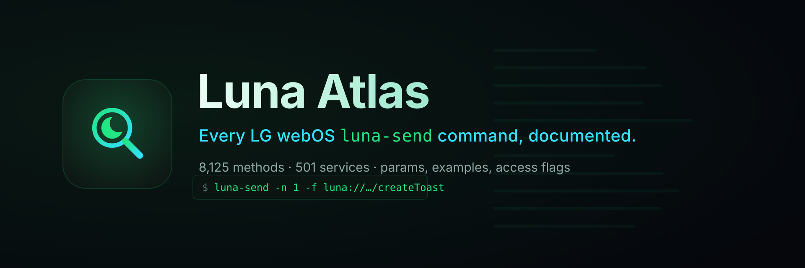

# WEBOS-LUNA-SEND-ATLAS

[](https://github.com/ohmybahgosh/WEBOS-LUNA-SEND-ATLAS/releases/latest)
[](LICENSE)
[](catalog/luna-catalog.jsonl)
[](#services)
[](#install)
[](#what-this-is)
[](https://github.com/ohmybahgosh/WEBOS-LUNA-SEND-ATLAS/stargazers)



> **Every LG webOS `luna-send` command in one place.**  8,125 methods across 501 services, each with its parameters, a ready-to-run example, its access level and where it came from.  Search it, read it, and run it straight from the terminal.

---

## Contents

|  |  |
|---|---|
| **Start here** | [What this is](#what-this-is) &middot; [Install](#install) &middot; [Quick start](#quick-start) |
| **Use it** | [Finding a command](#finding-a-command) &middot; [Recipes](docs/recipes.md) &middot; [Using the script](#usage) |
| **Reference** | [The catalog](#the-catalog) &middot; [Coverage](#coverage) &middot; [How descriptions are sourced](#how-descriptions-are-sourced) &middot; [Categories](#categories) &middot; [Services](#services) |
| **More** | [Dump your own TV](#dump-your-own-tv) &middot; [Discovery notes](docs/discovery.md) &middot; [Scope & safety](#scope-and-safety) &middot; [Credits](#credits) &middot; [License](#license) |

---

## What this is

Every LG webOS TV ships a command-line tool called **`luna-send`**.  It talks to the **Luna Service Bus**, the internal message bus that every system service listens on: power, apps, inputs, picture and sound, Wi-Fi, notifications, the panel, software update, and hundreds more.  On a rooted TV or in Developer Mode, `luna-send` is how you drive any of it from a shell:

```sh
luna-send -n 1 -f luna://com.webos.notification/createToast '{"message":"Hello from luna-send"}'
```

There has never been a complete list of what you can *say* to it.  This repo is that list, **8,125 methods across 501 services**, with a small command-line tool, [`luna-atlas.sh`](luna-atlas.sh), that reads the catalog to `search`, `show` and `run` any of them over SSH, with tab completion.

> [!IMPORTANT]
> **Under heavy active development.**  The catalog and the script are both changing fast.  Method names are solid, but many parameters are still being filled in, categories may move, and the script is pre-1.0.  Expect breaking changes and re-dumps; pin a commit if you need something stable.

> [!NOTE]
> **The catalog is the focus right now; the CLI is still early.**  The priority is documenting every Luna call first; the `luna-atlas` script is rough and will get the attention once the catalog is solid.  Treat it as a preview, not a finished tool.

> [!WARNING]
> **This drives real services on your TV.**  Many calls change settings, inputs, power or the panel, and a few can factory reset, wipe data, or brick the set.  Those are flagged ⚠️ and listed in [docs/dangerous.md](docs/dangerous.md).  Running one here is exactly as safe or unsafe as typing the same `luna-send` yourself.  Use at your own risk; there is no warranty (see [LICENSE](LICENSE)).  You need a **rooted TV or Developer Mode**.

<details>
<summary><b>How this is built</b> &mdash; AI-assisted, directed and verified on a real TV</summary>

<br>

I, [OhMyBahGosh](https://github.com/ohmybahgosh), build this with AI coding agents (Claude), directed, reviewed and tested by me.  I've been building software for over 17 years; my day job is data engineering, and security and pentesting are what I do for fun.  AI does a lot of the work here: I decide what goes in, check how it's done, and verify it against a real TV (an LG C2 on webOS 22).  The catalog is pulled from the official webOS TV and webOS OSE docs, the homebrew and remote-control community, and the full service list introspected from my own rooted TV; every record lists its source, and a scrub step keeps personal data and installed-app names out.

</details>

---

## Install

First you need a **rooted TV** (see [RootMyTV](https://rootmy.tv)) or **Developer Mode**, so that `luna-send` and SSH are available.

On a rooted TV, drop the repo somewhere writable (e.g. with [Entware](https://github.com/ohmybahgosh/WEBOS-ENTWARE-INSTALLER) for `git`/`curl`, or just `scp` it over):

```sh
# from your PC:
scp -r WEBOS-LUNA-SEND-ATLAS root@<tv-ip>:/home/root/luna-atlas
# on the TV:
cd /home/root/luna-atlas
sh luna-atlas.sh search toast
```

Only `luna-atlas.sh` and the `catalog/` folder are needed at runtime.  Put `luna-atlas.sh` on your `PATH` and set `LUNA_ATLAS_DATA` to that folder if you move it.  For **tab completion**, source the right file (bash via Entware, or on your own machine):

```sh
. completions/luna-atlas.bash     # bash
# or add completions/luna-atlas.zsh to your $fpath for zsh
```

---

## Quick start

```sh
luna-atlas search toast                               # find methods by name, service or description
luna-atlas show com.webos.notification/createToast    # params + a ready-to-run example
luna-atlas run luna://com.webos.notification/createToast '{"message":"hi"}'
```

---

## Finding a command

Five ways to get from "what is it called?" to a line you can run, fastest first.

- **Search on the web.**  [ohmybahgosh.dev/luna-atlas](https://ohmybahgosh.dev/luna-atlas/) has a live search box over the whole catalog.  Type a service, a method, or a few words from a description.
- **Search from the shell.**  `luna-atlas search <term>` matches method names, services and descriptions, and `luna-atlas show <service>/<method>` prints the parameters and a ready-to-run example.
- **Browse by category.**  The 27 [category pages](#categories) group every method by what it does: power, picture, network, apps and so on.
- **Browse by service.**  There is one [page per service](docs/services/) under `docs/services/`, and every method has its own anchor, so you can link straight to it.
- **Grep the index.**  [`catalog/index.tsv`](catalog/index.tsv) is one tab-separated row per method: `service`, `method`, `uri`, `access`, `dangerous`, `subscribe`, `category`, `description`, `confidence`.

Listing every dangerous call in the power category is then a one-liner:

```sh
awk -F'\t' '$5==1 && $7=="power" {print $3}' catalog/index.tsv
```

For ready-to-run lines for common tasks (screen off, screenshot, current app, volume, notifications), see [recipes](docs/recipes.md).

---

## Usage

```sh
luna-atlas search toast                 # find methods by name, service or description
luna-atlas show com.webos.notification/createToast   # params + a ready-to-run example
luna-atlas services tvpower             # list services (optionally filtered)
luna-atlas categories                   # methods grouped by what they do
luna-atlas run luna://com.webos.notification/createToast '{"message":"hi"}'
luna-atlas run luna://com.webos.service.tvpower/power/reboot   # dangerous ones ask first
luna-atlas dump                         # read-only dump of THIS TV's services
```

`run` passes your call straight to `luna-send`, and asks for a typed **YES** on anything flagged dangerous.  Tab completion fills in service and method names from the catalog.

## The catalog

8,125 methods across 501 services.  Machine-readable in [`catalog/luna-catalog.json`](catalog/luna-catalog.json) / [`.jsonl`](catalog/luna-catalog.jsonl); a grep-friendly [`catalog/index.tsv`](catalog/index.tsv) feeds the script.  One page per service under [`docs/services/`](docs/services/), grouped by category under [`docs/categories/`](docs/categories/).  The compact [`web/catalog.json`](web/catalog.json) that [ohmybahgosh.dev/luna-atlas](https://ohmybahgosh.dev/luna-atlas/) reads is built from the JSONL: run `python3 scripts/build-web-catalog.py` after changing it.

<details>
<summary>Deeper reference docs</summary>

<br>

[recipes](docs/recipes.md) &middot; [discovery notes](docs/discovery.md) &middot; [luna-send basics](docs/luna-send-basics.md) &middot; [SSAP + the createAlert trick](docs/ssap-and-createalert.md) &middot; [SSAP routing](docs/ssap-routing-W22O.md) &middot; [settings keys](docs/settings-keys.md) &middot; [hidden menus](docs/hidden-menus.md) &middot; [calibration](docs/calibration.md) &middot; [dangerous calls](docs/dangerous.md) &middot; [sensitive services](docs/sensitive-services.md) &middot; [TV dumps](docs/tv-dumps.md)

</details>

### Coverage

| Access | Methods |
|---|---|
| `private` | 5161 |
| `public` | 2514 |
| `unknown` | 315 |
| `ssap` | 100 |
| `root` | 35 |

`public` = callable by apps with the right permission.  `private` = needs root or system rights.  `ssap` = reachable over the SSAP websocket.  `unknown` = the source didn't say.  Access levels for methods present on a real LG C2 (webOS 22) are confirmed against the on-device permission groups; 96 previously `unknown` entries were resolved this way.

### How descriptions are sourced

Every method carries a `confidence` flag (column 9 of `index.tsv`, `dc` in the web catalog) so nothing reads as more certain than it is:

| Confidence | Methods | What it means |
|---|---|---|
| `documented` | 1,807 | Described from an authoritative source: the [webOS OSE LS2 API reference](https://www.webosose.org/docs/reference/ls2-api/) (CC-BY 4.0), official LG docs, or community tools.  Parameters and return fields are real where shown. |
| `inferred` | 6,316 | LG-proprietary services with no public documentation and no readable source (native firmware binaries).  The one-line description is derived **only from the method's own name** &mdash; e.g. `getLockStatusforSubscribe` &rarr; "Returns the lock status (subscription variant)".  **No parameters are invented.**  Treat these as a best-effort guide, not verified behaviour. |
| `stub` | 2 | Name only, no description yet. |

The method names, access levels, ACG permission groups and danger flags are all real (from the on-device permission registry).  Recovering real parameter schemas for the `inferred` methods needs the running device, which reports what each call requires &mdash; a planned follow-up.

### Categories

Methods grouped by what they broadly do.  Each opens a page with its full method list, confidence and descriptions.  The **⚠️** column counts the dangerous methods in each group (see [docs/dangerous.md](docs/dangerous.md)).

| Category | Methods | ⚠️ |
|---|---|---|
| [TV Broadcast / DVR](docs/categories/tv-broadcast.md) | 1901 | 64 |
| [Misc](docs/categories/misc.md) | 829 | 25 |
| [Input & Keys](docs/categories/input.md) | 795 | 23 |
| [Audio](docs/categories/audio.md) | 697 | 7 |
| [Media Playback](docs/categories/media.md) | 433 | 9 |
| [Power](docs/categories/power.md) | 369 | 39 |
| [Applications](docs/categories/apps.md) | 365 | 11 |
| [Bluetooth](docs/categories/bluetooth.md) | 336 | 4 |
| [Network / Wi-Fi](docs/categories/network.md) | 304 | 10 |
| [Settings](docs/categories/settings.md) | 295 | 28 |
| [System Info](docs/categories/system-info.md) | 289 | 30 |
| [Security / Keys](docs/categories/security.md) | 279 | 14 |
| [Database (db8)](docs/categories/db.md) | 274 | 17 |
| [Display / Panel](docs/categories/display.md) | 212 | 8 |
| [Storage & USB](docs/categories/storage.md) | 140 | 7 |
| [Connection Manager](docs/categories/connection.md) | 103 | 3 |
| [Software Update](docs/categories/update.md) | 90 | 9 |
| [Notifications & Alerts](docs/categories/notifications.md) | 82 | 3 |
| [Camera](docs/categories/camera.md) | 73 | 0 |
| [Activity Manager](docs/categories/activity.md) | 66 | 0 |
| [Developer Mode & Testing](docs/categories/devmode.md) | 44 | 0 |
| [Power Management (sleep/wake)](docs/categories/power-mgmt.md) | 44 | 0 |
| [UI / Compositor](docs/categories/ui.md) | 44 | 0 |
| [Picture](docs/categories/picture.md) | 26 | 3 |
| [Location](docs/categories/location.md) | 21 | 0 |
| [Key Management](docs/categories/keys.md) | 13 | 0 |
| [Sound](docs/categories/sound.md) | 1 | 0 |

### Services

Every service has its own page under [`docs/services/`](docs/services/).  A few big or commonly reached ones:

[`com.webos.service.tvpower`](docs/services/com.webos.service.tvpower.md) &middot; [`com.webos.service.audio`](docs/services/com.webos.service.audio.md) &middot; [`com.webos.service.bluetooth2`](docs/services/com.webos.service.bluetooth2.md) &middot; [`com.webos.service.wifi`](docs/services/com.webos.service.wifi.md) &middot; [`com.webos.applicationManager`](docs/services/com.webos.applicationManager.md) &middot; [`com.webos.media`](docs/services/com.webos.media.md) &middot; [`com.webos.service.mrcu`](docs/services/com.webos.service.mrcu.md) &middot; [`com.webos.service.legacybroadcast.channel`](docs/services/com.webos.service.legacybroadcast.channel.md) &middot; [`com.webos.service.utp.channel`](docs/services/com.webos.service.utp.channel.md) &middot; [`com.webos.service.commercial.scapadapter`](docs/services/com.webos.service.commercial.scapadapter.md)

For anything specific, search the catalog (see [Finding a command](#finding-a-command)).

**webOS TV &mdash; 445 services**

<details>
<summary><code>com.webos.service.*</code> &mdash; 355 services, 6239 methods</summary>

| Service | Methods | Platforms |
|---|---|---|
| [`com.webos.service.accountmanager`](docs/services/com.webos.service.accountmanager.md) | 16 | webOS TV |
| [`com.webos.service.acr`](docs/services/com.webos.service.acr.md) | 17 | webOS TV |
| [`com.webos.service.activityPolicyMgr`](docs/services/com.webos.service.activityPolicyMgr.md) | 2 | webOS TV |
| [`com.webos.service.admanager`](docs/services/com.webos.service.admanager.md) | 33 | webOS TV |
| [`com.webos.service.adoverlay`](docs/services/com.webos.service.adoverlay.md) | 1 | webOS TV |
| [`com.webos.service.aiinferencemanager`](docs/services/com.webos.service.aiinferencemanager.md) | 11 | webOS TV |
| [`com.webos.service.airessrvallocator`](docs/services/com.webos.service.airessrvallocator.md) | 3 | webOS TV |
| [`com.webos.service.airplayadaptor`](docs/services/com.webos.service.airplayadaptor.md) | 9 | webOS TV |
| [`com.webos.service.ajservice`](docs/services/com.webos.service.ajservice.md) | 1 | webOS TV |
| [`com.webos.service.alarm`](docs/services/com.webos.service.alarm.md) | 7 | webOS OSE, webOS TV |
| [`com.webos.service.alwaysready`](docs/services/com.webos.service.alwaysready.md) | 8 | webOS TV |
| [`com.webos.service.analytics`](docs/services/com.webos.service.analytics.md) | 1 | webOS TV |
| [`com.webos.service.aos`](docs/services/com.webos.service.aos.md) | 5 | webOS TV |
| [`com.webos.service.apiadapter`](docs/services/com.webos.service.apiadapter.md) | 57 | webOS TV |
| [`com.webos.service.apinstaller`](docs/services/com.webos.service.apinstaller.md) | 5 | webOS TV |
| [`com.webos.service.apluspolicymanager`](docs/services/com.webos.service.apluspolicymanager.md) | 3 | webOS TV |
| [`com.webos.service.appcasting`](docs/services/com.webos.service.appcasting.md) | 9 | webOS TV |
| [`com.webos.service.applaunchmanager`](docs/services/com.webos.service.applaunchmanager.md) | 1 | webOS TV |
| [`com.webos.service.applicationManager`](docs/services/com.webos.service.applicationManager.md) | 48 | webOS TV |
| [`com.webos.service.applicationmanager`](docs/services/com.webos.service.applicationmanager.md) | 32 | webOS OSE, webOS TV |
| [`com.webos.service.appstatus`](docs/services/com.webos.service.appstatus.md) | 1 | webOS TV |
| [`com.webos.service.arccontroller`](docs/services/com.webos.service.arccontroller.md) | 4 | webOS TV |
| [`com.webos.service.asc`](docs/services/com.webos.service.asc.md) | 8 | webOS TV |
| [`com.webos.service.attachedstoragemanager`](docs/services/com.webos.service.attachedstoragemanager.md) | 24 | webOS TV |
| [`com.webos.service.audio`](docs/services/com.webos.service.audio.md) | 236 | webOS OSE, webOS TV |
| [`com.webos.service.audiooutput`](docs/services/com.webos.service.audiooutput.md) | 18 | webOS OSE, webOS TV |
| [`com.webos.service.avf`](docs/services/com.webos.service.avf.md) | 41 | webOS TV |
| [`com.webos.service.avmutemanager`](docs/services/com.webos.service.avmutemanager.md) | 12 | webOS TV |
| [`com.webos.service.bam`](docs/services/com.webos.service.bam.md) | 3 | webOS TV |
| [`com.webos.service.billing`](docs/services/com.webos.service.billing.md) | 10 | webOS TV |
| [`com.webos.service.blegatt`](docs/services/com.webos.service.blegatt.md) | 33 | webOS TV |
| [`com.webos.service.blegattsoundbar`](docs/services/com.webos.service.blegattsoundbar.md) | 4 | webOS TV |
| [`com.webos.service.bluetooth`](docs/services/com.webos.service.bluetooth.md) | 26 | webOS TV |
| [`com.webos.service.bluetooth2`](docs/services/com.webos.service.bluetooth2.md) | 256 | webOS OSE, webOS TV |
| [`com.webos.service.broadcast-conf-downloader`](docs/services/com.webos.service.broadcast-conf-downloader.md) | 1 | webOS TV |
| [`com.webos.service.broadcastchannelmixer`](docs/services/com.webos.service.broadcastchannelmixer.md) | 5 | webOS TV |
| [`com.webos.service.broadcastconfigd`](docs/services/com.webos.service.broadcastconfigd.md) | 17 | webOS TV |
| [`com.webos.service.browser`](docs/services/com.webos.service.browser.md) | 9 | webOS TV |
| [`com.webos.service.btaudiosnk`](docs/services/com.webos.service.btaudiosnk.md) | 15 | webOS TV |
| [`com.webos.service.btaudiosrc`](docs/services/com.webos.service.btaudiosrc.md) | 27 | webOS TV |
| [`com.webos.service.btgattwowcast`](docs/services/com.webos.service.btgattwowcast.md) | 9 | webOS TV |
| [`com.webos.service.bthidmanager`](docs/services/com.webos.service.bthidmanager.md) | 16 | webOS TV |
| [`com.webos.service.btleaudio`](docs/services/com.webos.service.btleaudio.md) | 22 | webOS TV |
| [`com.webos.service.buddyconnector`](docs/services/com.webos.service.buddyconnector.md) | 31 | webOS TV |
| [`com.webos.service.cacheproxy`](docs/services/com.webos.service.cacheproxy.md) | 2 | webOS TV |
| [`com.webos.service.camera`](docs/services/com.webos.service.camera.md) | 33 | webOS TV |
| [`com.webos.service.camera.gesture`](docs/services/com.webos.service.camera.gesture.md) | 2 | webOS TV |
| [`com.webos.service.camera2`](docs/services/com.webos.service.camera2.md) | 39 | webOS OSE, webOS TV |
| [`com.webos.service.capture`](docs/services/com.webos.service.capture.md) | 15 | webOS TV |
| [`com.webos.service.capturepermission`](docs/services/com.webos.service.capturepermission.md) | 2 | webOS TV |
| [`com.webos.service.capturetv`](docs/services/com.webos.service.capturetv.md) | 3 | webOS TV |
| [`com.webos.service.cbox`](docs/services/com.webos.service.cbox.md) | 9 | webOS TV |
| [`com.webos.service.chromecast.provisioning`](docs/services/com.webos.service.chromecast.provisioning.md) | 5 | webOS TV |
| [`com.webos.service.cloudupload`](docs/services/com.webos.service.cloudupload.md) | 5 | webOS TV |
| [`com.webos.service.colorInfoMiner`](docs/services/com.webos.service.colorInfoMiner.md) | 4 | webOS TV |
| [`com.webos.service.commercial.contentmanager`](docs/services/com.webos.service.commercial.contentmanager.md) | 11 | webOS TV |
| [`com.webos.service.commercial.scapadapter`](docs/services/com.webos.service.commercial.scapadapter.md) | 164 | webOS TV |
| [`com.webos.service.commercial.signage.localfileserver`](docs/services/com.webos.service.commercial.signage.localfileserver.md) | 8 | webOS TV |
| [`com.webos.service.commercial.webgateway`](docs/services/com.webos.service.commercial.webgateway.md) | 11 | webOS TV |
| [`com.webos.service.commercialinputdevice`](docs/services/com.webos.service.commercialinputdevice.md) | 13 | webOS TV |
| [`com.webos.service.config`](docs/services/com.webos.service.config.md) | 12 | webOS OSE, webOS TV |
| [`com.webos.service.connectionmanager`](docs/services/com.webos.service.connectionmanager.md) | 29 | webOS OSE, webOS TV |
| [`com.webos.service.contentminer`](docs/services/com.webos.service.contentminer.md) | 3 | webOS TV |
| [`com.webos.service.crashreport`](docs/services/com.webos.service.crashreport.md) | 1 | webOS TV |
| [`com.webos.service.credentialsmanager`](docs/services/com.webos.service.credentialsmanager.md) | 3 | webOS TV |
| [`com.webos.service.dass`](docs/services/com.webos.service.dass.md) | 2 | webOS TV |
| [`com.webos.service.datamigrator`](docs/services/com.webos.service.datamigrator.md) | 5 | webOS TV |
| [`com.webos.service.devicereset`](docs/services/com.webos.service.devicereset.md) | 18 | webOS TV |
| [`com.webos.service.dial`](docs/services/com.webos.service.dial.md) | 6 | webOS TV |
| [`com.webos.service.dial.ssdpmanager`](docs/services/com.webos.service.dial.ssdpmanager.md) | 1 | webOS TV |
| [`com.webos.service.dialssdp`](docs/services/com.webos.service.dialssdp.md) | 2 | webOS TV |
| [`com.webos.service.discovery`](docs/services/com.webos.service.discovery.md) | 23 | webOS TV |
| [`com.webos.service.dmost`](docs/services/com.webos.service.dmost.md) | 29 | webOS TV |
| [`com.webos.service.dmpautotest`](docs/services/com.webos.service.dmpautotest.md) | 1 | webOS TV |
| [`com.webos.service.dmrautotest`](docs/services/com.webos.service.dmrautotest.md) | 1 | webOS TV |
| [`com.webos.service.dmrsvc`](docs/services/com.webos.service.dmrsvc.md) | 12 | webOS TV |
| [`com.webos.service.dnssd`](docs/services/com.webos.service.dnssd.md) | 5 | webOS TV |
| [`com.webos.service.downloadmanager`](docs/services/com.webos.service.downloadmanager.md) | 18 | webOS OSE, webOS TV |
| [`com.webos.service.drm`](docs/services/com.webos.service.drm.md) | 31 | webOS TV |
| [`com.webos.service.eim`](docs/services/com.webos.service.eim.md) | 41 | webOS TV |
| [`com.webos.service.emmcd`](docs/services/com.webos.service.emmcd.md) | 5 | webOS TV |
| [`com.webos.service.eulaservice`](docs/services/com.webos.service.eulaservice.md) | 6 | webOS TV |
| [`com.webos.service.eventmonitor`](docs/services/com.webos.service.eventmonitor.md) | 5 | webOS TV |
| [`com.webos.service.externaldecodercontroller`](docs/services/com.webos.service.externaldecodercontroller.md) | 8 | webOS TV |
| [`com.webos.service.externaldevice`](docs/services/com.webos.service.externaldevice.md) | 15 | webOS TV |
| [`com.webos.service.extinputs`](docs/services/com.webos.service.extinputs.md) | 1 | webOS TV |
| [`com.webos.service.extinputs.av`](docs/services/com.webos.service.extinputs.av.md) | 23 | webOS TV |
| [`com.webos.service.extinputs.component`](docs/services/com.webos.service.extinputs.component.md) | 13 | webOS TV |
| [`com.webos.service.extinputs.displayport`](docs/services/com.webos.service.extinputs.displayport.md) | 25 | webOS TV |
| [`com.webos.service.extinputs.hdmi`](docs/services/com.webos.service.extinputs.hdmi.md) | 26 | webOS TV |
| [`com.webos.service.extinputs.spdif`](docs/services/com.webos.service.extinputs.spdif.md) | 7 | webOS TV |
| [`com.webos.service.facedetect`](docs/services/com.webos.service.facedetect.md) | 1 | webOS TV |
| [`com.webos.service.factorymanager`](docs/services/com.webos.service.factorymanager.md) | 22 | webOS TV |
| [`com.webos.service.familycare`](docs/services/com.webos.service.familycare.md) | 7 | webOS TV |
| [`com.webos.service.fancontroller`](docs/services/com.webos.service.fancontroller.md) | 7 | webOS TV |
| [`com.webos.service.faultmanager`](docs/services/com.webos.service.faultmanager.md) | 10 | webOS TV |
| [`com.webos.service.favorites`](docs/services/com.webos.service.favorites.md) | 23 | webOS TV |
| [`com.webos.service.fingerprint`](docs/services/com.webos.service.fingerprint.md) | 2 | webOS TV |
| [`com.webos.service.firstuse`](docs/services/com.webos.service.firstuse.md) | 2 | webOS TV |
| [`com.webos.service.ftms`](docs/services/com.webos.service.ftms.md) | 9 | webOS TV |
| [`com.webos.service.gibb.channel`](docs/services/com.webos.service.gibb.channel.md) | 4 | webOS TV |
| [`com.webos.service.gibbips`](docs/services/com.webos.service.gibbips.md) | 3 | webOS TV |
| [`com.webos.service.gibbips.acas`](docs/services/com.webos.service.gibbips.acas.md) | 11 | webOS TV |
| [`com.webos.service.gibbips.bcConfigAdapter`](docs/services/com.webos.service.gibbips.bcConfigAdapter.md) | 3 | webOS TV |
| [`com.webos.service.gibbips.broadcast`](docs/services/com.webos.service.gibbips.broadcast.md) | 40 | webOS TV |
| [`com.webos.service.gibbips.channel`](docs/services/com.webos.service.gibbips.channel.md) | 53 | webOS TV |
| [`com.webos.service.gibbips.config`](docs/services/com.webos.service.gibbips.config.md) | 2 | webOS TV |
| [`com.webos.service.gibbips.databroadcast`](docs/services/com.webos.service.gibbips.databroadcast.md) | 27 | webOS TV |
| [`com.webos.service.gibbips.debug`](docs/services/com.webos.service.gibbips.debug.md) | 11 | webOS TV |
| [`com.webos.service.gibbips.dvr`](docs/services/com.webos.service.gibbips.dvr.md) | 16 | webOS TV |
| [`com.webos.service.gibbips.frontend`](docs/services/com.webos.service.gibbips.frontend.md) | 12 | webOS TV |
| [`com.webos.service.gibbips.pcap`](docs/services/com.webos.service.gibbips.pcap.md) | 4 | webOS TV |
| [`com.webos.service.gibbips.power`](docs/services/com.webos.service.gibbips.power.md) | 1 | webOS TV |
| [`com.webos.service.gibbips.program`](docs/services/com.webos.service.gibbips.program.md) | 18 | webOS TV |
| [`com.webos.service.gibbips.recsig`](docs/services/com.webos.service.gibbips.recsig.md) | 1 | webOS TV |
| [`com.webos.service.gibbips.subtitle`](docs/services/com.webos.service.gibbips.subtitle.md) | 10 | webOS TV |
| [`com.webos.service.gibbips.tvpowerd`](docs/services/com.webos.service.gibbips.tvpowerd.md) | 16 | webOS TV |
| [`com.webos.service.gibbs`](docs/services/com.webos.service.gibbs.md) | 3 | webOS TV |
| [`com.webos.service.gibbs.acas`](docs/services/com.webos.service.gibbs.acas.md) | 11 | webOS TV |
| [`com.webos.service.gibbs.bcConfigAdapter`](docs/services/com.webos.service.gibbs.bcConfigAdapter.md) | 3 | webOS TV |
| [`com.webos.service.gibbs.broadcast`](docs/services/com.webos.service.gibbs.broadcast.md) | 39 | webOS TV |
| [`com.webos.service.gibbs.channel`](docs/services/com.webos.service.gibbs.channel.md) | 41 | webOS TV |
| [`com.webos.service.gibbs.databroadcast`](docs/services/com.webos.service.gibbs.databroadcast.md) | 26 | webOS TV |
| [`com.webos.service.gibbs.debug`](docs/services/com.webos.service.gibbs.debug.md) | 9 | webOS TV |
| [`com.webos.service.gibbs.dvr`](docs/services/com.webos.service.gibbs.dvr.md) | 16 | webOS TV |
| [`com.webos.service.gibbs.frontend`](docs/services/com.webos.service.gibbs.frontend.md) | 12 | webOS TV |
| [`com.webos.service.gibbs.pcap`](docs/services/com.webos.service.gibbs.pcap.md) | 4 | webOS TV |
| [`com.webos.service.gibbs.program`](docs/services/com.webos.service.gibbs.program.md) | 8 | webOS TV |
| [`com.webos.service.gibbs.recsig`](docs/services/com.webos.service.gibbs.recsig.md) | 1 | webOS TV |
| [`com.webos.service.gibbs.subtitle`](docs/services/com.webos.service.gibbs.subtitle.md) | 12 | webOS TV |
| [`com.webos.service.gibbs.tvpowerd`](docs/services/com.webos.service.gibbs.tvpowerd.md) | 16 | webOS TV |
| [`com.webos.service.gingaccwebservices`](docs/services/com.webos.service.gingaccwebservices.md) | 12 | webOS TV |
| [`com.webos.service.gingaccwebservices.test`](docs/services/com.webos.service.gingaccwebservices.test.md) | 14 | webOS TV |
| [`com.webos.service.google.signin`](docs/services/com.webos.service.google.signin.md) | 2 | webOS TV |
| [`com.webos.service.googlehomecontroller`](docs/services/com.webos.service.googlehomecontroller.md) | 7 | webOS TV |
| [`com.webos.service.hdcp2`](docs/services/com.webos.service.hdcp2.md) | 6 | webOS TV |
| [`com.webos.service.hdmitx`](docs/services/com.webos.service.hdmitx.md) | 4 | webOS TV |
| [`com.webos.service.hidusbemul`](docs/services/com.webos.service.hidusbemul.md) | 3 | webOS TV |
| [`com.webos.service.homeconnect`](docs/services/com.webos.service.homeconnect.md) | 7 | webOS TV |
| [`com.webos.service.homelaunchpoints`](docs/services/com.webos.service.homelaunchpoints.md) | 14 | webOS TV |
| [`com.webos.service.hybridtvapiserver`](docs/services/com.webos.service.hybridtvapiserver.md) | 9 | webOS TV |
| [`com.webos.service.hybridtvmanager`](docs/services/com.webos.service.hybridtvmanager.md) | 13 | webOS TV |
| [`com.webos.service.ics`](docs/services/com.webos.service.ics.md) | 51 | webOS TV |
| [`com.webos.service.iepg`](docs/services/com.webos.service.iepg.md) | 90 | webOS TV |
| [`com.webos.service.image`](docs/services/com.webos.service.image.md) | 5 | webOS TV |
| [`com.webos.service.ime`](docs/services/com.webos.service.ime.md) | 4 | webOS OSE, webOS TV |
| [`com.webos.service.independanotification`](docs/services/com.webos.service.independanotification.md) | 9 | webOS TV |
| [`com.webos.service.interactivecontent.apiserver`](docs/services/com.webos.service.interactivecontent.apiserver.md) | 2 | webOS TV |
| [`com.webos.service.interactivecontent.apiserver.test`](docs/services/com.webos.service.interactivecontent.apiserver.test.md) | 2 | webOS TV |
| [`com.webos.service.interactivecontent.webserver`](docs/services/com.webos.service.interactivecontent.webserver.md) | 3 | webOS TV |
| [`com.webos.service.iotclient`](docs/services/com.webos.service.iotclient.md) | 27 | webOS TV |
| [`com.webos.service.iotproxy`](docs/services/com.webos.service.iotproxy.md) | 2 | webOS TV |
| [`com.webos.service.irdbmanager`](docs/services/com.webos.service.irdbmanager.md) | 35 | webOS TV |
| [`com.webos.service.ismmanager`](docs/services/com.webos.service.ismmanager.md) | 3 | webOS TV |
| [`com.webos.service.iwc`](docs/services/com.webos.service.iwc.md) | 8 | webOS TV |
| [`com.webos.service.jsserver`](docs/services/com.webos.service.jsserver.md) | 4 | webOS TV |
| [`com.webos.service.keymanager2`](docs/services/com.webos.service.keymanager2.md) | 9 | webOS TV |
| [`com.webos.service.keymanager3`](docs/services/com.webos.service.keymanager3.md) | 15 | webOS TV |
| [`com.webos.service.ledbarcontroller`](docs/services/com.webos.service.ledbarcontroller.md) | 1 | webOS TV |
| [`com.webos.service.legacybroadcast`](docs/services/com.webos.service.legacybroadcast.md) | 3 | webOS TV |
| [`com.webos.service.legacybroadcast.acas`](docs/services/com.webos.service.legacybroadcast.acas.md) | 11 | webOS TV |
| [`com.webos.service.legacybroadcast.audiorecorder`](docs/services/com.webos.service.legacybroadcast.audiorecorder.md) | 4 | webOS TV |
| [`com.webos.service.legacybroadcast.bcConfigAdapter`](docs/services/com.webos.service.legacybroadcast.bcConfigAdapter.md) | 3 | webOS TV |
| [`com.webos.service.legacybroadcast.broadcast`](docs/services/com.webos.service.legacybroadcast.broadcast.md) | 48 | webOS TV |
| [`com.webos.service.legacybroadcast.channel`](docs/services/com.webos.service.legacybroadcast.channel.md) | 360 | webOS TV |
| [`com.webos.service.legacybroadcast.databroadcast`](docs/services/com.webos.service.legacybroadcast.databroadcast.md) | 42 | webOS TV |
| [`com.webos.service.legacybroadcast.debug`](docs/services/com.webos.service.legacybroadcast.debug.md) | 1 | webOS TV |
| [`com.webos.service.legacybroadcast.display`](docs/services/com.webos.service.legacybroadcast.display.md) | 3 | webOS TV |
| [`com.webos.service.legacybroadcast.dvr`](docs/services/com.webos.service.legacybroadcast.dvr.md) | 97 | webOS TV |
| [`com.webos.service.legacybroadcast.expcall`](docs/services/com.webos.service.legacybroadcast.expcall.md) | 1 | webOS TV |
| [`com.webos.service.legacybroadcast.frontend`](docs/services/com.webos.service.legacybroadcast.frontend.md) | 28 | webOS TV |
| [`com.webos.service.legacybroadcast.lbdsmcc`](docs/services/com.webos.service.legacybroadcast.lbdsmcc.md) | 8 | webOS TV |
| [`com.webos.service.legacybroadcast.power`](docs/services/com.webos.service.legacybroadcast.power.md) | 2 | webOS TV |
| [`com.webos.service.legacybroadcast.program`](docs/services/com.webos.service.legacybroadcast.program.md) | 9 | webOS TV |
| [`com.webos.service.legacybroadcast.recsig`](docs/services/com.webos.service.legacybroadcast.recsig.md) | 1 | webOS TV |
| [`com.webos.service.legacybroadcast.sound`](docs/services/com.webos.service.legacybroadcast.sound.md) | 7 | webOS TV |
| [`com.webos.service.legacybroadcast.subtitle`](docs/services/com.webos.service.legacybroadcast.subtitle.md) | 29 | webOS TV |
| [`com.webos.service.legacybroadcast.swupdate`](docs/services/com.webos.service.legacybroadcast.swupdate.md) | 9 | webOS TV |
| [`com.webos.service.legacybroadcast.teletext`](docs/services/com.webos.service.legacybroadcast.teletext.md) | 10 | webOS TV |
| [`com.webos.service.legacybroadcast.time`](docs/services/com.webos.service.legacybroadcast.time.md) | 4 | webOS TV |
| [`com.webos.service.legacybroadcast.tvpowerd`](docs/services/com.webos.service.legacybroadcast.tvpowerd.md) | 16 | webOS TV |
| [`com.webos.service.lightingcontroller`](docs/services/com.webos.service.lightingcontroller.md) | 4 | webOS TV |
| [`com.webos.service.lim`](docs/services/com.webos.service.lim.md) | 4 | webOS TV |
| [`com.webos.service.livepickplus`](docs/services/com.webos.service.livepickplus.md) | 10 | webOS TV |
| [`com.webos.service.logger`](docs/services/com.webos.service.logger.md) | 1 | webOS TV |
| [`com.webos.service.lowlevelstorage`](docs/services/com.webos.service.lowlevelstorage.md) | 3 | webOS TV |
| [`com.webos.service.lsa`](docs/services/com.webos.service.lsa.md) | 1 | webOS TV |
| [`com.webos.service.magicnum`](docs/services/com.webos.service.magicnum.md) | 6 | webOS TV |
| [`com.webos.service.matter`](docs/services/com.webos.service.matter.md) | 2 | webOS TV |
| [`com.webos.service.mediasync`](docs/services/com.webos.service.mediasync.md) | 1 | webOS TV |
| [`com.webos.service.membership`](docs/services/com.webos.service.membership.md) | 14 | webOS TV |
| [`com.webos.service.mfi`](docs/services/com.webos.service.mfi.md) | 8 | webOS TV |
| [`com.webos.service.micomservice`](docs/services/com.webos.service.micomservice.md) | 53 | webOS TV |
| [`com.webos.service.microphone`](docs/services/com.webos.service.microphone.md) | 7 | webOS TV |
| [`com.webos.service.miracast`](docs/services/com.webos.service.miracast.md) | 48 | webOS TV |
| [`com.webos.service.miracast.upnp`](docs/services/com.webos.service.miracast.upnp.md) | 2 | webOS TV |
| [`com.webos.service.miracasttx`](docs/services/com.webos.service.miracasttx.md) | 8 | webOS TV |
| [`com.webos.service.mrcu`](docs/services/com.webos.service.mrcu.md) | 122 | webOS TV |
| [`com.webos.service.msc`](docs/services/com.webos.service.msc.md) | 12 | webOS TV |
| [`com.webos.service.mss`](docs/services/com.webos.service.mss.md) | 8 | webOS TV |
| [`com.webos.service.mtsp`](docs/services/com.webos.service.mtsp.md) | 1 | webOS TV |
| [`com.webos.service.multiviewcontroller`](docs/services/com.webos.service.multiviewcontroller.md) | 54 | webOS TV |
| [`com.webos.service.mvpd`](docs/services/com.webos.service.mvpd.md) | 21 | webOS TV |
| [`com.webos.service.mycar`](docs/services/com.webos.service.mycar.md) | 1 | webOS TV |
| [`com.webos.service.mysketch`](docs/services/com.webos.service.mysketch.md) | 8 | webOS TV |
| [`com.webos.service.nabs.broadcast`](docs/services/com.webos.service.nabs.broadcast.md) | 27 | webOS TV |
| [`com.webos.service.nabs.channel`](docs/services/com.webos.service.nabs.channel.md) | 22 | webOS TV |
| [`com.webos.service.nabs.dvr`](docs/services/com.webos.service.nabs.dvr.md) | 30 | webOS TV |
| [`com.webos.service.nabs.program`](docs/services/com.webos.service.nabs.program.md) | 3 | webOS TV |
| [`com.webos.service.nabs.subtitle`](docs/services/com.webos.service.nabs.subtitle.md) | 5 | webOS TV |
| [`com.webos.service.nais`](docs/services/com.webos.service.nais.md) | 6 | webOS TV |
| [`com.webos.service.nettools`](docs/services/com.webos.service.nettools.md) | 12 | webOS OSE, webOS TV |
| [`com.webos.service.networkinput`](docs/services/com.webos.service.networkinput.md) | 16 | webOS TV |
| [`com.webos.service.nfc`](docs/services/com.webos.service.nfc.md) | 34 | webOS TV |
| [`com.webos.service.nlp`](docs/services/com.webos.service.nlp.md) | 14 | webOS TV |
| [`com.webos.service.nlpmanager`](docs/services/com.webos.service.nlpmanager.md) | 20 | webOS TV |
| [`com.webos.service.nms`](docs/services/com.webos.service.nms.md) | 10 | webOS TV |
| [`com.webos.service.nnproxy`](docs/services/com.webos.service.nnproxy.md) | 3 | webOS TV |
| [`com.webos.service.nomotion`](docs/services/com.webos.service.nomotion.md) | 7 | webOS TV |
| [`com.webos.service.nop`](docs/services/com.webos.service.nop.md) | 5 | webOS TV |
| [`com.webos.service.nudge`](docs/services/com.webos.service.nudge.md) | 10 | webOS TV |
| [`com.webos.service.objectdetection`](docs/services/com.webos.service.objectdetection.md) | 4 | webOS TV |
| [`com.webos.service.objectdetectionutilizer`](docs/services/com.webos.service.objectdetectionutilizer.md) | 4 | webOS TV |
| [`com.webos.service.ocp`](docs/services/com.webos.service.ocp.md) | 5 | webOS TV |
| [`com.webos.service.oledepl`](docs/services/com.webos.service.oledepl.md) | 23 | webOS TV |
| [`com.webos.service.opappmanager`](docs/services/com.webos.service.opappmanager.md) | 2 | webOS TV |
| [`com.webos.service.opappwebserver`](docs/services/com.webos.service.opappwebserver.md) | 5 | webOS TV |
| [`com.webos.service.outdoorwebcontrol`](docs/services/com.webos.service.outdoorwebcontrol.md) | 2 | webOS TV |
| [`com.webos.service.packagemanager`](docs/services/com.webos.service.packagemanager.md) | 6 | webOS TV |
| [`com.webos.service.panelcontroller`](docs/services/com.webos.service.panelcontroller.md) | 60 | webOS TV |
| [`com.webos.service.pbsw`](docs/services/com.webos.service.pbsw.md) | 57 | webOS TV |
| [`com.webos.service.pdm`](docs/services/com.webos.service.pdm.md) | 42 | webOS OSE, webOS TV |
| [`com.webos.service.personalsoundwizard`](docs/services/com.webos.service.personalsoundwizard.md) | 4 | webOS TV |
| [`com.webos.service.photorenderer`](docs/services/com.webos.service.photorenderer.md) | 18 | webOS TV |
| [`com.webos.service.pkgInstall`](docs/services/com.webos.service.pkgInstall.md) | 6 | webOS TV |
| [`com.webos.service.pkgUpdate`](docs/services/com.webos.service.pkgUpdate.md) | 2 | webOS TV |
| [`com.webos.service.pkgverifier`](docs/services/com.webos.service.pkgverifier.md) | 1 | webOS TV |
| [`com.webos.service.power`](docs/services/com.webos.service.power.md) | 18 | webOS TV |
| [`com.webos.service.ppm`](docs/services/com.webos.service.ppm.md) | 7 | webOS TV |
| [`com.webos.service.pqcontroller`](docs/services/com.webos.service.pqcontroller.md) | 24 | webOS TV |
| [`com.webos.service.preloadmanager`](docs/services/com.webos.service.preloadmanager.md) | 3 | webOS TV |
| [`com.webos.service.printing`](docs/services/com.webos.service.printing.md) | 23 | webOS TV |
| [`com.webos.service.prosense`](docs/services/com.webos.service.prosense.md) | 7 | webOS TV |
| [`com.webos.service.prs`](docs/services/com.webos.service.prs.md) | 18 | webOS TV |
| [`com.webos.service.push`](docs/services/com.webos.service.push.md) | 18 | webOS TV |
| [`com.webos.service.pushclient`](docs/services/com.webos.service.pushclient.md) | 12 | webOS TV |
| [`com.webos.service.qbd`](docs/services/com.webos.service.qbd.md) | 5 | webOS TV |
| [`com.webos.service.recent`](docs/services/com.webos.service.recent.md) | 4 | webOS TV |
| [`com.webos.service.remotediag`](docs/services/com.webos.service.remotediag.md) | 9 | webOS TV |
| [`com.webos.service.remotemonitorprotocol`](docs/services/com.webos.service.remotemonitorprotocol.md) | 1 | webOS TV |
| [`com.webos.service.rollingscreen`](docs/services/com.webos.service.rollingscreen.md) | 26 | webOS TV |
| [`com.webos.service.rovi`](docs/services/com.webos.service.rovi.md) | 2 | webOS TV |
| [`com.webos.service.ruleengine`](docs/services/com.webos.service.ruleengine.md) | 3 | webOS TV |
| [`com.webos.service.scd`](docs/services/com.webos.service.scd.md) | 3 | webOS TV |
| [`com.webos.service.screenmanager`](docs/services/com.webos.service.screenmanager.md) | 4 | webOS TV |
| [`com.webos.service.screenrotation`](docs/services/com.webos.service.screenrotation.md) | 5 | webOS TV |
| [`com.webos.service.sdpservernotice`](docs/services/com.webos.service.sdpservernotice.md) | 2 | webOS TV |
| [`com.webos.service.sdx`](docs/services/com.webos.service.sdx.md) | 36 | webOS TV |
| [`com.webos.service.sdxpromo`](docs/services/com.webos.service.sdxpromo.md) | 9 | webOS TV |
| [`com.webos.service.secondscreen.gateway`](docs/services/com.webos.service.secondscreen.gateway.md) | 28 | webOS TV |
| [`com.webos.service.sensor`](docs/services/com.webos.service.sensor.md) | 6 | webOS TV |
| [`com.webos.service.servicemanager`](docs/services/com.webos.service.servicemanager.md) | 5 | webOS TV |
| [`com.webos.service.settings`](docs/services/com.webos.service.settings.md) | 32 | webOS OSE, webOS TV |
| [`com.webos.service.settingsui`](docs/services/com.webos.service.settingsui.md) | 2 | webOS TV |
| [`com.webos.service.signageplayer`](docs/services/com.webos.service.signageplayer.md) | 18 | webOS TV |
| [`com.webos.service.sleep`](docs/services/com.webos.service.sleep.md) | 27 | webOS OSE, webOS TV |
| [`com.webos.service.sm`](docs/services/com.webos.service.sm.md) | 34 | webOS TV |
| [`com.webos.service.soundshare`](docs/services/com.webos.service.soundshare.md) | 5 | webOS TV |
| [`com.webos.service.sportsalarm`](docs/services/com.webos.service.sportsalarm.md) | 5 | webOS TV |
| [`com.webos.service.sportsalert`](docs/services/com.webos.service.sportsalert.md) | 9 | webOS TV |
| [`com.webos.service.ssc`](docs/services/com.webos.service.ssc.md) | 4 | webOS TV |
| [`com.webos.service.ssg.ssdpmanager`](docs/services/com.webos.service.ssg.ssdpmanager.md) | 1 | webOS TV |
| [`com.webos.service.storagestatistics`](docs/services/com.webos.service.storagestatistics.md) | 8 | webOS TV |
| [`com.webos.service.sysfaultdetector`](docs/services/com.webos.service.sysfaultdetector.md) | 1 | webOS TV |
| [`com.webos.service.systemmanager`](docs/services/com.webos.service.systemmanager.md) | 1 | webOS TV |
| [`com.webos.service.systemprofile`](docs/services/com.webos.service.systemprofile.md) | 5 | webOS TV |
| [`com.webos.service.systemservice`](docs/services/com.webos.service.systemservice.md) | 51 | webOS OSE, webOS TV |
| [`com.webos.service.systemUIManager`](docs/services/com.webos.service.systemUIManager.md) | 3 | webOS TV |
| [`com.webos.service.sysuicompmgr`](docs/services/com.webos.service.sysuicompmgr.md) | 4 | webOS TV |
| [`com.webos.service.terminalmanager`](docs/services/com.webos.service.terminalmanager.md) | 19 | webOS TV |
| [`com.webos.service.tnm`](docs/services/com.webos.service.tnm.md) | 4 | webOS TV |
| [`com.webos.service.trigger.alexa`](docs/services/com.webos.service.trigger.alexa.md) | 4 | webOS TV |
| [`com.webos.service.trigger.thinq`](docs/services/com.webos.service.trigger.thinq.md) | 9 | webOS TV |
| [`com.webos.service.tsrecord`](docs/services/com.webos.service.tsrecord.md) | 11 | webOS TV |
| [`com.webos.service.tts`](docs/services/com.webos.service.tts.md) | 16 | webOS OSE, webOS TV |
| [`com.webos.service.tv.audiorecorder`](docs/services/com.webos.service.tv.audiorecorder.md) | 4 | webOS TV |
| [`com.webos.service.tv.broadcast`](docs/services/com.webos.service.tv.broadcast.md) | 24 | webOS TV |
| [`com.webos.service.tv.capture`](docs/services/com.webos.service.tv.capture.md) | 14 | webOS TV |
| [`com.webos.service.tv.display`](docs/services/com.webos.service.tv.display.md) | 5 | webOS TV |
| [`com.webos.service.tv.dvr`](docs/services/com.webos.service.tv.dvr.md) | 18 | webOS TV |
| [`com.webos.service.tv.keymanager`](docs/services/com.webos.service.tv.keymanager.md) | 4 | webOS TV |
| [`com.webos.service.tv.legacyinput`](docs/services/com.webos.service.tv.legacyinput.md) | 1 | webOS TV |
| [`com.webos.service.tv.power`](docs/services/com.webos.service.tv.power.md) | 5 | webOS TV |
| [`com.webos.service.tv.swupdate`](docs/services/com.webos.service.tv.swupdate.md) | 1 | webOS TV |
| [`com.webos.service.tv.systemproperty`](docs/services/com.webos.service.tv.systemproperty.md) | 73 | webOS TV |
| [`com.webos.service.tv.time`](docs/services/com.webos.service.tv.time.md) | 1 | webOS TV |
| [`com.webos.service.tvdataexchanger`](docs/services/com.webos.service.tvdataexchanger.md) | 1 | webOS TV |
| [`com.webos.service.tvlinkcmdprocessor`](docs/services/com.webos.service.tvlinkcmdprocessor.md) | 2 | webOS TV |
| [`com.webos.service.tvpower`](docs/services/com.webos.service.tvpower.md) | 83 | webOS TV |
| [`com.webos.service.tvReservationAgent`](docs/services/com.webos.service.tvReservationAgent.md) | 42 | webOS TV |
| [`com.webos.service.tvrm`](docs/services/com.webos.service.tvrm.md) | 16 | webOS TV |
| [`com.webos.service.tvrm.policy.receiver`](docs/services/com.webos.service.tvrm.policy.receiver.md) | 1 | webOS TV |
| [`com.webos.service.tvrm.policy.sender`](docs/services/com.webos.service.tvrm.policy.sender.md) | 1 | webOS TV |
| [`com.webos.service.tvrmclient.gibbs_3189`](docs/services/com.webos.service.tvrmclient.gibbs_3189.md) | 1 | webOS TV |
| [`com.webos.service.tvrmclient.tv_2140`](docs/services/com.webos.service.tvrmclient.tv_2140.md) | 1 | webOS TV |
| [`com.webos.service.tvstorepolicy`](docs/services/com.webos.service.tvstorepolicy.md) | 2 | webOS TV |
| [`com.webos.service.universalqcard`](docs/services/com.webos.service.universalqcard.md) | 5 | webOS TV |
| [`com.webos.service.update`](docs/services/com.webos.service.update.md) | 48 | webOS TV |
| [`com.webos.service.updatefw.utilmgr`](docs/services/com.webos.service.updatefw.utilmgr.md) | 11 | webOS TV |
| [`com.webos.service.upnp`](docs/services/com.webos.service.upnp.md) | 18 | webOS TV |
| [`com.webos.service.usercontextmanager`](docs/services/com.webos.service.usercontextmanager.md) | 10 | webOS TV |
| [`com.webos.service.userintentmanager`](docs/services/com.webos.service.userintentmanager.md) | 8 | webOS TV |
| [`com.webos.service.utp.acas`](docs/services/com.webos.service.utp.acas.md) | 11 | webOS TV |
| [`com.webos.service.utp.audiorecorder`](docs/services/com.webos.service.utp.audiorecorder.md) | 4 | webOS TV |
| [`com.webos.service.utp.boot`](docs/services/com.webos.service.utp.boot.md) | 2 | webOS TV |
| [`com.webos.service.utp.broadcast`](docs/services/com.webos.service.utp.broadcast.md) | 70 | webOS TV |
| [`com.webos.service.utp.channel`](docs/services/com.webos.service.utp.channel.md) | 326 | webOS TV |
| [`com.webos.service.utp.config`](docs/services/com.webos.service.utp.config.md) | 1 | webOS TV |
| [`com.webos.service.utp.databroadcast`](docs/services/com.webos.service.utp.databroadcast.md) | 47 | webOS TV |
| [`com.webos.service.utp.display`](docs/services/com.webos.service.utp.display.md) | 1 | webOS TV |
| [`com.webos.service.utp.dvr`](docs/services/com.webos.service.utp.dvr.md) | 68 | webOS TV |
| [`com.webos.service.utp.externaldevice`](docs/services/com.webos.service.utp.externaldevice.md) | 19 | webOS TV |
| [`com.webos.service.utp.extinputs`](docs/services/com.webos.service.utp.extinputs.md) | 38 | webOS TV |
| [`com.webos.service.utp.frontend`](docs/services/com.webos.service.utp.frontend.md) | 1 | webOS TV |
| [`com.webos.service.utp.lbdsmcc`](docs/services/com.webos.service.utp.lbdsmcc.md) | 7 | webOS TV |
| [`com.webos.service.utp.power`](docs/services/com.webos.service.utp.power.md) | 2 | webOS TV |
| [`com.webos.service.utp.program`](docs/services/com.webos.service.utp.program.md) | 4 | webOS TV |
| [`com.webos.service.utp.sound`](docs/services/com.webos.service.utp.sound.md) | 4 | webOS TV |
| [`com.webos.service.utp.ssu`](docs/services/com.webos.service.utp.ssu.md) | 9 | webOS TV |
| [`com.webos.service.utp.subtitle`](docs/services/com.webos.service.utp.subtitle.md) | 20 | webOS TV |
| [`com.webos.service.utp.teletext`](docs/services/com.webos.service.utp.teletext.md) | 10 | webOS TV |
| [`com.webos.service.videooutput`](docs/services/com.webos.service.videooutput.md) | 33 | webOS OSE, webOS TV |
| [`com.webos.service.videosinkmanager`](docs/services/com.webos.service.videosinkmanager.md) | 10 | webOS TV |
| [`com.webos.service.videothumbnailer`](docs/services/com.webos.service.videothumbnailer.md) | 3 | webOS TV |
| [`com.webos.service.voice.performer.plugin`](docs/services/com.webos.service.voice.performer.plugin.md) | 6 | webOS TV |
| [`com.webos.service.voiceclick`](docs/services/com.webos.service.voiceclick.md) | 11 | webOS TV |
| [`com.webos.service.voiceconductor`](docs/services/com.webos.service.voiceconductor.md) | 32 | webOS TV |
| [`com.webos.service.voiceinput`](docs/services/com.webos.service.voiceinput.md) | 28 | webOS TV |
| [`com.webos.service.voiceinput.hidraw`](docs/services/com.webos.service.voiceinput.hidraw.md) | 5 | webOS TV |
| [`com.webos.service.voiceinput.network`](docs/services/com.webos.service.voiceinput.network.md) | 6 | webOS TV |
| [`com.webos.service.voiceinput.preprocessor`](docs/services/com.webos.service.voiceinput.preprocessor.md) | 11 | webOS TV |
| [`com.webos.service.voiceinput.sound`](docs/services/com.webos.service.voiceinput.sound.md) | 10 | webOS TV |
| [`com.webos.service.voiceinputadapter`](docs/services/com.webos.service.voiceinputadapter.md) | 4 | webOS TV |
| [`com.webos.service.wampluggable`](docs/services/com.webos.service.wampluggable.md) | 4 | webOS TV |
| [`com.webos.service.wampluggable.hbbtv`](docs/services/com.webos.service.wampluggable.hbbtv.md) | 26 | webOS TV |
| [`com.webos.service.wampluggable.opapp`](docs/services/com.webos.service.wampluggable.opapp.md) | 11 | webOS TV |
| [`com.webos.service.wan`](docs/services/com.webos.service.wan.md) | 6 | webOS TV |
| [`com.webos.service.wasupolicymanager`](docs/services/com.webos.service.wasupolicymanager.md) | 1 | webOS TV |
| [`com.webos.service.weavewebostv`](docs/services/com.webos.service.weavewebostv.md) | 4 | webOS TV |
| [`com.webos.service.webappmanager`](docs/services/com.webos.service.webappmanager.md) | 10 | webOS OSE, webOS TV |
| [`com.webos.service.webappportable`](docs/services/com.webos.service.webappportable.md) | 12 | webOS TV |
| [`com.webos.service.widevine`](docs/services/com.webos.service.widevine.md) | 33 | webOS TV |
| [`com.webos.service.wifi`](docs/services/com.webos.service.wifi.md) | 88 | webOS OSE, webOS TV |
| [`com.webos.service.wirelessavcontroller`](docs/services/com.webos.service.wirelessavcontroller.md) | 31 | webOS TV |
| [`com.webos.service.wowplay`](docs/services/com.webos.service.wowplay.md) | 22 | webOS TV |

</details>

<details>
<summary><code>com.webos.* (other)</code> &mdash; 43 services, 785 methods</summary>

| Service | Methods | Platforms |
|---|---|---|
| [`com.webos.accountdb`](docs/services/com.webos.accountdb.md) | 28 | webOS TV |
| [`com.webos.app.browser`](docs/services/com.webos.app.browser.md) | 7 | webOS TV |
| [`com.webos.app.igallery.preview`](docs/services/com.webos.app.igallery.preview.md) | 7 | webOS TV |
| [`com.webos.app.music.preview`](docs/services/com.webos.app.music.preview.md) | 2 | webOS TV |
| [`com.webos.app.photovideo.preview`](docs/services/com.webos.app.photovideo.preview.md) | 2 | webOS TV |
| [`com.webos.app.teletext`](docs/services/com.webos.app.teletext.md) | 8 | webOS TV |
| [`com.webos.appInstallService`](docs/services/com.webos.appInstallService.md) | 22 | all, webOS OSE, webOS TV |
| [`com.webos.applicationManager`](docs/services/com.webos.applicationManager.md) | 76 | webOS OSE, webOS TV |
| [`com.webos.appUpdateService`](docs/services/com.webos.appUpdateService.md) | 3 | webOS TV |
| [`com.webos.assetmanager`](docs/services/com.webos.assetmanager.md) | 4 | webOS TV |
| [`com.webos.audio`](docs/services/com.webos.audio.md) | 137 | webOS TV |
| [`com.webos.booster`](docs/services/com.webos.booster.md) | 3 | webOS TV |
| [`com.webos.bootManager`](docs/services/com.webos.bootManager.md) | 4 | webOS OSE, webOS TV |
| [`com.webos.chromecast.cell`](docs/services/com.webos.chromecast.cell.md) | 6 | webOS TV |
| [`com.webos.chromecast.log`](docs/services/com.webos.chromecast.log.md) | 2 | webOS TV |
| [`com.webos.coverUI`](docs/services/com.webos.coverUI.md) | 3 | webOS TV |
| [`com.webos.epgdb`](docs/services/com.webos.epgdb.md) | 39 | webOS OSE, webOS TV |
| [`com.webos.favchannels`](docs/services/com.webos.favchannels.md) | 2 | webOS TV |
| [`com.webos.flutter.embedder`](docs/services/com.webos.flutter.embedder.md) | 2 | webOS TV |
| [`com.webos.ghp.runtime`](docs/services/com.webos.ghp.runtime.md) | 10 | webOS TV |
| [`com.webos.iotframework`](docs/services/com.webos.iotframework.md) | 7 | webOS TV |
| [`com.webos.keyfilter.magicnumber`](docs/services/com.webos.keyfilter.magicnumber.md) | 1 | webOS TV |
| [`com.webos.media`](docs/services/com.webos.media.md) | 165 | webOS OSE, webOS TV |
| [`com.webos.mediadb`](docs/services/com.webos.mediadb.md) | 39 | webOS OSE, webOS TV |
| [`com.webos.memorymanager`](docs/services/com.webos.memorymanager.md) | 12 | webOS TV |
| [`com.webos.notification`](docs/services/com.webos.notification.md) | 44 | webOS OSE, webOS TV |
| [`com.webos.pmlogd`](docs/services/com.webos.pmlogd.md) | 12 | webOS TV |
| [`com.webos.rdxd`](docs/services/com.webos.rdxd.md) | 4 | webOS TV |
| [`com.webos.rm.client`](docs/services/com.webos.rm.client.md) | 3 | webOS TV |
| [`com.webos.sensord`](docs/services/com.webos.sensord.md) | 42 | webOS TV |
| [`com.webos.settingsservice`](docs/services/com.webos.settingsservice.md) | 29 | all, webOS TV |
| [`com.webos.statisticsManager`](docs/services/com.webos.statisticsManager.md) | 1 | webOS TV |
| [`com.webos.surfacemanager`](docs/services/com.webos.surfacemanager.md) | 38 | webOS OSE, webOS TV |
| [`com.webos.surfacemanager.extended`](docs/services/com.webos.surfacemanager.extended.md) | 2 | webOS TV |
| [`com.webos.surfacemanager.hcap`](docs/services/com.webos.surfacemanager.hcap.md) | 2 | webOS TV |
| [`com.webos.surfacemanager.home`](docs/services/com.webos.surfacemanager.home.md) | 1 | webOS TV |
| [`com.webos.surfacemanager.input`](docs/services/com.webos.surfacemanager.input.md) | 5 | webOS TV |
| [`com.webos.surfacemanager.screenSaver`](docs/services/com.webos.surfacemanager.screenSaver.md) | 1 | webOS TV |
| [`com.webos.surfacemanager.systemui`](docs/services/com.webos.surfacemanager.systemui.md) | 1 | webOS TV |
| [`com.webos.tas.aiplatform`](docs/services/com.webos.tas.aiplatform.md) | 2 | webOS TV |
| [`com.webos.tas.home`](docs/services/com.webos.tas.home.md) | 2 | webOS TV |
| [`com.webos.tas.screensaver`](docs/services/com.webos.tas.screensaver.md) | 2 | webOS TV |
| [`com.webos.tnp`](docs/services/com.webos.tnp.md) | 3 | webOS TV |

</details>

<details>
<summary><code>com.palm.*</code> &mdash; 25 services, 412 methods</summary>

| Service | Methods | Platforms |
|---|---|---|
| [`com.palm.activitymanager`](docs/services/com.palm.activitymanager.md) | 7 | webOS TV |
| [`com.palm.applicationManager`](docs/services/com.palm.applicationManager.md) | 8 | HP webOS, Palm, webOS TV |
| [`com.palm.audio`](docs/services/com.palm.audio.md) | 93 | HP webOS, Palm, webOS TV |
| [`com.palm.bus`](docs/services/com.palm.bus.md) | 1 | webOS TV |
| [`com.palm.certificatemanager`](docs/services/com.palm.certificatemanager.md) | 6 | webOS TV |
| [`com.palm.configurator`](docs/services/com.palm.configurator.md) | 4 | webOS TV |
| [`com.palm.connectionmanager`](docs/services/com.palm.connectionmanager.md) | 1 | webOS TV |
| [`com.palm.db`](docs/services/com.palm.db.md) | 39 | webOS OSE, webOS TV |
| [`com.palm.display`](docs/services/com.palm.display.md) | 7 | webOS TV |
| [`com.palm.download`](docs/services/com.palm.download.md) | 2 | webOS TV |
| [`com.palm.downloadmanager`](docs/services/com.palm.downloadmanager.md) | 20 | HP webOS, Palm, webOS TV |
| [`com.palm.filecache`](docs/services/com.palm.filecache.md) | 16 | webOS TV |
| [`com.palm.keymanager`](docs/services/com.palm.keymanager.md) | 17 | webOS TV |
| [`com.palm.lunabus`](docs/services/com.palm.lunabus.md) | 1 | webOS TV |
| [`com.palm.nettools`](docs/services/com.palm.nettools.md) | 2 | webOS TV |
| [`com.palm.power`](docs/services/com.palm.power.md) | 31 | webOS TV |
| [`com.palm.preferences`](docs/services/com.palm.preferences.md) | 18 | webOS TV |
| [`com.palm.service.bugreport`](docs/services/com.palm.service.bugreport.md) | 21 | webOS TV |
| [`com.palm.service.devmode`](docs/services/com.palm.service.devmode.md) | 5 | webOS TV |
| [`com.palm.sleep`](docs/services/com.palm.sleep.md) | 31 | webOS OSE, webOS TV |
| [`com.palm.storage`](docs/services/com.palm.storage.md) | 3 | HP webOS, Palm, webOS TV |
| [`com.palm.systemservice`](docs/services/com.palm.systemservice.md) | 10 | HP webOS, Palm, all, webOS TV |
| [`com.palm.tempdb`](docs/services/com.palm.tempdb.md) | 39 | webOS OSE, webOS TV |
| [`com.palm.uploadd`](docs/services/com.palm.uploadd.md) | 9 | webOS TV |
| [`com.palm.webappmanager`](docs/services/com.palm.webappmanager.md) | 21 | webOS TV |

</details>

<details>
<summary><code>Third-party adapters & other</code> &mdash; 22 services, 191 methods</summary>

| Service | Methods | Platforms |
|---|---|---|
| [`airplay.homekit`](docs/services/airplay.homekit.md) | 3 | webOS TV |
| [`airplay.service`](docs/services/airplay.service.md) | 19 | webOS TV |
| [`alibaba.genie.adapter.plugin`](docs/services/alibaba.genie.adapter.plugin.md) | 6 | webOS TV |
| [`amazon.alexa.adapter.plugin`](docs/services/amazon.alexa.adapter.plugin.md) | 18 | webOS TV |
| [`com.example.activityexample`](docs/services/com.example.activityexample.md) | 7 | webOS TV |
| [`com.example.helloworld`](docs/services/com.example.helloworld.md) | 12 | webOS TV |
| [`com.example.helloworld2`](docs/services/com.example.helloworld2.md) | 3 | webOS TV |
| [`com.example.service.native`](docs/services/com.example.service.native.md) | 4 | webOS TV |
| [`com.example.service.native2`](docs/services/com.example.service.native2.md) | 4 | webOS TV |
| [`com.example.service.native3`](docs/services/com.example.service.native3.md) | 4 | webOS TV |
| [`com.flutter.app.similarlist`](docs/services/com.flutter.app.similarlist.md) | 2 | webOS TV |
| [`com.lge.settingsservice`](docs/services/com.lge.settingsservice.md) | 25 | webOS OSE, webOS TV |
| [`com.palmdts.devmode.service`](docs/services/com.palmdts.devmode.service.md) | 2 | webOS TV |
| [`com.test.interc.service.fake`](docs/services/com.test.interc.service.fake.md) | 13 | webOS TV |
| [`dangbei.adapter.plugin`](docs/services/dangbei.adapter.plugin.md) | 7 | webOS TV |
| [`google.assistant.adapter.plugin`](docs/services/google.assistant.adapter.plugin.md) | 17 | webOS TV |
| [`lg.thinqai.adapter`](docs/services/lg.thinqai.adapter.md) | 18 | webOS TV |
| [`listenserver.service`](docs/services/listenserver.service.md) | 2 | webOS TV |
| [`netflix.service`](docs/services/netflix.service.md) | 5 | webOS TV |
| [`nuance.stt.adapter.plugin`](docs/services/nuance.stt.adapter.plugin.md) | 5 | webOS TV |
| [`tsuploader.service`](docs/services/tsuploader.service.md) | 5 | webOS TV |
| [`yandex.alice.adapter.plugin`](docs/services/yandex.alice.adapter.plugin.md) | 10 | webOS TV |

</details>

<details>
<summary><b>SSAP namespaces</b> (14) &mdash; aliases whose luna target isn't confirmed yet</summary>

<br>

| Service | Methods | Platforms |
|---|---|---|
| [`ssap:api`](docs/services/ssap_api.md) | 1 | webOS TV |
| [`ssap:audio`](docs/services/ssap_audio.md) | 9 | webOS TV |
| [`ssap:externalpq`](docs/services/ssap_externalpq.md) | 2 | webOS TV |
| [`ssap:media.controls`](docs/services/ssap_media.controls.md) | 5 | webOS TV |
| [`ssap:media.viewer`](docs/services/ssap_media.viewer.md) | 2 | webOS TV |
| [`ssap:pairing`](docs/services/ssap_pairing.md) | 1 | webOS TV |
| [`ssap:settings`](docs/services/ssap_settings.md) | 1 | webOS TV |
| [`ssap:system`](docs/services/ssap_system.md) | 4 | webOS TV |
| [`ssap:system.launcher`](docs/services/ssap_system.launcher.md) | 4 | webOS TV |
| [`ssap:system.notifications`](docs/services/ssap_system.notifications.md) | 2 | webOS TV |
| [`ssap:timer`](docs/services/ssap_timer.md) | 2 | webOS TV |
| [`ssap:tv`](docs/services/ssap_tv.md) | 10 | webOS TV |
| [`ssap:user`](docs/services/ssap_user.md) | 4 | webOS TV |
| [`ssap:webapp`](docs/services/ssap_webapp.md) | 6 | webOS TV |

</details>

<details>
<summary><b>webOS OSE only</b> (30) &mdash; may exist on TVs under the same or a different name</summary>

<br>

| Service | Methods | Platforms |
|---|---|---|
| [`com.palm.service.tellurium`](docs/services/com.palm.service.tellurium.md) | 17 | webOS OSE |
| [`com.webos.pipeline.camera`](docs/services/com.webos.pipeline.camera.md) | 5 | webOS OSE |
| [`com.webos.pipeline.record`](docs/services/com.webos.pipeline.record.md) | 8 | webOS OSE |
| [`com.webos.service.activitymanager`](docs/services/com.webos.service.activitymanager.md) | 36 | webOS OSE |
| [`com.webos.service.ai.voice`](docs/services/com.webos.service.ai.voice.md) | 4 | webOS OSE |
| [`com.webos.service.audiofocusmanager`](docs/services/com.webos.service.audiofocusmanager.md) | 6 | webOS OSE |
| [`com.webos.service.avoutput`](docs/services/com.webos.service.avoutput.md) | 17 | webOS OSE |
| [`com.webos.service.bugreport`](docs/services/com.webos.service.bugreport.md) | 4 | webOS OSE |
| [`com.webos.service.bus`](docs/services/com.webos.service.bus.md) | 11 | webOS OSE |
| [`com.webos.service.cec`](docs/services/com.webos.service.cec.md) | 8 | webOS OSE |
| [`com.webos.service.configurator`](docs/services/com.webos.service.configurator.md) | 4 | webOS OSE |
| [`com.webos.service.contextintentmgr`](docs/services/com.webos.service.contextintentmgr.md) | 3 | webOS OSE |
| [`com.webos.service.db`](docs/services/com.webos.service.db.md) | 52 | webOS OSE |
| [`com.webos.service.devmode`](docs/services/com.webos.service.devmode.md) | 3 | webOS OSE |
| [`com.webos.service.filecache`](docs/services/com.webos.service.filecache.md) | 16 | webOS OSE |
| [`com.webos.service.hfp`](docs/services/com.webos.service.hfp.md) | 11 | webOS OSE |
| [`com.webos.service.intent`](docs/services/com.webos.service.intent.md) | 7 | webOS OSE |
| [`com.webos.service.location`](docs/services/com.webos.service.location.md) | 18 | webOS OSE |
| [`com.webos.service.mediacontroller`](docs/services/com.webos.service.mediacontroller.md) | 23 | webOS OSE |
| [`com.webos.service.mediaindexer`](docs/services/com.webos.service.mediaindexer.md) | 23 | webOS OSE |
| [`com.webos.service.mediarecorder`](docs/services/com.webos.service.mediarecorder.md) | 11 | webOS OSE |
| [`com.webos.service.memorymanager`](docs/services/com.webos.service.memorymanager.md) | 11 | webOS OSE |
| [`com.webos.service.peripheralmanager`](docs/services/com.webos.service.peripheralmanager.md) | 43 | webOS OSE |
| [`com.webos.service.power2`](docs/services/com.webos.service.power2.md) | 11 | webOS OSE |
| [`com.webos.service.preferences`](docs/services/com.webos.service.preferences.md) | 17 | webOS OSE |
| [`com.webos.service.rosbridge`](docs/services/com.webos.service.rosbridge.md) | 5 | webOS OSE |
| [`com.webos.service.sdkagent`](docs/services/com.webos.service.sdkagent.md) | 12 | webOS OSE |
| [`com.webos.service.storageaccess`](docs/services/com.webos.service.storageaccess.md) | 13 | webOS OSE |
| [`com.webos.service.unifiedsearch`](docs/services/com.webos.service.unifiedsearch.md) | 8 | webOS OSE |
| [`com.webos.service.uwb`](docs/services/com.webos.service.uwb.md) | 16 | webOS OSE |

</details>

<details>
<summary><b>Palm / HP webOS and other</b> (12)</summary>

<br>

| Service | Methods | Platforms |
|---|---|---|
| [`com.palm.backup`](docs/services/com.palm.backup.md) | 1 | HP webOS, Palm |
| [`com.palm.btmonitor`](docs/services/com.palm.btmonitor.md) | 2 | HP webOS, Palm |
| [`com.palm.keys`](docs/services/com.palm.keys.md) | 1 | HP webOS, Palm |
| [`com.palm.location`](docs/services/com.palm.location.md) | 3 | HP webOS, Palm |
| [`com.palm.mediadb`](docs/services/com.palm.mediadb.md) | 2 | HP webOS, Palm |
| [`com.palm.messaging`](docs/services/com.palm.messaging.md) | 1 | HP webOS, Palm |
| [`com.palm.notes`](docs/services/com.palm.notes.md) | 1 | HP webOS, Palm |
| [`com.palm.service.backup`](docs/services/com.palm.service.backup.md) | 2 | HP webOS, Palm |
| [`com.palm.systemmanager`](docs/services/com.palm.systemmanager.md) | 1 | HP webOS, Palm |
| [`com.palm.telephony`](docs/services/com.palm.telephony.md) | 5 | HP webOS, Palm |
| [`com.palm.vibrate`](docs/services/com.palm.vibrate.md) | 1 | HP webOS, Palm |
| [`com.palm.wifi`](docs/services/com.palm.wifi.md) | 2 | HP webOS, Palm |

</details>

---

## Dump your own TV

<details>
<summary>The best contribution is a dump from your own firmware</summary>

<br>

1. `luna-atlas dump` (or copy `scripts/luna-dump.sh` to a rooted TV and run `sh luna-dump.sh /tmp`).  Read-only: it introspects services, it never calls one.
2. `python3 scripts/parse_dump.py /tmp/luna-dump-*.tar.gz` on your PC.
3. Open a PR or issue with `new-methods.jsonl` and your model + webOS version.

Before committing, run `sh scripts/scrub-check.sh`.  It fails on MAC / public-IP / credential / email leaks and on homebrew / sideloaded app buses.  The build keeps only stock services; homebrew apps (installed under `/media/developer`) are filtered so a dump never advertises what you installed.

</details>

---

## Scope and safety

Out of scope on purpose: DRM, LG account/store authentication, region or country lock bypass, and anything else that circumvents licensing or security protections.  The sensitive services (sdx, ACR, DRM, Widevine) are documented by what they do, not how to defeat them ([docs/sensitive-services.md](docs/sensitive-services.md)).

## Credits

Stands on the webOS OSE docs, LG's webOS TV developer docs, [Informatic's openlgtv webOS hacking notes](https://gist.github.com/Informatic/1983f2e501444cf1cbd182e50820d6c1), [webosbrew](https://github.com/webosbrew), [openlgtv](https://github.com/openlgtv), [bscpylgtv](https://github.com/chros73/bscpylgtv), [LGTV Companion](https://github.com/JPersson77/LGTVCompanion), [Glasshouse](https://github.com/rorygallagher2024/glasshouse), and the projects in [SOURCES.md](SOURCES.md).  QR codes by [qrcode-generator](https://github.com/kazuhikoarase/qrcode-generator) (MIT).

Not affiliated with LG Electronics.  webOS is a trademark of LG Electronics.

## License

MIT, see [LICENSE](LICENSE).

## Author

Built by **OhMyBahGosh**.  More LG webOS homebrew ([TiviBro](https://github.com/ohmybahgosh/TiviBro), [LG-USB-2-ETH0](https://github.com/ohmybahgosh/LG-USB-2-ETH0), [Entware installer](https://github.com/ohmybahgosh/WEBOS-ENTWARE-INSTALLER)) at [ohmybahgosh.dev](https://ohmybahgosh.dev).
